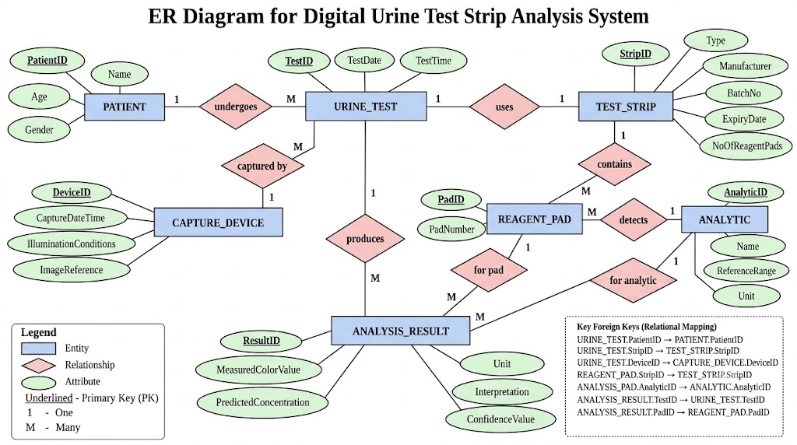
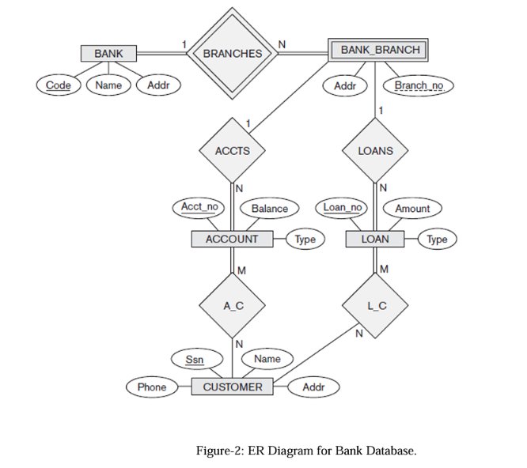

# DBMS Assignment – I Solutions

**Course:** ITC303 – Database Management System  
**Class:** SY IT, Semester III, Batch IV

---

## Q1. Explain the difference between logical and physical data independence.

Data independence is the ability to change the database schema at one level without requiring changes at the next higher level.

| Logical Data Independence | Physical Data Independence |
|---|---|
| It is the ability to change the conceptual schema without changing external views or application programs. | It is the ability to change the internal/physical schema without changing the conceptual schema or application programs. |
| It deals with changes in the logical structure of the database. | It deals with changes in how data is stored. |
| Examples include adding a new attribute, adding a new entity, or splitting a relation while preserving user views. | Examples include changing file organization, adding an index, changing storage devices, or using a different access method. |
| It is generally harder to achieve. | It is generally easier to achieve. |
| It protects users and applications from logical schema changes. | It protects users and applications from storage-level changes. |

**Example:** If a new attribute `Email` is added to a `PATIENT` table without affecting existing views, it demonstrates logical data independence. If an index is added to speed up searches without changing the table structure, it demonstrates physical data independence.

---

## Q2. Design an ER diagram for a Digital Urine Test Strip Analysis System.

 

---

  ## Q3. List the ER-to-Relational Mapping Rules and apply them to derive the relational model from Figure-2 (Bank Database).

   
  ## ER-to-Relational Mapping Rules

1.  Strong entity: Create a table with attributes and primary key.
    
2.  Weak entity: Include owner's primary key as a foreign key and combine it with the partial key.
    
3.  1:1 relationship: Add one entity's primary key as a foreign key in the other.
    
4.  1:N relationship: Add the 1-side primary key as a foreign key on the N-side.
    
5.  M:N relationship: Create a separate table containing both entities' primary keys.
    
6.  Multivalued attribute: Create a separate table with the owner's key and attribute.
    
7.  Composite attribute: Store its simple components.
    
8.  Derived attribute: Calculate when required; usually do not store.
    
9.  N-ary relationship: Create a separate table containing all participating entities' keys.
    

## Relational Model — Bank Database

-   BANK(`Code` PK, Name, Addr)
    
-   BANK_BRANCH(`Bank_Code` PK, FK, `Branch_no` PK, Addr)
    
-   ACCOUNT(`Acct_no` PK, Balance, Type, Bank_Code FK, Branch_no FK)
    
-   LOAN(`Loan_no` PK, Amount, Type, Bank_Code FK, Branch_no FK)
    
-   CUSTOMER(`Ssn` PK, Name, Phone, Addr)
    
-   A_C(`Acct_no` PK, FK, `Ssn` PK, FK)
    
-   L_C(`Loan_no` PK, FK, `Ssn` PK, FK)
  