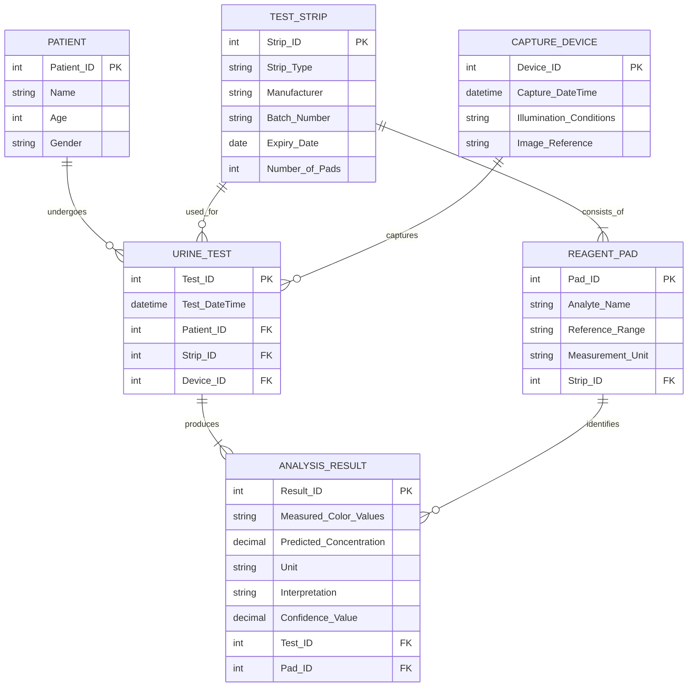

# DBMS Assignment – I Solutions

**Course:** ITC303 – Database Management System  
**Class:** SY IT, Semester III, Batch IV

---

## Q1. Explain the difference between logical and physical data independence.

Data independence is the ability to change the database schema at one level without requiring changes at the next higher level.

| Logical Data Independence | Physical Data Independence |
|---|---|
| It is the ability to change the conceptual schema without changing external views or application programs. | It is the ability to change the internal/physical schema without changing the conceptual schema or application programs. |
| It deals with changes in the logical structure of the database. | It deals with changes in how data is stored. |
| Examples include adding a new attribute, adding a new entity, or splitting a relation while preserving user views. | Examples include changing file organization, adding an index, changing storage devices, or using a different access method. |
| It is generally harder to achieve. | It is generally easier to achieve. |
| It protects users and applications from logical schema changes. | It protects users and applications from storage-level changes. |

**Example:** If a new attribute `Email` is added to a `PATIENT` table without affecting existing views, it demonstrates logical data independence. If an index is added to speed up searches without changing the table structure, it demonstrates physical data independence.

---

## Q2. Design an ER diagram for a Digital Urine Test Strip Analysis System.

### Entities and attributes

- **PATIENT** (`Patient_ID`, Name, Age, Gender)
- **URINE_TEST** (`Test_ID`, Test_DateTime, `Patient_ID`, `Strip_ID`, `Device_ID`)
- **TEST_STRIP** (`Strip_ID`, Strip_Type, Manufacturer, Batch_Number, Expiry_Date, Number_of_Pads)
- **REAGENT_PAD** (`Pad_ID`, Analyte_Name, Reference_Range, Measurement_Unit, `Strip_ID`)
- **CAPTURE_DEVICE** (`Device_ID`, Capture_DateTime, Illumination_Conditions, Image_Reference)
- **ANALYSIS_RESULT** (`Result_ID`, Measured_Color_Values, Predicted_Concentration, Unit, Interpretation, Confidence_Value, `Test_ID`, `Pad_ID`)

### Relationships and cardinalities

1. One **PATIENT** can undergo many **URINE_TESTS** (1:N).
2. Each **URINE_TEST** belongs to exactly one **PATIENT**.
3. Each **URINE_TEST** uses one **TEST_STRIP**; one strip record may be used for many tests (1:N).
4. One **TEST_STRIP** consists of multiple **REAGENT_PADS** (1:N).
5. One **CAPTURE_DEVICE** can be used for many **URINE_TESTS** (1:N); each test uses one capture device.
6. One **URINE_TEST** produces multiple **ANALYSIS_RESULTS** (1:N).
7. Each **ANALYSIS_RESULT** is associated with one specific **REAGENT_PAD**.

### ER diagram (Mermaid)

**Note:** Capture details are shown as attributes of `CAPTURE_DEVICE` to follow the assignment's listed fields. If each test has its own capture event, those details can instead be stored in a separate `CAPTURE` entity linked to both `URINE_TEST` and `CAPTURE_DEVICE`.

---

## Q3. List the ER-to-Relational Mapping Rules and apply them to derive the relational model from Figure-2 (Bank Database).

### ER-to-Relational Mapping Rules

1. **Regular (strong) entity:** Create a relation containing all simple attributes of the entity. Choose the entity's key as the primary key.
2. **Weak entity:** Create a relation containing its attributes and the primary key of its owner entity as a foreign key. The primary key usually combines the owner's key with the weak entity's partial key.
3. **Binary 1:1 relationship:** Add one entity's primary key as a foreign key in the other relation, preferably on the total-participation side. Include any relationship attributes there.
4. **Binary 1:N relationship:** Add the primary key of the “1” side as a foreign key in the relation on the “N” side. Include any relationship attributes in the “N” side relation.
5. **Binary M:N relationship:** Create a new relation containing the primary keys of both participating entities as foreign keys. Their combination is usually the primary key. Add any relationship attributes.
6. **Multivalued attribute:** Create a separate relation containing the owner's primary key and the multivalued attribute. Their combination is usually the primary key.
7. **Composite attribute:** Store its simple component attributes rather than the composite attribute as a single field.
8. **Derived attribute:** Usually do not store it; calculate it when required.
9. **N-ary relationship:** Create a separate relation containing the primary keys of all participating entities as foreign keys, along with any relationship attributes.

### Applying the rules to Figure-2

The diagram contains the entities **BANK**, **BANK_BRANCH**, **ACCOUNT**, **LOAN**, and **CUSTOMER**.

- `BANK` to `BANK_BRANCH` is a 1:N identifying relationship named `BRANCHES`. `BANK_BRANCH` is shown as a weak entity (double rectangle) and `BRANCHES` as an identifying relationship (double diamond). Therefore, its key includes the bank's key and the branch's partial key.
- `BANK_BRANCH` to `ACCOUNT` (`ACCTS`) is 1:N, so the branch key is included in `ACCOUNT`.
- `BANK_BRANCH` to `LOAN` (`LOANS`) is 1:N, so the branch key is included in `LOAN`.
- `ACCOUNT` to `CUSTOMER` (`A_C`) is M:N, so create a separate relation.
- `LOAN` to `CUSTOMER` (`L_C`) is M:N, so create a separate relation.

### Relational model

**BANK**  
`BANK(`**`Code`**`, Name, Addr)`
- Primary key: `Code`

**BANK_BRANCH**  
`BANK_BRANCH(`**`Bank_Code, Branch_no`**`, Addr)`
- Primary key: (`Bank_Code`, `Branch_no`)
- Foreign key: `Bank_Code` references `BANK(Code)`

**ACCOUNT**  
`ACCOUNT(`**`Acct_no`**`, Balance, Type, Bank_Code, Branch_no)`
- Primary key: `Acct_no`
- Foreign key: (`Bank_Code`, `Branch_no`) references `BANK_BRANCH(Bank_Code, Branch_no)`

**LOAN**  
`LOAN(`**`Loan_no`**`, Amount, Type, Bank_Code, Branch_no)`
- Primary key: `Loan_no`
- Foreign key: (`Bank_Code`, `Branch_no`) references `BANK_BRANCH(Bank_Code, Branch_no)`

**CUSTOMER**  
`CUSTOMER(`**`Ssn`**`, Name, Phone, Addr)`
- Primary key: `Ssn`

**A_C** (Account–Customer relationship)  
`A_C(`**`Acct_no, Ssn`**`)`
- Primary key: (`Acct_no`, `Ssn`)
- Foreign key: `Acct_no` references `ACCOUNT(Acct_no)`
- Foreign key: `Ssn` references `CUSTOMER(Ssn)`

**L_C** (Loan–Customer relationship)  
`L_C(`**`Loan_no, Ssn`**`)`
- Primary key: (`Loan_no`, `Ssn`)
- Foreign key: `Loan_no` references `LOAN(Loan_no)`
- Foreign key: `Ssn` references `CUSTOMER(Ssn)`

### Summary of relations

| Relation | Primary Key | Foreign Keys |
|---|---|---|
| BANK | `Code` | — |
| BANK_BRANCH | (`Bank_Code`, `Branch_no`) | `Bank_Code` → `BANK(Code)` |
| ACCOUNT | `Acct_no` | (`Bank_Code`, `Branch_no`) → `BANK_BRANCH` |
| LOAN | `Loan_no` | (`Bank_Code`, `Branch_no`) → `BANK_BRANCH` |
| CUSTOMER | `Ssn` | — |
| A_C | (`Acct_no`, `Ssn`) | `Acct_no` → `ACCOUNT`; `Ssn` → `CUSTOMER` |
| L_C | (`Loan_no`, `Ssn`) | `Loan_no` → `LOAN`; `Ssn` → `CUSTOMER` |

**Assumption from Figure-2:** `Branch_no` is treated as the partial key of weak entity `BANK_BRANCH`, so the full branch key is (`Bank_Code`, `Branch_no`). The diagram's `ACCTS` and `LOANS` relationships have no separate attributes, so none are added to the mapped relations.
  