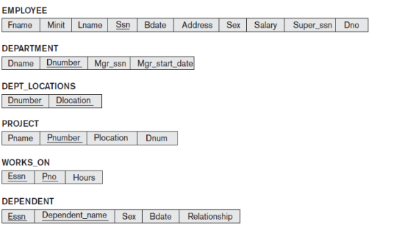

# DBMS Assignment – II Solutions

**Course Code:** ITC303  
**Course:** Database Management System  
**Class:** SY IT, Semester III  
**Roll Number:** 62

---
 

## a) Select all EMPLOYEE SSNs and all combinations of EMPLOYEE SSN and DEPARTMENT Dname.

```sql
SELECT Ssn
FROM EMPLOYEE;

SELECT E.Ssn, D.Dname
FROM EMPLOYEE E, DEPARTMENT D;
```

## b) Retrieve every employee's salary and all distinct salary values.

```sql
SELECT Salary
FROM EMPLOYEE;

SELECT DISTINCT Salary
FROM EMPLOYEE;
```

## c) List all project numbers involving an employee whose last name is Smith, either as a worker or as the manager of the department controlling the project.

```sql
SELECT DISTINCT P.Pnumber
FROM PROJECT P
JOIN WORKS_ON W ON P.Pnumber = W.Pno
JOIN EMPLOYEE E ON W.Essn = E.Ssn
WHERE E.Lname = 'Smith'

UNION

SELECT DISTINCT P.Pnumber
FROM PROJECT P
JOIN DEPARTMENT D ON P.Dnum = D.Dnumber
JOIN EMPLOYEE E ON D.Mgr_ssn = E.Ssn
WHERE E.Lname = 'Smith';
```

# Q2 (a) What is the highest normal form for the R₃ relation? (2 Marks)

Given:

$$
R_3 = \{A, B, C, D\}
$$

$$
F = \{A \rightarrow C,\; CD \rightarrow B\}
$$

**Step 1: Find the candidate key**

Find the closure of AD:

$$
(AD)^+ = \{A, D\}
$$

Using A → C, add C:

$$
(AD)^+ = \{A, C, D\}
$$

Using CD → B, add B:

$$
(AD)^+ = \{A, B, C, D\}
$$

Therefore, **AD is a candidate key**.

**Step 2: Check the normal form**

- A → C violates 3NF because A is not a superkey and C is a non-prime attribute.
- There is no partial dependency of a non-prime attribute on a proper subset of the candidate key AD.

**Answer: Highest normal form is 2NF**, assuming no other functional dependencies exist.

---

# Q2 (b) Demonstrate redundancy in a 3NF relation and normalize it to BCNF. (3 Marks)

Consider:

$$
R(A, B, C)
$$

$$
F = \{AB \rightarrow C,\; C \rightarrow B\}
$$

**Step 1: Find candidate keys**

For AB:

$$
(AB)^+ = \{A, B, C\}
$$

Therefore, AB is a candidate key.

For AC:

$$
(AC)^+ = \{A, C\}
$$

Given C → B, add B:

$$
(AC)^+ = \{A, B, C\}
$$

Therefore, AC is also a candidate key.

**Step 2: Check BCNF**

The dependency C → B violates BCNF because C is not a superkey.

**Step 3: Decompose into BCNF**

Decompose R into:

$$
R_1(C, B)
$$

$$
R_2(A, C)
$$

Both relations are in BCNF.

---
# Q3. Discuss the deferred update technique of recovery. State its advantages, disadvantages, and why it is called NO-UNDO/REDO. (5 Marks)

## Deferred Update Technique

Deferred update is a database recovery technique in which database changes are postponed until a transaction commits. Changes are first recorded in the log and then applied to the database.

## Working
1. **Start transaction:** Begin the transaction.
2. **Record changes:** Store the transaction's update operations in the log.
3. **Commit:** Write the commit record to the log after successful execution.
4. **Update database:** Apply the changes to the database.
5. **Recovery:** After a system failure, redo committed transactions if their updates were not saved to the database. Ignore uncommitted transactions.

## Advantages
- No need to undo uncommitted transactions.
- Maintains database consistency during recovery.
- Makes the recovery process simpler.

## Disadvantages
- Committed transactions may need to be redone after a crash.
- Database updates are delayed until the transaction commits.
- Recovery may take additional time to redo transactions.

## Why is it called NO-UNDO/REDO?
- **NO-UNDO:** Uncommitted changes are not applied to the database, so undo is unnecessary.
- **REDO:** Committed changes may need to be applied again after a system failure.