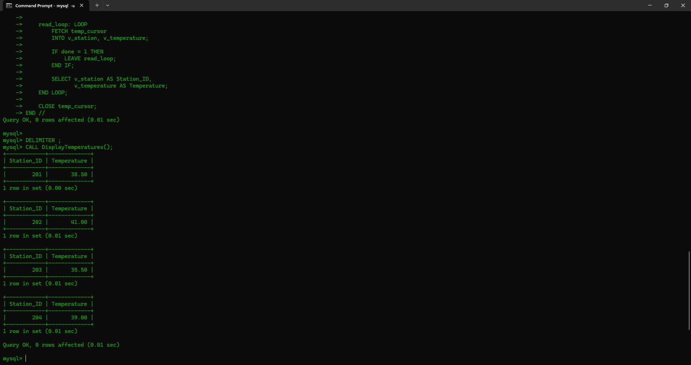

<p>
    <span style="float:left;">
        <h3> SQL Experiment 11
    </span>
    <span style="float:right; text-align:right;"> 
        Name: Dev Mandora<br>
        Roll Number: 62 <br>
        Batch: SB4</h3>
    </span>
</p>

<br clear="both">

### AIM

To implement Cursors in SQL.

### OBJECTIVE

- To understand the concept of cursors.
- To fetch temperature records one by one using a cursor.
- To process weather observations using a stored procedure.
- To understand cursor declaration, opening, fetching, and closing.

### SOFTWARE REQUIREMENT

MySQL Server 8.0  
MySQL Shell 8.0

### THEORY

A **Cursor** is used to process query results one row at a time. It is useful when individual temperature records need separate processing.

The main cursor operations are:

- **DECLARE:** Defines the cursor and its SELECT query.
- **OPEN:** Opens the cursor.
- **FETCH:** Retrieves the next record.
- **CLOSE:** Closes the cursor.

A `NOT FOUND` handler detects when no more records are available.

### SYNTAX

```sql
DECLARE cursor_name CURSOR FOR
SELECT columns FROM table_name;

DECLARE CONTINUE HANDLER FOR NOT FOUND
SET done = TRUE;

OPEN cursor_name;

FETCH cursor_name INTO variable1, variable2;

CLOSE cursor_name;
```

### GROUP 1 — CREATE WEATHER OBSERVATION TABLE

```sql
CREATE DATABASE climate_cursor_db;
USE climate_cursor_db;

CREATE TABLE Weather_Observation (
    Observation_ID INT PRIMARY KEY,
    Station_ID INT,
    Temperature DECIMAL(5,2),
    Humidity DECIMAL(5,2),
    Heat_Index DECIMAL(5,2)
);

INSERT INTO Weather_Observation VALUES
(501, 201, 38.50, 65.00, 42.00),
(502, 202, 41.00, 70.00, 46.00),
(503, 203, 35.50, 55.00, 37.00),
(504, 204, 39.00, 60.00, 41.00);
```

### GROUP 2 — CREATE CURSOR PROCEDURE

```sql
DELIMITER //

CREATE PROCEDURE DisplayTemperatures()
BEGIN
    DECLARE done INT DEFAULT 0;
    DECLARE v_station INT;
    DECLARE v_temperature DECIMAL(5,2);

    DECLARE temp_cursor CURSOR FOR
        SELECT Station_ID, Temperature
        FROM Weather_Observation;

    DECLARE CONTINUE HANDLER FOR NOT FOUND
        SET done = 1;

    OPEN temp_cursor;

    read_loop: LOOP
        FETCH temp_cursor
        INTO v_station, v_temperature;

        IF done = 1 THEN
            LEAVE read_loop;
        END IF;

        SELECT v_station AS Station_ID,
               v_temperature AS Temperature;
    END LOOP;

    CLOSE temp_cursor;
END //

DELIMITER ;
```

### GROUP 3 — EXECUTE CURSOR PROCEDURE

```sql
CALL DisplayTemperatures();
```
 
### OUTCOME

A cursor was successfully implemented to fetch and display station IDs and temperatures one record at a time using a stored procedure.

### CONCLUSION

Thus, SQL cursors were successfully implemented using DECLARE, OPEN, FETCH, and CLOSE to process weather observation records sequentially.