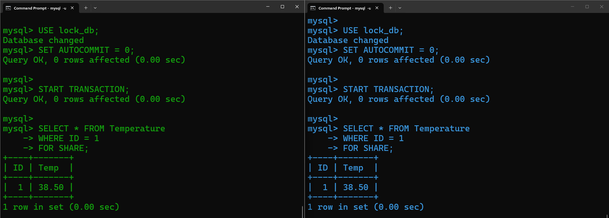
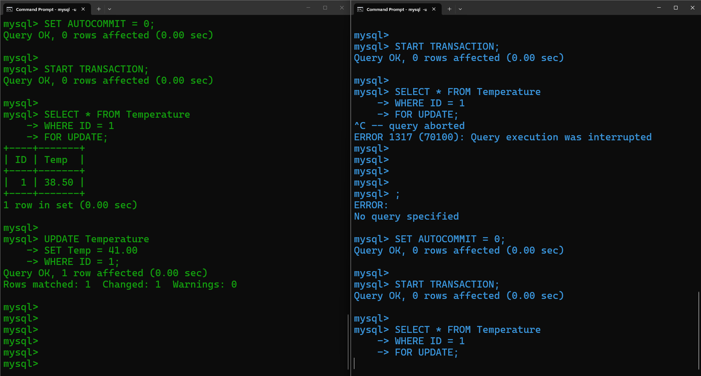
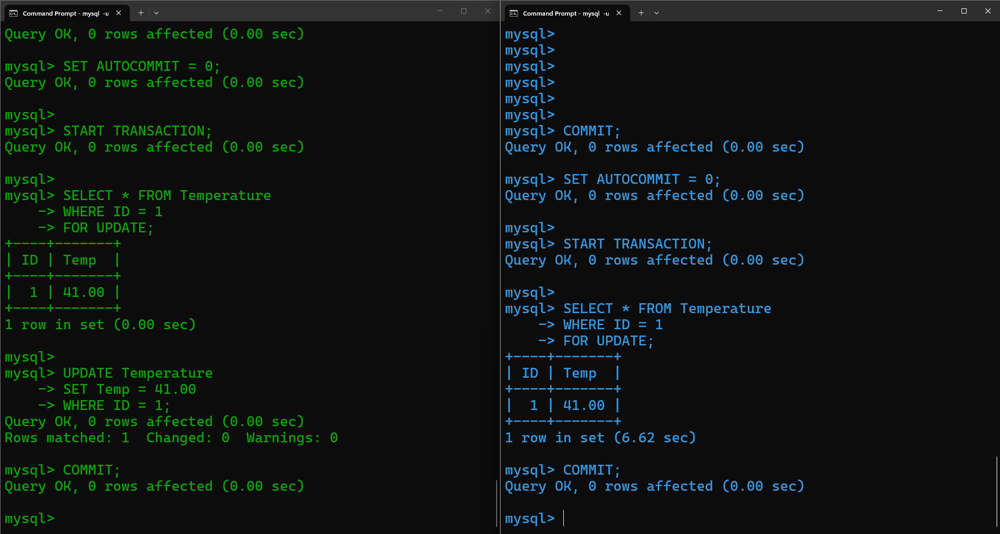

<p>
    <span style="float:left;">
        <h3> SQL Experiment 12
    </span>
    <span style="float:right; text-align:right;"> 
        Name: Dev Mandora<br>
        Roll Number: 62 <br>
        Batch: SB4</h3>
    </span>
</p>

<br clear="both">

### AIM

Implementation and demonstration of transaction and concurrency control technique using lock.

### OBJECTIVE

- To understand shared and exclusive locks.
- To demonstrate locks using two MySQL sessions.
- To understand transaction control using AUTOCOMMIT set to 0.

### SOFTWARE REQUIREMENT

- MySQL Server 8.0
- MySQL Workbench

### THEORY

**1. Shared Lock (S Lock)**

A shared lock allows multiple sessions to read the same record simultaneously.

**Syntax:**
```sql
START TRANSACTION;

SELECT *
FROM Temperature
WHERE ID = 1
FOR SHARE;

COMMIT;
```

**2. Exclusive Lock (X Lock)**

An exclusive lock allows a session to modify a record and prevents other sessions from acquiring conflicting locks on that record.

**Syntax:**
```sql
START TRANSACTION;

SELECT *
FROM Temperature
WHERE ID = 1
FOR UPDATE;

COMMIT;
```

### GROUP 1 — CREATE DATABASE AND TABLE

```sql
CREATE DATABASE IF NOT EXISTS lock_db;
USE lock_db;

CREATE TABLE IF NOT EXISTS Temperature (
    ID INT PRIMARY KEY,
    Temp DECIMAL(5,2)
) ENGINE = InnoDB;

INSERT IGNORE INTO Temperature VALUES
(1, 38.50),
(2, 40.00);

SELECT * FROM Temperature;
```

### GROUP 2 — DEMONSTRATE SHARED LOCK

**Session 1**

```sql
USE lock_db;
SET AUTOCOMMIT = 0;

START TRANSACTION;

SELECT * FROM Temperature
WHERE ID = 1
FOR SHARE;
```

**Session 2**

```sql
USE lock_db;
SET AUTOCOMMIT = 0;

START TRANSACTION;

SELECT * FROM Temperature
WHERE ID = 1
FOR SHARE;
```

 

```sql
COMMIT;
```
 
### GROUP 3 — DEMONSTRATE EXCLUSIVE LOCK

**Session 1**

```sql
SET AUTOCOMMIT = 0;

START TRANSACTION;

SELECT * FROM Temperature
WHERE ID = 1
FOR UPDATE;

UPDATE Temperature
SET Temp = 41.00
WHERE ID = 1;
```

Keep this transaction open.

**Session 2**

```sql
SET AUTOCOMMIT = 0;

START TRANSACTION;

SELECT * FROM Temperature
WHERE ID = 1
FOR UPDATE;
```

**Observation:** Session 2 waits because Session 1 holds the exclusive lock.
 
> [!abstract] i mistakely thought it was error from my side so i reran same query in 2nd session

Now execute in Session 1:

```sql
COMMIT;
```

Session 2 can now continue. Finish Session 2:

```sql
COMMIT;
```
 


### OUTCOME

Shared and exclusive locks were demonstrated using two MySQL sessions and a simple temperature table.

### CONCLUSION

Thus, transaction and concurrency control using shared and exclusive locks were demonstrated successfully in MySQL Server 8.0.
