<p>
    <span style="float:left;">
        <h3> SQL Experiment 6
    </span>
    <span style="float:right; text-align:right;"> 
        Name: Dev Mandora<br>
        Roll Number: 62 <br>
        Batch: SB4</h3>
    </span>
</p>

<br clear="both">

### AIM

Perform Simple Queries and Complex Queries using SQL.

### OBJECTIVE

- To understand the use of Structured Query Language (SQL).
- To understand various ways to retrieve data using SELECT commands and clauses.
- To perform simple queries using different comparison and logical operators.
- To use clauses such as LIKE, IN, BETWEEN, ORDER BY, DISTINCT and GROUP BY.
- To perform aggregate operations using COUNT(), AVG() and MAX().
- To use the HAVING clause with grouped data.
- To perform complex queries using multiple SQL clauses.

### SOFTWARE REQUIREMENT

MySQL Server 8.0  
MySQL Shell 8.0

### THEORY

Structured Query Language (SQL) is used to store, retrieve and manipulate data in a database. The SELECT command is used to retrieve records from one or more tables.

The basic SELECT commands are:

```sql
SELECT column1, column2
FROM table_name;

SELECT *
FROM table_name;

SELECT column1, column2
FROM table_name
WHERE condition;
````

The **WHERE** clause is used to retrieve only those records which satisfy a specified condition.

Different operators and clauses can be used with SELECT:

-   **Comparison Operators** – `=`, `<>`, `!=`, `>`, `<`, `>=`, `<=`
    
-   **LIKE / NOT LIKE** – Used for string pattern matching.
    
-   **Arithmetic Operators** – `+`, `-`, `*`, `/`, `DIV`, `%`
    
-   **Logical Operators** – `AND`, `OR`, `NOT`, `XOR`
    
-   **IN / NOT IN** – Used to compare values with a set of values.
    
-   **BETWEEN / NOT BETWEEN** – Used to check values within or outside a range.
    
-   **IS NULL / IS NOT NULL** – Used to check for NULL and non-NULL values.
    
-   **ORDER BY** – Used to sort query results.
    
-   **AS** – Used to provide an alias to a column or table.
    
-   **DISTINCT** – Used to display unique values.
    
-   **GROUP BY** – Used to group records for aggregate functions.
    
-   **HAVING** – Used to apply conditions to grouped results.
    

Aggregate functions such as `COUNT()`, `AVG()` and `MAX()` are used to perform calculations on groups of records.

### GROUP 1 — CREATING AND POPULATING THE TABLE

#### Syntax

```sql
CREATE TABLE table_name
(
    column_name datatype constraint,
    column_name datatype constraint
);

INSERT INTO table_name VALUES
(value1, value2, value3);
```

#### Query

```sql
USE climate_monitor_sys;

CREATE TABLE Climate_Data
(
    record_id INT PRIMARY KEY,
    station_name VARCHAR(50),
    city VARCHAR(50),
    observation_date DATE,
    temperature DECIMAL(5,2),
    humidity DECIMAL(5,2),
    rainfall DECIMAL(6,2),
    wind_speed DECIMAL(5,2),
    heat_index DECIMAL(5,2),
    alert_level VARCHAR(20)
);

INSERT INTO Climate_Data VALUES
(101, 'IMD Paris', 'Paris', '2026-09-20', 41.50, 38.00, 12.50, 18.20, 46.80, 'Critical'),
(102, 'IMD London', 'London', '2026-09-20', 34.20, 55.00, 8.20, 15.50, 37.40, 'Normal'),
(103, 'IMD Mumbai', 'Mumbai', '2026-09-21', 42.30, 35.00, NULL, 20.10, 48.50, 'Critical'),
(104, 'IMD Pune', 'Pune', '2026-09-21', 39.80, 42.00, 4.50, 12.80, 43.20, 'Warning'),
(105, 'IMD Nagpur', 'Nagpur', '2026-09-22', 43.10, 32.00, 2.80, 16.40, 49.10, 'Critical'),
(106, 'IMD Tokyo', 'Tokyo', '2026-09-22', 36.70, 48.00, 15.30, 14.20, 41.00, 'Warning'),
(107, 'IMD Paris North', 'Paris', '2026-09-23', 38.40, 45.00, NULL, 10.60, 42.80, 'Normal'),
(108, 'IMD Mumbai East', 'Mumbai', '2026-09-23', 40.20, 39.00, 6.70, 19.30, 45.60, 'Warning');

SELECT * FROM Climate_Data;
```

#### Output
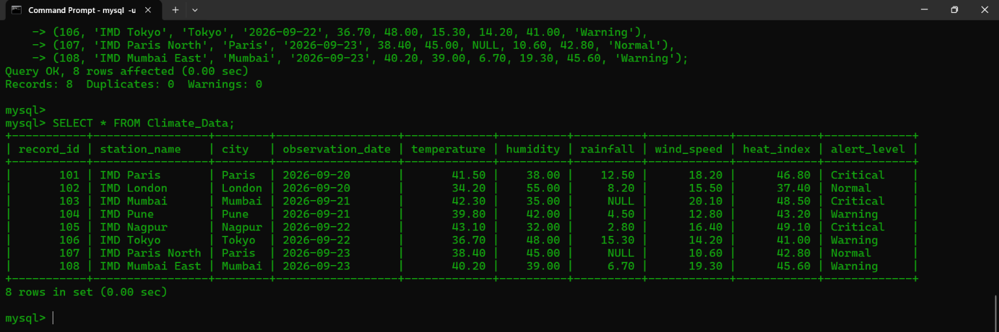 

### GROUP 2 — SELECT QUERIES USING DIFFERENT OPERATORS

#### Comparison Operators

##### Syntax

```sql
SELECT *
FROM table_name
WHERE column_name operator value;
````

##### Query

```sql
-- 1. Temperature greater than 40°C
SELECT *
FROM Climate_Data
WHERE temperature > 40;

-- 2. Temperature equal to 40.5°C
SELECT *
FROM Climate_Data
WHERE temperature = 40.5;

-- 3. Temperature less than 35°C
SELECT *
FROM Climate_Data
WHERE temperature < 35;

-- 4. Heat index greater than or equal to 45°C
SELECT *
FROM Climate_Data
WHERE heat_index >= 45;

-- 5. Records where alert is not Normal
SELECT *
FROM Climate_Data
WHERE NOT alert_level = 'Normal';
```

#### Output
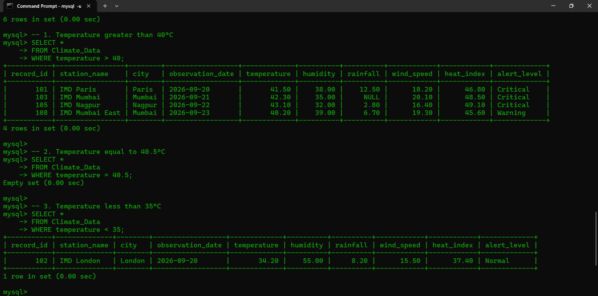 
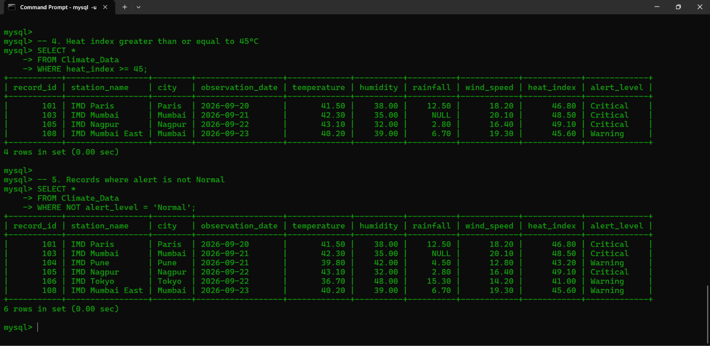 
### GROUP 3 — STRING PATTERN MATCHING

#### Syntax

```sql
SELECT *
FROM table_name
WHERE column_name LIKE 'pattern';

SELECT *
FROM table_name
WHERE column_name NOT LIKE 'pattern';
```

#### Query

```sql
-- 1. Find stations starting with IMD M
SELECT *
FROM Climate_Data
WHERE station_name LIKE 'IMD M%';

-- 2. Find cities ending with pur
SELECT *
FROM Climate_Data
WHERE city LIKE '%pur';

-- 3. Find cities containing a
SELECT *
FROM Climate_Data
WHERE city LIKE '%a%';

-- 4. Find stations not containing Mumbai
SELECT *
FROM Climate_Data
WHERE station_name NOT LIKE '%Mumbai%';
```

#### Output

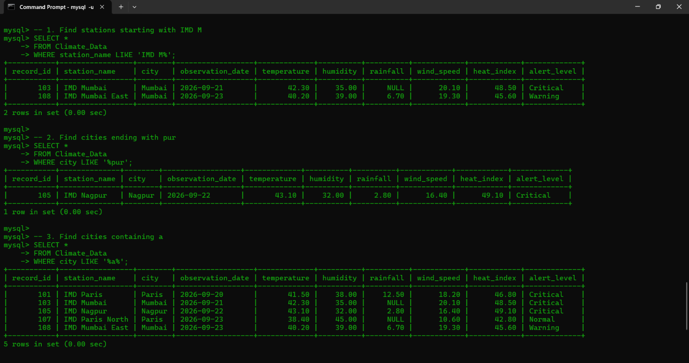 
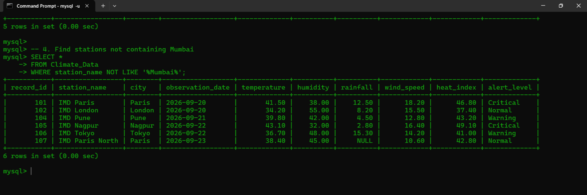 

### GROUP 4 — ARITHMETIC OPERATORS

#### Syntax

```sql
SELECT column_name + value
FROM table_name;

SELECT column_name - value
FROM table_name;
```

#### Query

```sql
-- 1. Increase temperature by 2°C
SELECT station_name, temperature,
       temperature + 2 AS increased_temperature
FROM Climate_Data;

-- 2. Calculate temperature difference from 30°C
SELECT station_name, temperature,
       temperature - 30 AS temperature_difference
FROM Climate_Data;
```

#### Output
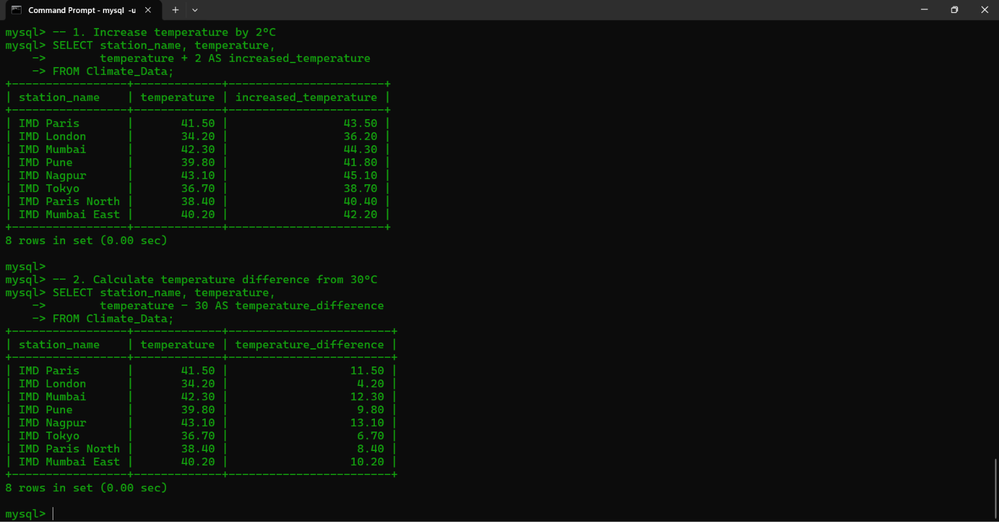 

### GROUP 5 — LOGICAL OPERATORS

#### AND

##### Query

```sql
-- Find records where temperature is above 40°C
-- and humidity is below 40%.
SELECT *
FROM Climate_Data
WHERE temperature > 40
AND humidity < 40;
```

#### OR

##### Query

```sql
-- Find records where temperature is above 42°C
-- or heat index is above 45°C.
SELECT *
FROM Climate_Data
WHERE temperature > 42
OR heat_index > 45;
```

#### NOT

##### Query

```sql
-- Find records that are not Critical.
SELECT *
FROM Climate_Data
WHERE NOT alert_level = 'Critical';
```

#### XOR

##### Query

```sql
-- Find records where either temperature is greater than 40°C
-- or humidity is less than 40%, but not both.
SELECT *
FROM Climate_Data
WHERE temperature > 40
XOR humidity < 40;
```

#### Output

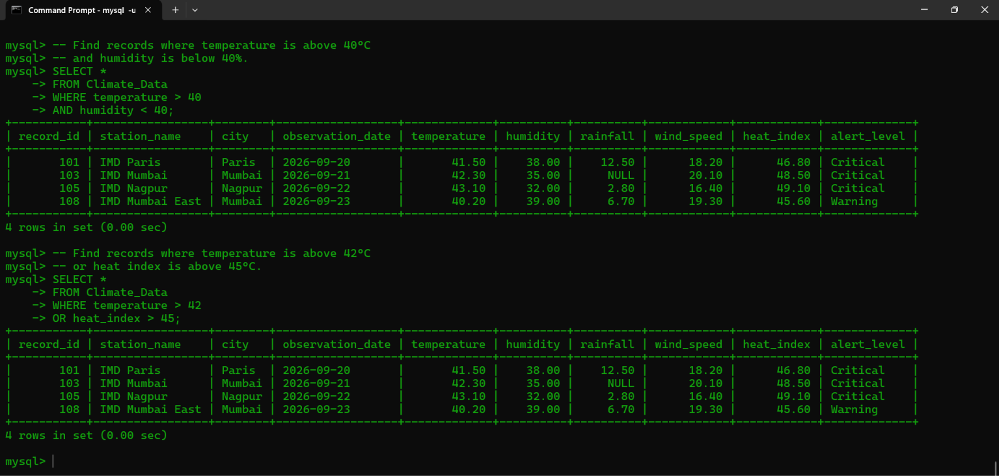 
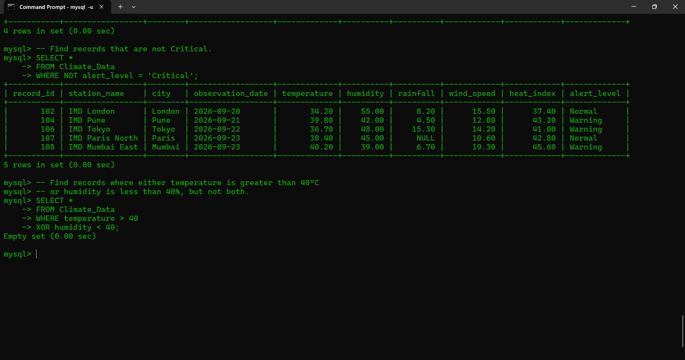 
### GROUP 6 — IN AND NOT IN

#### IN

##### Query

```sql
-- Find observations from Mumbai, Pune, and Nagpur.
SELECT *
FROM Climate_Data
WHERE city IN ('Mumbai', 'Pune', 'Nagpur');
```

#### NOT IN

##### Query

```sql
-- Find observations excluding Mumbai and Pune.
SELECT *
FROM Climate_Data
WHERE city NOT IN ('Mumbai', 'Pune');
```

#### Output

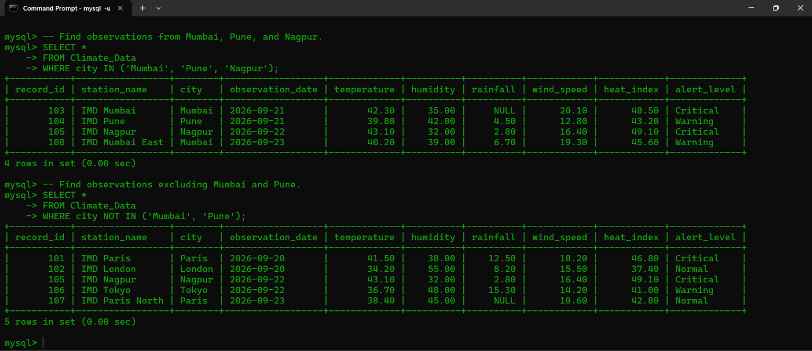 
### GROUP 7 — BETWEEN AND NOT BETWEEN

#### BETWEEN

##### Query

```sql
-- Find temperatures between 35°C and 40°C.
SELECT *
FROM Climate_Data
WHERE temperature BETWEEN 35 AND 40;
```

#### NOT BETWEEN

##### Query

```sql
-- Find temperatures outside the range 35°C–40°C.
SELECT *
FROM Climate_Data
WHERE temperature NOT BETWEEN 35 AND 40;
```

#### Output

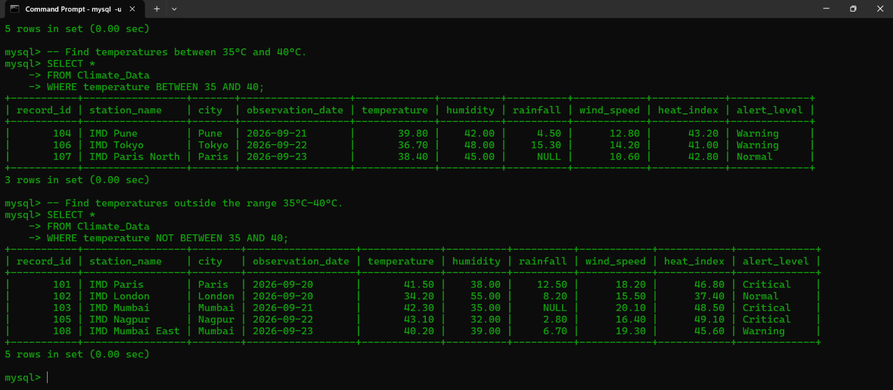 
### GROUP 8 — IS NULL AND IS NOT NULL

#### IS NULL

##### Query

```sql
-- Find NULL rainfall values.
SELECT *
FROM Climate_Data
WHERE rainfall IS NULL;
```

#### IS NOT NULL

##### Query

```sql
-- Find records where rainfall is available.
SELECT *
FROM Climate_Data
WHERE rainfall IS NOT NULL;
```

#### Output

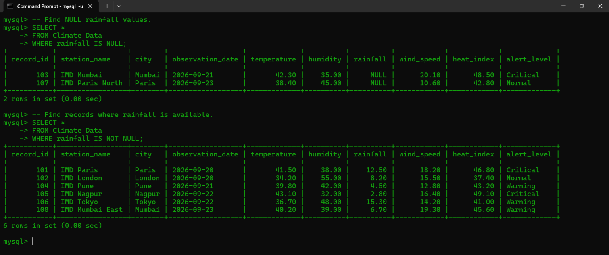 

### GROUP 9 — ORDER BY

#### Syntax

```sql
SELECT *
FROM table_name
ORDER BY column_name ASC;

SELECT *
FROM table_name
ORDER BY column_name DESC;
```

#### Query

```sql
-- A. Sort temperature in ascending order.
SELECT *
FROM Climate_Data
ORDER BY temperature ASC;

-- B. Sort temperature in descending order.
SELECT *
FROM Climate_Data
ORDER BY temperature DESC;
```

#### Output

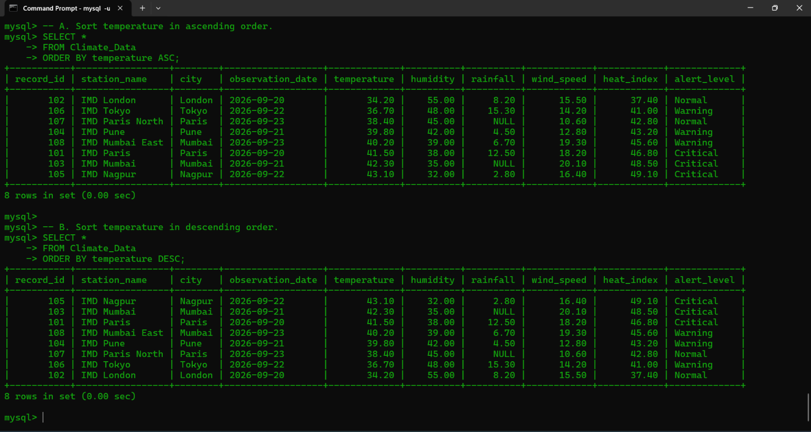 

### GROUP 10 — DISTINCT

#### Syntax

```sql
SELECT DISTINCT column_name
FROM table_name;

SELECT DISTINCT column1, column2
FROM table_name;
```

#### Query

```sql
-- 1. Find unique cities.
SELECT DISTINCT city
FROM Climate_Data;

-- 2. Find unique combinations of city and alert level.
SELECT DISTINCT city, alert_level
FROM Climate_Data;
```

#### Output

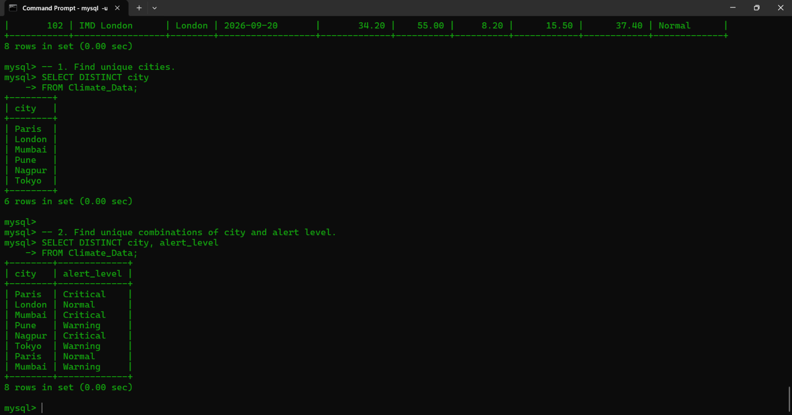 
### GROUP 11 — GROUP BY

#### Syntax

```sql
SELECT column_name, aggregate_function(column_name)
FROM table_name
GROUP BY column_name;
```

#### Query

```sql
-- 1. Count observations for each city.
SELECT city, COUNT(*) AS observation_count
FROM Climate_Data
GROUP BY city;

-- 2. Find average temperature for each city.
SELECT city, AVG(temperature) AS average_temperature
FROM Climate_Data
GROUP BY city;

-- 3. Find maximum temperature for each city.
SELECT city, MAX(temperature) AS maximum_temperature
FROM Climate_Data
GROUP BY city;
```

#### Output

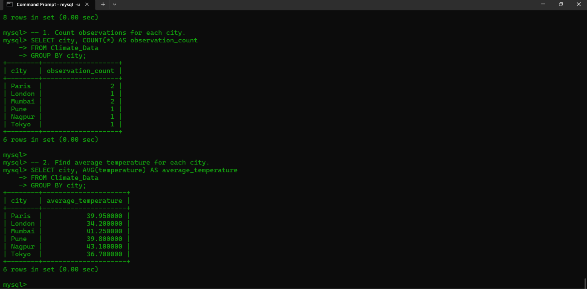 
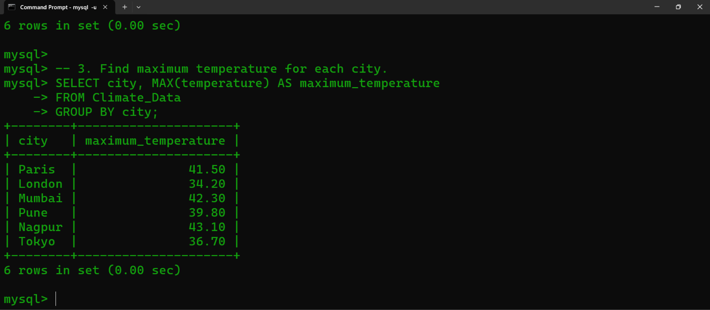 
### GROUP 12 — HAVING

#### Syntax

```sql
SELECT column_name, aggregate_function(column_name)
FROM table_name
GROUP BY column_name
HAVING aggregate_function(column_name) operator value;
```

#### Query

```sql
-- 1. Cities having average temperature greater than 38°C.
SELECT city, AVG(temperature) AS average_temperature
FROM Climate_Data
GROUP BY city
HAVING AVG(temperature) > 38;

-- 2. Alert levels having average heat index above 43°C.
SELECT alert_level, AVG(heat_index) AS average_heat_index
FROM Climate_Data
GROUP BY alert_level
HAVING AVG(heat_index) > 43;
```

#### Output

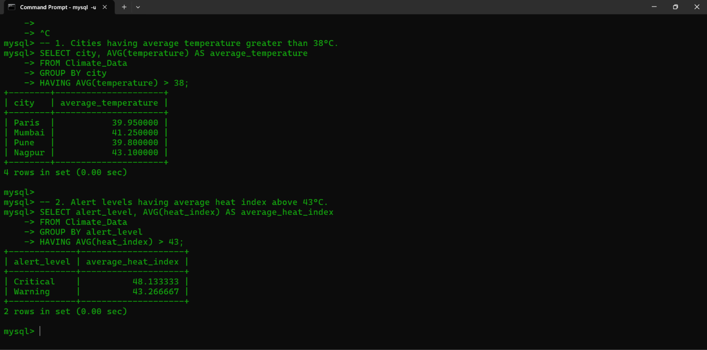 
### GROUP 13 — COMBINED QUERY

#### Syntax

```sql
SELECT column_name,
       aggregate_function(column_name),
       aggregate_function(column_name)
FROM table_name
GROUP BY column_name
HAVING condition
ORDER BY column_name DESC;
```

#### Query

```sql
-- Find cities whose average temperature is greater than 38°C,
-- display the average temperature and maximum heat index,
-- and sort them from highest to lowest average temperature.

SELECT city,
       AVG(temperature) AS average_temperature,
       MAX(heat_index) AS maximum_heat_index
FROM Climate_Data
GROUP BY city
HAVING AVG(temperature) > 38
ORDER BY average_temperature DESC;
```

#### Output

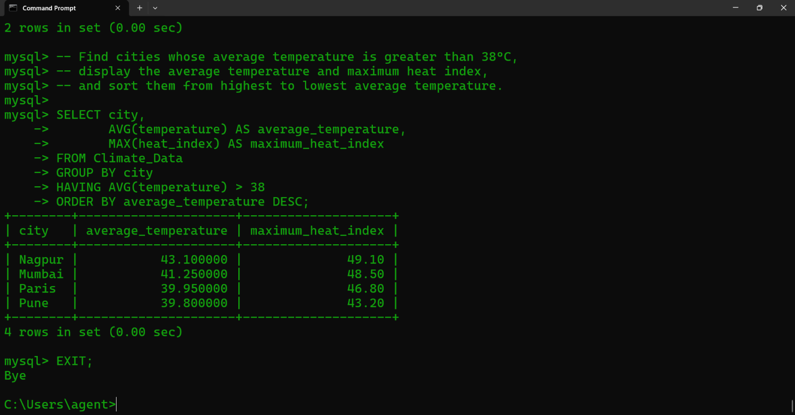 


> [!abstract] 6B
>  

```sql
CREATE DATABASE Climate_Intelligence;
USE Climate_Intelligence;

CREATE TABLE Weather_Station (
    Station_ID INT PRIMARY KEY,
    Station_Name VARCHAR(100),
    Location VARCHAR(100),
    District VARCHAR(50),
    State VARCHAR(50),
    Latitude DECIMAL(9,6),
    Longitude DECIMAL(9,6)
);

CREATE TABLE Weather_Observation (
    Observation_ID INT PRIMARY KEY,
    Station_ID INT,
    Observation_Date DATE,
    Observation_Time TIME,
    Temperature DECIMAL(5,2),
    Humidity DECIMAL(5,2),
    Wind_Speed DECIMAL(5,2),
    Heat_Index DECIMAL(5,2),
    FOREIGN KEY (Station_ID) REFERENCES Weather_Station(Station_ID)
);

CREATE TABLE Sensor (
    Sensor_ID INT PRIMARY KEY,
    Station_ID INT,
    Sensor_Type VARCHAR(50),
    Installation_Date DATE,
    Status VARCHAR(50),
    FOREIGN KEY (Station_ID) REFERENCES Weather_Station(Station_ID)
);

CREATE TABLE Heatwave_Event (
    Event_ID INT PRIMARY KEY,
    Station_ID INT,
    Start_Date DATE,
    End_Date DATE,
    Maximum_Temperature DECIMAL(5,2),
    Severity VARCHAR(30),
    FOREIGN KEY (Station_ID) REFERENCES Weather_Station(Station_ID)
);

CREATE TABLE Heatwave_Prediction (
    Prediction_ID INT PRIMARY KEY,
    Station_ID INT,
    Prediction_Date DATE,
    Predicted_Temperature DECIMAL(5,2),
    Probability DECIMAL(5,2),
    Risk_Level VARCHAR(30),
    FOREIGN KEY (Station_ID) REFERENCES Weather_Station(Station_ID)
);

CREATE TABLE Early_Warning (
    Warning_ID INT PRIMARY KEY,
    Station_ID INT,
    Prediction_ID INT,
    Warning_Date DATE,
    Warning_Level VARCHAR(30),
    Message VARCHAR(255),
    FOREIGN KEY (Station_ID) REFERENCES Weather_Station(Station_ID),
    FOREIGN KEY (Prediction_ID) REFERENCES Heatwave_Prediction(Prediction_ID)
);

INSERT INTO Weather_Station VALUES
(101, 'Station Mumbai', 'Mumbai', 'Mumbai', 'Maharashtra', 19.076000, 72.877700),
(102, 'Station Pune', 'Pune', 'Pune', 'Maharashtra', 18.520400, 73.856700),
(103, 'Station Nagpur', 'Nagpur', 'Nagpur', 'Maharashtra', 21.145800, 79.088200);

INSERT INTO Sensor VALUES
(201, 101, 'Temperature', '2026-01-10', 'Active'),
(202, 101, 'Humidity', '2026-01-12', 'Active'),
(203, 102, 'Temperature', '2026-02-05', 'Active'),
(204, 103, 'Temperature', '2026-02-15', 'Active');

INSERT INTO Weather_Observation VALUES
(301, 101, '2026-04-10', '12:00:00', 42.50, 35.00, 12.50, 46.00),
(302, 101, '2026-04-11', '13:00:00', 40.00, 40.00, 10.00, 43.00),
(303, 102, '2026-04-10', '12:30:00', 38.50, 45.00, 8.00, 40.00),
(304, 103, '2026-04-12', '14:00:00', 43.00, 30.00, 15.00, 48.00);

INSERT INTO Heatwave_Event VALUES
(401, 101, '2026-04-09', '2026-04-11', 42.50, 'Severe'),
(402, 102, '2026-04-10', '2026-04-10', 38.50, 'Moderate');

INSERT INTO Heatwave_Prediction VALUES
(501, 101, '2026-04-15', 44.00, 85.00, 'High'),
(502, 102, '2026-04-15', 39.00, 60.00, 'Moderate'),
(503, 103, '2026-04-15', 45.00, 90.00, 'High');

INSERT INTO Early_Warning VALUES
(601, 101, 501, '2026-04-14', 'High', 'Severe heatwave expected'),
(602, 103, 503, '2026-04-14', 'High', 'Very high temperature expected');

SELECT ws.Station_Name, ws.Location, wo.Observation_Date,
       wo.Temperature, wo.Humidity
FROM Weather_Station ws
INNER JOIN Weather_Observation wo
ON ws.Station_ID = wo.Station_ID;

```
### GROUP 14 — INNER JOIN

#### Syntax

```sql
SELECT columns
FROM table1
INNER JOIN table2
ON table1.column = table2.column;
```

#### Problem Statement

Display the weather station name, location, observation date, temperature, and humidity for all weather observations that have a corresponding weather station.

#### Query

```sql
SELECT ws.Station_Name, ws.Location, wo.Observation_Date,
       wo.Temperature, wo.Humidity
FROM Weather_Station ws
INNER JOIN Weather_Observation wo
ON ws.Station_ID = wo.Station_ID;
```

#### Output

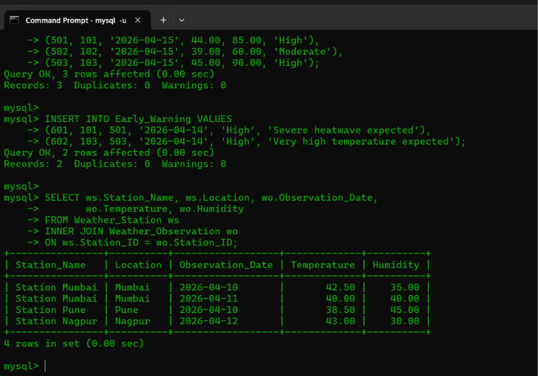 

---

### GROUP 15 — LEFT JOIN

#### Syntax

```sql
SELECT columns
FROM table1
LEFT JOIN table2
ON table1.column = table2.column;
```

#### Problem Statement

Display all weather stations along with their heatwave events, including stations where no heatwave event has been recorded.

#### Query

```sql
SELECT ws.Station_ID, ws.Station_Name, he.Event_ID,
       he.Start_Date, he.End_Date, he.Severity
FROM Weather_Station ws
LEFT JOIN Heatwave_Event he
ON ws.Station_ID = he.Station_ID;
```

#### Output

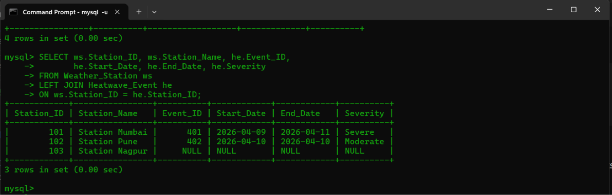 

---

### GROUP 16 — RIGHT JOIN

#### Syntax

```sql
SELECT columns
FROM table1
RIGHT JOIN table2
ON table1.column = table2.column;
```

#### Problem Statement

Display all heatwave prediction records along with the corresponding weather station details, including predictions for which station information is unavailable.

#### Query

```sql
SELECT hp.Prediction_ID, hp.Prediction_Date,
       hp.Predicted_Temperature, hp.Probability,
       hp.Risk_Level, ws.Station_Name, ws.Location
FROM Weather_Station ws
RIGHT JOIN Heatwave_Prediction hp
ON ws.Station_ID = hp.Station_ID;
```

#### Output

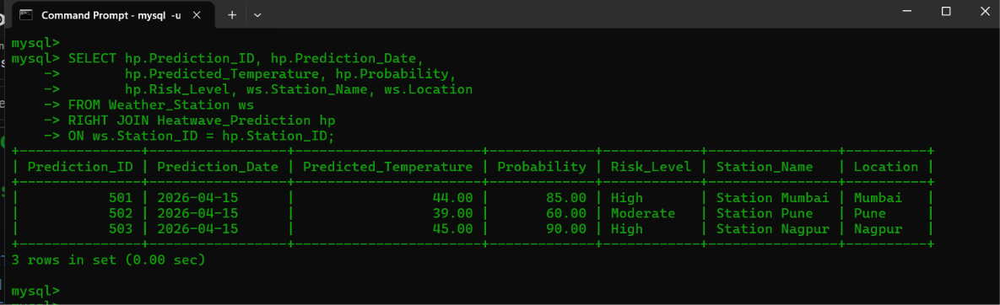 

---

### GROUP 17 — FULL OUTER JOIN

#### Syntax

```sql
SELECT columns
FROM table1
LEFT JOIN table2
ON table1.column = table2.column

UNION

SELECT columns
FROM table1
RIGHT JOIN table2
ON table1.column = table2.column;
```

#### Problem Statement

Display all weather stations and all heatwave events, including stations without heatwave events and heatwave events without matching station information.

#### Query

```sql
SELECT ws.Station_ID, ws.Station_Name,
       he.Event_ID, he.Start_Date, he.End_Date, he.Severity
FROM Weather_Station ws
LEFT JOIN Heatwave_Event he
ON ws.Station_ID = he.Station_ID

UNION

SELECT ws.Station_ID, ws.Station_Name,
       he.Event_ID, he.Start_Date, he.End_Date, he.Severity
FROM Weather_Station ws
RIGHT JOIN Heatwave_Event he
ON ws.Station_ID = he.Station_ID;
```

#### Output

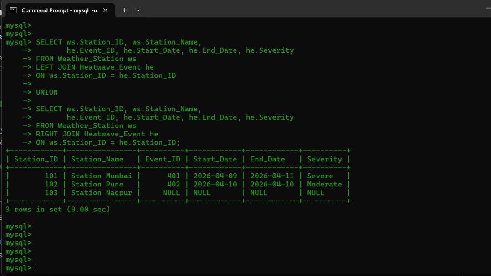 

---

### GROUP 18 — CROSS JOIN

#### Syntax

```sql
SELECT columns
FROM table1
CROSS JOIN table2;
```

#### Problem Statement

Generate all possible combinations of weather stations and sensor types to identify potential sensor deployment options.

#### Query

```sql
SELECT ws.Station_ID, ws.Station_Name, st.Sensor_Type
FROM Weather_Station ws
CROSS JOIN
(
    SELECT DISTINCT Sensor_Type
    FROM Sensor
) st;
```

#### Output

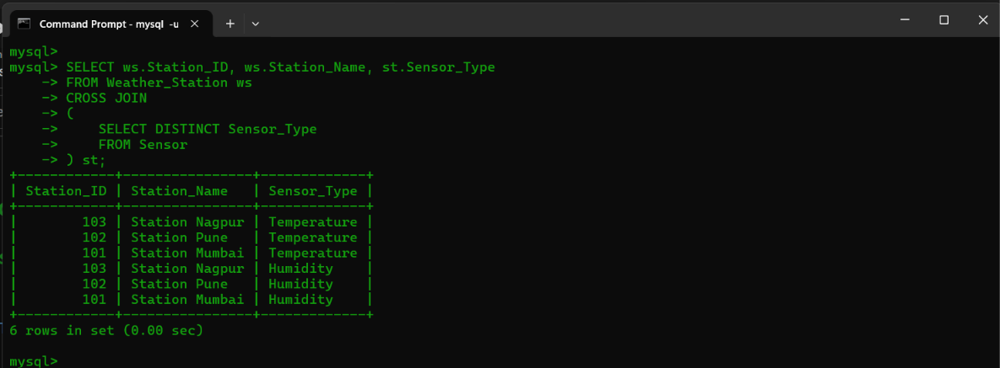 

---

### GROUP 19 — SELF JOIN

#### Syntax

```sql
SELECT columns
FROM table_name t1
INNER JOIN table_name t2
ON t1.column = t2.column
WHERE condition;
```

#### Problem Statement

Compare weather observations recorded at the same weather station and display cases where the temperature of one observation is higher than another observation.

#### Query

```sql
SELECT o1.Station_ID,
       o1.Observation_ID AS Observation_1,
       o1.Temperature AS Temperature_1,
       o2.Observation_ID AS Observation_2,
       o2.Temperature AS Temperature_2
FROM Weather_Observation o1
INNER JOIN Weather_Observation o2
ON o1.Station_ID = o2.Station_ID
WHERE o1.Temperature > o2.Temperature;
```

#### Output

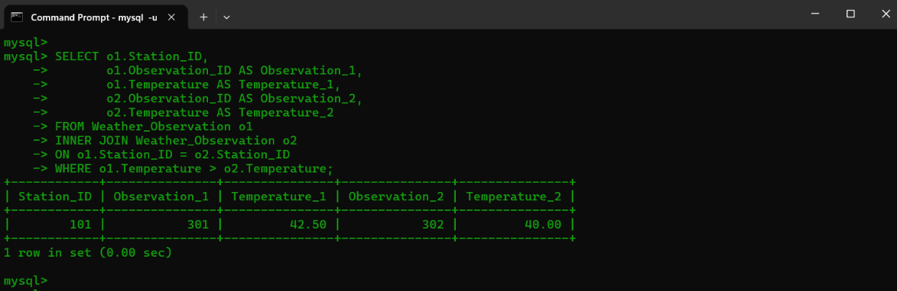 

---

### GROUP 20 — JOIN BETWEEN THREE TABLES

#### Syntax

```sql
SELECT columns
FROM table1
INNER JOIN table2
ON table1.column = table2.column
INNER JOIN table3
ON table2.column = table3.column;
```

#### Problem Statement

Display the weather station name, observed temperature, predicted temperature, prediction probability, and risk level by joining the Weather_Station, Weather_Observation, and Heatwave_Prediction tables.

#### Query

```sql
SELECT ws.Station_Name, wo.Temperature,
       hp.Predicted_Temperature, hp.Probability,
       hp.Risk_Level
FROM Weather_Station ws
INNER JOIN Weather_Observation wo
ON ws.Station_ID = wo.Station_ID
INNER JOIN Heatwave_Prediction hp
ON ws.Station_ID = hp.Station_ID;
```

#### Output
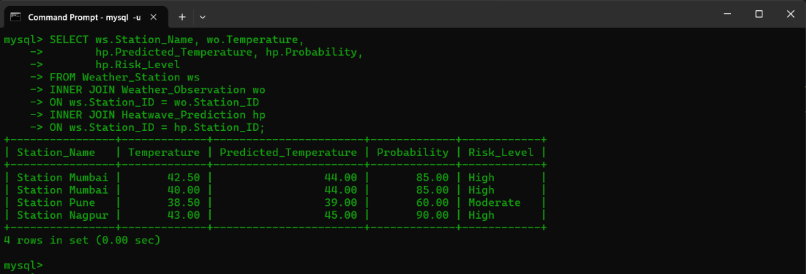 

---

### GROUP 21 — NESTED QUERY USING SELECT WITH SELECT

#### Syntax

```sql
SELECT columns
FROM table_name
WHERE column_name operator
(
    SELECT aggregate_function(column_name)
    FROM table_name
);
```

#### Problem Statement

Find all weather observations where the recorded temperature is greater than the average temperature of all observations.

#### Query

```sql
SELECT *
FROM Weather_Observation
WHERE Temperature >
(
    SELECT AVG(Temperature)
    FROM Weather_Observation
);
```

#### Output

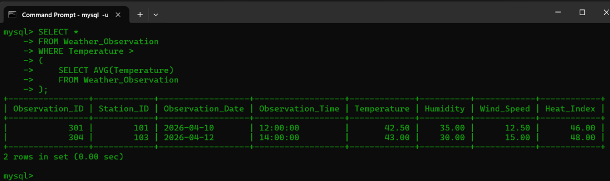 

---

### GROUP 22 — NESTED QUERY USING IN

#### Syntax

```sql
SELECT columns
FROM table1
WHERE column_name IN
(
    SELECT column_name
    FROM table2
);
```

#### Problem Statement

Display the names and locations of weather stations where at least one heatwave event has been recorded.

#### Query

```sql
SELECT Station_Name, Location
FROM Weather_Station
WHERE Station_ID IN
(
    SELECT Station_ID
    FROM Heatwave_Event
);
```

#### Output

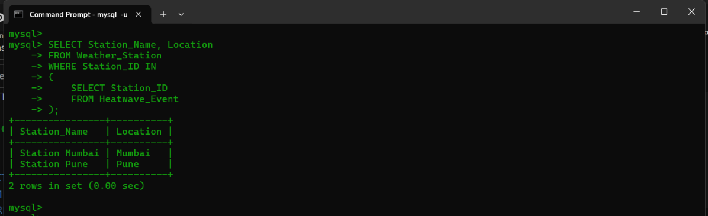 

---

### GROUP 23 — INSERT WITH SELECT

#### Syntax

```sql
INSERT INTO table_name
SELECT *
FROM source_table
WHERE condition;
```

#### Problem Statement

Insert weather observations whose temperature is greater than the average temperature into a new table called High_Temperature_Observations.

#### Query

```sql
CREATE TABLE High_Temperature_Observations
LIKE Weather_Observation;

INSERT INTO High_Temperature_Observations
SELECT *
FROM Weather_Observation
WHERE Temperature >
(
    SELECT AVG(Temperature)
    FROM Weather_Observation
);
```

#### Output

```sql
SELECT *
FROM High_Temperature_Observations;
```

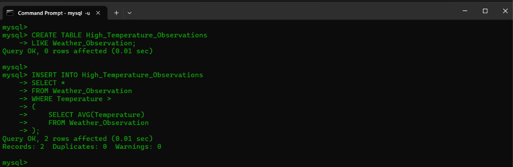 
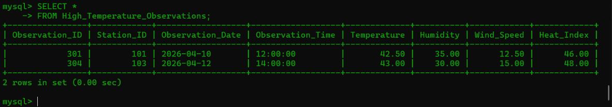 

---

### GROUP 24 — UPDATE WITH SELECT

#### Syntax

```sql
UPDATE table_name
SET column_name = value
WHERE column_name IN
(
    SELECT column_name
    FROM another_table
    WHERE condition
);
```

#### Problem Statement

Set the status of sensors installed at stations that have experienced a severe heatwave to 'Priority Monitoring'.

#### Query

```sql
UPDATE Sensor
SET Status = 'Priority Monitoring'
WHERE Station_ID IN
(
    SELECT Station_ID
    FROM Heatwave_Event
    WHERE Severity = 'Severe'
);
```

#### Output

```sql
SELECT *
FROM Sensor;
```
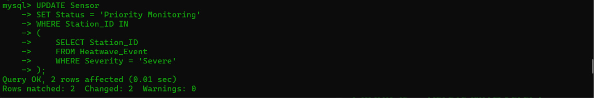 
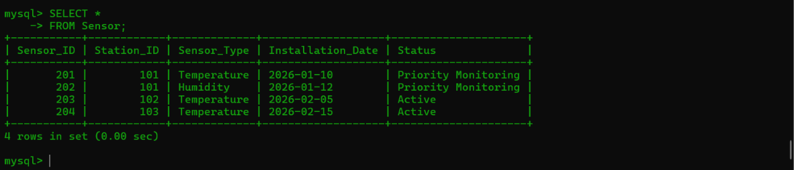 

---

### GROUP 25 — DELETE WITH SELECT

#### Syntax

```sql
DELETE FROM table_name
WHERE column_name NOT IN
(
    SELECT column_name
    FROM another_table
);
```

#### Problem Statement

Delete weather observations belonging to stations where no heatwave event has been recorded.

#### Query

```sql
DELETE FROM Weather_Observation
WHERE Station_ID NOT IN
(
    SELECT Station_ID
    FROM Heatwave_Event
);
```

#### Output

```sql
SELECT *
FROM Weather_Observation;
```

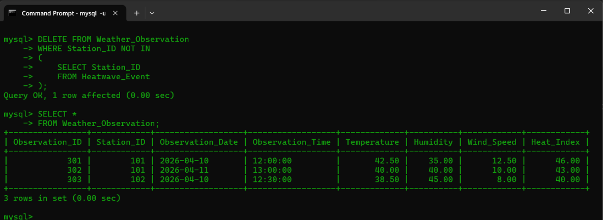 

---
### OUTCOME

Simple and complex SQL queries were successfully performed on climate-related data. Different SQL joins, nested queries, SELECT commands, comparison operators, pattern matching, arithmetic and logical operators, IN, BETWEEN, NULL checking, ORDER BY, DISTINCT, GROUP BY, HAVING, and aggregate functions were used to retrieve, filter, sort, group, compare, insert, update, delete, and analyze records.

### CONCLUSION

Thus, SQL joins and nested queries were successfully implemented for climate data analysis, heatwave monitoring, and prediction. Different SQL commands and clauses were used to combine related tables, filter and analyze records, and perform data manipulation operations.