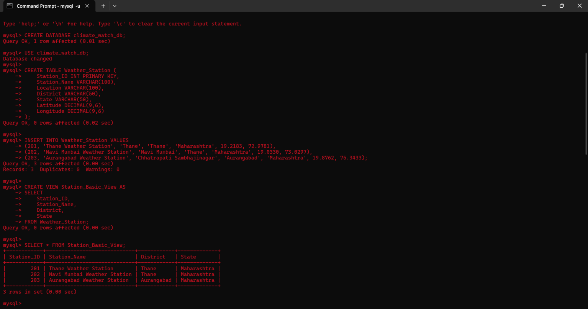
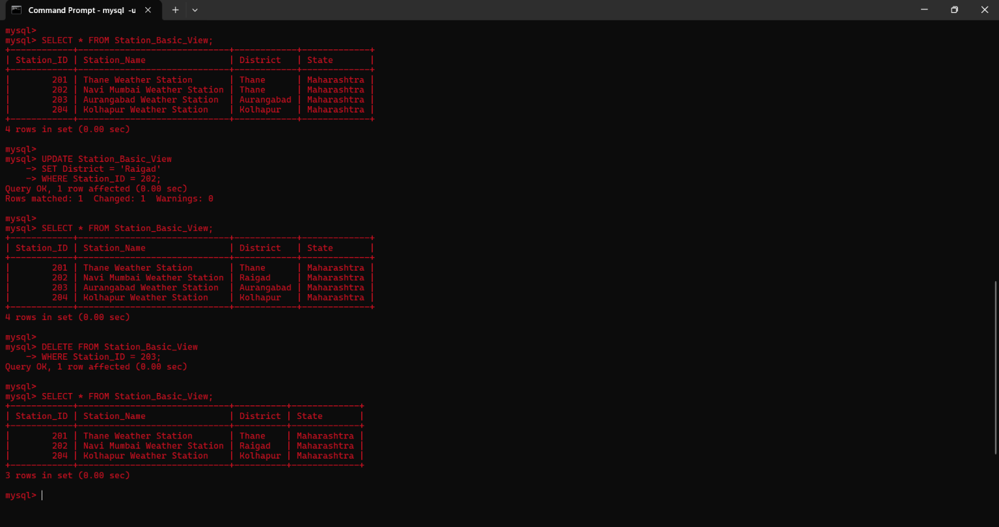
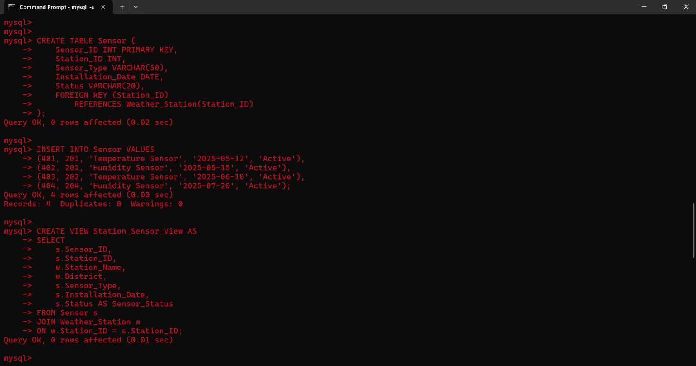
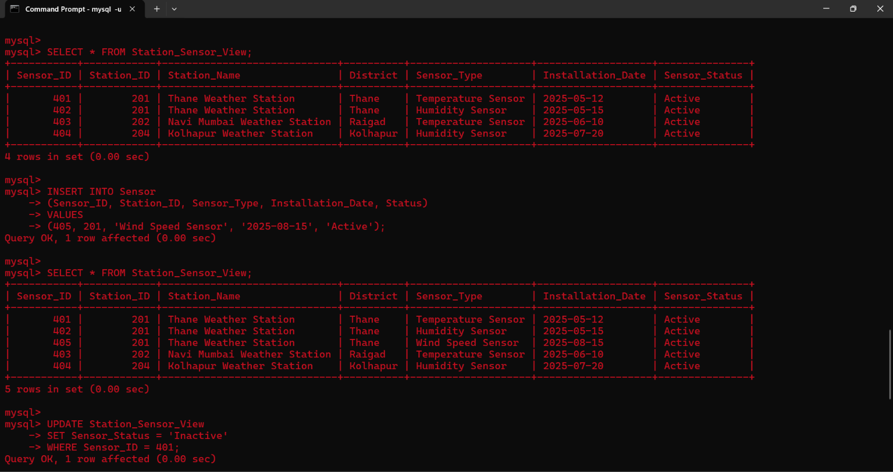
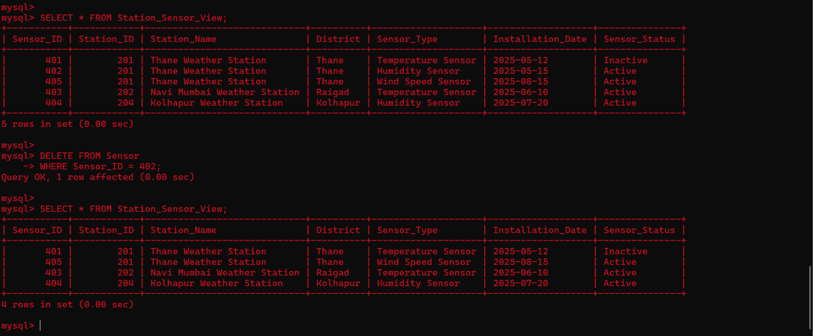
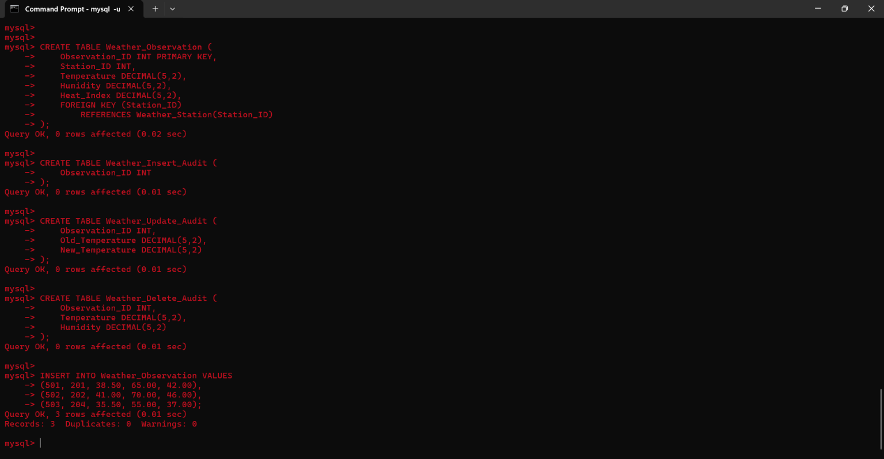
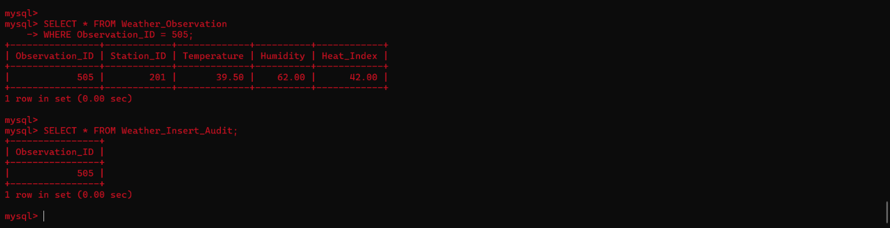
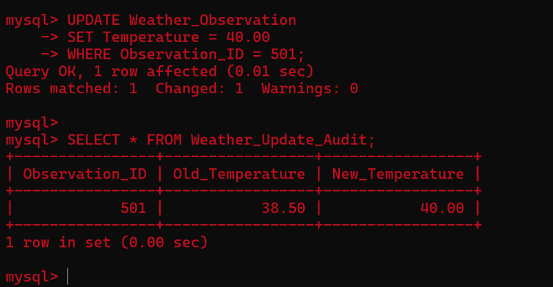
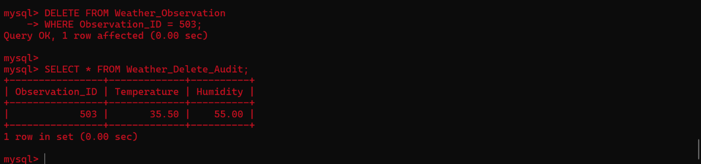
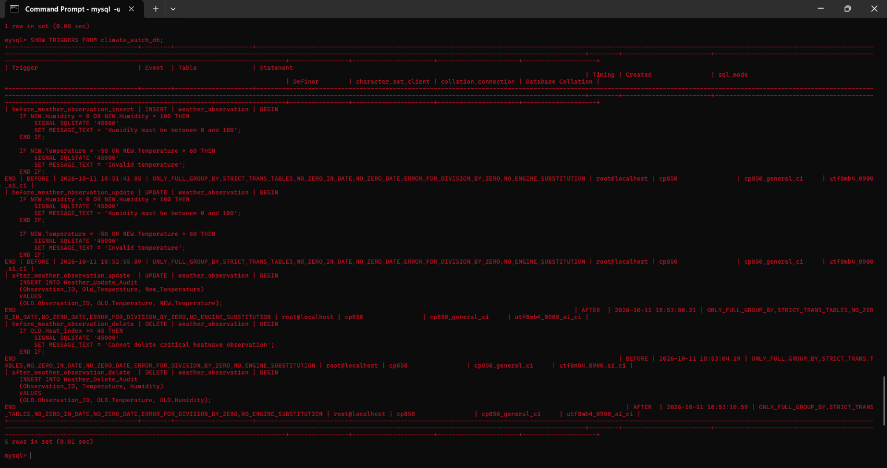

<p>
    <span style="float:left;">
        <h3> SQL Experiment 7
    </span>
    <span style="float:right; text-align:right;"> 
        Name: Dev Mandora<br>
        Roll Number: 62 <br>
        Batch: SB4</h3>
    </span>
</p>

<br clear="both">

### AIM

Implementation of Views and Triggers.

### OBJECTIVE

- To study and implement views on single and multiple tables.
- To perform INSERT, UPDATE, and DELETE operations on views.
- To implement BEFORE and AFTER triggers for INSERT, UPDATE, and DELETE operations in MySQL.

### SOFTWARE REQUIREMENT

MySQL Server 8.0  
MySQL Shell 8.0

### THEORY

A **View** is a virtual table created using an SQL query. It displays selected columns from one or more tables and simplifies data retrieval.

A **Trigger** is a database object that automatically executes when an INSERT, UPDATE, or DELETE operation occurs on a table.

- **BEFORE Trigger** – Executes before the specified operation.
- **AFTER Trigger** – Executes after the specified operation.

## PART A — IMPLEMENTATION OF VIEWS

**Database Name:** `climate_watch_db`

### GROUP 1 — VIEW ON SINGLE TABLE

#### Syntax

```sql
CREATE VIEW view_name AS
SELECT column1, column2
FROM table_name;

INSERT INTO view_name
VALUES (value1, value2);

UPDATE view_name
SET column_name = value
WHERE condition;

DELETE FROM view_name
WHERE condition;
```

#### Query

```sql
CREATE DATABASE climate_watch_db;
USE climate_watch_db;

CREATE TABLE Weather_Station (
    Station_ID INT PRIMARY KEY,
    Station_Name VARCHAR(100),
    Location VARCHAR(100),
    District VARCHAR(50),
    State VARCHAR(50),
    Latitude DECIMAL(9,6),
    Longitude DECIMAL(9,6)
);

INSERT INTO Weather_Station VALUES
(201, 'Thane Weather Station', 'Thane', 'Thane', 'Maharashtra', 19.2183, 72.9781),
(202, 'Navi Mumbai Weather Station', 'Navi Mumbai', 'Thane', 'Maharashtra', 19.0330, 73.0297),
(203, 'Aurangabad Weather Station', 'Chhatrapati Sambhajinagar', 'Aurangabad', 'Maharashtra', 19.8762, 75.3433);

CREATE VIEW Station_Basic_View AS
SELECT
    Station_ID,
    Station_Name,
    District,
    State
FROM Weather_Station;

SELECT * FROM Station_Basic_View;

INSERT INTO Station_Basic_View
VALUES (204, 'Kolhapur Weather Station', 'Kolhapur', 'Maharashtra');

SELECT * FROM Station_Basic_View;

UPDATE Station_Basic_View
SET District = 'Raigad'
WHERE Station_ID = 202;

SELECT * FROM Station_Basic_View;

DELETE FROM Station_Basic_View
WHERE Station_ID = 203;

SELECT * FROM Station_Basic_View;
```

#### Output

  

### GROUP 2 — VIEW ON MULTIPLE TABLES

#### Syntax

```sql
CREATE VIEW view_name AS
SELECT columns
FROM table1
JOIN table2
ON table1.column = table2.column;
```

#### Query

```sql
CREATE TABLE Sensor (
    Sensor_ID INT PRIMARY KEY,
    Station_ID INT,
    Sensor_Type VARCHAR(50),
    Installation_Date DATE,
    Status VARCHAR(20),
    FOREIGN KEY (Station_ID)
        REFERENCES Weather_Station(Station_ID)
);

INSERT INTO Sensor VALUES
(401, 201, 'Temperature Sensor', '2025-05-12', 'Active'),
(402, 201, 'Humidity Sensor', '2025-05-15', 'Active'),
(403, 202, 'Temperature Sensor', '2025-06-10', 'Active'),
(404, 204, 'Humidity Sensor', '2025-07-20', 'Active');

CREATE VIEW Station_Sensor_View AS
SELECT
    s.Sensor_ID,
    s.Station_ID,
    w.Station_Name,
    w.District,
    s.Sensor_Type,
    s.Installation_Date,
    s.Status AS Sensor_Status
FROM Sensor s
JOIN Weather_Station w
ON w.Station_ID = s.Station_ID;

SELECT * FROM Station_Sensor_View;

INSERT INTO Sensor
(Sensor_ID, Station_ID, Sensor_Type, Installation_Date, Status)
VALUES
(405, 201, 'Wind Speed Sensor', '2025-08-15', 'Active');

SELECT * FROM Station_Sensor_View;

UPDATE Station_Sensor_View
SET Sensor_Status = 'Inactive'
WHERE Sensor_ID = 401;

SELECT * FROM Station_Sensor_View;

DELETE FROM Sensor
WHERE Sensor_ID = 402;

SELECT * FROM Station_Sensor_View;
```

#### Output
   

## PART B — IMPLEMENTATION OF TRIGGERS

**Database Name:** `climate_watch_db`

### GROUP 3 — CREATING WEATHER OBSERVATION AND AUDIT TABLES

#### Query

```sql
CREATE TABLE Weather_Observation (
    Observation_ID INT PRIMARY KEY,
    Station_ID INT,
    Temperature DECIMAL(5,2),
    Humidity DECIMAL(5,2),
    Heat_Index DECIMAL(5,2),
    FOREIGN KEY (Station_ID)
        REFERENCES Weather_Station(Station_ID)
);

CREATE TABLE Weather_Insert_Audit (
    Observation_ID INT
);

CREATE TABLE Weather_Update_Audit (
    Observation_ID INT,
    Old_Temperature DECIMAL(5,2),
    New_Temperature DECIMAL(5,2)
);

CREATE TABLE Weather_Delete_Audit (
    Observation_ID INT,
    Temperature DECIMAL(5,2),
    Humidity DECIMAL(5,2)
);

INSERT INTO Weather_Observation VALUES
(501, 201, 38.50, 65.00, 42.00),
(502, 202, 41.00, 70.00, 46.00),
(503, 204, 35.50, 55.00, 37.00);
```
 
### GROUP 4 — BEFORE INSERT TRIGGER

A BEFORE INSERT trigger validates humidity and temperature before inserting a record.

#### Syntax

```sql
CREATE TRIGGER trigger_name
BEFORE INSERT ON table_name
FOR EACH ROW
BEGIN
    -- Trigger statements
END;
```

#### Query

```sql
DELIMITER //

CREATE TRIGGER before_weather_observation_insert
BEFORE INSERT ON Weather_Observation
FOR EACH ROW
BEGIN
    IF NEW.Humidity < 0 OR NEW.Humidity > 100 THEN
        SIGNAL SQLSTATE '45000'
        SET MESSAGE_TEXT = 'Humidity must be between 0 and 100';
    END IF;

    IF NEW.Temperature < -50 OR NEW.Temperature > 60 THEN
        SIGNAL SQLSTATE '45000'
        SET MESSAGE_TEXT = 'Invalid temperature';
    END IF;
END //

DELIMITER ;
```

### GROUP 5 — AFTER INSERT TRIGGER

An AFTER INSERT trigger stores the inserted observation ID in the audit table.

#### Query

```sql
DELIMITER //

CREATE TRIGGER after_weather_observation_insert
AFTER INSERT ON Weather_Observation
FOR EACH ROW
BEGIN
    INSERT INTO Weather_Insert_Audit
    (Observation_ID)
    VALUES (NEW.Observation_ID);
END //

DELIMITER ;
```

### GROUP 6 — BEFORE UPDATE TRIGGER

A BEFORE UPDATE trigger validates humidity and temperature before updating a record.

#### Query

```sql
DELIMITER //

CREATE TRIGGER before_weather_observation_update
BEFORE UPDATE ON Weather_Observation
FOR EACH ROW
BEGIN
    IF NEW.Humidity < 0 OR NEW.Humidity > 100 THEN
        SIGNAL SQLSTATE '45000'
        SET MESSAGE_TEXT = 'Humidity must be between 0 and 100';
    END IF;

    IF NEW.Temperature < -50 OR NEW.Temperature > 60 THEN
        SIGNAL SQLSTATE '45000'
        SET MESSAGE_TEXT = 'Invalid temperature';
    END IF;
END //

DELIMITER ;
```

### GROUP 7 — AFTER UPDATE TRIGGER

An AFTER UPDATE trigger records the old and new temperatures in the audit table.

#### Query

```sql
DELIMITER //

CREATE TRIGGER after_weather_observation_update
AFTER UPDATE ON Weather_Observation
FOR EACH ROW
BEGIN
    INSERT INTO Weather_Update_Audit
    (Observation_ID, Old_Temperature, New_Temperature)
    VALUES
    (OLD.Observation_ID, OLD.Temperature, NEW.Temperature);
END //

DELIMITER ;
```

### GROUP 8 — BEFORE DELETE TRIGGER

A BEFORE DELETE trigger prevents deletion of observations having a heat index of 45 or higher.

#### Query

```sql
DELIMITER //

CREATE TRIGGER before_weather_observation_delete
BEFORE DELETE ON Weather_Observation
FOR EACH ROW
BEGIN
    IF OLD.Heat_Index >= 45 THEN
        SIGNAL SQLSTATE '45000'
        SET MESSAGE_TEXT = 'Cannot delete critical heatwave observation';
    END IF;
END //

DELIMITER ;
```

### GROUP 9 — AFTER DELETE TRIGGER

An AFTER DELETE trigger stores deleted observation details in the audit table.

#### Query

```sql
DELIMITER //

CREATE TRIGGER after_weather_observation_delete
AFTER DELETE ON Weather_Observation
FOR EACH ROW
BEGIN
    INSERT INTO Weather_Delete_Audit
    (Observation_ID, Temperature, Humidity)
    VALUES
    (OLD.Observation_ID, OLD.Temperature, OLD.Humidity);
END //

DELIMITER ;
```

### GROUP 10 — TESTING TRIGGERS

#### INSERT

```sql
INSERT INTO Weather_Observation
VALUES (504, 201, 39.00, 60.00, 41.00);

SELECT * FROM Weather_Insert_Audit;
```
 
> [!attention] insert trigger was wrong previously so the final show all triggers may not include insert (the corrected screenshot is attached above)
#### UPDATE

```sql
UPDATE Weather_Observation
SET Temperature = 40.00
WHERE Observation_ID = 501;

SELECT * FROM Weather_Update_Audit;
```
 
#### DELETE

```sql
DELETE FROM Weather_Observation
WHERE Observation_ID = 503;

SELECT * FROM Weather_Delete_Audit;
```
 
### GROUP 11 — SHOWING ALL TRIGGERS

#### Query

```sql
SHOW TRIGGERS FROM climate_watch_db;
```
 
### OUTCOME

The views `Station_Basic_View` and `Station_Sensor_View` were created successfully. INSERT, UPDATE, and DELETE operations were performed, and BEFORE and AFTER triggers were implemented for weather observation records.

### CONCLUSION

Thus, views and triggers were successfully implemented in MySQL. Views simplified data retrieval from single and multiple tables, while triggers validated data and recorded changes before or after INSERT, UPDATE, and DELETE operations.