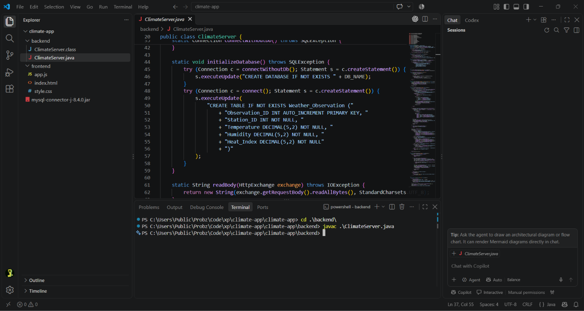
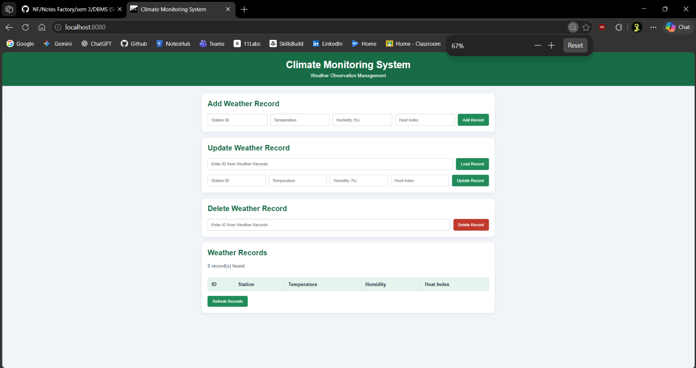
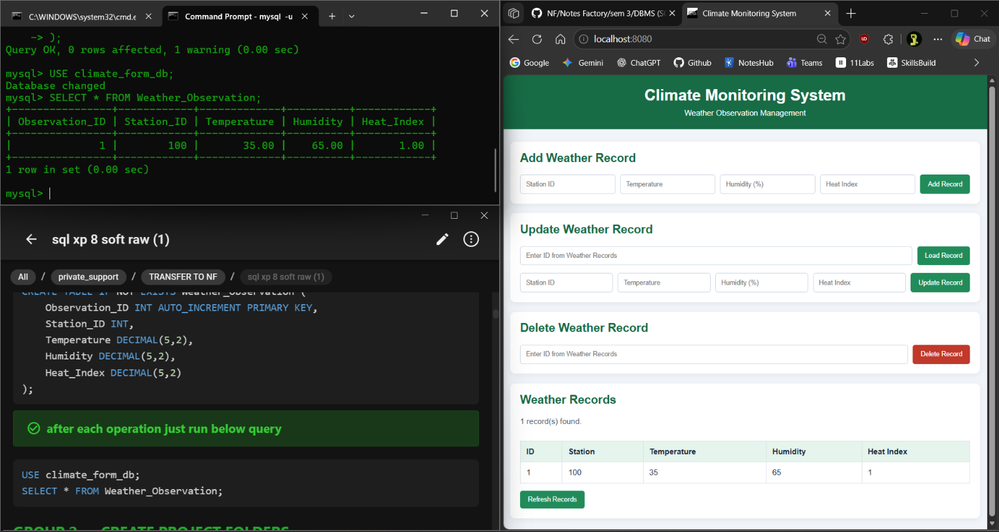
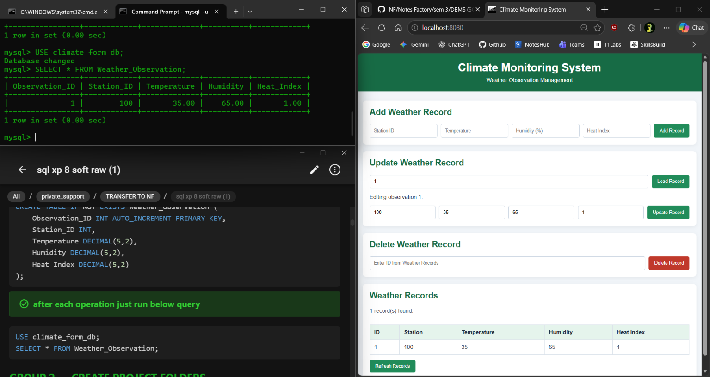
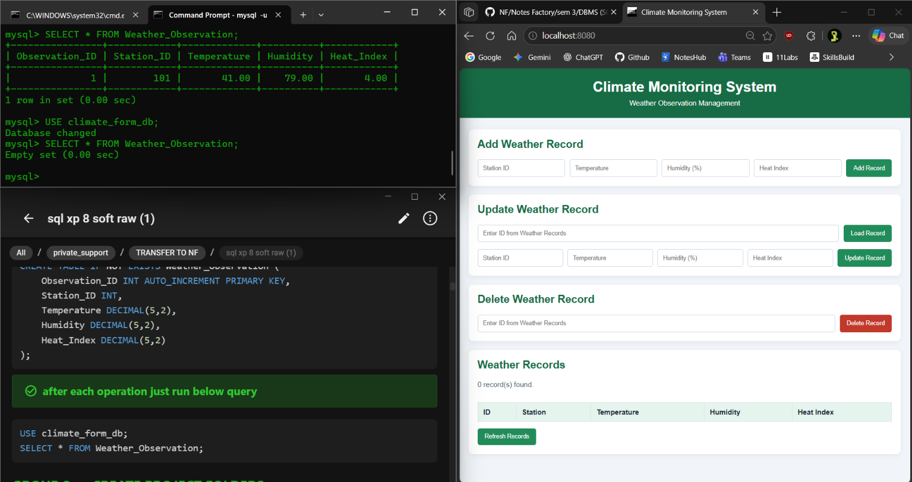
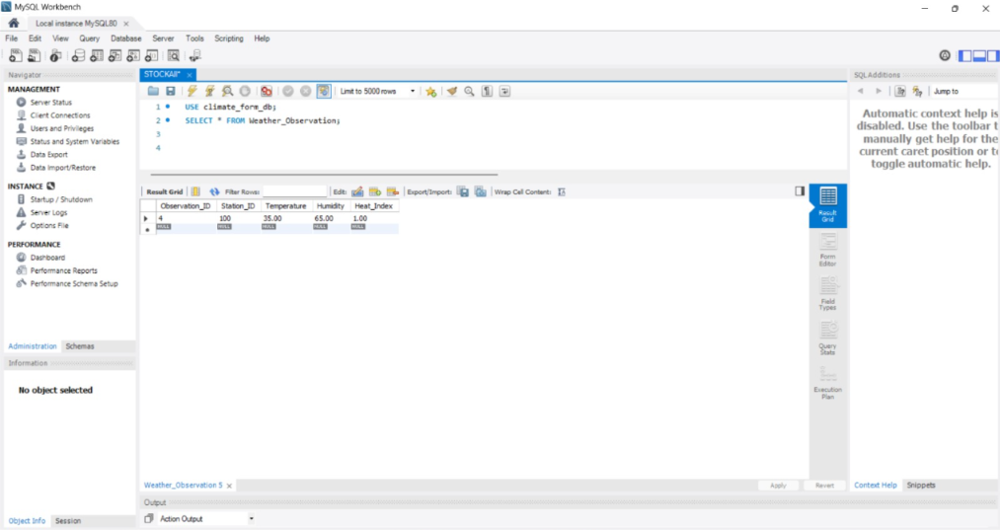
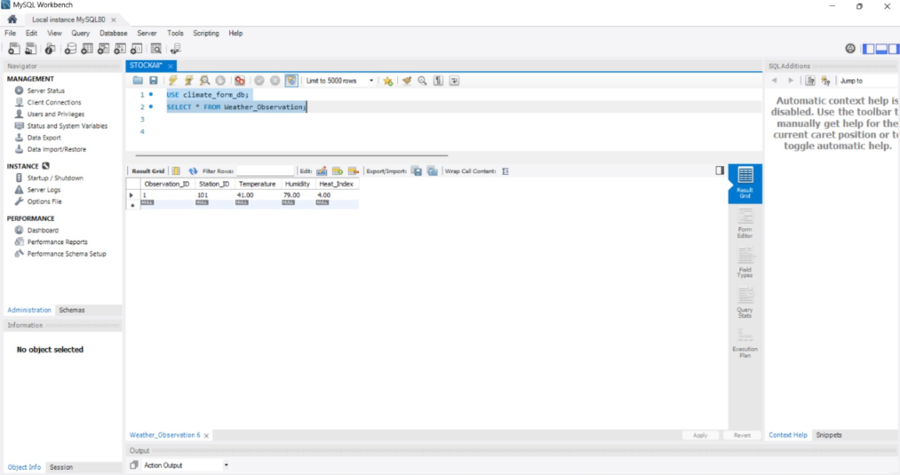
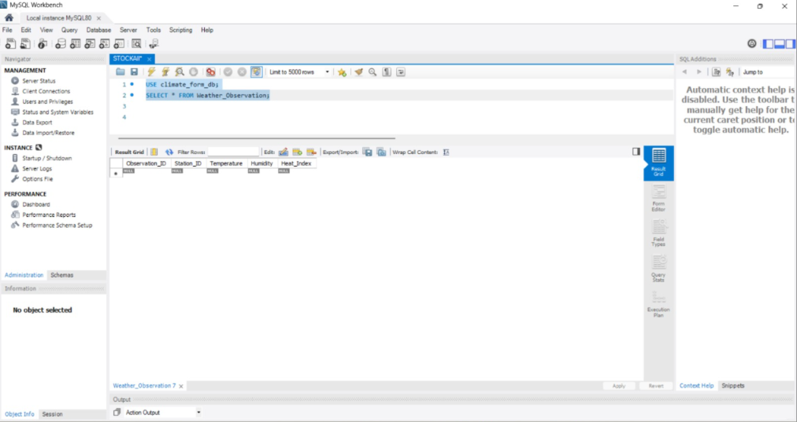

<p>
    <span style="float:left;">
        <h3> SQL  Experiment 8
    </span>
    <span style="float:right; text-align:right;"> 
        Name: Dev Mandora<br>
        Roll Number: 62 <br>
        Batch: SB4</h3>
    </span>
</p>

<br clear="both">

### AIM

Demonstrate database connectivity by preparing a simple form using a scripting language.

### OBJECTIVE

- To connect a web application with MySQL using Java.
- To create a form for entering weather observation details.
- To perform INSERT, SELECT, UPDATE, and DELETE operations.

### SOFTWARE REQUIREMENT

- Java Development Kit (JDK 17)
- MySQL Server 8.0
- MySQL Workbench
- MySQL Connector/J JDBC driver
- Text Editor and Web Browser

### THEORY

Java Database Connectivity (JDBC) allows Java programs to connect to MySQL databases.

In this experiment, HTML and CSS are used to create the user interface, JavaScript handles user interactions, and Java connects the application to MySQL.

The four CRUD operations are:

- **Create:** Insert a new record.
- **Read:** Display existing records.
- **Update:** Modify an existing record.
- **Delete:** Remove a record.

### PROCEDURE

1. Open MySQL Workbench and connect to the local MySQL Server.
2. Create the database `climate_form_db` and the `Weather_Observation` table with the required attributes.
3. Download MySQL Connector/J and add the JAR file to the Java project.
4. Configure the Java backend with the database URL, username, and password.
5. Establish the database connection using `DriverManager.getConnection()`.
6. Compile and run `ClimateServer.java` with the MySQL Connector/J driver.
7. Open the web application in a browser and test the INSERT, SELECT, UPDATE, and DELETE operations.
8. Verify the stored records using MySQL Workbench.

> [!attention] Demonstration Note
> The database connectivity and CRUD operations were demonstrated using MySQL Server 8.0 through the web application.
 MySQL Workbench can be used to execute SQL queries and verify the database records.
 The final output shows the query used to verify the records.
> `NOTE`: MySQL server is basically the cli version and SQL Workbench is the GUI of the same

### GROUP 1 — CREATE DATABASE AND TABLE

#### Query

```sql
CREATE DATABASE IF NOT EXISTS climate_form_db;
USE climate_form_db;

CREATE TABLE IF NOT EXISTS Weather_Observation (
    Observation_ID INT AUTO_INCREMENT PRIMARY KEY,
    Station_ID INT,
    Temperature DECIMAL(5,2),
    Humidity DECIMAL(5,2),
    Heat_Index DECIMAL(5,2)
);
````
> [!check] after each operation just run below query
```sql
USE climate_form_db;
SELECT * FROM Weather_Observation;

```

### GROUP 2 — CREATE PROJECT FOLDERS

Create the following project structure:

```
climate-app/
│
├── backend/
│   └── ClimateServer.java
│
├── frontend/
│   ├── index.html
│   ├── style.css
│   └── app.js
│
└── mysql-connector-j-VERSION.jar
```
| File / Technology | Purpose |
|---|---|
| `index.html` | Creates the form and records table |
| `style.css` | Styles the interface and makes it responsive |
| `app.js` | Sends requests and refreshes displayed records |
| `ClimateServer.java` | Runs the server and performs database operations |
| JDBC | Connects Java to MySQL |
| MySQL | Stores weather observation records |

The flow is **HTML form → JavaScript → Java backend → JDBC → MySQL**. The Java backend also serves the frontend.
***
<br>

> [!checklist] Download MySQL Connector/J from:
[https://dev.mysql.com/downloads/connector/j/](https://dev.mysql.com/downloads/connector/j/)
sPlace the downloaded JAR file inside the `climate-app` folder.

### GROUP 3 — HTML FRONTEND

#### File: `frontend/index.html`

```html
<!DOCTYPE html>
<html lang="en">
<head>
    <meta charset="UTF-8">
    <meta name="viewport" content="width=device-width, initial-scale=1.0">
    <title>Climate Monitoring System</title>
    <link rel="stylesheet" href="style.css">
    <script src="app.js" defer></script>
</head>
<body>
    <header>
        <h1>Climate Monitoring System</h1>
        <p>Weather Observation Management</p>
    </header>

    <main>
        <section class="card">
            <h2>Add Weather Record</h2>
            <form id="addForm">
                <input name="station" type="number" placeholder="Station ID" required>
                <input name="temp" type="number" step="0.01" placeholder="Temperature" required>
                <input name="humidity" type="number" step="0.01" min="0" max="100" placeholder="Humidity (%)" required>
                <input name="heat" type="number" step="0.01" placeholder="Heat Index" required>
                <button type="submit">Add Record</button>
            </form>
        </section>

        <section class="card">
            <h2>Update Weather Record</h2>
            <form id="updateLookupForm">
                <input name="id" type="number" min="1" placeholder="Enter ID from Weather Records" aria-label="Enter the ID shown in the Weather Records table" required>
                <button type="submit">Load Record</button>
            </form>
            <p id="updateMessage" aria-live="polite"></p>
            <form id="updateForm" hidden>
                <input name="id" type="hidden">
                <input name="station" type="number" placeholder="Station ID" required>
                <input name="temp" type="number" step="0.01" placeholder="Temperature" required>
                <input name="humidity" type="number" step="0.01" min="0" max="100" placeholder="Humidity (%)" required>
                <input name="heat" type="number" step="0.01" placeholder="Heat Index" required>
                <button type="submit">Update Record</button>
            </form>
        </section>

        <section class="card">
            <h2>Delete Weather Record</h2>
            <form id="deleteForm">
                <input name="id" type="number" min="1" placeholder="Enter ID from Weather Records" aria-label="Enter the ID shown in the Weather Records table" required>
                <button type="submit" class="delete">Delete Record</button>
            </form>
        </section>

        <section class="card">
            <h2>Weather Records</h2>
            <p id="message">Loading records...</p>
            <div class="table-container">
                <table>
                    <thead>
                        <tr>
                            <th>ID</th>
                            <th>Station</th>
                            <th>Temperature</th>
                            <th>Humidity</th>
                            <th>Heat Index</th>
                        </tr>
                    </thead>
                    <tbody id="records"></tbody>
                </table>
            </div>
            <button type="button" id="refreshBtn">Refresh Records</button>
        </section>
    </main>
</body>
</html>

```

### GROUP 4 — CSS STYLING

#### File: `frontend/style.css`

```css
* {
    box-sizing: border-box;
}

body {
    margin: 0;
    font-family: Arial, sans-serif;
    background: #f1f5f9;
    color: #1e293b;
}

header {
    background: #176b45;
    color: white;
    text-align: center;
    padding: 25px;
}

header h1 {
    margin: 0 0 8px;
}

header p {
    margin: 0;
}

main {
    max-width: 1000px;
    margin: 25px auto;
    padding: 0 15px;
}

.card {
    background: white;
    padding: 20px;
    margin-bottom: 20px;
    border-radius: 10px;
    box-shadow: 0 3px 12px rgba(0, 0, 0, 0.06);
}

h2 {
    margin-top: 0;
    color: #176b45;
}

form {
    display: flex;
    flex-wrap: wrap;
    gap: 10px;
}

input {
    flex: 1 1 180px;
    min-width: 0;
    padding: 11px;
    border: 1px solid #cbd5e1;
    border-radius: 5px;
}

button {
    padding: 11px 16px;
    background: #218c5a;
    color: white;
    border: none;
    border-radius: 5px;
    cursor: pointer;
}

button:hover {
    background: #176b45;
}

.delete {
    background: #c0392b;
}

.delete:hover {
    background: #922b21;
}

.table-container {
    overflow-x: auto;
}

table {
    width: 100%;
    border-collapse: collapse;
    margin: 15px 0;
}

th, td {
    padding: 12px;
    border: 1px solid #dbe2ea;
    text-align: left;
}

th {
    background: #e5f4ec;
}

#message {
    color: #475569;
}

@media (max-width: 600px) {
    header h1 {
        font-size: 23px;
    }

    .card {
        padding: 15px;
    }

    form button {
        width: 100%;
    }
}

```

### GROUP 5 — JAVASCRIPT

#### File: `frontend/app.js`

```js
const message = document.getElementById("message");
const records = document.getElementById("records");
const updateForm = document.getElementById("updateForm");
const updateMessage = document.getElementById("updateMessage");

async function loadRecords() {
    try {
        const response = await fetch("/api/records");
        if (!response.ok) {
            throw new Error("Could not load records");
        }

        const data = await response.json();
        records.replaceChildren();

        data.forEach((record) => {
            const row = document.createElement("tr");
            [record.id, record.station, record.temp, record.humidity, record.heat].forEach((value) => {
                const cell = document.createElement("td");
                cell.textContent = value ?? "";
                row.appendChild(cell);
            });
            records.appendChild(row);
        });

        message.textContent = `${data.length} record(s) found.`;
    } catch (error) {
        message.textContent = "Unable to load records.";
    }
}

async function submitForm(formId, action) {
    const form = document.getElementById(formId);
    form.addEventListener("submit", async (event) => {
        event.preventDefault();
        try {
            const response = await fetch(`/api/${action}`, {
                method: "POST",
                body: new URLSearchParams(new FormData(form))
            });
            const result = await response.text();
            message.textContent = result;
            if (response.ok) {
                form.reset();
                if (formId === "updateForm") {
                    form.hidden = true;
                    document.getElementById("updateLookupForm").reset();
                    updateMessage.textContent = "";
                }
                await loadRecords();
            }
        } catch (error) {
            message.textContent = "Request failed. Check the server.";
        }
    });
}

submitForm("addForm", "add");
submitForm("deleteForm", "delete");

document.getElementById("updateLookupForm").addEventListener("submit", async (event) => {
    event.preventDefault();
    updateForm.hidden = true;

    const id = new FormData(event.currentTarget).get("id");
    try {
        const response = await fetch(`/api/records/${encodeURIComponent(id)}`);
        if (!response.ok) {
            updateMessage.textContent = response.status === 404
                ? "Observation ID not found."
                : "Unable to load this record.";
            return;
        }

        const record = await response.json();
        updateForm.elements.namedItem("id").value = record.id;
        updateForm.elements.namedItem("station").value = record.station;
        updateForm.elements.namedItem("temp").value = record.temp;
        updateForm.elements.namedItem("humidity").value = record.humidity;
        updateForm.elements.namedItem("heat").value = record.heat;
        updateForm.hidden = false;
        updateMessage.textContent = `Editing observation ${record.id}.`;
    } catch (error) {
        updateMessage.textContent = "Request failed. Check the server.";
    }
});

submitForm("updateForm", "update");
document.getElementById("refreshBtn").addEventListener("click", loadRecords);
loadRecords();

```

### GROUP 6 — JAVA BACKEND

#### File: `backend/ClimateServer.java`

```java
import com.sun.net.httpserver.HttpExchange;
import com.sun.net.httpserver.HttpServer;

import java.io.IOException;
import java.io.OutputStream;
import java.net.InetSocketAddress;
import java.net.URLDecoder;
import java.nio.charset.StandardCharsets;
import java.nio.file.Files;
import java.nio.file.Path;
import java.nio.file.Paths;
import java.sql.Connection;
import java.sql.DriverManager;
import java.sql.PreparedStatement;
import java.sql.ResultSet;
import java.sql.SQLException;
import java.sql.Statement;
import java.util.Map;

public class ClimateServer {
    static final String DB_NAME = "climate_form_db";
    static final String URL = "jdbc:mysql://localhost:3306/" + DB_NAME;
    static final String USER = System.getenv().getOrDefault("MYSQL_USER", "root");
    static final String PASSWORD = System.getenv().getOrDefault("MYSQL_PASSWORD", "root");

    static Connection connect() throws SQLException {
        try {
            Class.forName("com.mysql.cj.jdbc.Driver");
        } catch (ClassNotFoundException e) {
            throw new SQLException("MySQL JDBC driver not found.", e);
        }
        return DriverManager.getConnection(URL, USER, PASSWORD);
    }

    static Connection connectWithoutDb() throws SQLException {
        try {
            Class.forName("com.mysql.cj.jdbc.Driver");
        } catch (ClassNotFoundException e) {
            throw new SQLException("MySQL JDBC driver not found.", e);
        }
        return DriverManager.getConnection("jdbc:mysql://localhost:3306/?user=" + USER + "&password=" + PASSWORD);
    }

    static void initializeDatabase() throws SQLException {
        try (Connection c = connectWithoutDb(); Statement s = c.createStatement()) {
            s.executeUpdate("CREATE DATABASE IF NOT EXISTS " + DB_NAME);
        }
        try (Connection c = connect(); Statement s = c.createStatement()) {
            s.executeUpdate(
                "CREATE TABLE IF NOT EXISTS Weather_Observation ("
                    + "Observation_ID INT AUTO_INCREMENT PRIMARY KEY, "
                    + "Station_ID INT NOT NULL, "
                    + "Temperature DECIMAL(5,2) NOT NULL, "
                    + "Humidity DECIMAL(5,2) NOT NULL, "
                    + "Heat_Index DECIMAL(5,2) NOT NULL"
                    + ")"
            );
        }
    }

    static String readBody(HttpExchange exchange) throws IOException {
        return new String(exchange.getRequestBody().readAllBytes(), StandardCharsets.UTF_8);
    }

    static String getFormValue(String form, String key) {
        for (String part : form.split("&")) {
            String[] pair = part.split("=", 2);
            if (pair.length == 0) {
                continue;
            }
            String name = URLDecoder.decode(pair[0], StandardCharsets.UTF_8);
            if (name.equals(key)) {
                String value = (pair.length > 1) ? pair[1] : "";
                return URLDecoder.decode(value, StandardCharsets.UTF_8);
            }
        }
        return "";
    }

    static void reply(HttpExchange exchange, int status, String text) throws IOException {
        byte[] data = text.getBytes(StandardCharsets.UTF_8);
        exchange.getResponseHeaders().set("Content-Type", "text/plain; charset=UTF-8");
        exchange.sendResponseHeaders(status, data.length);
        try (OutputStream os = exchange.getResponseBody()) {
            os.write(data);
        }
        exchange.close();
    }

    static void handleApi(HttpExchange exchange) throws Exception {
        String path = exchange.getRequestURI().getPath();

        if (path.matches("/api/records/\\d+") && "GET".equals(exchange.getRequestMethod())) {
            int id = Integer.parseInt(path.substring("/api/records/".length()));
            try (Connection c = connect();
                 PreparedStatement p = c.prepareStatement(
                     "SELECT Observation_ID, Station_ID, Temperature, Humidity, Heat_Index "
                         + "FROM Weather_Observation WHERE Observation_ID=?")) {
                p.setInt(1, id);
                try (ResultSet r = p.executeQuery()) {
                    if (!r.next()) {
                        reply(exchange, 404, "Observation ID not found.");
                        return;
                    }
                    String json = "{"
                        + "\"id\":" + r.getInt("Observation_ID")
                        + ",\"station\":" + r.getInt("Station_ID")
                        + ",\"temp\":" + r.getBigDecimal("Temperature")
                        + ",\"humidity\":" + r.getBigDecimal("Humidity")
                        + ",\"heat\":" + r.getBigDecimal("Heat_Index")
                        + "}";
                    byte[] data = json.getBytes(StandardCharsets.UTF_8);
                    exchange.getResponseHeaders().set("Content-Type", "application/json; charset=UTF-8");
                    exchange.sendResponseHeaders(200, data.length);
                    try (OutputStream os = exchange.getResponseBody()) {
                        os.write(data);
                    }
                    exchange.close();
                }
            }
            return;
        }

        if (path.equals("/api/records") && "GET".equals(exchange.getRequestMethod())) {
            StringBuilder json = new StringBuilder("[");
            try (Connection c = connect(); Statement s = c.createStatement(); ResultSet r = s.executeQuery("SELECT * FROM Weather_Observation ORDER BY Observation_ID")) {
                boolean first = true;
                while (r.next()) {
                    if (!first) {
                        json.append(',');
                    }
                    first = false;
                    json.append('{')
                        .append("\"id\":").append(r.getInt("Observation_ID"))
                        .append(",\"station\":").append(r.getInt("Station_ID"))
                        .append(",\"temp\":").append(r.getBigDecimal("Temperature"))
                        .append(",\"humidity\":").append(r.getBigDecimal("Humidity"))
                        .append(",\"heat\":").append(r.getBigDecimal("Heat_Index"))
                        .append('}');
                }
            }
            json.append(']');
            byte[] data = json.toString().getBytes(StandardCharsets.UTF_8);
            exchange.getResponseHeaders().set("Content-Type", "application/json; charset=UTF-8");
            exchange.sendResponseHeaders(200, data.length);
            try (OutputStream os = exchange.getResponseBody()) {
                os.write(data);
            }
            exchange.close();
            return;
        }

        if (!"POST".equals(exchange.getRequestMethod())) {
            reply(exchange, 405, "Method not allowed.");
            return;
        }

        String form = readBody(exchange);
        String result;
        try (Connection c = connect()) {
            if (path.equals("/api/add")) {
                String sql = "INSERT INTO Weather_Observation (Station_ID, Temperature, Humidity, Heat_Index) VALUES (?, ?, ?, ?)";
                try (PreparedStatement p = c.prepareStatement(sql)) {
                    p.setInt(1, Integer.parseInt(getFormValue(form, "station")));
                    p.setBigDecimal(2, new java.math.BigDecimal(getFormValue(form, "temp")));
                    p.setBigDecimal(3, new java.math.BigDecimal(getFormValue(form, "humidity")));
                    p.setBigDecimal(4, new java.math.BigDecimal(getFormValue(form, "heat")));
                    p.executeUpdate();
                }
                result = "Record added successfully.";
            } else if (path.equals("/api/update")) {
                String sql = "UPDATE Weather_Observation SET Station_ID=?, Temperature=?, Humidity=?, Heat_Index=? WHERE Observation_ID=?";
                int count;
                try (PreparedStatement p = c.prepareStatement(sql)) {
                    p.setInt(1, Integer.parseInt(getFormValue(form, "station")));
                    p.setBigDecimal(2, new java.math.BigDecimal(getFormValue(form, "temp")));
                    p.setBigDecimal(3, new java.math.BigDecimal(getFormValue(form, "humidity")));
                    p.setBigDecimal(4, new java.math.BigDecimal(getFormValue(form, "heat")));
                    p.setInt(5, Integer.parseInt(getFormValue(form, "id")));
                    count = p.executeUpdate();
                }
                result = count > 0 ? "Record updated successfully." : "Observation ID not found.";
            } else if (path.equals("/api/delete")) {
                int count;
                try (PreparedStatement p = c.prepareStatement("DELETE FROM Weather_Observation WHERE Observation_ID=?")) {
                    p.setInt(1, Integer.parseInt(getFormValue(form, "id")));
                    count = p.executeUpdate();
                }
                result = count > 0 ? "Record deleted successfully." : "Observation ID not found.";
            } else {
                reply(exchange, 404, "API endpoint not found.");
                return;
            }
        }
        reply(exchange, 200, result);
    }

    static void handle(HttpExchange exchange) throws IOException {
        String path = exchange.getRequestURI().getPath();
        try {
            if (path.startsWith("/api/")) {
                handleApi(exchange);
                return;
            }

            if ("GET".equals(exchange.getRequestMethod())) {
                String resourcePath = ("/".equals(path)) ? "/index.html" : path;
                Path file = Paths.get("frontend").resolve(resourcePath.substring(1)).normalize();
                Path frontendFolder = Paths.get("frontend").toAbsolutePath().normalize();
                Path target = file.toAbsolutePath().normalize();

                if (!target.startsWith(frontendFolder) || !Files.isRegularFile(target)) {
                    reply(exchange, 404, "File not found.");
                    return;
                }

                String type = resourcePath.endsWith(".css") ? "text/css" : resourcePath.endsWith(".js") ? "application/javascript" : "text/html";
                byte[] data = Files.readAllBytes(target);
                exchange.getResponseHeaders().set("Content-Type", type + "; charset=UTF-8");
                exchange.sendResponseHeaders(200, data.length);
                try (OutputStream os = exchange.getResponseBody()) {
                    os.write(data);
                }
                exchange.close();
                return;
            }

            reply(exchange, 405, "Method not allowed.");
        } catch (Exception e) {
            e.printStackTrace();
            try {
                reply(exchange, 500, "Error. Check Java console and MySQL settings.");
            } catch (Exception ignored) {
            }
        }
    }

    public static void main(String[] args) throws Exception {
        try {
            initializeDatabase();
            System.out.println("Database ready: " + DB_NAME);
        } catch (SQLException e) {
            System.err.println("Could not connect to MySQL using USER=" + USER + ", PASSWORD=***");
            System.err.println("Update MYSQL_USER and MYSQL_PASSWORD if your local MySQL server uses different credentials.");
            e.printStackTrace();
        }

        HttpServer server = HttpServer.create(new InetSocketAddress(8080), 0);
        server.createContext("/", ClimateServer::handle);
        server.start();
        System.out.println("Server started at http://localhost:8080");
    }
}

```


### GROUP 7 — COMPILE AND RUN

1.  Start MySQL Server and execute the database query from Group 1.
    
2.  Open Command Prompt in the `climate-app` folder.
    
3.  Replace `mysql-connector-j-VERSION.jar` with your actual JAR filename.
    

#### Compile

```
javac -cp ".;mysql-connector-j-VERSION.jar" backend\ClimateServer.java
```

#### Run

```
java -cp ".;mysql-connector-j-VERSION.jar;backend" ClimateServer
```
 
4. Open the browser and visit:

```
http://localhost:8080
```
 
### GROUP 8 — TEST CRUD OPERATIONS

1.  INSERT: Enter weather details and click Add Record.
     
2.  SELECT: View the records displayed in the table.
   
3.  UPDATE: Enter an existing Observation ID and the new values.
> [!check] Before Update
>    

> [!check] After Update
> 

4.  DELETE: Enter an existing Observation ID and delete it.
 
5.  Verify the changes in MySQL Workbench:
```sql
USE climate_form_db;
SELECT * FROM Weather_Observation;
```


 


### OUTCOME

A web-based weather observation application was developed using HTML, CSS, JavaScript, Java, JDBC, and MySQL to perform CRUD operations.

### CONCLUSION

Thus, database connectivity was demonstrated successfully using a separate frontend and Java backend connected to MySQL.


