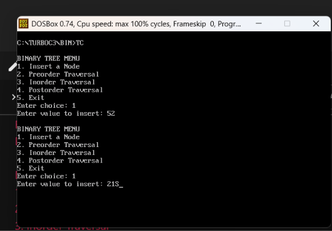
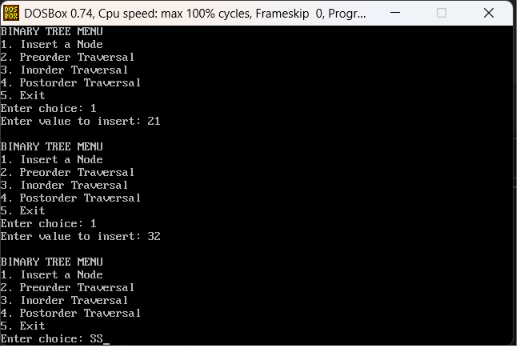
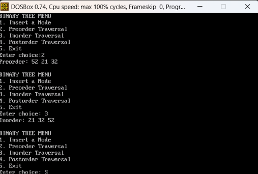
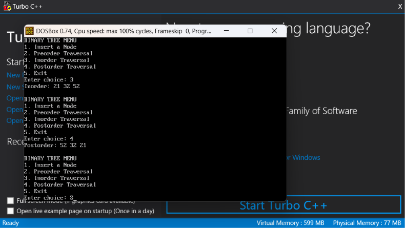

<div align = "center">

<a href="https://ibb.co/0y4jv78d" align="center"></a>
</div>


<p>
    <span style="float:left;">
        <h3> DSA Experiment 6
    </span>
    <span style="float:right; text-align:right;"> 
        Name: Dev Mandora<br>
        Roll Number: 62 <br>
        Batch: SB4</h3>
    </span>
</p>
 

### Aim:

To Implement Binary Tree and its Traversal for real-world application.

### Objective:

- To understand the structure of a Binary Tree.
- To create and insert nodes into a Binary Search Tree.
- To perform Inorder, Preorder, and Postorder traversal.
- To demonstrate a real-world application using a binary tree.

### Software Used:

- Turbo C / Turbo C++
- DOSBox

### Theory:

A **Binary Tree** is a non-linear data structure in which each node can have at most two children: left and right.

- **Inorder:** Left, Root, Right
- **Preorder:** Root, Left, Right
- **Postorder:** Left, Right, Root

A Binary Search Tree stores smaller values on the left and larger values on the right. Binary trees are used in searching, decision-making systems, and hierarchical data storage.

### Program 1: AI Use Case – Heatwave Risk Classification

This program stores temperature readings in a Binary Search Tree and classifies them into heatwave alert levels using predefined rules. It is a rule-based simulation, not a trained AI model.

```c
#include <stdio.h>
#include <conio.h>
#include <stdlib.h>

struct node
{
    int temperature;
    struct node *left, *right;
};

struct node* insert(struct node *root, int temp)
{
    struct node *p;

    if(root == NULL)
    {
        p = (struct node *)malloc(sizeof(struct node));
        p->temperature = temp;
        p->left = NULL;
        p->right = NULL;
        return p;
    }

    if(temp < root->temperature)
        root->left = insert(root->left, temp);
    else if(temp > root->temperature)
        root->right = insert(root->right, temp);

    return root;
}

void display(int temp)
{
    printf("%d C - ", temp);

    if(temp >= 45)
        printf("Red Alert\n");
    else if(temp >= 43)
        printf("Orange Alert\n");
    else if(temp >= 40)
        printf("Yellow Alert\n");
    else
        printf("Normal\n");
}

void inorder(struct node *root)
{
    if(root != NULL)
    {
        inorder(root->left);
        display(root->temperature);
        inorder(root->right);
    }
}

void preorder(struct node *root)
{
    if(root != NULL)
    {
        display(root->temperature);
        preorder(root->left);
        preorder(root->right);
    }
}

void postorder(struct node *root)
{
    if(root != NULL)
    {
        postorder(root->left);
        postorder(root->right);
        display(root->temperature);
    }
}

void main()
{
    struct node *root = NULL;
    int choice, temp;

    do
    {
        printf("\nHEATWAVE RISK MENU");
        printf("\n1. Insert Temperature");
        printf("\n2. Preorder Report");
        printf("\n3. Inorder Report");
        printf("\n4. Postorder Report");
        printf("\n5. Exit");
        printf("\nEnter choice: ");
        scanf("%d", &choice);

        switch(choice)
        {
            case 1:
                printf("Enter temperature: ");
                scanf("%d", &temp);
                root = insert(root, temp);
                printf("Temperature added.\n");
                break;

            case 2:
                printf("\nPreorder Heatwave Report:\n");
                preorder(root);
                break;

            case 3:
                printf("\nInorder Heatwave Report:\n");
                inorder(root);
                break;

            case 4:
                printf("\nPostorder Heatwave Report:\n");
                postorder(root);
                break;

            case 5:
                printf("Program exited.\n");
                break;

            default:
                printf("Invalid choice.\n");
        }

    } while(choice != 5);

    getch();
}
````

### Output:

```
HEATWAVE RISK MENU
1. Insert Temperature
2. Preorder Report
3. Inorder Report
4. Postorder Report
5. Exit
Enter choice: 1
Enter temperature: 43
Temperature added.

HEATWAVE RISK MENU
1. Insert Temperature
2. Preorder Report
3. Inorder Report
4. Postorder Report
5. Exit
Enter choice: 1
Enter temperature: 38
Temperature added.

HEATWAVE RISK MENU
1. Insert Temperature
2. Preorder Report
3. Inorder Report
4. Postorder Report
5. Exit
Enter choice: 1
Enter temperature: 46
Temperature added.

HEATWAVE RISK MENU
1. Insert Temperature
2. Preorder Report
3. Inorder Report
4. Postorder Report
5. Exit
Enter choice: 3

Inorder Heatwave Report:
38 C - Normal
43 C - Orange Alert
46 C - Red Alert
```

### Program 2: Basic Binary Search Tree and Traversal

```c
#include <stdio.h>
#include <conio.h>
#include <stdlib.h>

struct node
{
    int data;
    struct node *left, *right;
};

struct node* insert(struct node *root, int value)
{
    struct node *p;

    if(root == NULL)
    {
        p = (struct node *)malloc(sizeof(struct node));
        p->data = value;
        p->left = NULL;
        p->right = NULL;
        return p;
    }

    if(value < root->data)
        root->left = insert(root->left, value);
    else if(value > root->data)
        root->right = insert(root->right, value);

    return root;
}

void preorder(struct node *root)
{
    if(root != NULL)
    {
        printf("%d ", root->data);
        preorder(root->left);
        preorder(root->right);
    }
}

void inorder(struct node *root)
{
    if(root != NULL)
    {
        inorder(root->left);
        printf("%d ", root->data);
        inorder(root->right);
    }
}

void postorder(struct node *root)
{
    if(root != NULL)
    {
        postorder(root->left);
        postorder(root->right);
        printf("%d ", root->data);
    }
}

void main()
{
    struct node *root = NULL;
    int choice, value;

    do
    {
        printf("\nBINARY TREE MENU");
        printf("\n1. Insert a Node");
        printf("\n2. Preorder Traversal");
        printf("\n3. Inorder Traversal");
        printf("\n4. Postorder Traversal");
        printf("\n5. Exit");
        printf("\nEnter choice: ");
        scanf("%d", &choice);

        switch(choice)
        {
            case 1:
                printf("Enter value to insert: ");
                scanf("%d", &value);
                root = insert(root, value);
                break;

            case 2:
                printf("Preorder: ");
                preorder(root);
                printf("\n");
                break;

            case 3:
                printf("Inorder: ");
                inorder(root);
                printf("\n");
                break;

            case 4:
                printf("Postorder: ");
                postorder(root);
                printf("\n");
                break;

            case 5:
                printf("Program exited.\n");
                break;

            default:
                printf("Invalid choice.\n");
        }

    } while(choice != 5);

    getch();
}
```

### Output:
 
 
 
 

### Outcome:

A Binary Search Tree was implemented successfully. Nodes were inserted, and Inorder, Preorder, and Postorder traversals were performed. A rule-based heatwave risk classification application was also demonstrated.

### Conclusion:

Thus, Binary Tree insertion and traversal techniques were implemented successfully, demonstrating their use in organizing data and supporting simple decision-making applications.

```

```
