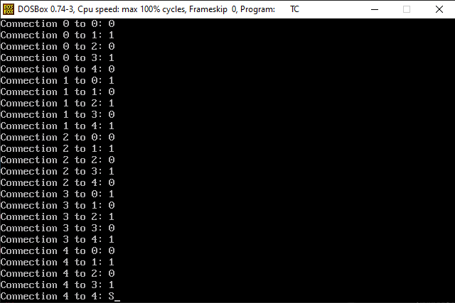
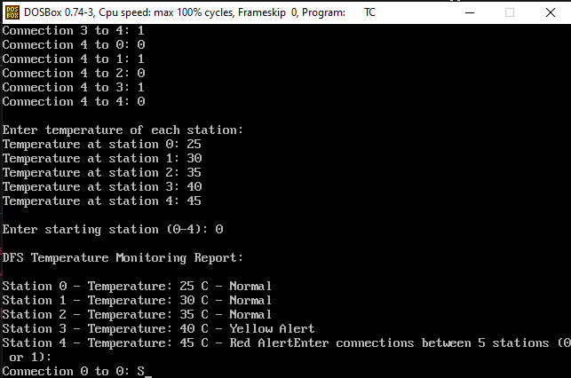
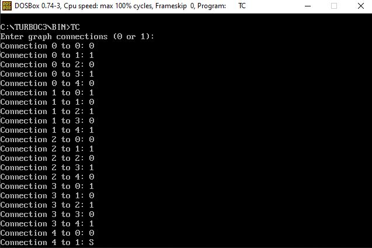
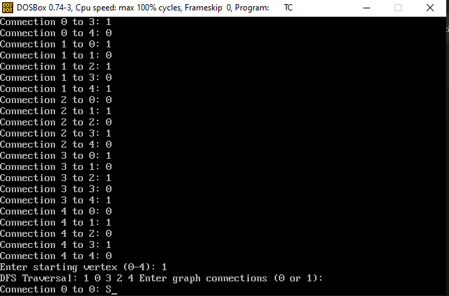

<div align = "center">

<a href="https://ibb.co/0y4jv78d" align="center"></a>
</div>


<p>
    <span style="float:left;">
        <h3> DSA Experiment 7
    </span>
    <span style="float:right; text-align:right;"> 
        Name: Dev Mandora<br>
        Roll Number: 62 <br>
        Batch: SB4</h3>
    </span>
</p>
          
### AIM
Implementation of any one Graph Traversal Technique for real-world application.

### OBJECTIVE
- To understand graph representation using an adjacency matrix.
- To implement Depth First Search (DFS).
- To apply DFS to a real-world temperature monitoring system.

### SOFTWARE USED
- Turbo C / Turbo C++
- DOSBox

### THEORY
A **Graph** is a non-linear data structure consisting of vertices (nodes) and edges (connections).

**Depth First Search (DFS)** is a graph traversal technique that visits a node and explores its unvisited adjacent nodes as deeply as possible before backtracking.

Graphs are used in network traversal, path finding, and temperature monitoring across connected weather stations.

## Program 1: Real-World Use Case – Temperature Monitoring Using DFS

This program represents weather stations as vertices and connections between stations as edges. It uses DFS to visit connected stations and classify their temperatures into normal, high, and critical heat alert levels. This is a rule-based demonstration only

### CODE

```c
#include <stdio.h>
#include <conio.h>

#define N 5

int graph[N][N];
int visited[N];
int temperature[N];

void DFS(int station)
{
    int i;

    visited[station] = 1;

    printf("\nStation %d - Temperature: %d C - ",
           station, temperature[station]);

    if(temperature[station] >= 45)
        printf("Red Alert");
    else if(temperature[station] >= 43)
        printf("Orange Alert");
    else if(temperature[station] >= 40)
        printf("Yellow Alert");
    else
        printf("Normal");

    for(i = 0; i < N; i++)
    {
        if(graph[station][i] == 1 && visited[i] == 0)
            DFS(i);
    }
}

void main()
{
    int i, j, start;

    printf("Enter connections between 5 stations (0 or 1):\n");

    for(i = 0; i < N; i++)
    {
        for(j = 0; j < N; j++)
        {
            printf("Connection %d to %d: ", i, j);
            scanf("%d", &graph[i][j]);
        }
    }

    printf("\nEnter temperature of each station:\n");

    for(i = 0; i < N; i++)
    {
        printf("Temperature at station %d: ", i);
        scanf("%d", &temperature[i]);
    }

    printf("\nEnter starting station (0-4): ");
    scanf("%d", &start);

    if(start < 0 || start >= N)
    {
        printf("Invalid station.");
        getch();
        return;
    }

    for(i = 0; i < N; i++)
        visited[i] = 0;

    printf("\nDFS Temperature Monitoring Report:\n");
    DFS(start);

    getch();
}
````

###  OUTPUT
 
 


Note: The connection matrix must be entered so that the stations are connected. For an undirected graph, enter matching values for `Connection i to j` and `Connection j to i`.

## Program 2: Basic Graph Traversal Using DFS

### CODE

```c
#include <stdio.h>
#include <conio.h>

#define N 5

int graph[N][N];
int visited[N];

void DFS(int vertex)
{
    int i;

    visited[vertex] = 1;
    printf("%d ", vertex);

    for(i = 0; i < N; i++)
    {
        if(graph[vertex][i] == 1 && visited[i] == 0)
            DFS(i);
    }
}

void main()
{
    int i, j, start;

    printf("Enter graph connections (0 or 1):\n");

    for(i = 0; i < N; i++)
    {
        for(j = 0; j < N; j++)
        {
            printf("Connection %d to %d: ", i, j);
            scanf("%d", &graph[i][j]);
        }
    }

    printf("Enter starting vertex (0-4): ");
    scanf("%d", &start);

    if(start < 0 || start >= N)
    {
        printf("Invalid vertex.");
        getch();
        return;
    }

    for(i = 0; i < N; i++)
        visited[i] = 0;

    printf("DFS Traversal: ");
    DFS(start);

    getch();
}
```

###  OUTPUT
 
 
> [!check] input values alternative of 0 and 1 and so on


### OUTCOME

Depth First Search was implemented using an adjacency matrix to traverse a graph. A temperature monitoring application was also demonstrated by classifying temperatures at connected weather stations.

### CONCLUSION

Thus, Depth First Search was implemented successfully and applied to a real-world temperature monitoring scenario.