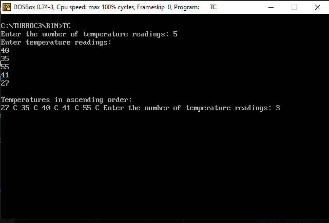
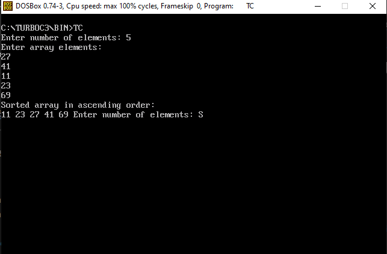

<div align = "center">

<a href="https://ibb.co/0y4jv78d" align="center"></a>
</div>


<p>
    <span style="float:left;">
        <h3> DSA Experiment 8
    </span>
    <span style="float:right; text-align:right;"> 
        Name: Dev Mandora<br>
        Roll Number: 62 <br>
        Batch: SB4</h3>
    </span>
</p>


### AIM
Implementation of any one Sorting Technique considering a real-world application.

### OBJECTIVE
- To understand the concept of sorting.
- To implement Bubble Sort in C.
- To arrange data in ascending order.
- To demonstrate sorting using a real-world temperature monitoring use case.

### SOFTWARE USED
- Turbo C / Turbo C++
- DOSBox

### THEORY
Sorting is the process of arranging data in a particular order.

**Bubble Sort** is a sorting technique that compares adjacent elements and swaps them if they are in the wrong order. This process repeats until the elements are sorted.


Bubble Sort is used for arranging marks, temperatures, prices, and other numerical data.

## Program 1: AI Use Case – Temperature Data Sorting

This program accepts temperature readings from the user and sorts them in ascending order using Bubble Sort. It helps arrange weather station temperatures from lowest to highest for easier analysis. This is a sorting demonstration, not a trained AI model.

### CODE

```c
#include <stdio.h>
#include <conio.h>

void main()
{
    int n, i, j, temp;
    int arr[100];

    printf("Enter the number of temperature readings: ");
    scanf("%d", &n);

    if(n < 1 || n > 100)
    {
        printf("Invalid number of readings.");
        getch();
        return;
    }

    printf("Enter temperature readings:\n");

    for(i = 0; i < n; i++)
        scanf("%d", &arr[i]);

    for(i = 0; i < n - 1; i++)
    {
        for(j = 0; j < n - i - 1; j++)
        {
            if(arr[j] > arr[j + 1])
            {
                temp = arr[j];
                arr[j] = arr[j + 1];
                arr[j + 1] = temp;
            }
        }
    }

    printf("\nTemperatures in ascending order:\n");

    for(i = 0; i < n; i++)
        printf("%d C ", arr[i]);

    getch();
}
````

###  OUTPUT

 

## Program 2: Basic Bubble Sort

### CODE

```c
#include <stdio.h>
#include <conio.h>

void main()
{
    int n, i, j, temp;
    int arr[100];

    printf("Enter number of elements: ");
    scanf("%d", &n);

    if(n < 1 || n > 100)
    {
        printf("Invalid number of elements.");
        getch();
        return;
    }

    printf("Enter array elements:\n");

    for(i = 0; i < n; i++)
        scanf("%d", &arr[i]);

    for(i = 0; i < n - 1; i++)
    {
        for(j = 0; j < n - i - 1; j++)
        {
            if(arr[j] > arr[j + 1])
            {
                temp = arr[j];
                arr[j] = arr[j + 1];
                arr[j + 1] = temp;
            }
        }
    }

    printf("Sorted array in ascending order:\n");

    for(i = 0; i < n; i++)
        printf("%d ", arr[i]);

    getch();
}
```

###  OUTPUT
 

### OUTCOME

Bubble Sort was implemented successfully in C to arrange numerical data in ascending order. A temperature monitoring use case was also demonstrated by sorting temperature readings.

### CONCLUSION

Thus, Bubble Sort was implemented successfully and applied to a real-world temperature data sorting scenario.