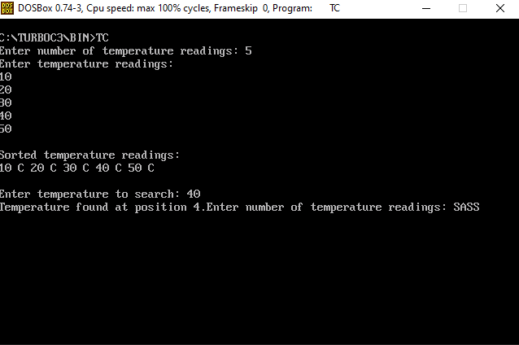
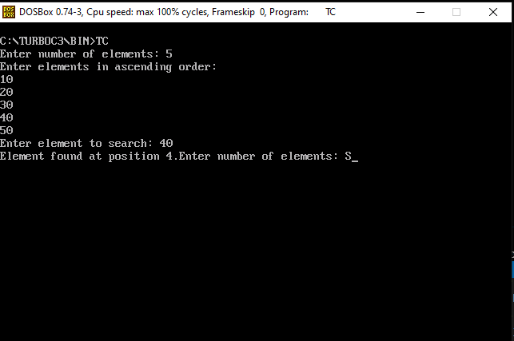

<div align = "center">

<a href="https://ibb.co/0y4jv78d" align="center"></a>
</div>


<p>
    <span style="float:left;">
        <h3> DSA Experiment 9
    </span>
    <span style="float:right; text-align:right;"> 
        Name: Dev Mandora<br>
        Roll Number: 62 <br>
        Batch: SB4</h3>
    </span>
</p>
          
### AIM
To implement Binary Search Technique considering a real-world application.

### OBJECTIVE
- To understand the Binary Search technique.
- To search for an element in a sorted array.
- To implement Binary Search using C.
- To demonstrate searching in a real-world temperature monitoring application.

### SOFTWARE USED
Turbo C / Turbo C++ and DOSBox.

### THEORY
Binary Search is a searching technique used to find an element in a sorted array. It compares the target value with the middle element and repeatedly reduces the search range by half.

**Steps:**
1. Find the middle element of the sorted array.
2. If the middle element matches the target, the search is successful.
3. If the target is smaller, search the left half.
4. If the target is greater, search the right half.
5. Repeat until the element is found or the search range becomes empty.

**Time Complexity:** O(log n)

---

### PROGRAM 1: Real-World Application – Temperature Monitoring

This program searches for a particular temperature reading in a sorted list using Binary Search. It is a basic rule-based demonstration, not trained AI.

#### CODE

```c
#include <stdio.h>
#include <conio.h>

void main()
{
    int arr[100], n, i, j, temp;
    int key, low, high, mid, found = 0;

    printf("Enter number of temperature readings: ");
    scanf("%d", &n);

    if(n < 1 || n > 100)
    {
        printf("Invalid number of readings.");
        getch();
        return;
    }

    printf("Enter temperature readings:\n");

    for(i = 0; i < n; i++)
        scanf("%d", &arr[i]);

    /* Sort temperatures in ascending order */
    for(i = 0; i < n - 1; i++)
    {
        for(j = 0; j < n - i - 1; j++)
        {
            if(arr[j] > arr[j + 1])
            {
                temp = arr[j];
                arr[j] = arr[j + 1];
                arr[j + 1] = temp;
            }
        }
    }

    printf("\nSorted temperature readings:\n");

    for(i = 0; i < n; i++)
        printf("%d C ", arr[i]);

    printf("\n\nEnter temperature to search: ");
    scanf("%d", &key);

    low = 0;
    high = n - 1;

    while(low <= high)
    {
        mid = (low + high) / 2;

        if(arr[mid] == key)
        {
            found = 1;
            break;
        }
        else if(key < arr[mid])
            high = mid - 1;
        else
            low = mid + 1;
    }

    if(found == 1)
        printf("Temperature found at position %d.", mid + 1);
    else
        printf("Temperature not found.");

    getch();
}
````

####  OUTPUT

 

### PROGRAM 2: Basic Binary Search

#### CODE

```c
#include <stdio.h>
#include <conio.h>

void main()
{
    int arr[100], n, i;
    int key, low, high, mid, found = 0;

    printf("Enter number of elements: ");
    scanf("%d", &n);

    if(n < 1 || n > 100)
    {
        printf("Invalid number of elements.");
        getch();
        return;
    }

    printf("Enter elements in ascending order:\n");

    for(i = 0; i < n; i++)
        scanf("%d", &arr[i]);

    printf("Enter element to search: ");
    scanf("%d", &key);

    low = 0;
    high = n - 1;

    while(low <= high)
    {
        mid = (low + high) / 2;

        if(arr[mid] == key)
        {
            found = 1;
            break;
        }
        else if(key < arr[mid])
            high = mid - 1;
        else
            low = mid + 1;
    }

    if(found == 1)
        printf("Element found at position %d.", mid + 1);
    else
        printf("Element not found.");

    getch();
}
```

####  OUTPUT

 

### OUTCOME

Binary Search was implemented successfully to search for an element in a sorted array.

### CONCLUSION

Binary Search efficiently searches sorted data by repeatedly dividing the search range into two halves.