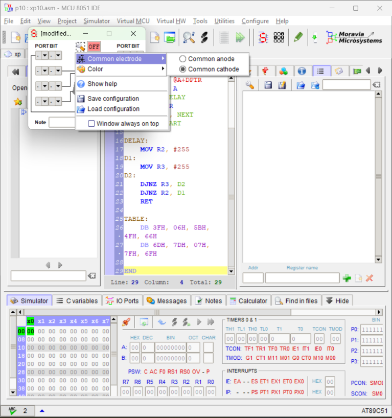
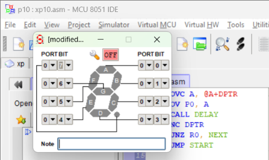
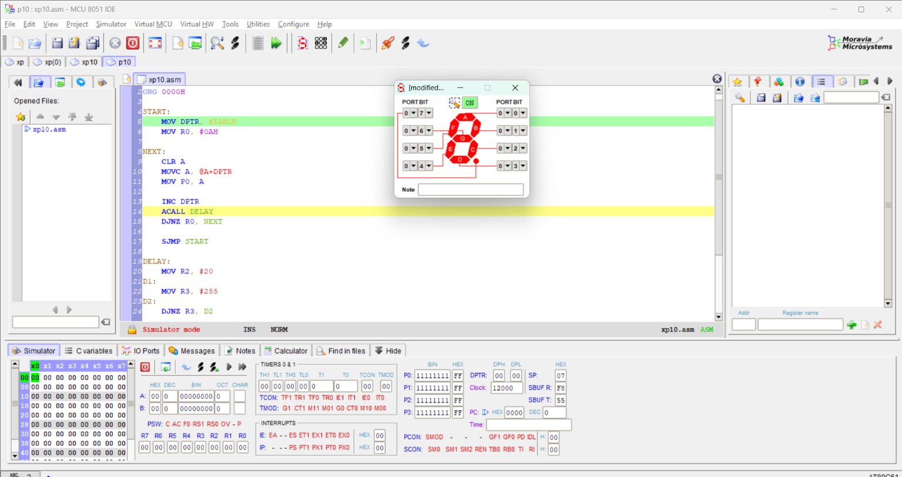
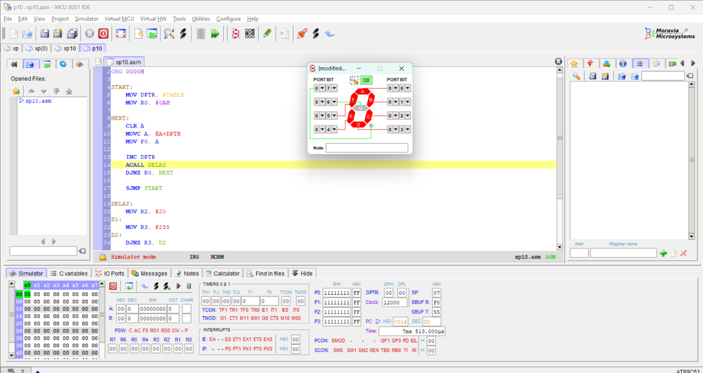
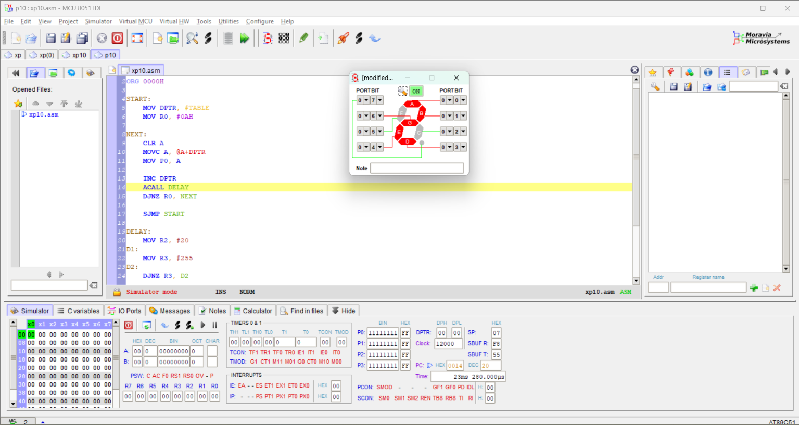
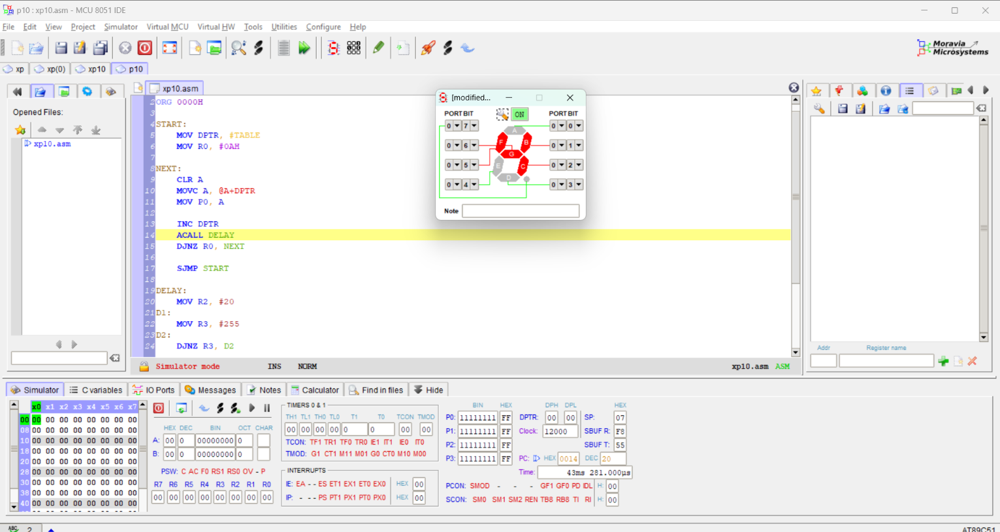
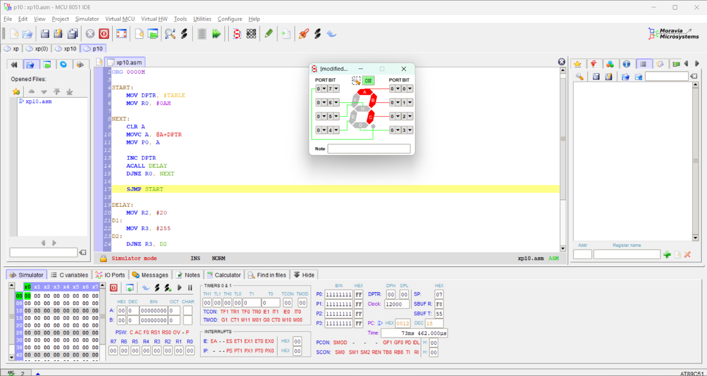
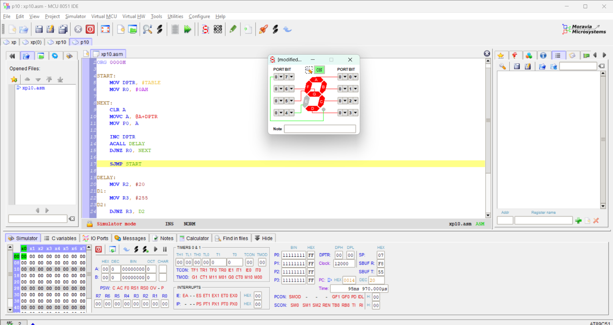

<div align = "center">

<a href="https://ibb.co/0y4jv78d" align="center"></a>
</div>
<div align="center"> <b>
<u>DEPARTMENT OF INFORMATION TECHNOLOGY</u>

Course: Microprocessor and Microcontroller Lab (ITL304)
 B.Tech. (Information Technology) – Semester III
Academic Year: 2026-27 (ODD Semester) </b>
</div>

<p>
    <span style="float:left;">
        <h3> MPMC Experiment 10
    </span>
    <span style="float:right; text-align:right;"> 
        Name: Dev Mandora<br>
        Roll Number: 62 <br>
        Batch: SB4</h3>
    </span>
</p>

<br clear="both">

Name: Dev Mandora  
Roll Number: 62  
Batch: SB4

</div>

### AIM

Interfacing of Seven Segment Display with the 8051 Microcontroller using Assembly Language Programming.

### SOFTWARE REQUIREMENT

-   8051 MCU IDE
    
-   AT89C51 Microcontroller Simulator
    

## THEORY

A seven-segment display is commonly used in electronic devices to display decimal numbers from 0 to 9 and some basic characters. It consists of seven LED segments arranged to form digits.

There are two types of seven-segment displays:

1.  Common Anode
    
2.  Common Cathode
    

In a common anode display, all positive terminals are connected together. In a common cathode display, all negative terminals are connected together.

The 8051 sends hexadecimal codes to the output port to turn the required segments ON or OFF.

## ALGORITHM

1.  Start the program.
    
2.  Initialize the counter to count hexadecimal numbers.
    
3.  Load the data pointer with the starting address of the lookup table.
    
4.  Clear the accumulator.
    
5.  Get a hexadecimal code from the lookup table into the accumulator.
    
6.  Send the hexadecimal code to Port 0 and point to the next byte.
    
7.  Give a small delay.
    
8.  Decrement the counter. If it is not zero, repeat from Step 4; otherwise, repeat the process.
    
## PROCEDURE

### Step 1: Open the project

1.  Open 8051 MCU IDE.
    
2.  Click Project → New Project.
    
3.  Enter the project name as `Seven Segment`.
    
4.  Select a folder where you want to save the project.
    
5.  Select the processor type as `AT89C51`.
    
6.  Finish creating the project and open the assembly source editor.
    

### Step 2: Enter the program

1.  Create or open the assembly source file.
    
2.  Type the assembly program provided below.
    
3.  Save the file as `p10.asm`.
    

### Step 3: Configure the seven-segment display

Follow these settings in the virtual hardware window.


1. Open the display

Click Virtual HW → LED Display from the top menu. A small seven-segment display configuration window should appear.

 
2. Configure the pins

In the settings window, select Common Cathode. Set the segment connections to Port 0 using the following mapping:

| Segment | PORT | BIT |
| --- | --- | --- |
| A   | 0   | 0   |
| B   | 0   | 1   |
| C   | 0   | 2   |
| D   | 0   | 3   |
| E   | 0   | 4   |
| F   | 0   | 5   |
| G   | 0   | 6   |
| DP  | 0   | 7   |

Your program writes the segment code to Port 0, so the mapping must match these settings.

 

3. Enable the display

Click the ON button in the display window. Keep the window open so you can see the digits when the program runs.

### Step 4: Compile and simulate

1.  Compile the program: Click the compile/assemble option in the IDE. Check the Messages or output panel. Make sure it reports `0 errors`.
    
2.  Reset the microcontroller: Stop the simulation if it is running, then reset the device.
    
3.  Start execution: Use the simulator's Run control to execute the program.
    
4.  Observe the display: The seven-segment display should show digits from `0` to `9` in sequence, then repeat.
    
5.  Open code memory: Go to Virtual MCU → Show Code Memory. Look for the hexadecimal values stored in the lookup table: `3F`, `06`, `5B`, `4F`, `66`, `6D`, `7D`, `07`, `7F`, and `6F`.
    
6.  Use step-by-step execution: Select the step-by-step execution control and execute instructions one at a time. Observe the Program Counter (PC) as it advances through the instructions.
    
7.  Run continuously: Start continuous execution again and verify that the display repeatedly counts from `0` to `9`.
    

Note: The dropdown order and menu names may vary slightly with your IDE version. If the digits appear incorrectly, check the segment-to-bit mapping first.

## PROGRAM

```
ORG 0000H

START:
    MOV DPTR, #TABLE
    MOV R0, #0AH

NEXT:
    CLR A
    MOVC A, @A+DPTR
    MOV P0, A
    ACALL DELAY
    INC DPTR
    DJNZ R0, NEXT
    SJMP START

DELAY:
    MOV R2, #255
D1:
    MOV R3, #255
D2:
    DJNZ R3, D2
    DJNZ R2, D1
    RET

TABLE:
    DB 3FH, 06H, 5BH, 4FH, 66H
    DB 6DH, 7DH, 07H, 7FH, 6FH

END
```

## OUTPUT

The common-cathode seven-segment display repeatedly displays the digits from 0 to 9.
***
> before run
 

>after run


> after 20s   
 
 > after 40s
> 
 
> after 90s  

> [!check] each digit is shown for about 10s~

***
## OUTCOME

The seven-segment display was interfaced with the 8051 microcontroller using Assembly Language Programming in 8051 MCU IDE.

## CONCLUSION

Thus, the interfacing of a seven-segment display with the 8051 microcontroller was implemented using Assembly Language Programming.