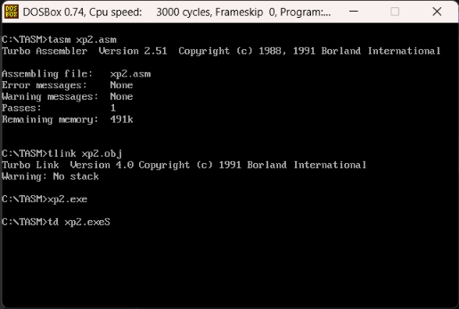
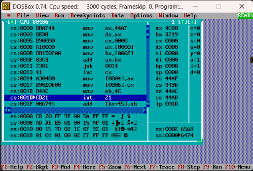
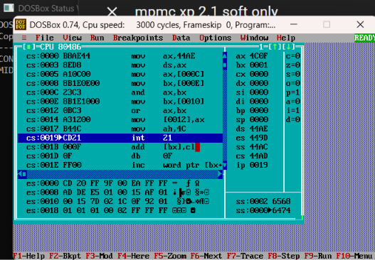
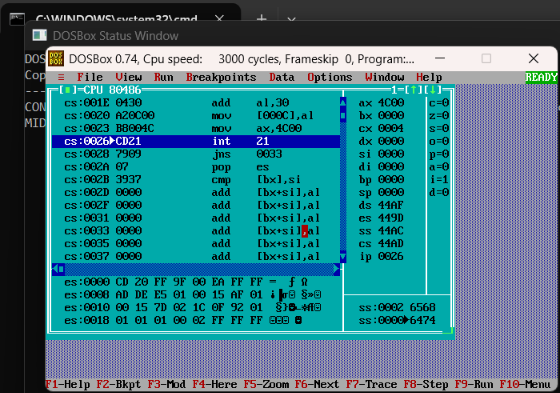

<p align="center">

<a href="https://ibb.co/0y4jv78d"></a>

<p>
    <span style="float:left;">
        <h3>MPMC Experiment 2.1
    </span>
    <span style="float:right; text-align:right;"> 
        Name: Dev  Mandora<br>
        Roll Number: 62 <br>
        Batch: SB4</h3>
    </span>
</p>

<br clear="both">

### Aim:

Implementation of arithmetic and logical operations using assembly language programme.

### Lab Objective:

a) Program to perform arithmetic operations on 16-bit data.

b) Program to evaluate a given logical expression.

c) Convert two-digit packed BCD to unpacked BCD.

### Theory:

#### Arithmetic Operations in 8086:

-   The 8086 microprocessor performs arithmetic operations using instructions like ADD, ADC, SUB, SBB, INC, DEC, MUL and DIV.
    
-   Arithmetic operations can be performed using registers, memory locations and immediate values.
    

#### Logical Operations in 8086:

-   Logical operations are performed using instructions like AND, OR, XOR and NOT.
    
-   These instructions perform bitwise operations on binary data.
    

#### Packed BCD to Unpacked BCD:

-   Packed BCD stores two decimal digits in one byte.
    
-   Unpacked BCD stores each decimal digit separately in a byte.
    
-   Logical operations and rotation instructions can be used to separate the two digits.
    

***

### Program 1: 16-bit Hexadecimal Addition

Two 16-bit hexadecimal numbers are added, and the carry is stored separately.

#### Calculation:

```
   4567H
+  3219H
--------
   7780H
```

#### Program:

```
.model small

.data
a dw 4567H
b dw 3219H
c dw 0000H
d dw 0000H

.code
start:
    mov ax,@data
    mov ds,ax

    mov cx,0000H

    mov ax,a
    mov bx,b
    add ax,bx

    jnc teleport
    inc cx

teleport:
    mov c,ax
    mov d,cx

    mov ah,4CH
    int 21H

end start
```

#### Output:
 
 

***

### Program 2: Evaluation of Logical Expression

The logical expression **(A AND B) OR C** is evaluated using the AND and OR instructions.

#### Program:

```
.model small

.data
a dw 0F0FH
b dw 00FFH
c dw 0001H
result dw 0000H

.code
start:
    mov ax,@data
    mov ds,ax

    mov ax,a
    mov bx,b
    and ax,bx

    mov bx,c
    or ax,bx

    mov result,ax

    mov ah,4CH
    int 21H

end start
```

#### Explanation:

1.  Load the first number into AX.
    
2.  Perform the AND operation with the second number.
    
3.  Perform the OR operation with the third number.
    
4.  Store the final result in `result`.
    

#### Output:

 

***

### Program 3: Packed BCD to Unpacked BCD

Packed BCD stores two decimal digits in one byte. For packed BCD `79H`, the lower digit is `09H` and the higher digit is `07H`.

The ROL instruction rotates the higher nibble into the lower nibble position. Adding `30H` converts each digit into its ASCII representation.

#### Program:

```
.model small

.data
pbcd db 79H
dig1 db ?
dig2 db ?
asc1 db ?
asc2 db ?

.code
start:
    mov ax,@data
    mov ds,ax

    mov al,pbcd
    and al,0FH
    mov dig1,al
    add al,30H
    mov asc1,al

    mov al,pbcd
    and al,0F0H
    mov cl,04H
    rol al,cl
    mov dig2,al
    add al,30H
    mov asc2,al

    mov ax,4C00H
    int 21H

end start
```

#### Explanation:

1.  Load the packed BCD value into AL.
    
2.  Use AND with `0FH` to extract the lower digit.
    
3.  Use AND with `0F0H` and ROL to extract the higher digit.
    
4.  Store both digits separately.
    
5.  Add `30H` to obtain their ASCII values.
    

#### Output:

 

***

### Outcome:

The required 16-bit arithmetic operation, logical expression evaluation and packed BCD to unpacked BCD conversion were performed using 8086 Assembly Language.

### Conclusion:

Thus, the 8086 assembly language programs successfully demonstrated arithmetic operations on 16-bit data, logical operations and conversion of two-digit packed BCD into unpacked BCD.
