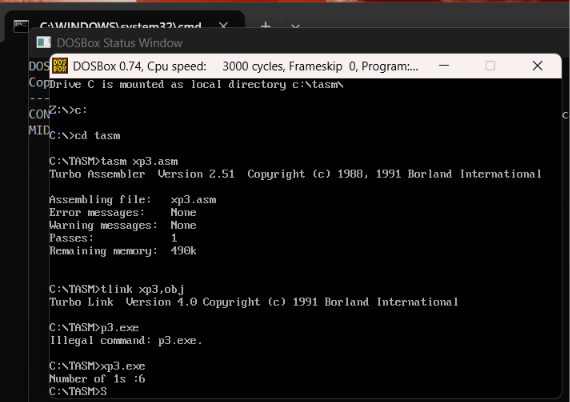
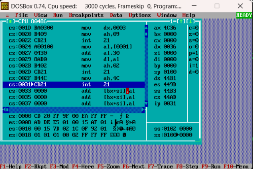
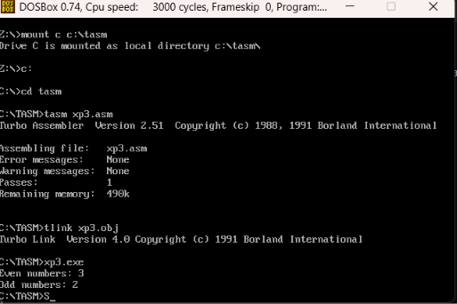
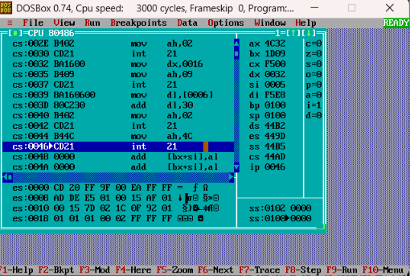
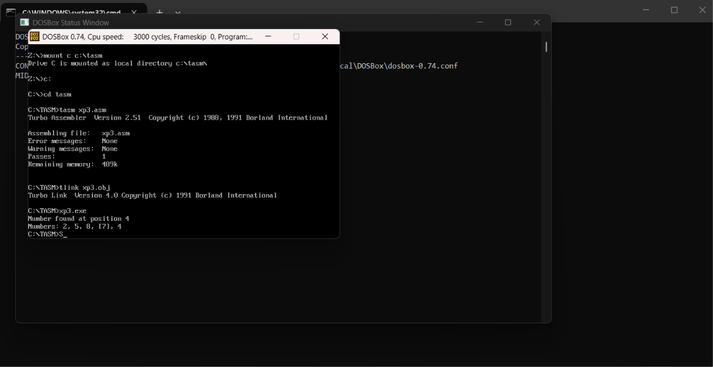
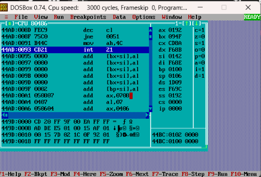

<p align="center">

<a href="https://ibb.co/0y4jv78d"></a>

<p>
    <span style="float:left;">
        <h3>MPMC Experiment 3.1
    </span>
    <span style="float:right; text-align:right;"> 
        Name: Dev Mandora<br>
        Roll Number: 62 <br>
        Batch: SB4</h3>
    </span>
</p>

<br clear="both">

### Aim:

To implement loop operations using Assembly Language Programming.

### Lab Objective:

b) Program to count the number of 1s and 0s in a given 8-bit number.

c) Program to find even and odd numbers from a given list.

d) Program to search for a given number.


### Program 1: Count Number of 1s and 0s in an 8-bit Number

We take the 8-bit number `F3H` and count the number of 1s and 0s in its binary representation.

Example:

```
F3H = 11110011B

Number of 1s = 6
Number of 0s = 2
```

#### Program:

```
.model small
.stack 100h

.data
    num db 0F3h
    ones db 0
    zeros db 0
    msg1 db 'Number of 1s: $'
    msg0 db 13,10,'Number of 0s: $'

.code
main:
    mov ax,@data
    mov ds,ax

    mov al,num
    mov cl,8
    clc

count_loop:
    rcr al,1
    jc is_one

    inc zeros
    jmp next_bit

is_one:
    inc ones

next_bit:
    dec cl
    jnz count_loop

    mov dx,offset msg1
    mov ah,09h
    int 21h

    mov dl,ones
    add dl,'0'
    mov ah,02h
    int 21h

    mov dx,offset msg0
    mov ah,09h
    int 21h

    mov dl,zeros
    add dl,'0'
    mov ah,02h
    int 21h

    mov ah,4Ch
    int 21h

end main
```

### Program Explanation:

-   `MOV AL,num` loads the 8-bit number into AL.
    
-   `MOV CL,8` sets the loop counter to 8.
    
-   `RCR AL,1` rotates the number through the Carry Flag.
    
-   `JC is_one` checks whether the current bit is 1.
    
-   `INC ones` increases the count of 1s.
    
-   `INC zeros` increases the count of 0s.
    
-   `DEC CL` decreases the loop counter.
    
-   `JNZ count_loop` repeats the process until all 8 bits are checked.
    
-   The counts of 1s and 0s are displayed.
    

### Output:

```
Number of 1s: 6
Number of 0s: 2
```
> [!attention] The above is expected output, but tasm didnt print the 2nd line, tried different approach
> 
 
 

***

### Program 2: Find Even and Odd Numbers from a Given List

The program checks a list of five numbers and counts how many are even and odd.

Example:

```
Numbers: 2, 5, 8, 7, 4

Even numbers = 3
Odd numbers = 2
```

#### Program:

```
.model small
.stack 100h

.data
    numbers db 2,5,8,7,4
    even_count db 0
    odd_count db 0
    msg1 db 'Even numbers: $'
    msg2 db 13,10,'Odd numbers: $'

.code
main:
    mov ax,@data
    mov ds,ax

    mov si,offset numbers
    mov cl,5

check_num:
    mov al,[si]
    test al,1
    jz even_num

    inc odd_count
    jmp next_num

even_num:
    inc even_count

next_num:
    inc si
    dec cl
    jnz check_num

    mov dx,offset msg1
    mov ah,09h
    int 21h

    mov dl,even_count
    add dl,'0'
    mov ah,02h
    int 21h

    mov dx,offset msg2
    mov ah,09h
    int 21h

    mov dl,odd_count
    add dl,'0'
    mov ah,02h
    int 21h

    mov ah,4Ch
    int 21h

end main
```

### Program Explanation:

-   `MOV SI,offset numbers` points to the first number in the list.
    
-   `MOV CL,5` sets the loop counter to five numbers.
    
-   `MOV AL,[SI]` loads the current number.
    
-   `TEST AL,1` checks the last bit.
    
-   `JZ even_num` jumps if the number is even.
    
-   `INC even_count` increases the even counter.
    
-   `INC odd_count` increases the odd counter.
    
-   `INC SI` moves to the next number.
    
-   `DEC CL` and `JNZ check_num` repeat the process.
    
-   The total even and odd numbers are displayed.
    

### Output:

```
Even numbers: 3
Odd numbers: 2
```
> [!attention] For this program the tasm prints the 2nd line in output unlike previous program

 
 
***

### Program 3: Search for a Given Number

The program searches for a given number in a list of five numbers and displays its position if found. It also prints the list dynamically, highlighting the matching number in brackets.

Example:

```
Numbers: 2, 5, 8, 7, 4

Search number: 7

Number found at position 4
Numbers: 2, 5, 8, [7], 4
```

#### Program:

```
.model small
.stack 100h

.data
    numbers db 2,5,8,7,4 ; the actual array
    search_num db 7 ; number we need to find
    count db 5 
    position db 1
    found_pos db 0
    msg1 db 'Number found at position $'
    msg2 db 13,10,'Number Not Found$'
    msg3 db 13,10,'Numbers: $'
    comma db ', $'

.code
main:
    mov ax,@data
    mov ds,ax

    mov si,offset numbers
    mov cl,count
    mov al,search_num

search_loop:
    cmp al,[si]
    je found

    inc si
    inc position
    dec cl
    jnz search_loop

    mov dx,offset msg2
    mov ah,09h
    int 21h
    jmp exitprog

found:
    mov al,position
    mov found_pos,al

    mov dx,offset msg1
    mov ah,09h
    int 21h

    mov dl,found_pos
    add dl,'0'
    mov ah,02h
    int 21h

    mov dx,offset msg3
    mov ah,09h
    int 21h

    mov si,offset numbers
    mov cl,count
    mov position,1

print_loop:
    mov al,position
    cmp al,found_pos
    jne print_number

    mov dl,'['
    mov ah,02h
    int 21h

print_number:
    mov dl,[si]
    add dl,'0'
    mov ah,02h
    int 21h

    mov al,position
    cmp al,found_pos
    jne next_print

    mov dl,']'
    mov ah,02h
    int 21h

next_print:
    mov al,position
    cmp al,count
    je finish_print

    mov dx,offset comma
    mov ah,09h
    int 21h

finish_print:
    inc si
    inc position
    dec cl
    jnz print_loop

exitprog:
    mov ah,4Ch
    int 21h

end main
```

### Program Explanation:

-   `MOV SI,offset numbers` points to the first number.
    
-   `MOV CL,count` sets the number of elements to check.
    
-   `MOV AL,search_num` loads the number to be searched.
    
-   `CMP AL,[SI]` compares the search number with the current list element.
    
-   `JE found` jumps if the number matches.
    
-   `INC SI` moves to the next element.
    
-   `INC position` increases the position counter.
    
-   `DEC CL` decreases the loop counter.
    
-   `JNZ search_loop` repeats the search while elements remain.
    
-   `MOV found_pos,AL` stores the position where the number was found.
    
-   `print_loop` prints each number from the array.
    
-   Brackets are printed around the matching element using `found_pos`.
    
-   If the number is not found, the program displays `Number Not Found`.
    

### Output:

```
Number found at position 4
Numbers: 2, 5, 8, [7], 4
```


 
 
***

### Outcome:

The required loop operations were successfully implemented using 8086 Assembly Language to count the number of 1s and 0s in an 8-bit number, find even and odd numbers from a list, and search for a given number.

### Conclusion:

Thus, the experiment successfully demonstrated loop operations, conditional jumps, bit manipulation, number classification and linear searching using 8086 Assembly Language.

