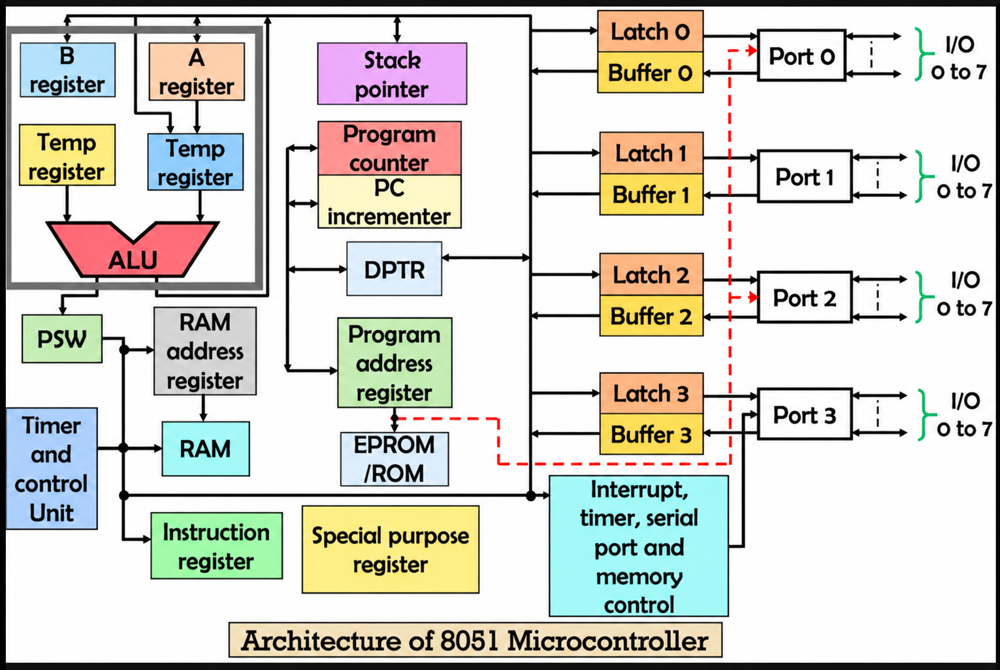
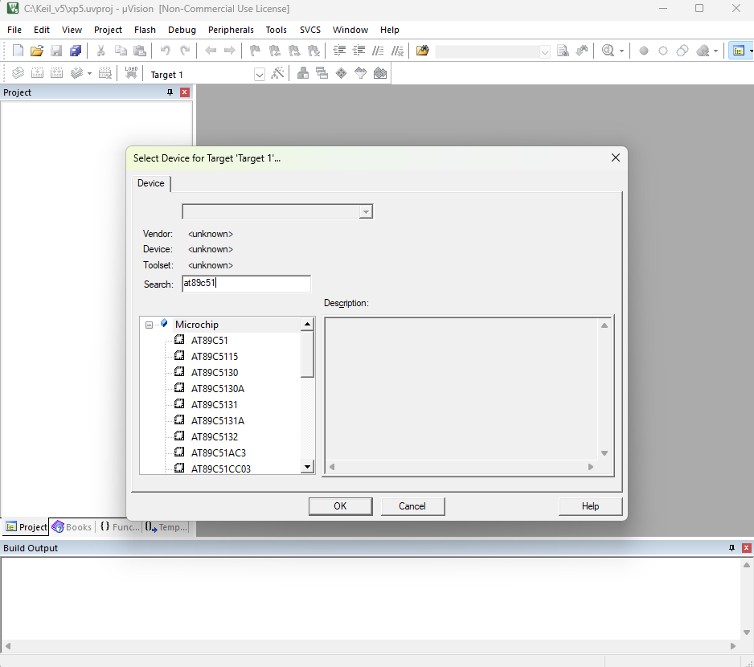
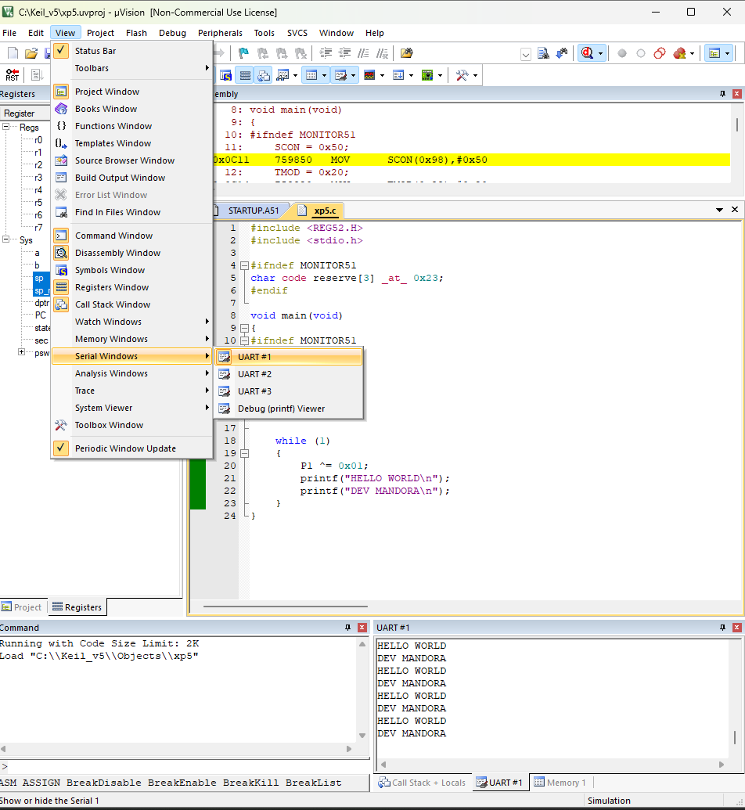
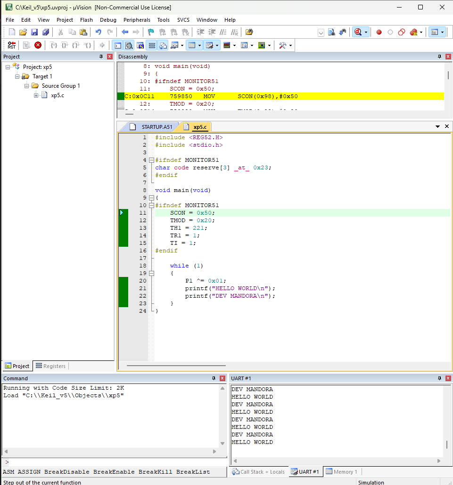

<div align = "center">

<a href="https://ibb.co/0y4jv78d" align="center"></a>
</div>
<div align="center"> <b>
<u>DEPARTMENT OF INFORMATION TECHNOLOGY</u>

Course: Microprocessor and Microcontroller Lab (ITL304)
 B.Tech. (Information Technology) – Semester III
Academic Year: 2026-27 (ODD Semester) </b>
</div>

<p>
    <span style="float:left;">
        <h3> MPMC Experiment 5
    </span>
    <span style="float:right; text-align:right;"> 
        Name: Dev Mandora<br>
        Roll Number: 62 <br>
        Batch: SB4</h3>
    </span>
</p>

<br clear="both">

### AIM

Simulation of selected instructions to understand the addressing modes and instruction set of 8051 Microcontroller.

### OBJECTIVE

To simulate an 8051 microcontroller program in Keil µVision 5, display messages through UART serial communication, and observe the toggling of Port 1 bit 0.

### SOFTWARE REQUIREMENT

-   Keil µVision 5
    
-   8051/8052 microcontroller simulation environment
    

## THEORY

The 8051 is an 8-bit microcontroller consisting of a CPU, memory, timers, serial communication interface, and input/output ports.
  
UART (Universal Asynchronous Receiver/Transmitter) is used for serial communication. Timer 1 generates the baud-rate timing required for UART communication.

The `printf()` function sends messages to the serial terminal, while `P1 ^= 0x01` toggles bit 0 of Port 1.

## ALGORITHM

1.  Start the program.
    
2.  Initialize UART serial communication.
    
3.  Configure Timer 1 in Mode 2.
    
4.  Load the timer reload value and start Timer 1.
    
5.  Set the transmit flag.
    
6.  Toggle Port 1 bit 0.
    
7.  Display "HELLO WORLD" and the programmer's name through UART.
    
8.  Repeat the process continuously.
    

## PROCEDURE
 
> [!abstract] DEVICE NAME (IN MICROCHIP)
> ```AT89C51```


### Step 1: Open the project

1.  Open Keil µVision 5.
    
2.  Open the existing 8051 project.
    
3.  Expand Target 1 in the Project window.
    
4.  Expand Source Group 1.
    
5.  Double-click the C source file containing the program.
    

### Step 2: Enter the program

1.  Open the C source file.
    
2.  Enter the program given below.
    
3.  Replace the existing program if required.
    
4.  Save the file using `Ctrl + S`.
    

### Step 3: Build the project

1.  Click Project → Build Target.
    
2.  Alternatively, press `F7`.
    
3.  Check the Build Output window.
    
4.  Ensure that the program compiles without errors.
    

### Step 4: Start the debugger

1.  Click Debug → Start/Stop Debug Session.
    
2.  Alternatively, press `Ctrl + F5`.
    
3.  Wait for the debugger window to open.
    

### Step 5: Open the serial terminal

1.  Open the UART #1 serial window in the debugger.
    
2.  If it is not visible, check the View menu.
    
3.  Keep the serial terminal open to observe the output.
     

### Step 6: Run the program

1.  Click Run or press `F5`.
    
2.  Observe the UART serial terminal.
    
3.  The messages should appear repeatedly.
    
4.  Click Stop to stop program execution.
    

### Step 7: Observe Port 1

1.  Open the Peripherals menu.
    
2.  Select I/O Ports → Port 1.
    
3.  Observe bit `P1.0`.
    
4.  Verify that it changes state during execution.
    

## PROGRAM

```c
#include <REG52.H>
#include <stdio.h>

#ifndef MONITOR51
char code reserve[3] _at_ 0x23;
#endif

void main(void)
{
#ifndef MONITOR51
    SCON = 0x50;
    TMOD = 0x20;
    TH1 = 221;
    TR1 = 1;
    TI = 1;
#endif

    while (1)
    {
        P1 ^= 0x01;
        printf("HELLO WORLD\n");
        printf("DEV MANDORA\n");
    }
}
```

##  OUTPUT

The UART #1 serial terminal displays:

 


Port 1 bit 0 (`P1.0`) toggles repeatedly while the program runs.

## OUTCOME

The 8051 microcontroller program was simulated using Keil µVision 5. UART serial communication was used to display messages repeatedly, and Port 1 bit 0 was toggled during execution.

## CONCLUSION

The simulation of the 8051 microcontroller was performed successfully to understand instruction execution, UART serial communication, timer configuration, and Port 1 operation.

