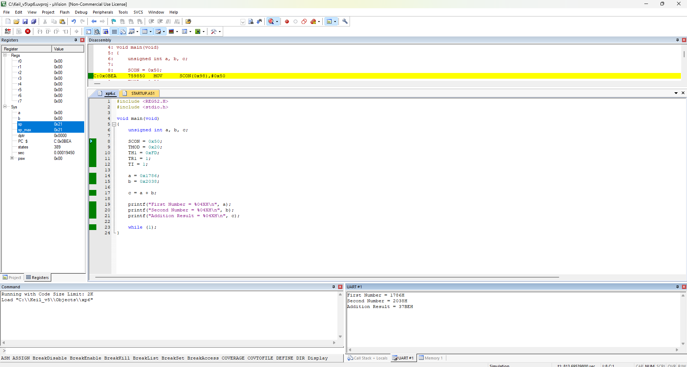
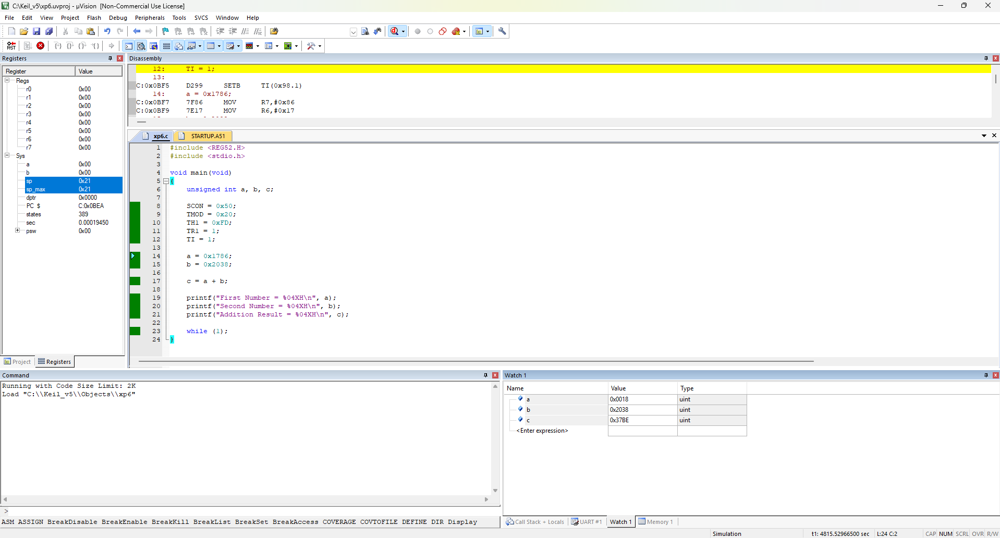
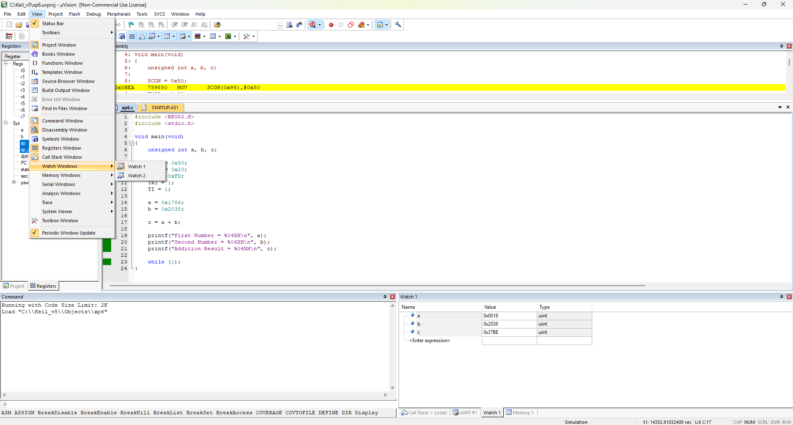
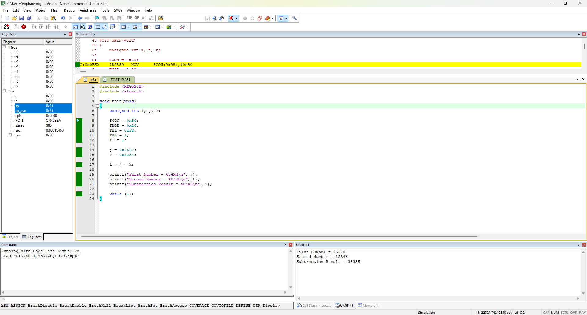
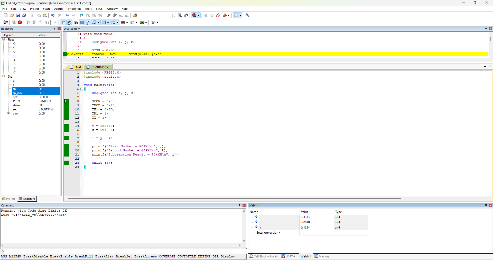
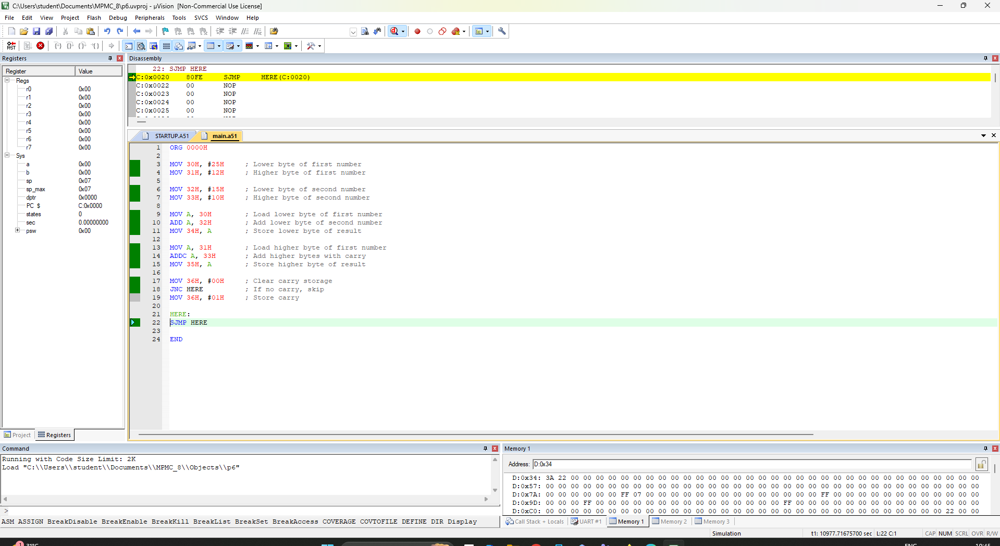
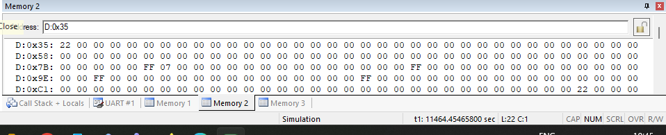
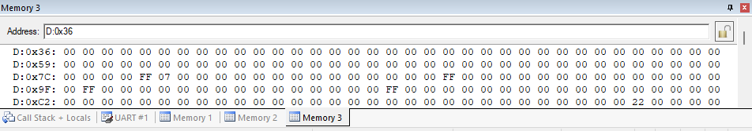

<div align = "center">

<a href="https://ibb.co/0y4jv78d" align="center"></a>
</div>
<div align="center"> <b>
<u>DEPARTMENT OF INFORMATION TECHNOLOGY</u>

Course: Microprocessor and Microcontroller Lab (ITL304)
 B.Tech. (Information Technology) – Semester III
Academic Year: 2026-27 (ODD Semester) </b>
</div>

<p>
    <span style="float:left;">
        <h3> MPMC Experiment 6
    </span>
    <span style="float:right; text-align:right;"> 
        Name: Dev Mandora<br>
        Roll Number: 62 <br>
        Batch: SB4</h3>
    </span>
</p>

<br clear="both">


## AIM

Program to perform arithmetic operations on 16-bit data.

## OBJECTIVE

To implement addition and subtraction of two 16-bit numbers using C language programming on the 8051 microcontroller and display the results through UART serial communication.

## SOFTWARE REQUIREMENT

-   Keil µVision 5
    
-   8051 microcontroller simulator (AT89C51)
    

## THEORY

The 8051 microcontroller supports arithmetic operations such as addition, subtraction, multiplication, and division.

The Carry Flag (CY), Auxiliary Carry (AC), and Overflow Flag (OV) are affected by certain arithmetic instructions. In C programming, arithmetic operators are used to perform mathematical calculations.

| Arithmetic Operation | C Operator | Example |
| --- | --- | --- |
| Addition | `+` | `z = x + y;` |
| Subtraction | `-` | `p = q - r;` |
| Multiplication | `*` | `c = a * b;` |
| Division | `/` | `u = s / t;` |
| Modulo Division | `%` | `k = i % j;` |

UART (Universal Asynchronous Receiver/Transmitter) is used for serial communication. Timer 1 generates the baud-rate timing required for UART communication. The `printf()` function is used to display the calculated results in the serial terminal.

## PROCEDURE

### Step 1: Open Keil µVision 5

1.  Open Keil µVision 5.
    
2.  Create a new project.
    
3.  Select the target device.
    
4.  Expand Atmel and select AT89C51.
    

### Step 2: Create a source file

1.  Click File → New.
    
2.  Enter the C program provided below.
    
3.  Save the file with a `.c` extension, for example, `exp6_add.c`.
    
4.  In the Project window, right-click Source Group 1.
    
5.  Select Add Existing Files to Group.
    
6.  Select the saved C file and click Add, then close the dialog.
    

### Step 3: Configure the project

1.  Right-click Target 1 and select Options for Target 1.
    
2.  Open the Target tab.
    
3.  Set the oscillator frequency to `11.0592 MHz`.
    
4.  Open the Output tab.
    
5.  Enable Create HEX File.
    
6.  Click OK.
    

### Step 4: Compile the program

1.  Click Project → Build Target.
    
2.  Alternatively, press `F7`.
    
3.  Check the Build Output window for errors.
    
4.  Correct any errors and rebuild the program.
    

### Step 5: Configure UART

1.  Ensure that the program initializes the serial port using `SCON`, `TMOD`, `TH1`, `TR1`, and `TI`.
    
2.  Use the UART output configuration available in your Keil project.
    
3.  Open the UART #1 serial window if supported by the selected simulator configuration.
    

### Step 6: Start debugging

1.  Click Debug → Start/Stop Debug Session.
    
2.  Confirm the settings if prompted.
    
3.  Press `F5` to run the program.
    
4.  Observe the calculated result in the UART serial terminal.
    

### Step 7: Verify the output

1.  Check the displayed input numbers and result.
    
2.  Open the Watch window if you also want to verify the values of the variables.
    
3.  Record the output in the observation table.
    

### Step 8: Stop debugging

1.  Click Debug → Start/Stop Debug Session.
    
2.  End the simulation after recording the result.
    

## PROGRAM 1: Addition of Two 16-Bit Numbers Using C

### Algorithm

1.  Start the program.
    
2.  Initialize UART serial communication.
    
3.  Declare three unsigned integer variables `a`, `b`, and `c`.
    
4.  Assign `0x1786` to `a` and `0x2038` to `b`.
    
5.  Add `a` and `b` and store the result in `c`.
    
6.  Display the input numbers and result using `printf()`.
    
7.  Stop further execution using an infinite loop.
    

### Program

```c
#include <REG52.H>
#include <stdio.h>

void main(void)
{
    unsigned int a, b, c;

    SCON = 0x50;
    TMOD = 0x20;
    TH1 = 0xFD;
    TR1 = 1;
    TI = 1;

    a = 0x1786;
    b = 0x2038;

    c = a + b;

    printf("First Number = %04XH\n", a);
    printf("Second Number = %04XH\n", b);
    printf("Addition Result = %04XH\n", c);

    while (1);
}
```

### Output

 
 


> [!attention] how to use watch window?
> 
> now in expression enter each variable u r using
## PROGRAM 2: Subtraction of Two 16-Bit Numbers Using C

### Algorithm

1.  Start the program.
    
2.  Initialize UART serial communication.
    
3.  Declare three unsigned integer variables `i`, `j`, and `k`.
    
4.  Assign `0x4567` to `j` and `0x1234` to `k`.
    
5.  Subtract `k` from `j` and store the result in `i`.
    
6.  Display the input numbers and result using `printf()`.
    
7.  Stop further execution using an infinite loop.
    

### Program

```c
#include <REG52.H>
#include <stdio.h>

void main(void)
{
    unsigned int i, j, k;

    SCON = 0x50;
    TMOD = 0x20;
    TH1 = 0xFD;
    TR1 = 1;
    TI = 1;

    j = 0x4567;
    k = 0x1234;

    i = j - k;

    printf("First Number = %04XH\n", j);
    printf("Second Number = %04XH\n", k);
    printf("Subtraction Result = %04XH\n", i);

    while (1);
}
```

### Output

 
 
## OBSERVATION TABLE

| Operation | First Number | Second Number | Result |
| --- | --- | --- | --- |
| Addition | `1786H` | `2038H` | `37BEH` |
| Subtraction | `4567H` | `1234H` | `3333H` |

## WAP to Perform Addition of Two 16-bit Numbers Using 8051 Assembly Language

### Assembly Program

```asm
ORG 0000H

MOV 30H, #25H     ; Lower byte of first number
MOV 31H, #12H     ; Higher byte of first number

MOV 32H, #15H     ; Lower byte of second number
MOV 33H, #10H     ; Higher byte of second number

MOV A, 30H        ; Load lower byte of first number
ADD A, 32H        ; Add lower byte of second number
MOV 34H, A        ; Store lower byte of result

MOV A, 31H        ; Load higher byte of first number
ADDC A, 33H       ; Add higher bytes with carry
MOV 35H, A        ; Store higher byte of result

MOV 36H, #00H     ; Clear carry storage
JNC HERE          ; If no carry, skip
MOV 36H, #01H     ; Store carry

HERE:
SJMP HERE

END
```

### Steps to Execute in Keil µVision

1.  Open Keil µVision and select Project → New µVision Project.
    
2.  Create a project and select the AT89C51 microcontroller.
    
3.  Right-click Source Group 1 and select Add New Item to Group.
    
4.  Create an Assembly source file named `main.a51`.
    
5.  Paste the program and save the file.
    
6.  Select Project → Build Target or press F7.
    
7.  Select Debug → Start/Stop Debug Session or press Ctrl+F5.
    
8.  Run the program or execute it step by step.
    
9.  Open View → Memory Windows → Memory 1 and enter `D:0x34`.
    
10.  Verify the result in internal RAM.
     

### Expected Result

The two numbers are:

-   First number: `1225H`
    
-   Second number: `1015H`
    
-   Sum: `223AH`
    

| Memory Location | Result |
| --- | --- |
| `34H` | `3AH` — lower byte |
| `35H` | `22H` — higher byte |
| `36H` | `00H` — carry |

The program adds the lower bytes first and uses `ADDC` to include any carry while adding the higher bytes.
## output
   

## RESULT

The addition and subtraction of two 16-bit numbers were performed using C language programming on the 8051 microcontroller. The results were displayed using `printf()` through UART serial communication.

## CONCLUSION

Thus, I have implemented arithmetic operations of the 8051 microcontroller using C language programming. I have successfully executed two C programs using Keil µVision 5, displayed the results through UART serial communication, and verified the outputs.

