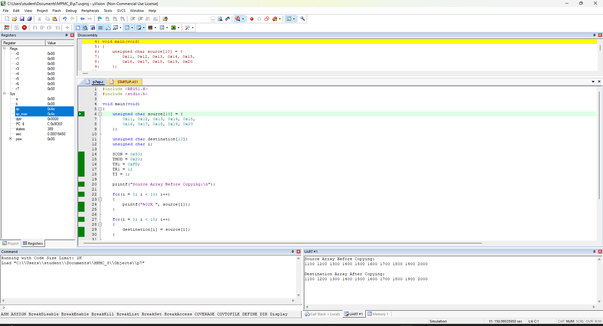
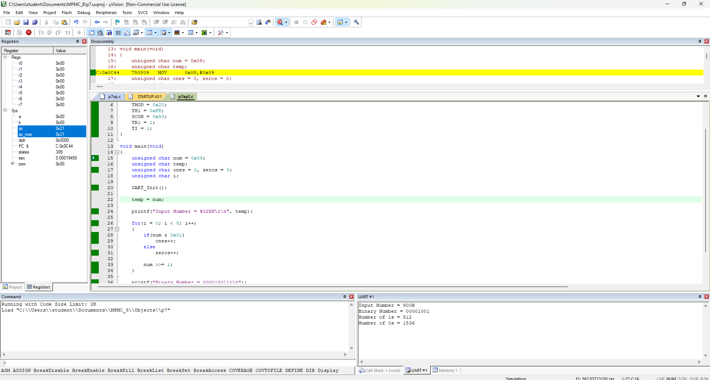

<div align = "center">

<a href="https://ibb.co/0y4jv78d" align="center"></a>
</div>
<div align="center"> <b>
<u>DEPARTMENT OF INFORMATION TECHNOLOGY</u>

Course: Microprocessor and Microcontroller Lab (ITL304)
 B.Tech. (Information Technology) – Semester III
Academic Year: 2026-27 (ODD Semester) </b>
</div>

<p>
    <span style="float:left;">
        <h3> MPMC Experiment 7
    </span>
    <span style="float:right; text-align:right;"> 
        Name: Dev Mandora<br>
        Roll Number: 62 <br>
        Batch: SB4</h3>
    </span>
</p>

<br clear="both">

## AIM

Program to implement loop operations using C language in the 8051 microcontroller.

## OBJECTIVE

1. To copy 10 bytes of data from a source array to a destination array using C.
2. To count the number of 1s and 0s in an 8-bit binary number and transmit the results through UART using C.

## SOFTWARE REQUIREMENT

- Keil µVision 5
- 8051-compatible microcontroller (AT89C51)
- C source file (.c)
- Keil simulator/debugger

## THEORY

Loops are used to perform repetitive operations efficiently. In C, a `for` loop can copy data from one array to another by accessing corresponding indexes.

An 8-bit number contains eight binary bits. Bitwise operations can check each bit and count the number of 1s and 0s. UART serial communication is used to transmit the calculated counts.

## PROCEDURE

### Step 1: Create the project

1. Open Keil µVision 5 and select **Project → New µVision Project**.
2. Select the **AT89C51** microcontroller.
3. Right-click **Source Group 1** and select **Add New Item to Group**.
4. Create a C source file named `main.c`.

### Step 2: Enter the program

Paste Program 1 or Program 2 into the source file and save it. Use separate source files or projects for each program.

### Step 3: Configure the project

1. Right-click **Target 1 → Options for Target 1**.
2. Set the oscillator frequency to `11.0592 MHz`.
3. Under the Output tab, enable **Create HEX File** if required.
4. Click OK.

### Step 4: Compile the program

1. Select **Project → Build Target** or press `F7`.
2. Check the Build Output window for errors.

### Step 5: Execute and verify

1. Select **Debug → Start/Stop Debug Session**.
2. Run the program or execute it step by step.
3. For Program 1, inspect the `source` and `destination` arrays in the Watch window.
4. For Program 2, open the UART serial window and verify the transmitted counts.
5. Stop debugging after recording the output.

## PROGRAM 1: Copy 10 Bytes from Source Array to Destination Array Using C

### Algorithm

1. Start the program.
2. Initialize the source array with 10 bytes.
3. Declare a destination array of 10 bytes.
4. Use a `for` loop to copy each source element to the corresponding destination element.
5. Keep the program running for observation.

### Program

```c
#include <REG51.H>
#include <stdio.h>

void main(void)
{
    unsigned char source[10] = {
        0x11, 0x12, 0x13, 0x14, 0x15,
        0x16, 0x17, 0x18, 0x19, 0x20
    };

    unsigned char destination[10];
    unsigned char i;

    SCON = 0x50;
    TMOD = 0x20;
    TH1 = 0xFD;
    TR1 = 1;
    TI = 1;

    printf("Source Array Before Copying:\n");

    for(i = 0; i < 10; i++)
    {
        printf("%02X ", source[i]);
    }

    for(i = 0; i < 10; i++)
    {
        destination[i] = source[i];
    }

    printf("\n\nDestination Array After Copying:\n");

    for(i = 0; i < 10; i++)
    {
        printf("%02X ", destination[i]);
    }

    while(1);
}
```

### Expected Output

| Index | Source | Destination |
|---:|---|---|
| 0 | `11H` | `11H` |
| 1 | `12H` | `12H` |
| 2 | `13H` | `13H` |
| 3 | `14H` | `14H` |
| 4 | `15H` | `15H` |
| 5 | `16H` | `16H` |
| 6 | `17H` | `17H` |
| 7 | `18H` | `18H` |
| 8 | `19H` | `19H` |
| 9 | `20H` | `20H` |

## Output
 

### Observation

Initially, the destination array is uninitialized. After the loop executes, it contains the same 10 values as the source array. Verify both arrays using the Watch window during debugging.


## PROGRAM 2: Count 1s and 0s in an 8-Bit Number and Display Results Through UART Using C

### Algorithm

1. Start the program and initialize UART.
2. Initialize the 8-bit number to `09H`.
3. Set the counts of 1s and 0s to zero.
4. Check each bit using the bitwise AND operator.
5. Increment the appropriate count and shift the number right.
6. Repeat for all eight bits.
7. Display the input number and both counts through UART.
8. Keep the program running.

**Note:** This program counts the 1s and 0s; it does not calculate a separate even/odd parity bit.

**Keil requirement:** Configure the `printf()` output to use the 8051 UART in your Keil C51 project. The serial terminal should be configured for 9600 baud, 8 data bits, no parity, and 1 stop bit.
### Program

```c
#include <REG51.H>
#include <stdio.h>

void UART_Init(void)
{
    TMOD = 0x20;
    TH1 = 0xFD;
    SCON = 0x50;
    TR1 = 1;
    TI = 1;
}

void main(void)
{
    unsigned char num = 0x09;
    unsigned char temp;
    unsigned char ones = 0, zeros = 0;
    unsigned char i;

    UART_Init();

    temp = num;

    printf("Input Number = %02XH\r\n", temp);

    for(i = 0; i < 8; i++)
    {
        if(num & 0x01)
            ones++;
        else
            zeros++;

        num >>= 1;
    }

    printf("Binary Number = 00001001\r\n");
    printf("Number of 1s = %d\r\n", ones);
    printf("Number of 0s = %d\r\n", zeros);

    while(1);
}
```

### Output


 
### Explanation

| Statement | Purpose |
|---|---|
| `UART_Init()` | Configures the 8051 serial port and Timer 1. |
| `TMOD = 0x20` | Configures Timer 1 in Mode 2. |
| `TH1 = 0xFD` | Sets the reload value for 9600 baud with an 11.0592 MHz crystal. |
| `printf()` | Displays the input number and calculated counts through UART. |
| `num & 0x01` | Checks whether the least significant bit is 1 or 0. |
| `num >>= 1` | Shifts the next bit into the least significant position. |


## RESULT

The loop operations were implemented using C language on the 8051 microcontroller. Ten bytes were copied between arrays, and the number of 1s and 0s in an 8-bit number was counted and transmitted through UART.

## CONCLUSION

Thus, loop operations were successfully implemented using C programming in Keil µVision 5. The array-copying operation and bit-counting operation were verified through debugging and UART output.
