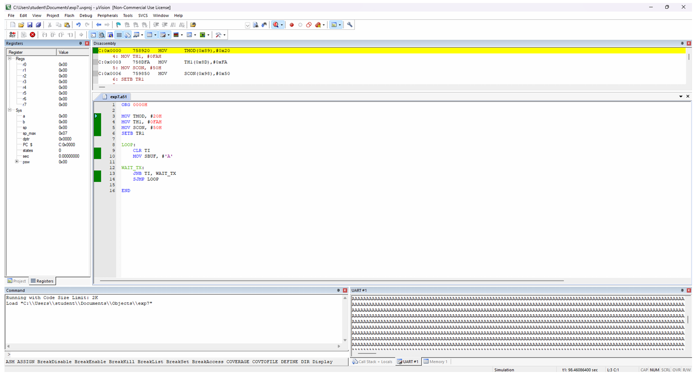
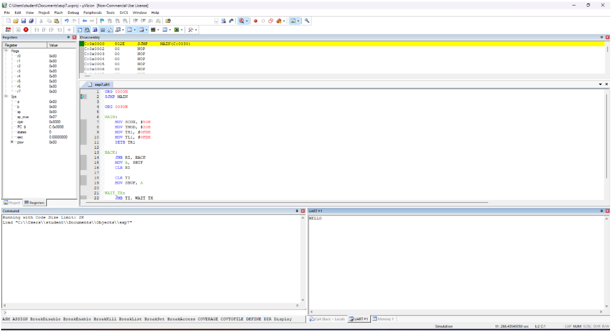

<div align = "center">

<a href="https://ibb.co/0y4jv78d" align="center"></a>
</div>
<div align="center"> <b>
<u>DEPARTMENT OF INFORMATION TECHNOLOGY</u>

Course: Microprocessor and Microcontroller Lab (ITL304)
 B.Tech. (Information Technology) – Semester III
Academic Year: 2026-27 (ODD Semester) </b>
</div>

<p>
    <span style="float:left;">
        <h3> MPMC  Experiment 8
    </span>
    <span style="float:right; text-align:right;"> 
        Name: Dev Mandora<br>
        Roll Number: 62 <br>
        Batch: SB4</h3>
    </span>
</p>

<br clear="both">

# AIM
To write and execute a program to perform serial communication between a microcontroller and a computer using UART.

# OBJECTIVES
- To understand serial communication using UART.
- To configure UART for data transmission and reception.
- To understand the use of SBUF and SCON registers.
- To simulate serial communication using Keil µVision 5.

# SOFTWARE REQUIREMENT
- Keil µVision 5
- 8051/8052 microcontroller simulation environment

# THEORY
The 8051 microcontroller has a built-in UART used for serial communication. It transmits and receives data one bit at a time through TXD and RXD pins.

The SBUF register is used to transmit and receive data, while the SCON register configures serial communication. Timer 1 is commonly used to generate the baud rate.

UART communication transfers data in frames containing a start bit, data bits, and a stop bit. Keil µVision 5 provides a UART #1 serial window to observe transmitted and received characters.

# PROGRAM 8.1: TRANSMIT 'A' CONTINUOUSLY AT 4800 BAUD

## ALGORITHM
1. Start the program.
2. Configure Timer 1 in Mode 2.
3. Load FAH into TH1 for baud-rate generation.
4. Configure UART using SCON.
5. Start Timer 1.
6. Load character 'A' into SBUF.
7. Wait until TI becomes 1.
8. Repeat the transmission continuously.

## PROGRAM
```asm
ORG 0000H

MOV TMOD, #20H
MOV TH1, #0FAH
MOV SCON, #50H
SETB TR1

LOOP:
    CLR TI
    MOV SBUF, #'A'

WAIT_TX:
    JNB TI, WAIT_TX
    SJMP LOOP

END
```

## OUTPUT
```text
AAAAAAAAAAAAAAAAAAAAAAAA
```
 


## OBSERVATION
The character 'A' is transmitted continuously and can be observed in the UART #1 serial window.

# PROGRAM 8.2: RECEIVE AND ECHO CHARACTERS AT 9600 BAUD

## ALGORITHM
1. Start the program.
2. Configure UART using SCON.
3. Configure Timer 1 in Mode 2.
4. Load FDH into TH1 and TL1.
5. Start Timer 1.
6. Wait until RI becomes 1.
7. Read the received character from SBUF.
8. Clear RI and transmit the same character.
9. Wait until TI becomes 1.
10. Repeat the process.

## PROGRAM
```asm
ORG 0000H
SJMP MAIN

ORG 0030H

MAIN:
    MOV SCON, #50H
    MOV TMOD, #20H
    MOV TH1, #0FDH
    MOV TL1, #0FDH
    SETB TR1

BACK:
    JNB RI, BACK
    MOV A, SBUF
    CLR RI

    CLR TI
    MOV SBUF, A

WAIT_TX:
    JNB TI, WAIT_TX
    SJMP BACK

END
```

## OUTPUT
```text
Input:  HELLO 
Output: HELLO 
```
 
## OBSERVATION
The characters entered through the serial window are received by the 8051 and transmitted back to the computer.

# RESULT
Serial communication using UART was implemented successfully using Assembly Language Programming in the 8051 microcontroller.

# CONCLUSION
Thus, UART-based serial communication was studied and implemented. The experiment demonstrated data transmission and reception using the SBUF and SCON registers and baud-rate generation using Timer 1.
