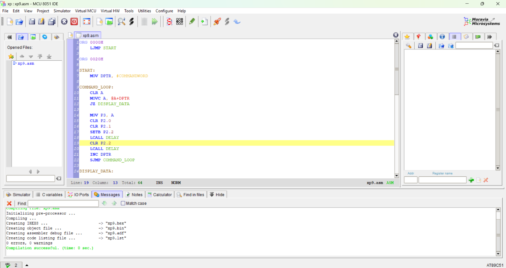
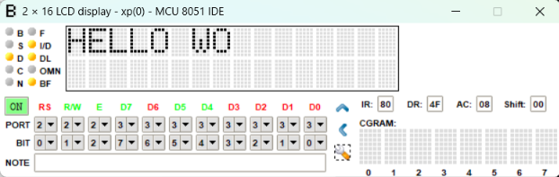
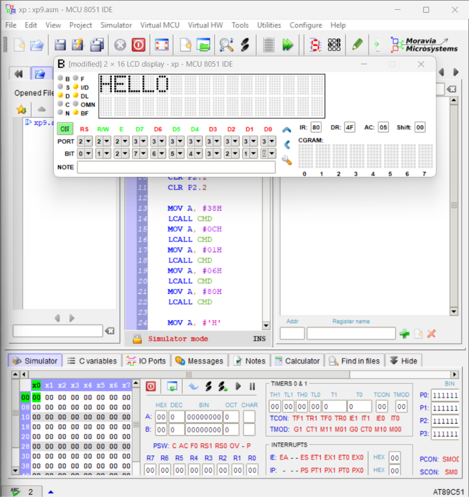
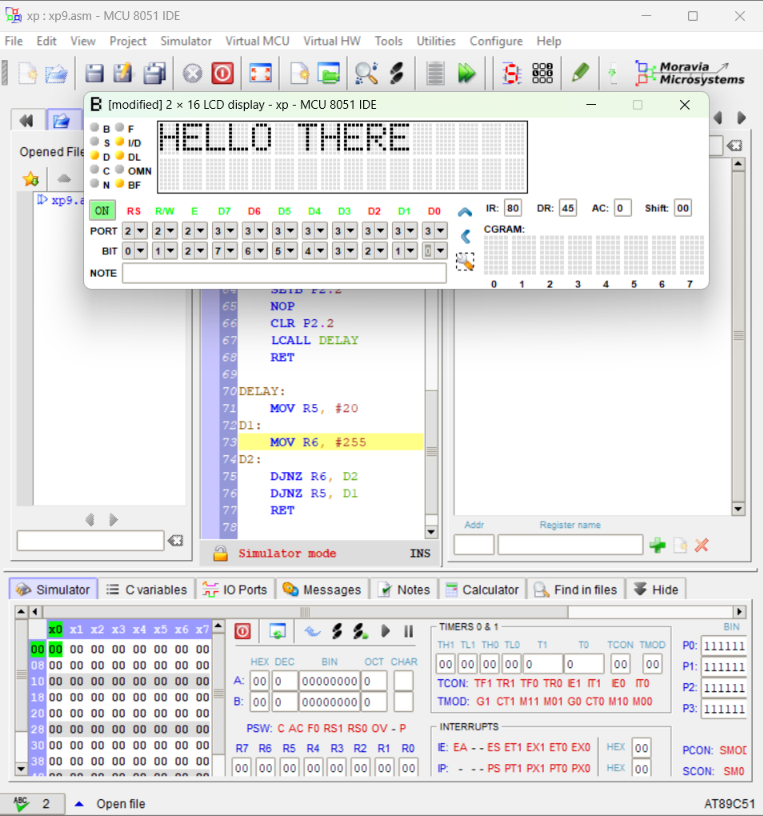
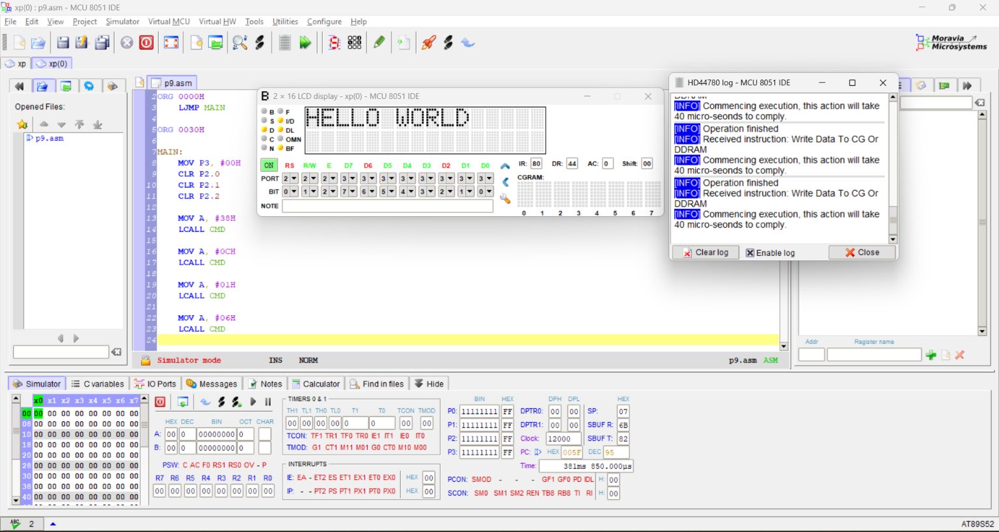

<p>
    <span style="float:left;">
        <h3>MPMC Experiment 9</h3>
    </span>
    <span style="float:right; text-align:right;">
        <h3>Name: Dev Mandora<br>
        Roll Number: 62<br>
        Batch: SB4</h3>
    </span>
</p>
<br clear="both">

### AIM
To implement LCD interfacing with the 8051 microcontroller using Assembly Language Programming.

### OBJECTIVES
- To understand LCD interfacing with the 8051 microcontroller.
- To understand the RS, R/W and EN control signals.
- To display a text message on a 16×2 LCD.
- To simulate LCD interfacing using 8051 MCU IDE.

### SOFTWARE REQUIREMENT
- 8051 MCU IDE
- 8051 microcontroller simulation environment

### THEORY
A Liquid Crystal Display (LCD) is used to display information and provide a user interface. A 16×2 LCD can display 16 characters on each of its two lines.

The LCD uses three control signals: RS, R/W and EN, along with eight data lines when operating in 8-bit mode.

- **RS:** Selects the command register when 0 and the data register when 1.
- **R/W:** Selects writing when 0 and reading when 1.
- **EN:** A HIGH-to-LOW pulse enables the LCD to latch the command or data.

The 8051 sends commands to initialize the LCD and sends character data to display the required message. The MOVC instruction is used to read commands and characters stored in program memory.

### PROGRAM

### ALGORITHM
1. Start the program.
2. Initialize the LCD using the command table.
3. Read each command from program memory using MOVC.
4. Send each command to the LCD through Port 3.
5. Generate an enable pulse for each command.
6. Load the address of the message into DPTR.
7. Read each character from program memory.
8. Set RS to 1 and R/W to 0 to send character data.
9. Send each character to the LCD and generate an enable pulse.
10. Repeat until the null character is reached.
11. Enter an infinite loop.

### ASSEMBLY LANGUAGE PROGRAM

```asm
ORG 0000H
    LJMP MAIN

ORG 0030H

MAIN:
    MOV P3, #00H
    CLR P2.0
    CLR P2.1
    CLR P2.2

    MOV A, #38H
    LCALL CMD

    MOV A, #0CH
    LCALL CMD

    MOV A, #01H
    LCALL CMD

    MOV A, #06H
    LCALL CMD

    MOV A, #80H
    LCALL CMD

    MOV DPTR, #MESSAGE

NEXT:
    CLR A
    MOVC A, @A+DPTR
    JZ HERE
    LCALL DISPLAY
    INC DPTR
    SJMP NEXT

HERE:
    SJMP HERE

CMD:
    MOV P3, A
    CLR P2.0
    CLR P2.1
    SETB P2.2
    NOP
    CLR P2.2
    LCALL LONG_DELAY
    RET

DISPLAY:
    MOV P3, A
    SETB P2.0
    CLR P2.1
    SETB P2.2
    NOP
    CLR P2.2
    LCALL LONG_DELAY
    RET

LONG_DELAY:
    MOV R2, #20
L1:
    MOV R3, #255
L2:
    DJNZ R3, L2
    DJNZ R2, L1
    RET

MESSAGE:
    DB 'HELLO WORLD', 00H

END

```

### PROCEDURE

## A. Download and install the software

1. Open the following link:

[MCU 8051 IDE download | SourceForge.net](https://sourceforge.net/projects/mcu8051ide/)

2. Download the installer and open the downloaded `.exe` file.
3. Follow the installation instructions.
4. Launch **MCU 8051 IDE** from the Start menu.
5. If the software fails to launch on your Windows version, note the error before trying another version.

## B. Create the Assembly program

1. Open MCU 8051 IDE.
2. Select **Project → New** and create a project named `Experiment9_LCD`, if the option is available in your version.
3. Select an 8051-compatible microcontroller if prompted.
4. Create a new source file using the editor's **New File** option.
5. Copy the Assembly Language program given above into the editor.
6. Save the file as `xp9.asm`.
7. Ensure that the source file is treated as Assembly Language, not as a C program.

## C. Assemble and check the program

1. Save the file using `Ctrl + S`.
2. Use the IDE's **Assemble/Compile** command. In versions where the shortcut is supported, press `F11`.
    
4. Check the Messages or Output panel.
5. If an error appears, correct it before proceeding.
6. Confirm that the program has assembled successfully.

## D. Open the virtual LCD hardware

1. Locate the **Virtual HW** menu.
2. Select **Open**.
3. Select Virtual Display -> 2*16
## E. Configure the LCD connections

Configure the virtual hardware according to the Assembly program.

Use the dropdowns in the PORT row to connect them:

| LCD pin | Select |
| --- | --- |
| D0  | P3.0 |
| D1  | P3.1 |
| D2  | P3.2 |
| D3  | P3.3 |
| D4  | P3.4 |
| D5  | P3.5 |
| D6  | P3.6 |
| D7  | P3.7 |

Important: The LCD labels are displayed in reverse order, from D7 down to D0. Match each dropdown to the label directly above it.
***
Use the same PORT row dropdowns:

| LCD pin | Select |
| --- | --- |
| RS  | P2.0 |
| R/W | P2.1 |
| E   | P2.2 |

Leave the BIT row unchanged unless your IDE requires bit-level configuration.

 

> [!attention] don't the led indicators on left side of panel
> Its fine if you dont see HELLO WO ( i have attached output screenshot to showcase the configration of the lcd directly)
## F. Run the simulation

1. Ensure that the source program has assembled successfully.
2. Start the simulator using the IDE's simulation or run command.
3. Switch on the virtual LCD if required.
4. Start program execution using **Run**.
5. Wait for the LCD to initialize and display the text.
6. Observe the first line of the LCD.
7. If the screen remains blank, check the LCD connections, contrast setting, and simulator status.

## G. Record the output

1. Capture a screenshot of the running simulation.
2. Ensure that the LCD output is visible in the screenshot.


#  OUTPUT

The LCD should display the following message on the first line, beginning at the fourth character position:

 
 
 
# RESULT
LCD interfacing with the 8051 microcontroller was implemented using Assembly Language Programming.

# CONCLUSION
Thus, LCD interfacing with the 8051 microcontroller was studied and implemented using Assembly Language Programming. The experiment demonstrated LCD initialization, command transmission and character display.
