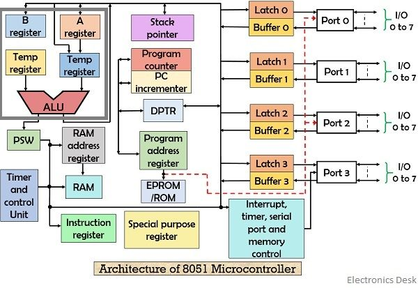

# COA Assignment No. 2 — Answers (4 Marks Each)

## Q1. Draw and explain the block diagram of the 8051 Microcontroller with its registers.
 

The 8051 microcontroller is an 8-bit microcontroller used in embedded systems.

Main blocks:

1.  CPU: Executes instructions and controls operations.
    
2.  ROM: Stores the program.
    
3.  RAM: Stores temporary data and variables.
    
4.  I/O Ports: Four 8-bit ports (P0–P3) connect external devices.
    
5.  Timers/Counters: Two 16-bit timers, Timer 0 and Timer 1.
    
6.  Serial Port: Supports serial communication.
    
7.  Interrupt Control: Handles interrupt requests.
    
8.  Oscillator: Provides the clock signal.
    


## Q2. Classify and explain computers according to parallelism (Flynn’s Taxonomy). Mention advantages, disadvantages and uses.

Flynn’s Taxonomy classifies computers based on the number of instruction and data streams.

| Type | Explanation | Advantage | Disadvantage | Use |
| --- | --- | --- | --- | --- |
| SISD | Single instruction, single data stream. | Simple design | Limited speed | Basic computers |
| SIMD | Single instruction, multiple data streams. | Fast parallel data processing | Less suitable for different tasks simultaneously | GPUs, image processing |
| MISD | Multiple instructions, single data stream. | Can support redundant processing | Rare and complex | Specialized fault-tolerant systems |
| MIMD | Multiple instructions, multiple data streams. | Handles different tasks simultaneously | Complex programming | Multicore CPUs, servers |

## Q3. Implement an Embedded C program to perform addition of two 16-bit numbers.

```c
#include <reg51.h>

void main()
{
    unsigned int a = 1000; // unsigneed 16 bit numbers
    unsigned int b = 2000; // likewise 
    unsigned long sum;

    sum = (unsigned long)a + b;

    while(1);
}
```


## Q4 (i). Explain the difference between Programmed I/O and DMA I/O data transfer.

| Programmed I/O | DMA I/O |
| --- | --- |
| CPU controls data transfer. | DMA controller manages data transfer. |
| CPU repeatedly checks device status. | CPU can perform other tasks during transfer. |
| Requires more CPU time. | Requires less CPU involvement. |
| Suitable for small data transfers. | Suitable for large data transfers. |

## Q4 (ii). Explain the concept of Direct Memory Access (DMA).

Direct Memory Access (DMA) transfers data directly between an I/O device and main memory without the CPU handling every data item.

Working:

1.  CPU initializes the DMA controller with the address, direction and size of transfer.
    
2.  DMA controller requests control of the system bus.
    
3.  Data is transferred directly between the device and memory.
    
4.  After completion, DMA notifies the CPU, usually through an interrupt.
    

Advantages: Faster block transfers and reduced CPU workload.

## Q5. Design the memory hierarchy and explain its characteristics.

 
Memory hierarchy arranges memory according to speed, cost and storage capacity.

1.  Registers: Fastest memory inside the CPU; stores immediate data and instructions.
    
2.  Cache: Stores frequently used data to reduce CPU access time.
    
3.  Main Memory (RAM): Holds currently running programs and data; volatile.
    
4.  Secondary Storage: Stores data permanently; has high capacity but is slower than RAM.
    

Characteristics:

-   Speed decreases from top to bottom.
    
-   Storage capacity generally increases from top to bottom.
    
-   Cost per bit generally decreases from top to bottom.
    
-   Frequently used data is kept in faster memory for improved performance.