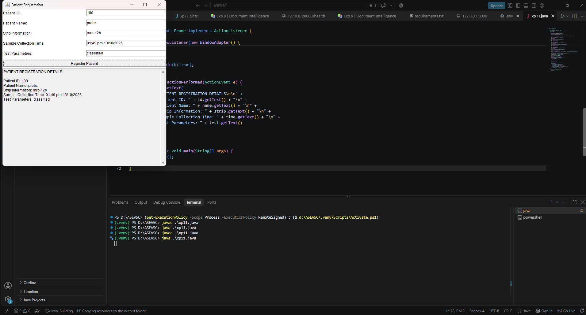

<p>
    <span style="float:left;">
        <h3> JAVA Experiment 11
    </span>
    <span style="float:right; text-align:right;"> 
        Name: Dev Mandora<br>
        Roll Number: 62 <br>
        Batch: SB4</h3>
    </span>
</p>

<br clear="both">

### Aim:

Design Graphical User Interfaces (GUI) using AWT components and layouts.

### Objective:

1. To understand GUI development using Java AWT.
2. To use AWT components such as Label, TextField, Button, and Choice.
3. To arrange GUI components using layouts.
4. To develop a patient registration interface.
5. To enter patient details, strip information, sample collection time, and test parameters.

### Software Used:

- Java Development Kit (JDK 17)
- Visual Studio Code
- Command Prompt / Terminal
- Java Compiler (`javac`)

### Theory:

Abstract Window Toolkit (AWT) is a Java library used to create graphical user interfaces.

AWT provides components such as `Label`, `TextField`, `Button`, and `Choice` to accept input and perform actions. Layout managers arrange components inside a window.

In this program, an AWT-based patient registration interface is created to enter patient details, strip information, sample collection time, and test parameters. A button displays the entered information.

### Program:

```java
import java.awt.*;
import java.awt.event.*;

class xp11 extends Frame implements ActionListener {
    TextField id, name, strip, time, test;
    TextArea output;
    Button submit;

    xp11() {
        setTitle("Patient Registration");
        setSize(550, 550);
        setLayout(new BorderLayout(10, 10));

        Panel form = new Panel(new GridLayout(5, 2, 10, 10));

        form.add(new Label("Patient ID:"));
        id = new TextField();
        form.add(id);

        form.add(new Label("Patient Name:"));
        name = new TextField();
        form.add(name);

        form.add(new Label("Strip Information:"));
        strip = new TextField();
        form.add(strip);

        form.add(new Label("Sample Collection Time:"));
        time = new TextField();
        form.add(time);

        form.add(new Label("Test Parameters:"));
        test = new TextField();
        form.add(test);

        submit = new Button("Register Patient");
        submit.addActionListener(this);

        output = new TextArea("", 6, 40, TextArea.SCROLLBARS_VERTICAL_ONLY);
        output.setEditable(false);

        Panel bottom = new Panel(new BorderLayout(5, 5));
        bottom.add(submit, BorderLayout.NORTH);
        bottom.add(output, BorderLayout.CENTER);

        add(form, BorderLayout.NORTH);
        add(bottom, BorderLayout.CENTER);

        addWindowListener(new WindowAdapter() {
            public void windowClosing(WindowEvent e) {
                dispose();
            }
        });

        setVisible(true);
    }

    public void actionPerformed(ActionEvent e) {
        output.setText(
            "PATIENT REGISTRATION DETAILS\n\n" +
            "Patient ID: " + id.getText() + "\n" +
            "Patient Name: " + name.getText() + "\n" +
            "Strip Information: " + strip.getText() + "\n" +
            "Sample Collection Time: " + time.getText() + "\n" +
            "Test Parameters: " + test.getText()
        );
    }

    public static void main(String[] args) {
        new xp11();
    }
}
```

### Output:

 
### Execution:

```powershell
(.venv) PS D:\A5EV5C> javac .\xp11.java
(.venv) PS D:\A5EV5C> java .\xp11.java 

```

### Outcome:

A Java AWT-based patient registration interface was successfully developed using GUI components and layouts to enter and display patient details.

### Conclusion:

Thus, a graphical user interface was successfully designed using Java AWT components and layouts for patient registration and sample information entry.