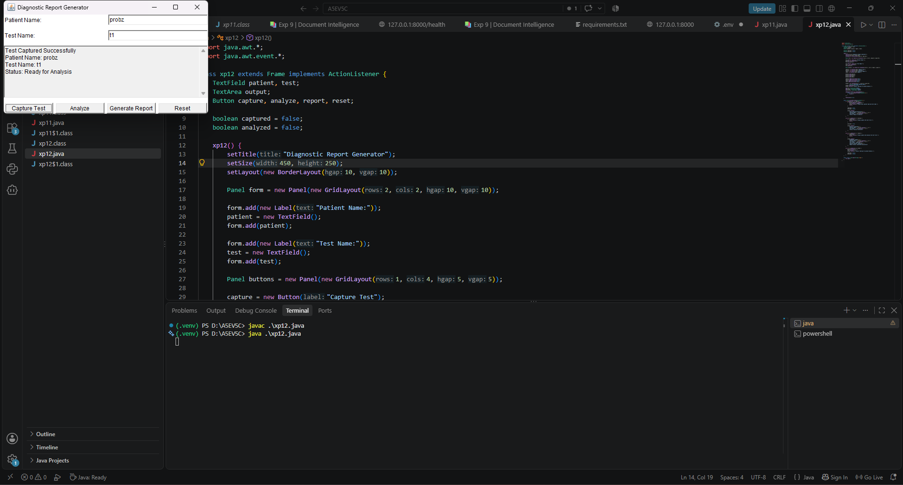
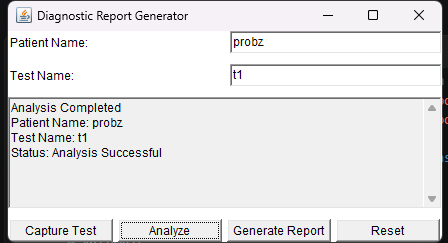
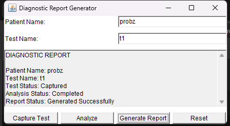

<p>
    <span style="float:left;">
        <h3> JAVA Experiment 12
    </span>
    <span style="float:right; text-align:right;"> 
        Name: Dev Mandora<br>
        Roll Number: 62 <br>
        Batch: SB4</h3>
    </span>
</p>

<br clear="both">

### Aim:

Develop interactive Java GUI applications using event handling mechanisms.

### Objective:

1. To understand event handling in Java.
2. To use buttons and event listeners in a GUI application.
3. To implement Capture Test, Analyze, Generate Report, and Reset buttons.
4. To display diagnostic status based on user interactions.
5. To develop an interactive diagnostic report generator using Java AWT.

### Software Used:

- Java Development Kit (JDK 17)
- Visual Studio Code
- Command Prompt / Terminal
- Java Compiler (`javac`)

### Theory:

Event handling in Java allows a program to respond to user actions such as button clicks.

The `ActionListener` interface is used to handle button click events. The `actionPerformed()` method executes when a registered button is clicked.

In this program, an interactive diagnostic report generator is developed using Java AWT. The Capture Test button captures test details, the Analyze button displays the analysis status, the Generate Report button generates a diagnostic report, and the Reset button clears the details and resets the status.

### Program:

```java
import java.awt.*;
import java.awt.event.*;

class xp12 extends Frame implements ActionListener {
    TextField patient, test;
    TextArea output;
    Button capture, analyze, report, reset;

    boolean captured = false;
    boolean analyzed = false;

    xp12() {
        setTitle("Diagnostic Report Generator");
        setSize(450, 250);
        setLayout(new BorderLayout(10, 10));

        Panel form = new Panel(new GridLayout(2, 2, 10, 10));

        form.add(new Label("Patient Name:"));
        patient = new TextField();
        form.add(patient);

        form.add(new Label("Test Name:"));
        test = new TextField();
        form.add(test);

        Panel buttons = new Panel(new GridLayout(1, 4, 5, 5));

        capture = new Button("Capture Test");
        analyze = new Button("Analyze");
        report = new Button("Generate Report");
        reset = new Button("Reset");

        buttons.add(capture);
        buttons.add(analyze);
        buttons.add(report);
        buttons.add(reset);

        capture.addActionListener(this);
        analyze.addActionListener(this);
        report.addActionListener(this);
        reset.addActionListener(this);

        output = new TextArea("", 10, 40,
                TextArea.SCROLLBARS_VERTICAL_ONLY);
        output.setEditable(false);
        output.setText("Status: Waiting for patient details.");

        add(form, BorderLayout.NORTH);
        add(output, BorderLayout.CENTER);
        add(buttons, BorderLayout.SOUTH);

        addWindowListener(new WindowAdapter() {
            public void windowClosing(WindowEvent e) {
                dispose();
            }
        });

        setVisible(true);
    }

    public void actionPerformed(ActionEvent e) {
        if (e.getSource() == capture) {
            if (patient.getText().isEmpty() ||
                test.getText().isEmpty()) {
                output.setText("Please enter patient name and test name.");
                return;
            }

            captured = true;
            analyzed = false;

            output.setText(
                "Test Captured Successfully\n" +
                "Patient Name: " + patient.getText() + "\n" +
                "Test Name: " + test.getText() + "\n" +
                "Status: Ready for Analysis"
            );
        }

        else if (e.getSource() == analyze) {
            if (!captured) {
                output.setText("Please capture the test first.");
                return;
            }

            analyzed = true;

            output.setText(
                "Analysis Completed\n" +
                "Patient Name: " + patient.getText() + "\n" +
                "Test Name: " + test.getText() + "\n" +
                "Status: Analysis Successful"
            );
        }

        else if (e.getSource() == report) {
            if (!analyzed) {
                output.setText("Please capture and analyze the test first.");
                return;
            }

            output.setText(
                "DIAGNOSTIC REPORT\n\n" +
                "Patient Name: " + patient.getText() + "\n" +
                "Test Name: " + test.getText() + "\n" +
                "Test Status: Captured\n" +
                "Analysis Status: Completed\n" +
                "Report Status: Generated Successfully"
            );
        }

        else if (e.getSource() == reset) {
            patient.setText("");
            test.setText("");
            output.setText("Status: Waiting for patient details.");

            captured = false;
            analyzed = false;
        }
    }

    public static void main(String[] args) {
        new xp12();
    }
}
```

### Output:

   

### Execution:

```powershell
javac .\xp12.java
java .\xp12.java
```

### Outcome:

An interactive diagnostic report generator was successfully developed using Java AWT and event handling mechanisms. Buttons were used to capture test details, display analysis status, generate reports, and reset the interface.

### Conclusion:

Thus, an interactive Java GUI application was successfully implemented using AWT components and event handling. The `ActionListener` interface was used to respond to button clicks and update the diagnostic status based on user interactions.