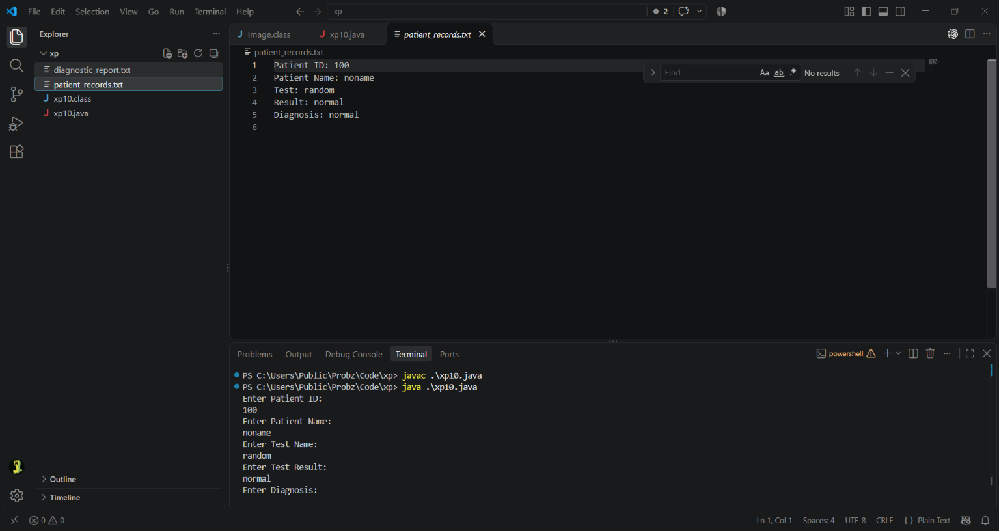
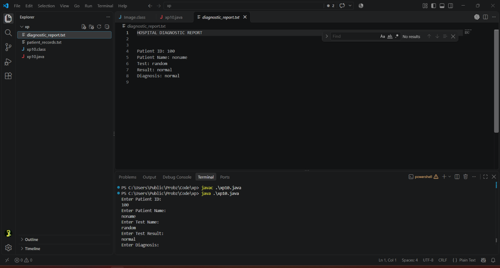

<p>
    <span style="float:left;">
        <h3> JAVA Experiment 10
    </span>
    <span style="float:right; text-align:right;"> 
        Name: Dev Mandora<br>
        Roll Number: 62 <br>
        Batch: SB4</h3>
    </span>
</p>

<br clear="both">

### Aim:

To develop a Java application using File I/O streams to read patient records from files and write diagnostic reports for hospital record management.

### Objective:

1. To understand file handling in Java.
2. To read patient records from a text file.
3. To use `FileReader` and `BufferedReader` to read data.
4. To use `FileWriter` and `BufferedWriter` to write diagnostic reports.
5. To store and process patient information using files.

### Software Used:

- Java Development Kit (JDK 17)
- Visual Studio Code
- Command Prompt / Terminal
- Java Compiler (`javac`)

### Theory:

File handling in Java allows programs to read data from files and write data into files.

The `FileReader` class is used to read character data from a file, while `BufferedReader` reads text efficiently, one line at a time.

The `FileWriter` class is used to write data into a file, while `BufferedWriter` improves writing efficiency by buffering the output.

In this program, patient records are read from `patient_records.txt` and copied into a diagnostic report named `diagnostic_report.txt`. The report includes the patient details and a simple diagnostic result.

### Program:

```java
import java.io.*;
import java.util.Scanner;

class xp10 {
    public static void main(String[] args) throws IOException {
        Scanner sc = new Scanner(System.in);

        BufferedWriter bw = new BufferedWriter(
            new FileWriter("patient_records.txt"));

        System.out.println("Enter Patient ID:");
        String id = sc.nextLine();

        System.out.println("Enter Patient Name:");
        String name = sc.nextLine();

        System.out.println("Enter Test Name:");
        String test = sc.nextLine();

        System.out.println("Enter Test Result:");
        String result = sc.nextLine();

        System.out.println("Enter Diagnosis:");
        String diagnosis = sc.nextLine();

        bw.write("Patient ID: " + id);
        bw.newLine();
        bw.write("Patient Name: " + name);
        bw.newLine();
        bw.write("Test: " + test);
        bw.newLine();
        bw.write("Result: " + result);
        bw.newLine();
        bw.write("Diagnosis: " + diagnosis);
        bw.newLine();
        bw.close();

        BufferedReader br = new BufferedReader(
            new FileReader("patient_records.txt"));

        bw = new BufferedWriter(
            new FileWriter("diagnostic_report.txt"));

        String record;

        bw.write("HOSPITAL DIAGNOSTIC REPORT");
        bw.newLine();
        bw.write("\n");
        bw.newLine();

        while ((record = br.readLine()) != null) {
            bw.write(record);
            bw.newLine();
        }

        br.close();
        bw.close();
        sc.close();

        System.out.println("Patient records saved successfully.");
        System.out.println("Diagnostic report generated successfully.");
    }
}
````


### Output:


  
```
PS C:\Users\Public\Probz\Code\xp> javac .\xp10.java 
PS C:\Users\Public\Probz\Code\xp> java .\xp10.java 
Enter Patient ID:
100
Enter Patient Name:
noname
Enter Test Name:
random
Enter Test Result:
normal
Enter Diagnosis:
normal
Patient records saved successfully.
Diagnostic report generated successfully.
PS C:\Users\Public\Probz\Code\xp> 
```

### Outcome:

The Java program successfully reads patient records from a text file and writes them into a diagnostic report using Java File I/O streams.

### Conclusion:

The experiment successfully demonstrates file handling in Java using `FileReader`, `BufferedReader`, `FileWriter`, and `BufferedWriter` for reading and writing patient records.


