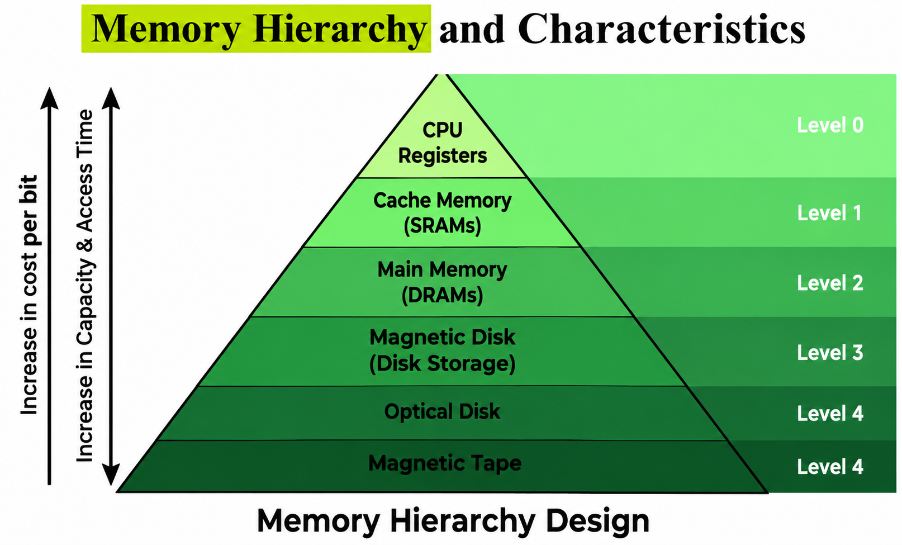
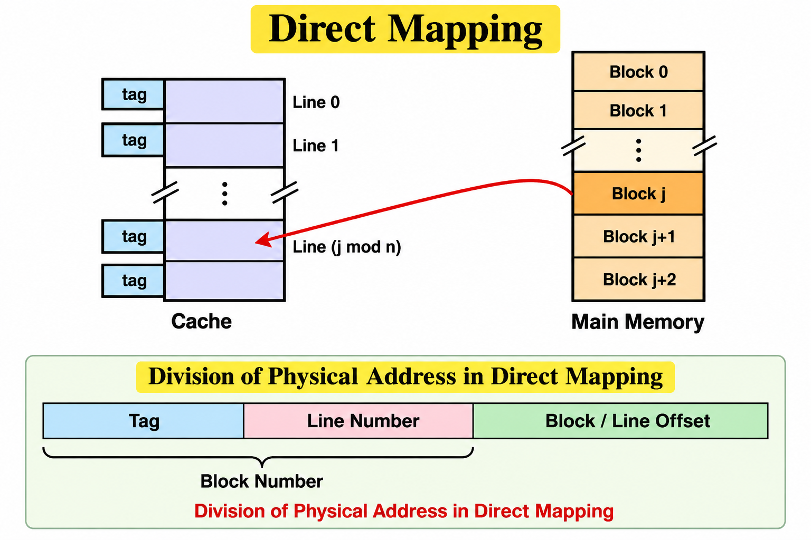

# COA Chapter 4 — Memory Organisation
## Solvify Question Bank Notes | Exam-Oriented | 4-Mark Answers

> **Scope:** This file covers **Module 4 / Chapter 4: Memory Organisation only**. 
>
> **Answer style:** Simple, exam-ready answers sized for approximately 4 marks. Learn the key points and practise the diagrams.

## Quick Navigation

| Full question | Go to answer |
|---|---|
| Design the memory hierarchy and explain the characteristics. | <a href="#q1-memory-hierarchy">Answer 1</a> |
| Compare Primary memory and Secondary memory. | <a href="#q2-primary-secondary">Answer 2</a> |
| Compare SRAM and DRAM. | <a href="#q3-sram-dram">Answer 3</a> |
| Compare Contiguous Memory Allocation and Non-Contiguous Memory Allocation. | <a href="#q4-allocation">Answer 4</a> |
| Mention the Need for Cache and Explain Cache HIT and MISS with a proper diagram. | <a href="#q5-cache-hit-miss">Answer 5</a> |
| Explain Direct Mapping in Cache Memory mapping technique. | <a href="#q6-direct-mapping">Answer 6</a> |

## Important Basics Before the Questions

These short concepts support multiple answers in this chapter.

### Memory and memory parameters

- **Memory:** Hardware used to store data and instructions, either temporarily or for long-term use.
- **Memory location:** A storage position identified by a unique address.
- **Capacity:** Total amount of data memory can store.
- **Access time:** Time required to complete a memory read or write operation.
- **Bandwidth:** Amount of data transferred per unit of time.
- **Cost per bit:** Cost required to store one bit of information.
- **Volatile memory:** Loses its data when power is switched off, e.g., RAM.
- **Non-volatile memory:** Retains data without power, e.g., ROM, SSD and HDD.

### Memory units

| Unit | Common meaning |
|---|---:|
| 1 byte | 8 bits |
| 1 KB | 1024 bytes |
| 1 MB | 1024 KB |
| 1 GB | 1024 MB |
| 1 TB | 1024 GB |

### Main idea of memory organisation

A computer uses several kinds of memory because no single memory type can be simultaneously **very fast, very large and very cheap**. Small, fast memory is placed close to the CPU, while larger and cheaper storage is placed farther away.

---

<p id="q1-memory-hierarchy"></p>

## Question 1: Design the memory hierarchy and explain the characteristics.

### Answer

**Memory hierarchy** is the arrangement of memory types according to speed, cost and capacity. Faster memory is closer to the CPU, while slower, larger memory is farther away.

### Diagram
 


### Characteristics

1. **Speed:** Registers and cache are the fastest; secondary storage is slower.
2. **Capacity:** Capacity generally increases as we move down the hierarchy.
3. **Cost:** Cost per bit is highest near the CPU and decreases down the hierarchy.
4. **Access frequency:** Frequently used data is kept in registers and cache to reduce access time.
5. **Volatility:** Registers, cache and RAM are volatile; SSDs, HDDs and archival storage are non-volatile.

**Conclusion:** Memory hierarchy balances speed, capacity and cost to improve overall computer performance.

**Memory trick:** Going down the hierarchy means **capacity increases, cost per bit decreases, and speed decreases**.

---

<p id="q2-primary-secondary"></p>

## Question 2: Compare Primary Memory and Secondary Memory.

| Primary Memory | Secondary Memory |
| --- | --- |
| 1. Primary memory is directly accessible by the CPU during program execution. | 1. Secondary memory is accessed through I/O controllers and storage interfaces. |
| 2. Primary memory provides faster data access. | 2. Secondary memory provides slower data access. |
| 3. Primary memory generally has smaller storage capacity. | 3. Secondary memory generally has larger storage capacity. |
| 4. Primary memory has a higher cost per bit. | 4. Secondary memory has a lower cost per bit. |
| 5. Primary memory includes both volatile RAM and non-volatile ROM. | 5. Secondary memory is generally non-volatile and retains data without power. |
| 6. Examples of primary memory are RAM and ROM. | 6. Examples of secondary memory are SSDs, HDDs and memory cards. |

Conclusion: Primary memory stores data and instructions needed quickly by the CPU, whereas secondary memory stores data and programs for long-term use.

---

<p id="q3-sram-dram"></p>

## Question 3: Compare SRAM and DRAM.

### Answer

| SRAM | DRAM |
| --- | --- |
| 1. SRAM stands for Static Random Access Memory. | 1. DRAM stands for Dynamic Random Access Memory. |
| 2. SRAM stores each bit using a flip-flop circuit. | 2. DRAM stores each bit using a capacitor and transistor. |
| 3. SRAM does not require periodic refreshing while powered. | 3. DRAM requires periodic refreshing to preserve data. |
| 4. SRAM provides faster data access. | 4. DRAM provides slower data access than SRAM. |
| 5. SRAM is more expensive and has lower storage density. | 5. DRAM is cheaper and has higher storage density. |
| 6. SRAM is commonly used in cache memory. | 6. DRAM is commonly used as main memory (RAM). |

**Conclusion**: SRAM is suitable for fast cache memory, whereas DRAM is suitable for larger-capacity main memory because it is cheaper per bit.

**Memory trick:** SRAM = Speed; DRAM = Density.

---

<p id="q4-allocation"></p>


## Question 4: Compare Contiguous Memory Allocation and Non-Contiguous Memory Allocation.

### Answer

Memory allocation determines how a process is placed in main memory.

| Contiguous Memory Allocation | Non-Contiguous Memory Allocation |
| --- | --- |
| 1. A process occupies one continuous block of physical memory. | 1. A process can occupy multiple separate locations in physical memory. |
| 2. It is simple to implement and manage. | 2. It requires additional mapping and memory management. |
| 3. It can suffer from external fragmentation. | 3. Paging avoids external fragmentation, but segmentation can still suffer from it. |
| 4. Process size may be limited by the largest available continuous free block. | 4. A process can use multiple available frames or segments. |
| 5. It may require memory compaction to combine scattered free spaces. | 5. It generally does not require contiguous physical space for the entire process. |
| 6. Examples include fixed and variable partition allocation. | 6. Examples include paging and segmentation. |
### Simple diagram
> [!check] DRAW BELOW DIAGRAM
> why are you looking at question bro, draw it if you want marks 
```text
CONTIGUOUS                         NON-CONTIGUOUS
+------------------+               +------------------+
| Operating System |               | Operating System |
+------------------+               +------------------+
| Process A        |               | Process A - part 1|
|                  |               +------------------+
+------------------+               | Process B        |
| Process B        |               +------------------+
+------------------+               | Process A - part 2|
| Free space       |               +------------------+
+------------------+               | Process A - part 3|
                                   +------------------+
```

**Conclusion:** Contiguous allocation is simpler, while non-contiguous allocation uses memory more flexibly and is the basis of paging and segmentation.

**Key distinction:** In paging, a process is divided into fixed-size **pages** and physical memory into same-sized **frames**.

---

<p id="q5-cache-hit-miss"></p>

## Question 5: Mention the Need for Cache and Explain Cache HIT and MISS with a proper diagram.

### Answer

**Cache memory** is a small, high-speed memory placed between the CPU and main memory. It stores copies of frequently or recently used data and instructions.

### Need for cache memory

1. The CPU operates faster than main memory.
2. Cache reduces the average time required to access data.
3. It reduces repeated access to slower RAM.
4. It improves overall system performance by using **temporal locality** (recently used data may be used again) and **spatial locality** (nearby data may be used soon).

### Cache HIT

A **cache hit** occurs when the requested data is already present in cache. The CPU receives it quickly from cache.

### Cache MISS

A **cache miss** occurs when the requested data is not present in cache. The data must be fetched from main memory and is commonly placed in cache for possible future use.

### Diagram

```text
              CPU requests data
                     |
                     v
              +-------------+
              | Check Cache |
              +-------------+
                 /       \
             HIT           MISS
              |              |
              v              v
       +-------------+  +----------------+
       | Read Cache  |  | Read Main RAM  |
       +-------------+  +----------------+
              |              |
              |              v
              |       +----------------+
              |       | Update Cache   |
              |       +----------------+
              |              |
              +-------+------+
                      |
                      v
                 Data to CPU
```

### Hit ratio

**Hit ratio** is the fraction of memory requests found in cache.

`Hit Ratio = Cache Hits / Total Memory Requests`

`Miss Ratio = Cache Misses / Total Memory Requests`

`Miss Ratio = 1 - Hit Ratio`

**Conclusion:** A high cache hit ratio generally improves performance because fewer requests need to access main memory.

---

<p id="q6-direct-mapping"></p>

## Question 6: Explain Direct Mapping in Cache Memory mapping technique.

### Answer

**Direct mapping** is a cache mapping technique in which each block of main memory can be placed in only one specific cache line.

### Mapping formula

`Cache Line = Main Memory Block Number mod Number of Cache Lines`

### Working

1. Main memory is divided into fixed-size blocks, and cache is divided into cache lines.
2. Each main-memory block maps to one cache line using the formula above.
3. The cache line stores the block data and a **tag** that identifies which main-memory block is currently stored there.
4. When the CPU requests data, the cache checks the indexed line and compares its tag. A matching valid tag gives a hit; otherwise, it is a miss and the required block is fetched.

### Example

Assume the cache contains **8 lines** and the requested main-memory block is **19**.

`Cache Line = 19 mod 8 = 3`

Therefore, **main-memory block 19 maps to cache line 3**.

Block 27 also maps to line 3 because `27 mod 8 = 3`. If both blocks are accessed repeatedly, they may replace each other in that line.

### Diagram
 


**Advantages:** Simple, fast and inexpensive to implement.

**Disadvantage:** Different memory blocks can map to the same line, causing **conflict misses**.

---

## Last-Minute Revision

| Topic | Remember this |
|---|---|
| Memory hierarchy | Downward: capacity increases, speed decreases, cost per bit decreases. |
| Primary vs secondary | Primary is faster; secondary is larger and persistent. |
| SRAM vs DRAM | SRAM is faster/no refresh; DRAM is denser/needs refresh. |
| Contiguous allocation | One continuous physical block. |
| Non-contiguous allocation | Process parts can occupy separate locations. |
| Cache hit | Requested data is present in cache. |
| Cache miss | Requested data is absent; fetch from RAM. |
| Direct mapping | One main-memory block maps to one fixed cache line. |
| Direct mapping formula | `Cache Line = Block Number mod Number of Cache Lines` |

