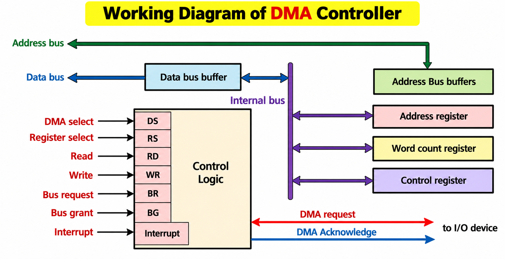
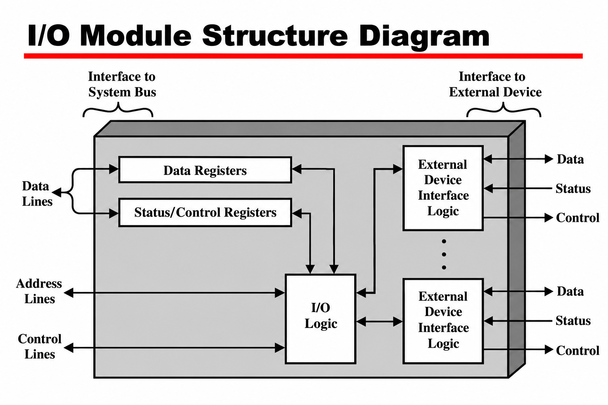

# COA Module 5 — I/O Organization
## Solvify Question Bank Notes | Exam-Oriented | 4-Mark Answers

> [!note]  Scope: 
These notes cover the four Module 5 questions shown in your syllabus image.
Short prerequisite concepts are included first so the answers are easier to understand.

## Quick Navigation

| Full question | Go to answer |
|---|---|
| Explain the concept of the Direct Memory Access technique (DMA). | <a href="#q1-dma"></a> [Go to answer](#q1-dma) |
| Describe with the help of a neat diagram the I/O Module Structure. | <a href="#q2-io-module"></a> [Go to answer](#q2-io-module) |
| Compare Programmed and Interrupt-Driven I/O Data Transfer. | <a href="#q3-programmed-interrupt"></a> [Go to answer](#q3-programmed-interrupt) |
| Differentiate between Programmed and DMA I/O data transfer. | <a href="#q4-programmed-dma"></a> [Go to answer](#q4-programmed-dma) |

## Important Basics Before the Questions 

### 1. What is an I/O system?

An **Input/Output (I/O) system** provides communication between the computer and the outside environment. Input devices send data to the computer, while output devices present or send processed results.

Examples:
- **Input:** Keyboard, mouse, sensors.
- **Output:** Monitor, printer.
- **Storage / other peripherals:** Magnetic disk, tape and network interface.

### 2. What is an I/O module, and why is it needed?

An **I/O module** is the interface between the system bus (CPU and memory) and one or more peripheral devices. Peripherals are not normally connected directly to the system bus because:

1. Peripherals operate differently from the CPU and memory.
2. Peripherals are usually slower, so data transfer needs coordination.
3. Peripheral data formats and word lengths may differ from the computer's.
4. Different devices need different control signals and operating methods.

### 3. Main functions of an I/O module

- **Control and timing:** Coordinates data transfer.
- **CPU communication:** Receives commands and reports status.
- **Device communication:** Sends control signals and exchanges data with peripherals.
- **Data buffering:** Temporarily stores data during transfer.
- **Error detection:** Detects and reports transfer or device errors.

### 4. Three I/O data-transfer techniques

| Technique | Basic idea |
|---|---|
| Programmed I/O | CPU repeatedly checks device status and manages the transfer. |
| Interrupt-driven I/O | CPU continues other work and the device interrupts it when service is needed. |
| Direct Memory Access (DMA) | A DMA controller transfers a block of data between an I/O device and memory with little CPU involvement. |

---

<p id="q1-dma"></p>

## Question 1: Explain the concept of the Direct Memory Access technique (DMA).

### Answer

**Direct Memory Access (DMA)** is a data-transfer technique in which a DMA controller transfers a block of data directly between an I/O device and main memory without the CPU handling every data item.

### Working of DMA
 
1. The CPU initializes the DMA controller with the starting memory address, transfer count and read/write direction.
2. The I/O device or controller requests a DMA transfer.
3. The DMA controller obtains control of the system bus.
4. Data is transferred directly between the I/O device and main memory, while the CPU can perform other work when bus access permits.
5. After the block transfer finishes, the DMA controller interrupts the CPU to report completion.


### Advantages

- Transfers large blocks efficiently.
- Reduces CPU workload.
- Improves data-transfer performance compared with CPU-managed transfer.

**Conclusion:** DMA is useful when large amounts of data must be transferred between an I/O device and memory with minimal CPU involvement.

---

<p id="q2-io-module"></p>

## Question 2: Describe the I/O Module Structure with a neat diagram.

### Answer

An **I/O module** connects the computer's system bus to peripheral devices. It manages communication, data transfer, control signals and status information between the CPU, memory and external devices.

### Diagram
 


### Main Components

1.  **Data Registers:** Temporarily store data exchanged between the system bus and peripheral devices.
    
2.  **Status/Control Registers:** Store device status information, such as ready or busy, and control information received from the CPU.
    
3.  **I/O Logic:** Decodes addresses and control signals from the system bus and coordinates operations within the I/O module.
    
4.  **External Device Interface Logic:** Handles communication with external devices by exchanging data, status signals, and control signals.
    
5.  **System Bus Interface:** Connects the I/O module to the CPU and memory through data lines, address lines, and control lines.
    

### Conclusion

The I/O module provides an organised interface between the system bus and peripheral devices, allowing them to exchange data and control information efficiently.

---

<p id="q3-programmed-interrupt"></p>

## Question 3: Compare Programmed I/O and Interrupt-Driven I/O Data Transfer.

### Answer

| Programmed I/O | Interrupt-Driven I/O |
|---|---|
| 1. The CPU continuously checks the device status. | 1. The device interrupts the CPU when it needs service. |
| 2. The CPU waits until the device is ready. | 2. The CPU can perform other work while the device operates. |
| 3. The CPU manages each data transfer. | 3. The CPU transfers data when the interrupt is serviced. |
| 4. Repeated status checking wastes CPU time. | 4. It reduces repeated status checking and CPU waiting. |
| 5. It is simpler to implement. | 5. It requires interrupt-handling hardware and software. |
| 6. It is suitable for simple or low-speed I/O operations. | 6. It is suitable when devices can notify the CPU when ready. |

**Conclusion:** Programmed I/O relies on continuous CPU checking, whereas interrupt-driven I/O lets the CPU do other work until the device requests service.

### Simple flow

```text
PROGRAMMED I/O
CPU checks status → Not ready? Check again
                 → Ready → Transfer data

INTERRUPT-DRIVEN I/O
CPU starts I/O → CPU does other work
               → Device interrupts CPU
               → CPU services request and transfers data
```

---

<p id="q4-programmed-dma"></p>

## Question 4: Differentiate between Programmed I/O and DMA I/O Data Transfer.

### Answer

| Programmed I/O | DMA I/O Transfer |
|---|---|
| 1. Data transfer is controlled by CPU-executed instructions. | 1. Data transfer is controlled by a DMA controller. |
| 2. Data passes through the CPU during transfer. | 2. Data moves directly between the I/O device and main memory. |
| 3. The CPU manages each data item or word. | 3. The DMA controller manages the block transfer. |
| 4. The CPU repeatedly checks device status. | 4. The DMA controller manages transfer progress and signals completion. |
| 5. It is slower for large data transfers and uses more CPU time. | 5. It is more efficient for large data transfers and reduces CPU workload. |
| 6. It does not require a separate DMA controller. | 6. It requires a DMA controller and bus-control support. |

**Conclusion:** Programmed I/O is suitable for simple transfers, while DMA is more efficient for transferring large blocks of data.

---

## Last-Minute Revision

| Topic | Remember this |
|---|---|
| I/O system | Communicates between the computer and external environment. |
| I/O module | Interface between the system bus and peripherals. |
| Programmed I/O | CPU repeatedly checks status and manages transfer. |
| Interrupt-driven I/O | Device interrupts the CPU when service is needed. |
| DMA | Controller transfers a block directly between device and memory. |
| DMA setup | Starting address, transfer count and read/write direction. |
| DMA completion | Controller typically interrupts the CPU when the transfer finishes. |


