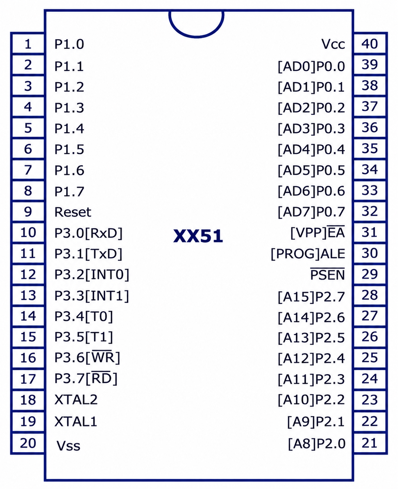
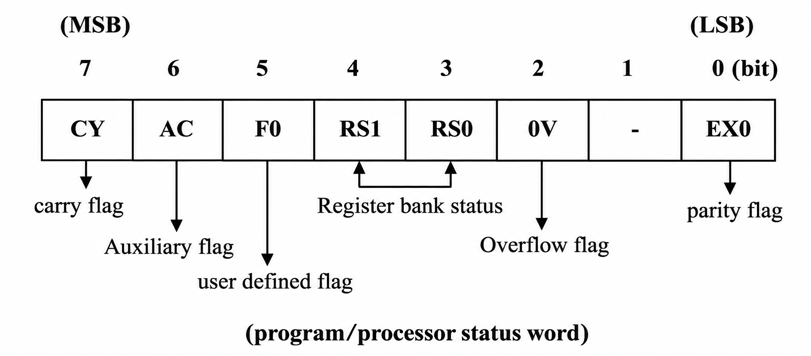
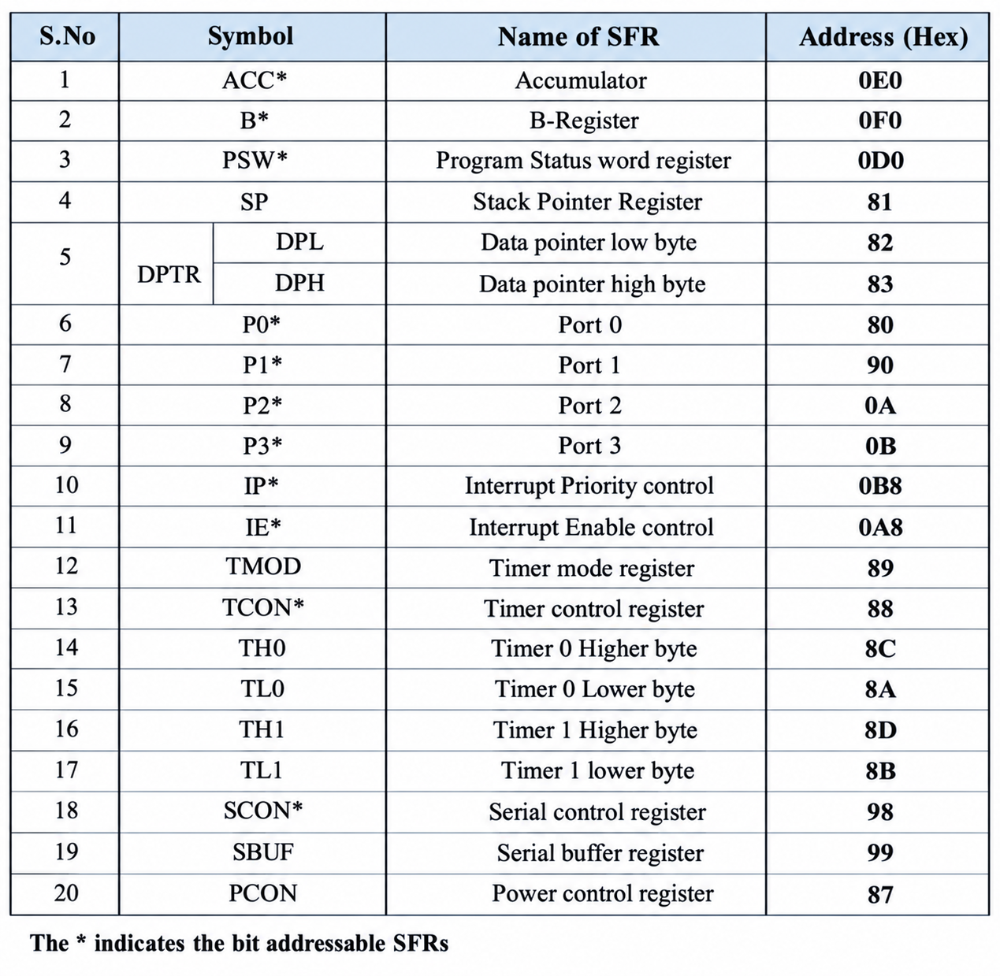

# COA Module 6 — Overview of 8051 Microcontroller
## Solvify Question Bank Notes | Exam-Oriented Answers

> [!note] Scope: 
These notes cover the **seven Module 6 questions**

## Quick Navigation

| Full question | Go to answer |
|---|---|
| Differentiate between a microcontroller and a microprocessor with reference to their applications in an AI-based weather monitoring system. | <a href="#q1-microcontroller-microprocessor">Go to answer</a> |
| Implement embedded C program to perform addition of two 16-bit numbers (8051 Microcontroller). | <a href="#q2-add-16-bit">Go to answer</a> |
| Implement embedded C program to transfer a block of data from one memory location to another memory location. | <a href="#q3-block-transfer">Go to answer</a> |
| Explain the pin diagram of the 8051 microcontroller and the functions of its pins with reference to an AI-based agricultural monitoring system that interfaces with soil moisture, temperature, and humidity sensors. | <a href="#q4-pin-diagram">Go to answer</a> |
| Explain the PSW register. | <a href="#q5-psw">Go to answer</a> |
| Write an 8051 C program to send values 00–FF to port P1. | <a href="#q6-port-p1">Go to answer</a> |
| List Special Function Registers and explain any one. | <a href="#q7-sfr">Go to answer</a> |

## Important Basics Before the Questions
## Explain the Architecture of the 8051 Microcontroller with a Neat Diagram

### Answer

The 8051 microcontroller is an 8-bit microcontroller that integrates a CPU, memory, I/O ports, timers and serial communication circuits on a single chip.
/xp/soft/.attachments/47109034528dc1f0528e4f15f8ebbe9425165336.png)
### Explanation of the main blocks

1. CPU: It contains the ALU and control unit. It executes instructions and performs arithmetic and logical operations.

2. Program Memory (ROM): It stores the program instructions that the microcontroller executes.

3. Data Memory (RAM): It temporarily stores data, variables and intermediate results during program execution.

4. I/O Ports: The 8051 has four 8-bit ports, P0, P1, P2 and P3, used to connect external devices such as sensors, LEDs and switches.

5. Timers/Counters: The two 16-bit timers/counters are used to generate delays, count external events and measure time intervals.

6. Serial Port: It enables serial communication with external devices using the RXD and TXD pins.

7. Interrupt Control: It handles interrupt requests and allows the CPU to respond to important events without continuously checking them.

8. Oscillator and Clock Circuit: It generates the clock signals required to synchronize and control the operations of the microcontroller.

9. Registers: Registers such as the accumulator, B register, PSW, program counter and data pointer help process data and control program execution.


### 1. What is an 8051 microcontroller?

The **8051** is an 8-bit microcontroller used in embedded systems. The standard 8051 has a CPU, 4 KB on-chip program ROM, 128 bytes of internal RAM, four 8-bit I/O ports, two 16-bit timers/counters, and serial communication support.

### 2. Important 8051 registers

| Register | Function |
|---|---|
| A (Accumulator) | Stores operands and results of arithmetic and logical operations. |
| B | Used with A for multiplication and division; can also be used as a general-purpose register. |
| PC (Program Counter) | 16-bit register holding the address of the next instruction. |
| DPTR (Data Pointer) | 16-bit pointer formed by DPH and DPL; used for memory addressing. |
| SP (Stack Pointer) | Points to the top of the stack. |
| PSW (Program Status Word) | Holds status flags and register-bank selection bits. |

### 3. 8051 ports at a glance

| Port | Important function |
|---|---|
| P0 | General-purpose I/O when external memory is not used; multiplexed low address/data bus with external memory. Requires external pull-ups when used as general I/O on the classic 8051. |
| P1 | General-purpose 8-bit I/O port; does not have the alternate external-memory bus role of P0 and P2. |
| P2 | General-purpose I/O; provides the high-order address bus during external memory access. |
| P3 | I/O with alternate functions such as RXD, TXD, INT0, INT1, T0, T1, WR and RD. |

### 4. C code note

The code below uses **classic 8051 / Keil C51-style** declarations such as `P1`, `unsigned char`, and `unsigned int`. Hardware sensor systems may require external signal-conditioning or ADC circuitry because a classic 8051 does not contain an onboard analog-to-digital converter.

---

<p id="q1-microcontroller-microprocessor"></p>

## Question 1: Differentiate between a microcontroller and a microprocessor with reference to their applications in an AI-based weather monitoring system.

### Answer

A microprocessor mainly contains the CPU and generally requires external memory and I/O components. A microcontroller integrates the CPU, memory and I/O peripherals on a single chip and is commonly used in embedded systems.

| Microprocessor | Microcontroller |
| --- | --- |
| 1. A microprocessor mainly contains the CPU, while memory and I/O components are usually external. | 1. A microcontroller integrates the CPU, memory and I/O peripherals on a single chip. |
| 2. It generally requires more external components and a more complex circuit. | 2. It generally requires fewer external components and supports a compact circuit. |
| 3. It is suitable for complex, general-purpose computing tasks. | 3. It is suitable for dedicated embedded control tasks. |
| 4. The complete system may consume more power due to its additional components. | 4. It is often suitable for low-power monitoring applications. |
| 5. It can process large amounts of weather data and run computationally intensive AI models when supported by suitable hardware. | 5. It can collect temperature, humidity and pressure readings and perform basic local processing. |
| 6. It is suitable for running advanced weather prediction software on a capable computing system. | 6. It is suitable for reading sensors, controlling alarms and transmitting weather data to another system. |

Conclusion: In an AI-based weather monitoring system, a microcontroller can collect sensor readings and handle local control, while a sufficiently powerful microprocessor-based system can perform computationally intensive AI-based weather prediction.

---

<p id="q2-add-16-bit"></p>

## Question 2: Implement an embedded C program to perform addition of two 16-bit numbers using the 8051 microcontroller.

### Answer

A 16-bit number can be stored in an `unsigned int` in a typical 8051 C51 compiler. To preserve a possible carry beyond 16 bits, the sum is stored in an `unsigned long`.

### Program

```c
#include <reg51.h>

void main(void)
{
    unsigned int num1 = 0x1234;
    unsigned int num2 = 0x2345;
    unsigned long sum;

    sum = (unsigned long)num1 + num2;

    while (1);
}
```

### Explanation

1. `num1` and `num2` store the two 16-bit numbers.
2. The numbers are added using the `+` operator.
3. The result is stored in `sum`, which is wider than 16 bits so a carry can be retained.
4. The program stops in the infinite loop after calculating the result.

**Example:** `0x1234 + 0x2345 = 0x3579`.

**Note:** This example keeps the result in a variable for inspection in the debugger. To display or transmit the result, additional output code is required.

---

<p id="q3-block-transfer"></p>

## Question 3: Implement an embedded C program to transfer a block of data from one memory location to another memory location.

### Answer

Block data transfer means copying a sequence of bytes from a source memory area to a destination memory area. The following program copies five bytes from one internal RAM array to another.

### Program

```c
#include <reg51.h>

void main(void)
{
    unsigned char source[5] = {10, 20, 30, 40, 50};
    unsigned char destination[5];
    unsigned char i;

    for (i = 0; i < 5; i++)
    {
        destination[i] = source[i];
    }

    while (1);
}
```

### Explanation

1. `source` contains the original five data bytes.
2. `destination` is the memory area where the data will be copied.
3. The `for` loop accesses each source element one by one.
4. Each source byte is copied to the corresponding destination position.
The expected output is:

```
Source:      10 20 30 40 50
Destination: 10 20 30 40 50
```


**Conclusion:** The loop transfers the complete block by copying each byte from the source array to the destination array.

**Note:** This is an array-based internal-memory example. Exact memory addresses or external RAM (`xdata`) should be used only if the question or hardware setup specifies them.

---

<p id="q4-pin-diagram"></p>

## Question 4: Explain the pin diagram of the 8051 microcontroller and the functions of its pins with reference to an AI-based agricultural monitoring system that interfaces with soil moisture, temperature, and humidity sensors.

### Answer

The classic 8051 is a 40-pin microcontroller with four 8-bit I/O ports. In an agricultural monitoring system, its ports can connect to sensor-interface circuits and output devices.  
### Important pins and their functions

| Pins | Function | Use in agricultural monitoring |
|---|---|---|
| 1–8: Port 1 | General-purpose 8-bit I/O. | Can receive digital sensor-interface signals or control indicators. |
| 9: RST | Resets the microcontroller when the required reset signal is applied. | Restarts the monitoring controller. |
| 10–17: Port 3 | I/O with alternate functions such as RXD, TXD, INT0, INT1, T0, T1, WR and RD. | Can support serial communication or interrupt-based sensor alerts. |
| 18–19: XTAL2, XTAL1 | Connect to the clock crystal/oscillator circuit. | Provide the clock for the controller. |
| 20: VSS | Ground (0 V). | Common ground for the circuit. |
| 21–28: Port 2 | General-purpose I/O; supplies high-order address signals for external memory. | Can be used for digital I/O if external memory addressing is not needed. |
| 29: PSEN | Program Store Enable; used to read external program memory. | Usually not needed for a basic system using internal program memory. |
| 30: ALE/PROG | Address Latch Enable for external-memory address/data multiplexing. | Supports external-memory interfacing when required. |
| 31: EA/VPP | Selects internal/external program-memory access on the classic 8051. | Usually tied high when using internal program memory only. |
| 32–39: Port 0 | General-purpose I/O or multiplexed low-order address/data bus; requires external pull-ups for general I/O on the classic 8051. | Can connect to digital interfaces when external memory is not being used. |
| 40: VCC | Positive supply; commonly +5 V for a classic 8051. | Powers the controller. |

### How the system can work

1. Soil moisture, temperature and humidity sensors measure field conditions.
2. If a sensor provides an analogue output, an external ADC or suitable sensor-interface module is needed because the classic 8051 has no built-in ADC.
3. The 8051 reads the digital values through its I/O interface.
4. The program compares the readings with configured limits and can activate an alarm, relay or communication interface.
5. The collected readings can be sent to another system for AI-based analysis or prediction.

**Conclusion:** The 8051 can act as the embedded controller for collecting sensor readings and controlling field devices. AI prediction may run on a separate computer or cloud system if the model is too demanding for the 8051.

---

<p id="q5-psw"></p>

## Question 5: Explain the PSW (Program Status Word) register.

### Answer

The **Program Status Word (PSW)** is an 8-bit special function register in the 8051. It stores arithmetic status flags and the bits used to select one of the four register banks. The PSW bit layout is shown on pages 14–15 of the teacher's PDF.
 
### PSW bit layout

| Bit | Flag | Function |
|---|---|---|
| PSW.7 | CY | Carry flag; indicates a carry or borrow condition for relevant arithmetic operations. |
| PSW.6 | AC | Auxiliary carry flag; indicates carry from bit 3 to bit 4. |
| PSW.5 | F0 | User-available general-purpose flag. |
| PSW.4 | RS1 | Register-bank selection bit 1. |
| PSW.3 | RS0 | Register-bank selection bit 0. |
| PSW.2 | OV | Overflow flag for signed arithmetic. |
| PSW.1 | — | User-definable flag bit. |
| PSW.0 | P | Parity flag; reflects the parity of the accumulator. |

### Register-bank selection

| RS1 | RS0 | Selected bank | Address range |
|---:|---:|---|---|
| 0 | 0 | Bank 0 | 00H–07H |
| 0 | 1 | Bank 1 | 08H–0FH |
| 1 | 0 | Bank 2 | 10H–17H |
| 1 | 1 | Bank 3 | 18H–1FH |

### Importance

1. CY, AC and OV indicate conditions produced by arithmetic operations.
2. P indicates the parity of the accumulator.
3. RS1 and RS0 select the active register bank.
4. F0 and PSW.1 are available as user flags.

**Conclusion:** The PSW helps the 8051 keep track of arithmetic conditions and select the active register bank during program execution.

---

<p id="q6-port-p1"></p>

## Question 6: Write an 8051 C program to send values 00H–FFH to Port P1.

### Answer

Port P1 is an 8-bit general-purpose I/O port. The program below outputs every value from `00H` to `FFH` in sequence.

### Program

```c
#include <reg51.h>

void main(void)
{
    unsigned int i;

    while (1)
    {
        for (i = 0; i <= 0xFF; i++)
        {
            P1 = (unsigned char)i;
        }
    }
}
```

### Explanation

1. `P1` represents Port 1 in the 8051 header file.
2. The `for` loop generates values from `00H` through `FFH`.
3. Each value is converted to an 8-bit value and written to Port P1.
4. The outer `while (1)` repeats the sequence continuously.
### Expected Output

The program continuously sends hexadecimal values from `00H` to `FFH` to Port P1.

```
P1 = 00H
P1 = 01H
P1 = 02H
P1 = 03H
   ...
P1 = FEH
P1 = FFH
P1 = 00H
P1 = 01H
   ... repeats continuously
```

Note: The program does not print these values on the screen. They appear on the physical Port P1 pins and can be observed using LEDs, a logic analyser, or a simulator.
**Important:** The program changes the port values very quickly. If a visible delay is required between values, add a suitable delay routine. The actual output can be observed using LEDs, a logic analyser or a debugger, with appropriate hardware connections.

---

<p id="q7-sfr"></p>

## Question 7: List the Special Function Registers (SFRs) and explain any one.

### Answer

**Special Function Registers (SFRs)** are registers located in the 8051's special function address space. They control CPU operations, I/O ports, timers, serial communication and interrupts.
> [!check] You can ignore the Address column (HEX)
>  

### Explain Accumulator (ACC)

The Accumulator (ACC) is an 8-bit Special Function Register (SFR) in the 8051 microcontroller. It is mainly used to store data and the results of arithmetic and logical operations.

1.  The accumulator is an 8-bit register.
    
2.  It stores operands used in arithmetic and logical operations.
    
3.  It stores results of operations such as addition, subtraction, AND and OR.
    
4.  It is used in many 8051 instructions for data processing.
    

Example:

```
A = 10;
A = A + 5;
```

Output/result: The accumulator `A` contains `15` (decimal).

Conclusion: The accumulator is an important register that stores data and results during program execution.

---

## Last-Minute Revision

| Topic | Remember this |
|---|---|
| Microprocessor vs microcontroller | External system components vs CPU, memory and I/O integrated on one chip. |
| 8051 standard memory (as stated in the PDF) | 4 KB on-chip ROM and 128 bytes internal RAM. |
| Port 1 | General-purpose 8-bit I/O port. |
| Port 0 | Multiplexed low address/data bus for external memory; external pull-ups needed for general I/O on the classic 8051. |
| Port 2 | High-order address bus during external memory access. |
| Port 3 | Alternate functions include RXD, TXD, INT0, INT1, T0, T1, WR and RD. |
| PSW | CY, AC, F0, RS1, RS0, OV, user flag, P. |
| DPTR | 16-bit data pointer made of DPH and DPL. |
| PC | 16-bit program counter. |
| SFR examples | ACC, B, PSW, SP, DPTR, P0–P3, TMOD, TCON, SCON, SBUF, IE, IP. |
