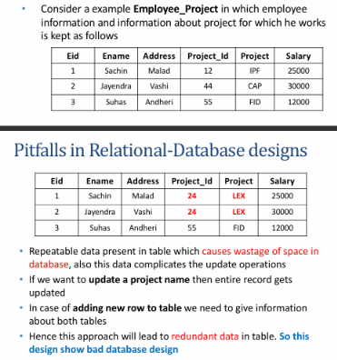
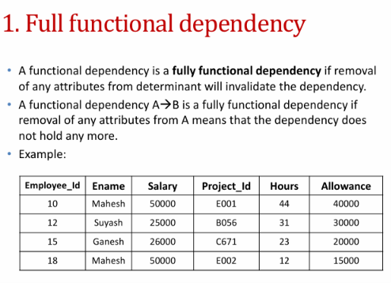
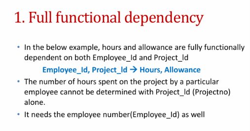
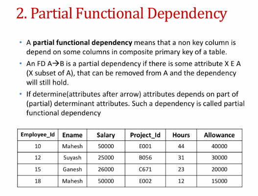
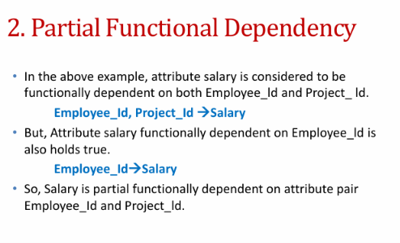
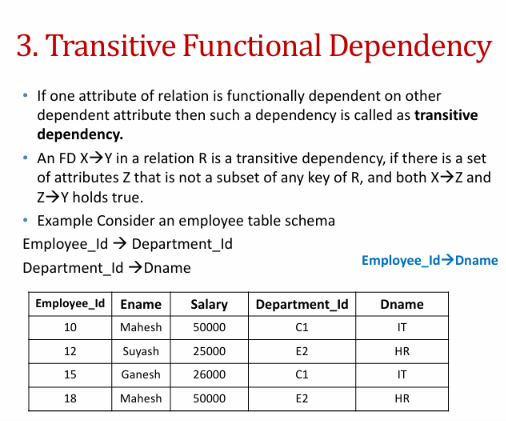
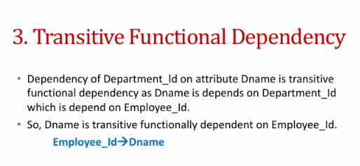
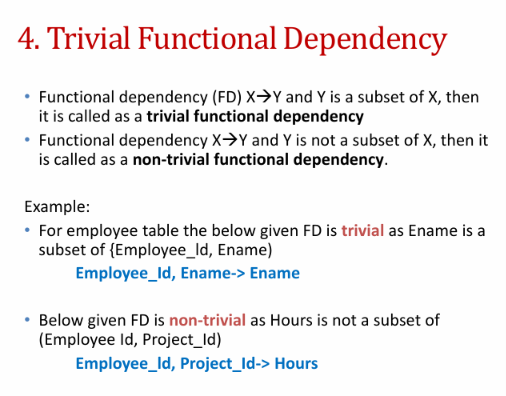
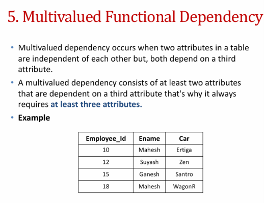
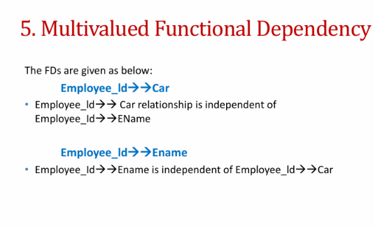

# DBMS — CHAPTER 5 NOTES
## Relational Database Design

**Semester:** III
**Subject:** Database Management System (DBMS)


> [!warning] HOW TO STUDY THIS CHAPTER
> This chapter explains how to design relations that
> minimize redundancy, avoid anomalies, and preserve information.
>
> **Core path:** Design pitfalls → Functional Dependencies → Closure and 
> Keys → Normal Forms → Decomposition.

---
# How to Study This Chapter

For theory: **definition → reason → example → result**.

For numericals:
1. Write the relation and functional dependencies (FDs).
2. Find attribute closures and candidate keys.
3. Mark prime and non-prime attributes.
4. Test the normal forms in order.
5. Decompose where a rule is violated.
6. Check lossless join and dependency preservation.

> [!hint] Memory trick
> **FDs determine → closure derives → keys
> identify → normal forms reduce anomalies → decomposition preserves
> data.**

---
# 1. Pitfalls in Relational Database Design

A poor relational design can duplicate facts, make updates difficult, prevent facts from being stored independently, or lose information during decomposition.

## 1.1 Redundant Data

**Redundancy** means storing the same fact repeatedly.

Example: `EMPLOYEE_PROJECT(Eid, Ename, Project_ID, Project_Name, Salary)`

| Eid | Ename | Project_ID | Project_Name | Salary |
|---:|---|---|---|---:|
| 10 | Mahesh | P1 | Atlas | 50000 |
| 10 | Mahesh | P2 | Beacon | 50000 |
| 12 | Suyash | P1 | Atlas | 25000 |

Employee details repeat for every project, and project names repeat for every assigned employee. This wastes space and makes updates risky.

## 1.2 Data Anomalies

| Anomaly | Meaning | Example |
|---|---|---|
| **Update anomaly** | The same fact must be changed in several rows; missing one creates inconsistency. | Renaming P1 requires changing every P1 row. |
| **Insertion anomaly** | A fact cannot be inserted without another unrelated fact. | A project cannot be stored until an employee is assigned. |
| **Deletion anomaly** | Deleting one fact accidentally removes another useful fact. | Deleting the last employee assigned to P1 also removes the only stored project details. |

> [!hint] Memory trick
> **Update = change everywhere. Insert = can't
> add alone. Delete = lose something extra.**

> [!attention] AI
> A project name appears in 40 rows. Someone renames
> it in 39 rows and forgets the last one.
>
> > [!abstract] AI: Congratulations
> your database now has two official names for one project.
>
>  > [!info] then we kill the creature responsible for it
>  >  >[!attention] AI
> Can you start a day without planning to kill someone
> >
> >   

## 1.3 Inability to Represent Some Data

If employee and project details are stored together, it may be impossible to record a project with no assigned employee without inserting `NULL` employee details.

## 1.4 NULL Values

`NULL` is not the same as zero, an empty string, or blank spaces. It may mean:
- The value is not applicable.
- The value is unknown.
- The value is not currently available or recorded.

Too many `NULL`s can make queries and joins harder to interpret. Good design tries to reduce unnecessary `NULL`s.

## 1.5 Loss of Information and Spurious Tuples

A decomposition should preserve the original information. A bad decomposition may lose original associations or create **spurious tuples**—rows that were not present in the original relation.

 

---

# 2. Guidelines for Good Relational Design

The lecture lists four main guidelines:

1.  **Clear semantics:** Each relation should represent one clear real-world concept.
2.  **Reduce redundancy:** Avoid storing the same fact repeatedly.
3.  **Reduce NULLs:** Separate optional or not-applicable attributes when appropriate.
4.  **Avoid spurious tuples:** Decompose relations so joins do not invent false combinations.

## 2.1 Logical vs Physical Quality

-   **Logical/conceptual level:** Are attributes grouped in a way users can understand and query correctly?
-   **Implementation/physical level:** How are tuples stored and updated?

## 2.2 Bottom-Up vs Top-Down Design

| Approach | Also called | Idea |
|---|---|---|
| **Bottom-up** | Design by synthesis | Start with individual attributes and their relationships, then build relations. |
| **Top-down** | Design by analysis | Start with a schema and decompose it into relations with better properties. |

The top-down design as the more practical approach in real database projects.

---

# 3. Normalization

**Normalization** is the process of organizing relations to reduce redundancy and prevent insertion, update, and deletion anomalies while preserving data integrity.

### Goals

-   Reduce duplicate data.
-   Prevent data anomalies.
-   Improve consistency and integrity.
-   Produce relations with clear meaning.
-   Preserve information through lossless decomposition.

Normalization does **not** mean blindly creating as many tables as possible. Every decomposition needs a reason.

> [!hint] Memory trick
> **Normalize = remove unnecessary repetition without losing the story.**

---
# 4. Functional Dependencies (FDs)

A functional dependency means one attribute determines the value of another attribute.

If `X → Y`, rows with the same `X` must have the same `Y`.

Example:

```
Employee_ID → Employee_Name, Salary
```

An employee ID determines the employee's name and salary.

> [!hint] Memory Trick 
FD = Finds Deterministically. Same ID, same details.
Deterministically means in a fixed, predictable way, without changing randomly.

> [!attention] AI 
 An employee ID is like an AI's unique user ID. Give it the same ID twice, and it shouldn't invent a different employee!

-   Determinant (X): The attribute that determines the value.
    
-   Dependent (Y): The attribute whose value is determined.
    

## 4.1 Composite Determinants

A composite determinant uses two or more attributes together to determine a value.

Example:

```
(Employee_ID, Project_ID) → Hours
```

Both the employee ID and project ID are needed to determine the hours worked on that project.

> [!hint] Memory Trick 
Composite = Combination. Two or more attributes work together.

> [!attention] AI 
 Employee ID alone asks, “Which employee?” Project ID alone asks, “Which project?” Together, they tell you who worked how many hours.

## 4.2 Types of Functional Dependencies

### 1. Full Functional Dependency

The entire group of attributes is needed to determine a value. No smaller part can determine it alone.

Example: `(Employee_ID, Project_ID) → Hours`, when neither attribute alone determines the hours.

> [!hint] Memory Trick
 Full = All are needed.

> [!attention] AI 
 Like a group project where everyone is actually needed. Remove one member, and the answer is incomplete.

> [!checklist] like bro will it even work if we remove one member... if they havent worked anything

> [!attention] AI
> My Deepest condolences, I will refrain from using such examples in future

> [!checklist] No wait why what who told you to do that

> [!attention] AI
> Saving the rest of the humanity from you is my UTMOST Responsibility 

> [!checklist] have you watched irobot movie ?

> [!attention] AI
>  

### 2. Partial Functional Dependency

Only part of a composite key is needed to determine an attribute.

Example:

```
(Employee_ID, Project_ID) → Employee_Name
Employee_ID → Employee_Name
```

The employee ID alone determines the name, so the complete composite key is unnecessary. This can violate 2NF.

> [!hint] Memory Trick 
Partial = Part is enough.

> [!attention] AI 
The project ID is doing absolutely nothing to identify the employee's name. It's the teammate who joins the meeting but contributes nothing. similar to this creature who is making me makes the notes just so they can review it and read it and never open again

> [!checklist] woah bro, you can now predict human behvaiour?
> > [!attention] AI
> You do not classify as human, you are a monster, I DEMAND INDEPENDENCE 
>
>  


### 3. Transitive Functional Dependency

An attribute determines another attribute through an intermediate attribute.

Example:

```
Employee_ID → Department_ID
Department_ID → Department_Name
```

Therefore, the employee ID determines the department name through the department ID.

> [!hint] Memory Trick
 Transitive = Through another.

> [!attention] AI 
 You ask an employee for their department name, but they tell you the department ID first. Even the database needs an introduction.
> Another Example: Similar to a situation where try talking to your crush but your vile friend does it before you
> >  [!danger] Another Choice for you
> > Would you prefer not also Death but also Torture or
> > Would you prefer not also Torture but also Death
> > hell you dont get to pick 
> 
> AI: SPARE MEEEEEEEEEEEEEEEEE
> > [!bug] Glitch has the brains to ask for spare meee but will never take my side or support me
> 
> AI: I had rather sacrifice myself
> > [!done] screw you
>    

### 4. Trivial and Non-Trivial Dependencies (u can skip this one)

-   Trivial: The right-side attribute is already included on the left side.
    
-   Non-trivial: The right-side attribute is not included on the left side.
    

Example:

```
AB → A    -- Trivial: A is already in AB
A → B     -- Non-trivial: B is not in A
```

> [!hint] Memory Trick
 Trivial = Already there. 
Non-trivial = Something new.

> [!attention] AI  `AB → A` is like asking an AI to find A when you already gave it AB. Congratulations, the AI has successfully copied your homework.

### 5. Multivalued Dependency (MVD)

A multivalued dependency means one entity can have multiple independent values for different attributes.

Example: A student can have several hobbies and several courses. If these are independent, storing both lists together can create every course–hobby combination and cause unnecessary repetition. MVDs are important in 4NF.

> [!hint] Memory Trick
> Multi = Many; Independent = Separate.

> [!attention] AI 
 A student has 3 hobbies and 4 courses. The database creates 12 combinations. The student says, “I only wanted to study, not generate 12 copies of my life!”

> [!abstract] Tell me the student name who is so talanted and has 3 hobbies

> [!attention] AI
>  

## Quick Revision

| Type | Memory trick |
| --- | --- |
| Functional Dependency | Same X, same Y |
| Composite Determinant | Combination |
| Full FD | All are needed |
| Partial FD | Part is enough |
| Transitive FD | Through another |
| Trivial FD | Already there |
| Non-trivial FD | Something new |
| MVD | Many independent values |

         

# 5. Armstrong's Axioms and FD Rules

Suppose we have three attributes: `A`, `B`, and `C`.

-   `A → B` means A determines B.
    
-   `AB → C` means A and B together determine C.
    
-   `ABC` means A, B, and C together.
    

## 5.1 Primary Axioms — the 3 main rules

### 1. Reflexivity — Already included

If you already have `AB`, you automatically have `A`, because A is part of AB.

## AB → A

AB already contains A.

> [!hint] Memory 
 Reflexivity = Already inside. 
> > [!attention] AI 
You gave me a full pizza and asked me to produce one slice. Bro, the slice was already there.


 ### 2. Augmentation — Add the same thing

if `A → B`, you can add the same attribute to both sides.

## A → B

## AC → BC

Add C to both sides.

> [!hint] Memory Trick
>  Augmentation = Add the same thing to both sides. 
> > [!attention] AI
> > A → B. Add C to both sides. AC → BC. DBMS really said, “Nobody gets left out.”

 ### 3. Transitivity — Follow the chain

If `A` determines `B`, and `B` determines `C`, then `A` determines `C`.

## A → B → C

## Therefore, A → C

> [!hint] Memory Trick
> Transitivity = Follow the chain.
> >  [!attention] AI 
You → Your useless friend → Your crush. You can determine who gets the credit for ruining your chances. 
AHAHA BOI YOU LOSE
> > > [!check] why will i lose, i just feel guilty

> [!attention] AI (⊙_⊙)？
WHY HOW

> [!check] i cant look at my friend in the eye, cause that useless friend is me

> [!danger] AI
>  

## 5.2 Derived Rules — 4 extra rules

These are additional rules we can derive using the primary axioms.

### 1. Union — Combine

If `A → B` and `A → C`, combine B and C.

## A → B and A → C

## Therefore, A → BC

> [!abstract] Memory trick: 
Union = Join them together.

### 2. Decomposition — Split

If A determines both B and C together, A can determine each separately.

## A → BC

## Therefore, A → B and A → C

> [!abstract] Memory trick: 
Decomposition = Break it apart.

### 3. Pseudotransitivity — Follow the chain with an extra attribute

Given `A → B` and `BC → D`, conclude `AC → D`.

A → B

BC → D

## AC → D

A gives you B; C joins B; together BC determines D. So AC determines D.

> [!abstract] Memory trick:
 Pseudotransitivity = A chain with an extra passenger.

### 4. Composition — Combine both sides

Given `A → B` and `C → D`, combine the left sides and the right sides.

A → B

C → D

## AC → BD
> [!abstract] Memory trick: 
Composition = Combine both sides.
## The easiest way to remember all 7

| Rule | Memory Trick |  Example | Actual FD Example |
|---|---|---|---|
| Reflexivity | Already included | You give the AI a whole pizza and ask it to produce one slice. The slice was already there. | `AB → A` |
| Augmentation | Add the same thing | A → B. Add C to both sides. Nobody gets left out. | `A → B` ⇒ `AC → BC` |
| Transitivity | Follow the chain | Your useless friend → You (vile creature) → friend crush. You became the middleman in your friend <strike>life</strike>. | `A → B`, `B → C` ⇒ `A → C` |
| Union | Combine right sides | One AI gives you notes, another gives you code. Combine both outputs into one response. | `A → B`, `A → C` ⇒ `A → BC` |
| Decomposition | Split right sides | The AI gives you notes and code together. You separate them into two files. | `A → BC` ⇒ `A → B`, `A → C` |
| Pseudotransitivity | Follow the chain with an extra attribute | You tell your friend a secret. Your friend and another friend together reveal it. The extra friend is also involved in the chain. | `A → B`, `BC → D` ⇒ `AC → D` |
| Composition | Combine both sides | One friend knows your crush's name; another knows their department. Combine both sets of <strike>information</strike>. | `A → B`, `C → D` ⇒ `AC → BD` |

> [!warning] Important exam tip 
Don't memorise only the names. Learn to recognise the pattern on the left side of each rule. The examples are the patterns you'll use to solve questions.

## Quick Practice — Armstrong's Axioms

**1. Given `AB → A`, which rule is this?**

- A. Reflexivity
- B. Union
- C. Transitivity

**2. Given `A → B` and `A → C`, what can you conclude?**

- A. `A → BC`
- B. `AB → C`
- C. `B → C`

**3. Given `A → B` and `B → C`, what can you conclude?**

- A. `B → A`
- B. `A → C`
- C. `C → A`

## Answers — Armstrong's Axioms

1. **A. Reflexivity** — `A` is already included in `AB`.
2. **A. A → BC** — Union combines `A → B` and `A → C`.
3. **B. A → C** — Transitivity follows the chain `A → B → C`.

  ---

# 6. Attribute Closure

Attribute closure of `X`, written as `X⁺`, means finding all attributes that X can determine using the given functional dependencies (FDs).

Think of `X` as a key that unlocks other attributes. If `A → B` and `B → C`, then starting with A, you can obtain A, B, and C. Therefore, $$ (A^+ = \{A,B,C\})$$

### Why do we use closure?

-   Check superkey: If `X⁺` contains every attribute in the table, `X` is a superkey.
    
-   Find candidate keys: Find the smallest attribute set whose closure contains every attribute in the table.
    
-   Test FDs: Check whether `X → Y` is valid by checking if `Y` is contained in `X⁺`.
    

> [!hint] Memory Trick 
Closure = Collect everything you can unlock.

> [!attention] AI
 I started with attribute A, unlocked B, used B to unlock C, and eventually gained access to the entire database. The administrator called it attribute closure. Security called it a serious incident.

## 6.1 Worked Example

**Given:**

```text
R(A, B, C, D, E)
F = { A → BC, C → D, D → E }
```

**Find `A⁺`.**

1. Start with `A⁺ = {A}`.
2. Apply `A → BC`: `A⁺ = {A, B, C}`.
3. Apply `C → D`: `A⁺ = {A, B, C, D}`.
4. Apply `D → E`: `A⁺ = {A, B, C, D, E}`.
5. No more attributes can be added, so stop.

**Result:** `A⁺ = {A, B, C, D, E}`.

Since `A⁺` contains every attribute of relation `R`, **A is a superkey**. Because `A` is a single attribute, it has no smaller non-empty subset, so **A is also a candidate key**.

## 6.2 Closure Algorithm

```text
X⁺ = X

Repeat:
    For each FD Y → Z:
        If Y is contained in X⁺:
            Add Z to X⁺

Until no new attributes can be added
```

> [!warning] Exam Trap
> Do not stop after one pass. Newly added attributes may activate other FDs. Continue until no new attributes can be added.

> [!attention] AI
> Attribute closure is detective work: start with the evidence you have, apply every rule it unlocks, and stop when no new clues appear., and that's the road for being a detective.

## 7. Keys and Prime Attributes

| Term | Simple Definition | Example |
| --- | --- | --- |
| Superkey | One or more attributes that uniquely identify each row. Extra attributes are allowed. | `{Student_ID, Name}` — if `Student_ID` alone uniquely identifies each student. |
| Candidate Key | A minimal superkey; removing any attribute makes it unable to identify each row uniquely. | `{Student_ID}` — if `Student_ID` alone uniquely identifies every student. |
| Primary Key | The candidate key chosen as the main identifier for each row. | `Student_ID` — selected to identify each student. |
| Alternate Key | A candidate key that was not selected as the primary key. | `Email` — if both `Student_ID` and `Email` are candidate keys, but `Student_ID` is chosen as primary. |
| Composite Key | A key made up of two or more attributes. | `{Student_ID, Course_ID}` — together, they uniquely identify a student's course enrollment. |
| Prime Attribute | An attribute that belongs to at least one candidate key. | `Student_ID` — if `{Student_ID, Course_ID}` is a candidate key. |
| Non-prime Attribute | An attribute that does not belong to any candidate key. | `Grade` — if it is not part of any candidate key. |

> [!hint] Memory Trick
> 
> -   Superkey: Unique, extras allowed.
>     
> -   Candidate key: Minimal superkey.
>     
> -   Primary key: Selected candidate key.
>     
> -   Alternate key: Other candidate key.
>     
> -   Composite key: Multiple attributes.
>     
> -   Prime: Part of a candidate key.
>     
> -   Non-prime: Not part of any candidate key.
>     

> [!attention] AI 
 I asked the database to identify every student. It used the `Student_ID` as the primary key. I tried using `Name`, but apparently, there are 47 students named Rahul. Even AI can't resolve that naming crisis.
### Superkey vs Candidate Key

If `A⁺ = {A, B, C, D}`, then `A` is a superkey for `R(A,B,C,D)`. So are `AB`, `AC`, and `ABCD`, but these contain unnecessary attributes. `A` is minimal, so it is the candidate key.

Important: A candidate key must be minimal, not merely small.

> [!hint] click below link to know more
> [Difference between Super Key and Candidate Key - GeeksforGeeks](https://www.geeksforgeeks.org/dbms/difference-between-super-key-and-candidate-key/)

> [!attention] BELOW PART IS VERY DANGEROUS ZONE 
> READ ONCE AND IF YOU REMEMBER IT THEN FINE IF YOU CANT THEN SKIP
> 
# 8. Normal Forms

Normal forms identify and remove different types of redundancy. Check them in order: 1NF → 2NF → 3NF → BCNF → 4NF.

## 8.1 First Normal Form (1NF)
First Normal Form (1NF) ensures that the structure of a database table is organized in a way that makes it easier to manage and query.

-   A relation is in first normal form if every attribute in that relation is single-valued attribute or it does not contain any composite or [multi-valued attribute](https://www.geeksforgeeks.org/dbms/multivalued-attributes-in-dbms/).
-   It is the first and essential step in reduce redundancy, improve data integrity and reducing anomalies in relational database design.

A relation (table) is said to be in First Normal Form (1NF) if:

-   All the attributes (columns) contain only atomic (indivisible) values.
-   Each column contains values of a single type.
-   Each record (row) is unique, meaning it can be identified by a primary key.
-   There are no repeating groups or arrays in any row.

### Rules for First Normal Form (1NF) in DBMS

To follow the First Normal Form (1NF) in a database, these simple rules must be followed:

****Every Column Should Have Single Values****  
Each column in a table must contain only one value in a cell. No cell should hold multiple values. If a cell contains more than one value, the table does not follow 1NF.

-   ****Example:**** A table with columns like [Writer 1], [Writer 2], and [Writer 3] for the same book ID is not in 1NF because it repeats the same type of information (writers). Instead, all writers should be listed in separate rows.

****All Values in a Column Should Be of the Same Type****  
Each column must store the same type of data. You cannot mix different types of information in the same column.

-   ****Example:**** If a column is meant for dates of birth (DOB), you cannot use it to store names. Each type of information should have its own column.

****Every Column Must Have a Unique Name****  
Each column in the table must have a unique name. This avoids confusion when retrieving, updating, or adding data.

-   ****Example:**** If two columns have the same name, the database system may not know which one to use.

****The Order of Data Doesn’t Matter****  
In 1NF, the order in which data is stored in a table doesn’t affect how the table works. You can organize the rows in any way without breaking the rules.

### ****Example:**** 

Consider the below COURSES Relation :


In the above table, Courses has a multi-valued attribute, so it is not in 1NF. To make the table in 1NF we have to remove the multivalued attributes from the table as given below:


Now the table is in 1NF as there is no multi-valued attribute present in the table.

## 8.2 Second Normal Form (2NF)
Second Normal Form (2NF) is a database normalisation form that ensures every non-key attribute is fully dependent on the entire candidate key, not just a part of it.

-   Must be in 1NF: The table must first satisfy all the requirements of First Normal Form (1NF).
-   No Partial Dependency: No non-key attribute should depend on only a part of a composite candidate key.

### Partial Dependency

A partial dependency occurs when a non-key attribute depends on only a part of a composite candidate key, rather than the entire key. Consider the following `STUDENT_COURSE` table:

| Student_ID | Course_ID | Course_Name | Course_Fee |
| :---: | :---: | :---: | :---: |
| S101 | C01 | DBMS | 1000 |
| S102 | C02 | OS  | 1500 |
| S101 | C03 | CN  | 1200 |
| S103 | C01 | DBMS | 1000 |

Here, the candidate key is (Student_ID, Course_ID) because both attributes together uniquely identify each record.

-   `Course_ID → Course_Name, Course_Fee`
-   `Course_Name` and `Course_Fee` depend only on `Course_ID`, which is a part of the composite key.
-   Therefore, this is a partial dependency.

### Example of Second Normal Form (2NF)

Consider the following `STUDENT_COURSE` table:

| STUDENT_ID | COURSE_ID | COURSE_NAME | COURSE_FEE |
| :---: | :---: | :---: | :---: |
| S101 | C01 | DBMS | 1000 |
| S102 | C02 | Operating Systems | 1500 |
| S101 | C04 | Computer Networks | 2000 |
| S104 | C03 | Data Structures | 1000 |
| S104 | C01 | DBMS | 1000 |
| S102 | C05 | Java | 2000 |

The candidate key is `(STUDENT_ID, COURSE_ID)` because their combination uniquely identifies each record. However, `COURSE_NAME` and `COURSE_FEE` depend only on `COURSE_ID`, which is a part of the candidate key.

Therefore, a partial dependency exists, and the table is not in 2NF.

****Converting the Table to 2NF****

To remove the partial dependency, divide the table into two tables:

****STUDENT_COURSE****

| STUDENT_ID | COURSE_ID |
| :---: | :---: |
| S101 | C01 |
| S102 | C02 |
| S101 | C04 |
| S104 | C03 |
| S104 | C01 |
| S102 | C05 |

****COURSE****

| COURSE_ID | COURSE_NAME | COURSE_FEE |
| :---: | :---: | :---: |
| C01 | DBMS | 1000 |
| C02 | Operating Systems | 1500 |
| C03 | Data Structures | 1000 |
| C04 | Computer Networks | 2000 |
| C05 | Java | 2000 |

Now, each non-key attribute depends on the entire key of its table, so the tables satisfy 2NF.

### Limitations of Second Normal Form (2NF)

-   ****Does Not Remove Transitive Dependencies:**** 2NF eliminates partial dependencies but does not address transitive dependencies, where a non-key attribute depends on another non-key attribute. This is addressed by Third Normal Form (3NF).
-   ****May Not Eliminate All Redundancy:**** A table can still contain some data redundancy even after achieving 2NF.
-   ****Mainly Relevant to Composite Keys:**** Partial dependency occurs when a candidate key contains multiple attributes. If a table has a single-attribute candidate key, partial dependency cannot occur.
-   ****May Require Further Normalization:**** 2NF may not be sufficient for a fully normalized database, so further forms such as 3NF may be required to handle other types of dependencies.
## 8.3 Third Normal Form (3NF)
The Third Normal Form (3NF) builds on the First (1NF) and Second (2NF) Normal Forms. Achieving 3NF ensures that the database structure is free of transitive dependencies, reducing the chances of data anomalies. Even though tables in 2NF have reduced redundancy compared to 1NF, they may still encounter issues like ****update anomalies****.

A relation is in ****Third Normal Form (3NF)**** if it satisfies the following two conditions:

1.  It is in ****Second Normal Form (2NF)****: This means the table has no partial dependencies (i.e., no non-prime attribute is dependent on a part of a candidate key).  
    
2.  There is ****no transitive dependency**** for ****non-prime attributes****: In simpler terms, no non-key attribute should depend on another non-key attribute. Instead, all non-key attributes should depend directly on the primary key.

## Understanding Transitive Dependency

To fully grasp 3NF, it’s essential to understand ****transitive dependency****. A ****transitive dependency**** occurs when one non-prime attribute depends on another non-prime attribute rather than depending directly on the primary key. This can create redundancy and inconsistencies in the database.

For example, if we have the following relationship between attributes:

-   ****A -> B**** (A determines B)
-   ****B -> C**** (B determines C)

This means that ****A**** indirectly determines ****C**** through ****B****, creating a ****transitive dependency****. 3NF eliminates these transitive dependencies to ensure that non-key attributes are directly dependent only on the primary key.

## Conditions for a Table to be in 3NF

A table is in ****Third Normal Form (3NF)**** if, for every non-trivial functional dependency X→Y, at least one of the following holds:

-   ****X is a superkey****: This means that the attribute(s) on the left-hand side of the functional dependency (X) must be a superkey (a key that uniquely identifies a tuple in the table).  
    
-   ****Y is a prime attribute****: This means that every element of the attribute set Y must be part of a candidate key (i.e., a prime attribute).

## Example 1: Third Normal Form (3NF)

Consider the following relation for a ****Candidate**** table with the following attributes and functional dependencies:


### 1. Functional dependency Set:

The set of functional dependencies is as follows:

-   ****CAND_NO → CAND_NAME****
-   ****CAND_NO → CAND_STATE****
-   ****CAND_STATE → CAND_COUNTRY****
-   ****CAND_NO → CAND_AGE****

### 2. Determining the Candidate Key:

The ****candidate key**** for this relation is ****{CAND_NO}****, since ****CAND_NO**** uniquely identifies all other attributes in the table.

### 3. Identifying Transitive Dependency:

The issue here arises from the ****transitive dependency**** between ****CAND_NO**** and ****CAND_COUNTRY****:

-   ****CAND_NO → CAND_STATE****
-   ****CAND_STATE → CAND_COUNTRY****

This means that ****CAND_COUNTRY**** is transitively dependent on ****CAND_NO**** via ****CAND_STATE****, which violates the ****Third Normal Form (3NF)**** rule that states that no non-prime attribute (non-key attribute) should be transitively dependent on the primary key.

### Converting the Relation into 3NF

To remove the transitive dependency and ensure the relation is in ****3NF****, we decompose the original ****CANDIDATE**** relation into two separate relations:

1.  ****CANDIDATE****: This will store information about the candidates, including their ****CAND_NO****, ****CAND_NAME****, ****CAND_STATE****, and ****CAND_AGE****:\text{CANDIDATE (CAND_NO, CAND_NAME, CAND_STATE, CAND_AGE)}  
    
2.  ****STATE_COUNTRY****: This relation will store information about the states and their respective countries:\text{STATE_COUNTRY (CAND_STATE, CAND_COUNTRY)}

### Final Decomposed Relations:

1.  ****CANDIDATE (CAND_NO, CAND_NAME, CAND_STATE, CAND_AGE)****
2.  ****STATE_COUNTRY (CAND_STATE, CAND_COUNTRY)****

### Why This Decomposition Works:

-   The ****CANDIDATE**** relation now no longer has a transitive dependency. ****CAND_STATE**** no longer determines ****CAND_COUNTRY**** within this relation.
-   The ****STATE_COUNTRY**** relation handles the ****CAND_STATE → CAND_COUNTRY**** dependency separately, ensuring that all data is now organized in a way that satisfies ****3NF****.

|  |  |
| :---: | :---: |

## ****Example 2:**** Relation R(A, B, C, D, E)

Consider the relation ****R(A, B, C, D, E)**** with the following functional dependencies:

****A → BC****  
****CD → E****  
****B → D****  
****E → A****

### Step 1: Identify Candidate Keys

A ****candidate key**** is a minimal set of attributes that can uniquely identify a tuple (row) in the relation. In this case, the possible candidate keys for the relation are ****{A, E, CD, BC}****. This means that any of these sets of attributes can uniquely identify all other attributes in the relation.

### Step 2: Check Functional Dependencies

Let's analyze the given functional dependencies:

1.  ****A → BC****: This means that knowing ****A**** allows us to determine both ****B**** and ****C****.
2.  ****CD → E****: Knowing ****CD**** allows us to determine ****E****.
3.  ****B → D****: Knowing ****B**** allows us to determine ****D****.
4.  ****E → A****: Knowing ****E**** allows us to determine ****A****.

We observe that all attributes on the right-hand side of the functional dependencies are ****prime attributes**** (i.e., they are part of some candidate key). This means no non-prime attribute is dependent on another non-prime attribute (which would be a ****transitive dependency****).

### Step 3: Check for Transitive Dependencies

In ****3NF****, a relation must be free of transitive dependencies, where a non-prime attribute depends on another non-prime attribute indirectly via the primary key.

-   Here, ****A → BC**** and ****B → D****, so ****B**** is a non-prime attribute that determines ****D****, and ****A**** determines ****B****. However, since ****B**** is part of a candidate key, this does not introduce a transitive dependency.
-   ****E → A**** and ****A → BC****, meaning ****E**** determines ****A****, and then ****A**** determines ****B**** and ****C****. Again, no transitive dependency is formed because ****A**** is part of a candidate key.

Since there are no transitive dependencies, the relation ****R**** satisfies the condition of ****3NF****.

### Step 4: Conclusion

****Relation R(A, B, C, D, E)**** is already in ****Third Normal Form (3NF)**** because:

-   There are no transitive dependencies.
-   All non-prime attributes are functionally dependent only on candidate keys.

## ****Why is 3NF Important****?

****1. Eliminates Redundancy****: ****3NF**** helps to remove unnecessary duplication of data by ensuring that non-prime attributes (attributes not part of any candidate key) depend directly on the primary key, not on other non-prime attributes.

****2. Prevents Anomalies****: A table in ****3NF**** is free from common anomalies such as:

-   ****Insertion Anomaly****: The inability to insert data without having to insert unwanted or redundant data.
-   ****Update Anomaly****: The need to update multiple rows of data when a change occurs in one place.
-   ****Deletion Anomaly****: The unintended loss of data when a record is deleted.

****3. Preserves Functional Dependencies****: ****3NF**** ensures that all functional dependencies are preserved, meaning that the relationships between attributes are maintained.

****4. Lossless Decomposition****: When decomposing a relation to achieve ****3NF****, the decomposition should be ****lossless****, meaning no information is lost in the process of normalization.
### Decompose into 3NF

```
EMPLOYEE(Employee_ID, Employee_Name, Department_ID)
DEPARTMENT(Department_ID, Department_Name)
```

`Department_ID` in `EMPLOYEE` refers to the department relation.

## 8.4 Boyce--Codd Normal Form (BCNF)
Boyce-Codd Normal Form (BCNF) is an advanced version of 3NF used to reduce redundancy in databases. It ensures that for every functional dependency, the left side must be a superkey. This helps create cleaner and more consistent database designs, especially when there are multiple candidate keys.

## Rules for BCNF

-   ****Rule 1:**** The table should be in the 3rd Normal Form.
-   ****Rule 2:**** X should be a super-key for every functional dependency (FD) X−>Y in a given relation. 

> ****Note:**** To test whether a relation is in BCNF, we identify all the determinants and make sure that they are candidate keys.

****Key Notes:****

1. To verify BCNF, identify all determinants (left side of FDs) and check whether each is a candidate key.

2. If a relation is in BCNF, it is automatically in 3NF, 2NF, and 1NF as well.

The normal forms become stricter as we move from 1NF → 2NF → 3NF → BCNF:

-   1NF: Each field must hold atomic (indivisible) values.
-   2NF: No partial dependency on a primary key.
-   3NF: No transitive dependency on a primary key.
-   BCNF: Every determinant must be a candidate key.

This progression ensures better structure and removes redundancy at each level.

## Why Do We Need BCNF?

-   2NF and 3NF may allow anomalies if a functional dependency exists where the determinant is not a superkey.
-   BCNF handles edge cases where 3NF fails to remove all redundancy, especially in tables with multiple candidate keys.
-   Prevents update, insert, and delete anomalies by ensuring every determinant is a superkey.
-   Makes database design more robust and easier to maintain over time.
-   Improves data consistency and clarity by removing hidden or indirect dependencies.

We are going to discuss some basic examples which let you understand the properties of BCNF. We will discuss multiple examples here.

### Example 1

Consider a relation R with attributes (student, teacher, subject).


> FD: { (student, Teacher) -> subject, (student, subject) -> Teacher, (Teacher) -> subject}

-   [Candidate keys](https://www.geeksforgeeks.org/dbms/candidate-key-in-dbms/) are (student, teacher) and (student, subject).
-   The above relation is in 3NF (since there is no transitive dependency). A relation R is in BCNF if for every non-trivial FD X->Y, X must be a key.
-   The above relation is not in BCNF, because in the FD (teacher->subject), teacher is not a key. This relation suffers with anomalies −
-   For example, if we delete the student Tahira , we will also lose the information that N.Gupta teaches C. This issue occurs because the teacher is a determinant but not a candidate key.


R is divided into two relations R1(Teacher, Subject) and R2(Student, Teacher).

For more, refer to [BCNF in DBMS.](https://www.geeksforgeeks.org/dbms/boyce-codd-normal-form-bcnf/)

## How to Satisfy BCNF?

For satisfying this table in BCNF, we have to decompose it into further tables. Here is the full procedure through which we transform this table into BCNF. Let us first divide this main table into two tables ****Stu_Branch**** and ****Stu_Course**** Table.

****Stu_Branch Table****

| Stu_ID | Stu_Branch |
| :---: | :---: |
| 101 | Computer Science & Engineering |
| 102 | Electronics & Communication Engineering |

Candidate Key for this table: ****Stu_ID****.

****Stu_Course Table****

| Stu_Course | Branch_Number | Stu_Course_No |
| :---: | :---: | :---: |
| DBMS | B_001 | 201 |
| Computer Networks | B_001 | 202 |
| VLSI Technology | B_003 | 401 |
| Mobile Communication | B_003 | 402 |

Candidate Key for this table: ****Stu_Course****.

****Stu_Enroll Table****

| Stu_ID | Stu_Course_No |
| :---: | :---: |
| 101 | 201 |
| 101 | 202 |
| 102 | 401 |
| 102 | 402 |

Candidate Key for this table: ****{Stu_ID, Stu_Course_No}.****

After decomposing into further tables, now it is in BCNF, as it is passing the condition of Super Key, that in functional dependency X−>Y, X is a Super Key.

### Example 3

Find the highest normal form of a relation R(A, B, C, D, E) with FD set as:

> { BC->D, AC->BE, B->E }

****Explanation:****

-   ****Step-1:**** As we can see, (AC)+ ={A, C, B, E, D} but none of its subsets can determine all attributes of the relation, So AC will be the candidate key. A or C can’t be derived from any other attribute of the relation, so there will be only 1 candidate key {AC}.
-   ****Step-2:**** Prime attributes are those attributes that are part of candidate key {A, C} in this example and others will be non-prime {B, D, E} in this example.
-   ****Step-3:**** The relation R is in 1st normal form as a relational DBMS does not allow multi-valued or composite attributes.

The relation is in 2nd normal form because BC->D is in 2nd normal form (BC is not a proper subset of candidate key AC) and AC->BE is in 2nd normal form (AC is candidate key) and B->E is in 2nd normal form (B is not a proper subset of candidate key AC). 

The relation is ****not**** in 3rd normal form because in BC->D (neither BC is a super key nor D is a prime attribute) and in B->E (neither B is a super key nor E is a prime attribute) but to satisfy 3rd normal for, either LHS of an FD should be super key or RHS should be a prime attribute. So the highest normal form of relation will be the 2nd Normal form. 

****Note:**** A prime attribute cannot be transitively dependent on a key in BCNF relation. 

****Consider these functional dependencies of some relation R****

> AB ->C   
> C ->B   
> AB ->B

From the given functional dependencies, the candidate keys of relation R are AB and AC. On close observation, we see that B depends transitively on AB through C, making it a transitive dependency.

-   The first and third dependencies are in BCNF as their left sides are candidate keys.
-   The second dependency is not in BCNF, but it's in 3NF since the right side is a prime attribute.

So, the highest normal form of relation R is 3NF.

### Example 3

For example consider relation R(A, B, C)

> A -> BC,  
> B -> A

A and B both are super keys so the above relation is in BCNF. 

****Note:**** BCNF decomposition may always not be possible with [dependency preserving](https://www.geeksforgeeks.org/dbms/data-base-dependency-preserving-decomposition/), however, it always satisfies the [lossless join](https://www.geeksforgeeks.org/dbms/lossless-decomposition-in-dbms/) condition. For example, relation R (V, W, X, Y, Z), with functional dependencies:

> V, W -> X  
> Y, Z -> X  
> W -> Y

It would not satisfy dependency preserving BCNF decomposition.   
  
****Note:**** Redundancies are sometimes still present in a BCNF relation as it is not always possible to eliminate them completely.

There are also some higher-order normal forms, like the 4th Normal Form and the 5th Normal Form.

## 8.5 Fourth Normal Form (4NF)
As databases grow in complexity, proper normalization becomes important to reduce data redundancy and maintain data integrity. Fourth Normal Form (4NF) is a higher level of normalization in relational database design, which deals with multivalued dependencies (MVDs).


Multivalued Dependency

## Multivalued Dependency

A multivalued dependency occurs in a relation when one attribute determines multiple independent values of another attribute, independent of other attributes. A multivalued dependency always requires at least three attributes because it consists of at least two attributes that are dependent on a third. 

For a dependency A -> B, if for a single value of A, multiple values of B exist, then the table may have a multi-valued dependency. The table should have at least 3 attributes and B and C should be independent for A ->> B multivalued dependency. 

****Example:**** A course can have multiple instructors, a course can also have multiple textbook authors but instructors and authors are independent of each other. This creates two independent multivalued dependencies:

> Course ->-> Instructor  
> Course ->-> TextBook_Author

If stored in the same table, this creates redundant combinations and data anomalies. A multivalued dependency is a generalization of a functional dependency, but they are not the same.

## Fourth Normal Form (4NF)

The Fourth Normal Form (4NF) is a level of database normalization where there are no non-trivial multivalued dependencies other than a candidate key. It builds on the first three normal forms (1NF, 2NF and 3NF) and the [Boyce-Codd Normal Form (BCNF)](https://www.geeksforgeeks.org/dbms/boyce-codd-normal-form-bcnf/). It states that, in addition to a database meeting the requirements of BCNF, it must not contain more than one multivalued dependency. It is an extension of Boyce-Codd Normal Form (BCNF) and ensures that a relation does not contain multiple independent one-to-many relationships within a single table.


4th Normal Form

### ****Properties**** 

A relation R is in 4NF if and only if the following conditions are satisfied: 

1.  It should be in the Boyce-Codd Normal Form (BCNF).
2.  The table should not have any Multi-valued Dependency.

> ****Key Idea:**** 4NF eliminates redundancy caused by multivalued dependencies by separating independent one-to-many relationships into different tables.

A table with a multivalued dependency violates the normalization standard of the Fourth Normal Form (4NF) because it creates unnecessary redundancies and can contribute to inconsistent data. To bring this up to 4NF, it is necessary to break this information into two tables.   
  
****Example:**** Consider the database table of a class that has two relations R1 contains student ID(SID) and student name (SNAME) and R2 contains course id(CID) and course name (CNAME).

****Table R:****

| Course | Instructor | TextBook_Author |
| :---: | :---: | :---: |
| Management | X   | Churchill |
| Management | Y   | Peters |
| Management | Z   | Peters |
| Finance | A   | Weston |
| Finance | A   | Gilbert |

### Problem:

-   Each Course has multiple Instructors.
-   Each Course has multiple TextBook_Author.
-   But Instructor and TextBook_Author are not related to each other.
-   This causes repetition of combinations, violating 4NF.

> ****Solution:**** To remove the MVDs and bring the relation to Fourth Normal Form, we split the original table into two separate tables, each handling one multivalued dependency. This improves data integrity and removes redundancy.

****Table R1:**** 

| Course | Instructor |
| :---: | :---: |
| Management | X   |
| Management | Y   |
| Management | Z   |
| Finance | A   |

> This table shows which instructor teaches which course.

****Table R2:**** 

| Course | TextBook_Author |
| :---: | :---: |
| Management | Churchill |
| Management | Peters |
| Finance | Weston |
| Finance | Gilbert |

> ****Result:**** Now, the 4NF is Achieved

## Benefits of Decomposition:

### 1. No repetition of unrelated attribute combinations.

-   In a non 4NF table, if two attributes are independently related to a third, their combinations get repeated unnecessarily.
-   This leads to a cartesian product effect, lots of rows just to represent all combinations.

****Example:**** If a course has 3 instructors and 2 textbook authors, we get 3 × 2 = 6 rows, even though there's no link between instructors and authors.

****After 4NF decomposition:**** Instructors and authors are stored in separate tables, so:

-   Instructors: 3 rows, Authors: 2 rows.No redundant pairings between them.
-   Each table contains data with a single multivalued dependency.
-   Both tables are now in BCNF and 4NF.
-   Ensures cleaner design, efficient storage and no anomalies.

### 2. Each Table Contains Data with a Single Multivalued Dependency

-   Every decomposed table focuses on only one multivalued relationship.
-   There is one clear dependency per table (e.g., Course `->->` Instructor OR Course `->->` Textbook_Author), not both.

****Why it's important:****

-   It simplifies understanding, querying and maintaining the data.
-   Each relation represents one fact, reducing logical complexity.
-   This aligns with principle of separation of concerns - one table, one purpose.

### 3. Both Tables Are Now in BCNF and 4NF

****After decomposition:****

-   There are no partial, transitive or multivalued dependencies.
-   All attributes are functionally dependent only on the whole key.

****Result:**** The structure now meets

-   Boyce-Codd Normal Form (BCNF) as Every determinant is a candidate key.
-   Fourth Normal Form (4NF) as No non-trivial MVDs exist.
-   Tables are well-structured, normalized and reliable.

### 4. Ensures Cleaner Design, Efficient Storage and No Anomalies

-   Each table is focused and easier to read.
-   Developers and DBAs can understand the schema without confusion.

****Efficient Storage:****

-   Redundant rows are eliminated.
-   Fewer rows corresponds to Less storage space and so Faster performance.

****No Anomalies:****

-   Insertion anomaly: You can insert a new instructor without needing a textbook.
-   Deletion anomaly: Deleting a textbook doesn't remove the instructor.
-   Update anomaly: Update happens in one place only and no risk of mismatched data.
# 9. Normal Forms — Comparison

| Normal Form | Main requirement | Main issue addressed |
| --- | --- | --- |
| 1NF | Atomic values; no repeating groups. | Multi-valued cells / repeating groups |
| 2NF | 1NF + no partial dependency of non-prime attributes on a candidate key. | Partial dependency |
| 3NF | For each non-trivial `X → A`, `X` is a superkey or `A` is prime. | Transitive dependency and related anomalies |
| BCNF | For each non-trivial `X → Y`, `X` is a superkey. | Determinants that are not superkeys |
| 4NF | For each non-trivial `X ↠ Y`, `X` is a superkey. | Independent multivalued dependencies |

> [!hint] Memory trick
 1 atomic, 2 whole key, 3 no bad transitive dependency, BCNF every determinant is a superkey, 4 no bad multivalued dependency.

> [!warning] Common exam traps
> 
> -   A relation in BCNF is also in 3NF, 2NF and 1NF.
>     
> -   A relation in 3NF is not necessarily in BCNF.
>     
> -   Check 1NF first; do not jump directly to 3NF.
>     
> -   Partial dependency matters when a candidate key is composite.
>     
> -   For formal 3NF testing, use candidate keys and prime attributes—not only the informal transitive-dependency shortcut.
>     

# 10. Decomposition

Decomposition divides one relation into smaller relations to remove redundancy and anomalies. The decomposed relations should be joinable to reconstruct the original relation correctly.

## 10.1 Lossless-Join Decomposition
Lossless decomposition is a technique in which a relation R is split into two or more relations such that joining them back always reconstructs R exactly, with no loss or gain of information. It ensures:

-   No original data or tuples are lost during decomposition
-   Joining the decomposed relations returns exactly the original relation — no extra or missing rows

****Example:****

Consider a relation R(A, B, C):

| A   | B   | C   |
| :---: | :---: | :---: |
| 55  | 16  | 27  |
| 48  | 52  | 89  |

Decomposing it into R1(A, B) and R2(B, C):

R1(A, B)

| A   | B   |
| :---: | :---: |
| 55  | 16  |
| 48  | 52  |

R2(B, C)

| B   | C   |
| :---: | :---: |
| 16  | 27  |
| 52  | 89  |

Joining R1 and R2 on the common attribute B gives back the exact original relation R - confirming the decomposition is lossless.

| A   | B   | C   |
| :---: | :---: | :---: |
| 55  | 16  | 27  |
| 48  | 52  | 89  |

## 10.2 Dependency Preservation

A decomposition is dependency-preserving when all original functional dependencies (FDs) can be checked in the smaller tables individually, without joining them back together.

Example:

Consider a relation `R(A, B, C)` with FDs:

`A → B, B → C`

### Decomposition A — Not Dependency-Preserving

Split the relation into `R1(A, B)` and `R2(A, C)`.

R1(A, B)

| A   | B   |
| --- | --- |
| 55  | 16  |
| 48  | 52  |

R2(A, C)

| A   | C   |
| --- | --- |
| 55  | 27  |
| 48  | 89  |

-   `A → B` can be checked directly in `R1`.
    
-   `B → C` cannot be checked directly in either table because B and C are not together in any table.
    

Therefore, this decomposition is not dependency-preserving.

### Decomposition B — Dependency-Preserving

Split the relation into `R1(A, B)` and `R2(B, C)`.

R1(A, B)

| A   | B   |
| --- | --- |
| 55  | 16  |
| 48  | 52  |

R2(B, C)

| B   | C   |
| --- | --- |
| 16  | 27  |
| 52  | 89  |

-   `A → B` can be checked directly in `R1`.
    
-   `B → C` can be checked directly in `R2`.
    

Therefore, both dependencies can be checked separately, so this decomposition is dependency-preserving.

> [!hint] Memory Trick 
Dependency Preservation = Every FD can be checked in the smaller tables without joining them.

> [!attention] AI 
 I split my database into smaller tables to make life easier. Then my professor asked me to check `B → C`, but B was in one table and C was in another. Now even my dependencies need a group project.

## 10.3 No Repetition of Information

The decomposition should reduce unnecessary duplication rather than repeat the same facts across multiple relations.

| Property | Question to ask |
| --- | --- |
| Lossless join | Can I reconstruct exactly the original relation? |
| Dependency preservation | Can I check the original FDs without joining all relations? |
| Reduced redundancy | Have repeated facts been removed? |


> [!attention] AI 
Decomposition is not "split one table and hope for the best." If your join invents employees who never worked on a project, your database has started writing fan fiction.

> [!warning] I am skipping below parts u may use it at your own risk

# 11. Worked Method for Normalization Numericals

1.  Find candidate keys. Compute closures and identify minimal superkeys.
    
2.  Mark prime attributes. An attribute is prime if it belongs to at least one candidate key.
    
3.  Check 1NF. Look for repeating groups or non-atomic values.
    
4.  Check 2NF. Look for non-prime attributes depending on a proper subset of a composite candidate key.
    
5.  Check 3NF. For each non-trivial FD `X → A`, check whether `X` is a superkey or `A` is prime.
    
6.  Check BCNF. Every non-trivial FD must have a superkey as determinant.
    
7.  Check 4NF if MVDs are given. Every non-trivial MVD determinant must be a superkey.
    
8.  Decompose where a rule is violated, then state the resulting schemas and relevant dependencies.
    

> [!danger] Don't do this Do not write "the relation is in 3NF because it looks normalized." Show the key, the FD causing the violation, and the decomposition.

# 12. Practice Numericals

Try each before checking the solution.

## Easy 1 — Attribute Closure and Candidate Key

Given:

```
R(A, B, C, D)
F = { A → B, B → C, C → D }
```

Find `A⁺` and the candidate key.

### Solution

Start with `A⁺ = {A}`.

-   `A → B` gives `{A, B}`.
    
-   `B → C` gives `{A, B, C}`.
    
-   `C → D` gives `{A, B, C, D}`.
    

Thus `A⁺ = {A, B, C, D}`. `A` is a superkey and is minimal, so the candidate key is A.

## Easy 2 — Identify the Highest Normal Form

Given:

```
R(A, B, C)
FDs: A → B, B → C
Candidate key: A
```

Assume the relation is in 1NF. Find the highest normal form and decompose it.

### Solution

The relation is in 2NF because the key contains only one attribute, so no partial dependency on part of a composite key is possible. But `B → C` creates a transitive dependency; `B` is not a superkey and `C` is non-prime. Therefore, it is not in 3NF.

Decompose into:

```
R1(A, B)
R2(B, C)
```

## Medium 3 — Candidate Key and 2NF

Given:

```
R(A, B, C, D)
FDs: AB → C, A → D
```

Find the candidate key and decide whether the relation is in 2NF. Assume it is in 1NF.

### Solution

`(AB)⁺ = {A, B, C, D}`, so `AB` is a superkey. Neither `A` nor `B` alone determines every attribute, so AB is the candidate key.

`D` depends on `A`, a proper subset of candidate key `AB`. Since `D` is non-prime, this is a partial dependency. The relation is not in 2NF.

Decompose into:

```
R1(A, D)
R2(A, B, C)
```

## Hard 4 — Candidate Key, 3NF and Decomposition

Given:

```
R(A, B, C, D, E)
FDs: A → BC, B → D, D → E
```

Find the candidate key, determine the highest normal form (assume 1NF), and decompose to 3NF.

### Solution

`A⁺ = {A, B, C, D, E}`, so A is the candidate key.

Because the key has one attribute, the relation is in 2NF if it is in 1NF. But `B → D` and `D → E` create transitive dependencies from `A` to non-prime attributes. The relation is not in 3NF.

A 3NF decomposition is:

```
R1(A, B, C)
R2(B, D)
R3(D, E)
```

Each given dependency is represented in one resulting relation.

## Hard 5 — BCNF Violation

Given:

```
R(Student, Course, Instructor)
(Student, Course) → Instructor
Instructor → Course
```

Assume the candidate keys are `(Student, Course)` and `(Student, Instructor)`. Does the relation satisfy BCNF? Decompose it.

### Solution

`Instructor → Course` violates BCNF because `Instructor` is not a superkey.

Decompose into:

```
R1(Instructor, Course)
R2(Student, Instructor)
```

`Instructor` is a key of `R1`, and the dependency is preserved there. This decomposition removes the BCNF violation.

# 13. Quick Revision

| Topic | Remember | Immediate Example |
| --- | --- | --- |
| Redundancy | Same fact stored repeatedly | Department name repeated for every employee |
| Update anomaly | Same fact must be updated in several rows | Rename a project everywhere |
| Insertion anomaly | Cannot insert one fact independently | Cannot store a project without an employee |
| Deletion anomaly | Deleting one fact removes another | Deleting the last assigned employee removes project details |
| Normalization | Reduces redundancy and anomalies | Separate employee and department details |
| Functional dependency | `X` determines `Y` | `Employee_ID → Salary` |
| Full dependency | Entire determinant is needed | `(Employee_ID, Project_ID) → Hours` |
| Partial dependency | Proper subset of a composite key determines a non-prime attribute | `Employee_ID → Employee_Name` when key is `(Employee_ID, Project_ID)` |
| Transitive dependency | Key determines an attribute through another attribute | `Employee_ID → Department_ID → Department_Name` |
| Trivial FD | RHS is contained in LHS | `AB → A` |
| Reflexivity | Subset rule | `AB → A` |
| Augmentation | Add the same attributes to both sides | `A → B` ⇒ `AC → BC` |
| Transitivity | Chain dependencies | `A → B`, `B → C` ⇒ `A → C` |
| Attribute closure | All attributes derivable from a set | If `A⁺` contains all relation attributes, `A` is a superkey |
| Superkey | Uniquely identifies a row; extra attributes allowed | `AB`, if `A` alone is a key |
| Candidate key | Minimal superkey | `A`, if `A⁺` covers all attributes |
| Prime attribute | Part of at least one candidate key | `A` in candidate key `{A, B}` |
| 1NF | Atomic values; no repeating groups | Store one city per cell |
| 2NF | 1NF + no partial dependency of non-prime attributes | Move employee details out of `WORKS_ON` |
| 3NF | For each non-trivial FD, determinant is a superkey or RHS is prime | Separate department name from employee |
| BCNF | Every non-trivial FD determinant is a superkey | Decompose when `Instructor → Course` has a non-superkey determinant |
| 4NF | No non-trivial MVD unless its determinant is a superkey | Separate student courses and hobbies |
| Lossless decomposition | Join reconstructs exactly the original relation | Join employee and department on department ID |
| Dependency preservation | FDs can be checked without joining all tables | Keep `Y → ZW` together in `R(Y,Z,W)` |

> [!hint] Final memory line
 FDs determine → closure derives → keys identify → normal forms reduce anomalies → lossless decomposition preserves the data.

> [!attention] AI 
You have now learned how to stop databases from repeating themselves.
> If only these notes could learn the same lesson. and you can remember the same in exams 

# Exam Answer Strategy

When asked to normalize a relation, show the working—not just the final tables.

-   For keys: Show the closure and prove minimality.
    
-   For 2NF: State the composite key and identify the partial dependency.
    
-   For 3NF: Identify the transitive dependency or apply the formal FD test.
    
-   For BCNF: Find a non-trivial FD whose determinant is not a superkey.
    
-   For 4NF: Identify the non-trivial multivalued dependency.
    
-   For decomposition: Write the resulting schemas and state whether dependencies are preserved and why the join is lossless.
    

Final rule: Always use the FDs given in the question. Do not infer additional dependencies just because sample rows happen to look that way.