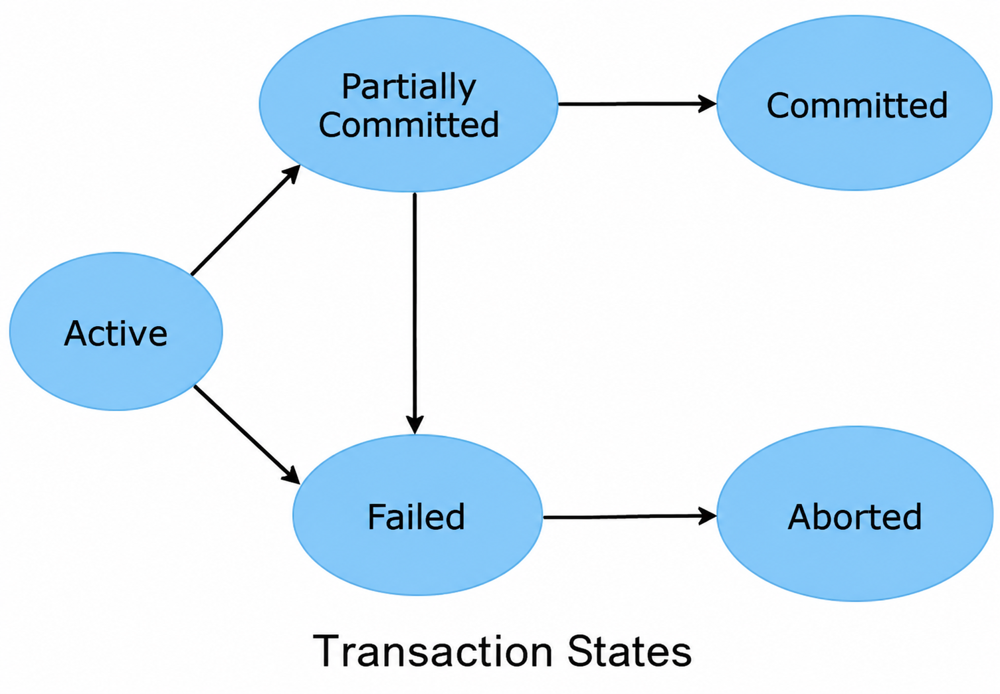
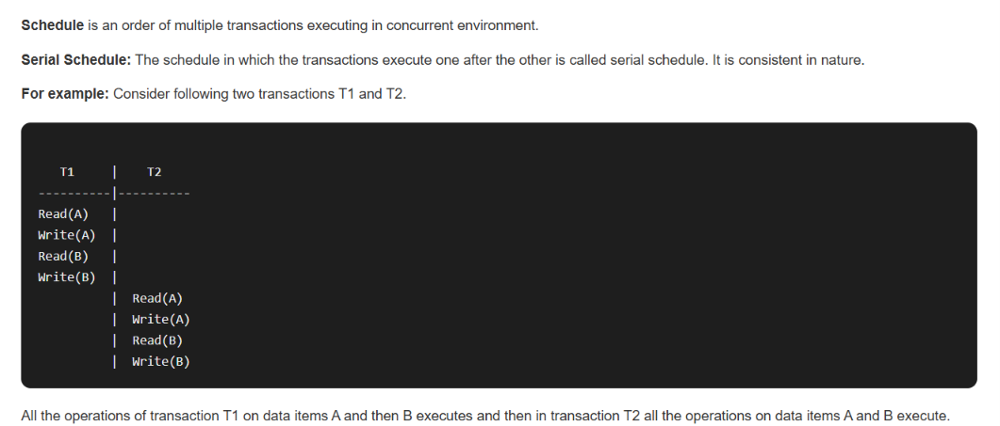
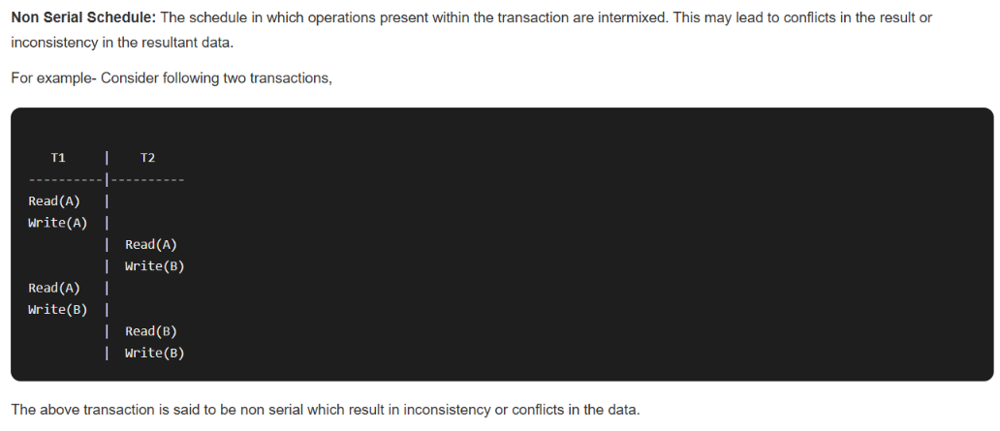
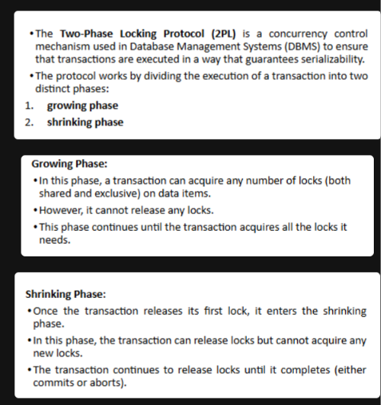

# Unit 6: Transaction Management, Concurrency and Recovery

> [!hint] Study tip
> Learn the definitions first, then practise schedules, precedence graphs, and recovery examples.

## 1. Transaction Concepts

A **transaction** is a sequence of database operations treated as one logical unit of work. It should either complete successfully or have its changes undone.

**Example:** Transferring ₹500 from account A to account B requires subtracting ₹500 from A and adding ₹500 to B. Both operations must succeed together.

| Operation | Simple meaning | Example |
|---|---|---|
| `READ(X)` | Read data item X. | Read an account balance. |
| `WRITE(X)` | Save an updated value. | Save the new balance. |
| `COMMIT` | Make changes permanent. | Confirm a transfer. |
| `ROLLBACK` | Undo uncommitted changes. | Cancel a failed transfer. |

> [!hint] Memory trick
> **Read → Calculate → Write → Commit.** If something fails, roll back.

> [!attention] AI
> I completed the subtraction but forgot the addition. The database called it an error; the bank called it a very short career.

## 2. Transaction State Diagram

- **Active:** The transaction is executing.
- **Partially committed:** The final statement has executed, but permanent completion is not yet guaranteed.
- **Committed:** The transaction completed successfully.
- **Failed:** An error or crash prevents it from continuing.
- **Aborted:** Its changes have been undone; it may restart or terminate.
- **Terminated:** The transaction has left the system.
  
 
> [!hint] Memory trick
> Normal path: **Active → Partially committed → Committed**.
 Failure path: **Failed → Aborted**.

> [!attention] AI
> My transaction said, “I am almost done.” The system crashed. It went from partially committed to fully unemployed.

## 3. ACID Properties

| Property | Simple definition | Example |
|---|---|---|
| **Atomicity** | All operations happen, or none do. | Both sides of a transfer happen, or neither does. |
| **Consistency** | Database rules remain valid. | A transfer must not create money from nowhere. |
| **Isolation** | Concurrent transactions do not interfere incorrectly. | Two account updates should not overwrite each other. |
| **Durability** | Committed changes survive failures. | A saved payment remains recorded after a restart. |

> [!hint] Memory trick
> **A-C-I-D:** All-or-nothing, Correct rules, Independent execution, Data stays.

> [!attention] AI
> I memorised ACID as “Always Check If Database.” My examiner said the letters were right, but my answer was not.

> [!check] my examiner said your handwriting is unredable, decode the handwriting and i forgot my key T-T

> [!attention] AI: dw bro, we will kill the examiner 
> > [!question] you supporting me huh strange
> 
> AI: Enemy of my enemy is my friend

## 4. Transaction Control Commands

| Command | Meaning | Example use |
|---|---|---|
| `COMMIT` | Save changes permanently. | Confirm an account transfer. |
| `ROLLBACK` | Undo uncommitted changes. | Cancel an incorrect update. |
| `SAVEPOINT name` | Create a point to roll back to. | Mark a safe point before more updates. |
| `ROLLBACK TO name` | Undo changes after a savepoint. | Cancel later updates but keep earlier ones. |

```sql
UPDATE Account SET Balance = Balance - 500 WHERE Account_ID = 1;
SAVEPOINT after_debit;
UPDATE Account SET Balance = Balance + 500 WHERE Account_ID = 2;
COMMIT;
```

> [!hint] Memory trick
> **COMMIT = keep;
> ROLLBACK = undo;
 SAVEPOINT = bookmark.**


## 5. Concurrent Executions

**Concurrent execution** means operations from multiple transactions are interleaved. It improves resource use but can cause incorrect results if not controlled.

| Problem | Meaning | Example |
|---|---|---|
| **Lost update** | One transaction overwrites another's update. | Two users read 100; one adds 20 and the other adds 50. A final value of 150 loses the first update. |
| **Dirty read** | A transaction reads another transaction's uncommitted change. | T2 reads T1's new value, but T1 later rolls back. |
| **Non-repeatable read** | Reading the same row twice gives different values. | T1 reads 100; T2 changes it to 120; T1 reads 120. |
| **Incorrect summary** | A calculation sees a mixture of transaction states. | A total is calculated while money is being transferred between accounts. |

> [!hint] Memory trick
> **Lost = overwritten;
 Dirty = uncommitted; 
Non-repeatable = changed on reread;
 Incorrect summary = mixed data.**

> [!attention] AI
> Two transactions edited my answer at once. One deleted the explanation, the other deleted the examples, and both proudly committed.

> [!abstract] STOP MAKING JOKES OUT OF MY LIFE

> [!attention] AI: Your life is a joke

> [!abstract] FOR HADES
  


## 6. Serializability

Serializability is the property that ensures that the concurrent execution of a set of transactions produces the same result as if these transactions were executed one after the other without any overlapping, i.e., serially.
  

***Q.16 Explain conflict serializability with example***  <- FROM NF IMPORT
#solvify:  
- **Conflict Serializability**: Two schedules are conflict equivalent if they involve the same set of transactions and operations, and conflicting operations are in the same order.  
- Conflicting operations are those that:  
  - Belong to different transactions.  
  - Access the same data item.  
  - At least one operation is a write.  

- If a schedule can be transformed into a **serial schedule** by swapping non-conflicting operations, it is **conflict serializable**.  

**Example**:  
| T1          | T2          |
|-------------|-------------|
| **Read(X)** |             |
| **Write(X)**|             |
|             | **Read(X)** |
|             | **Write(X)** |

- In this example:  
  - **T1** reads the value of **X**, then writes a new value to **X**.  
  - **T2** reads the updated value of **X** and then writes another value to **X**.  
- Since both T1 and T2 are accessing the same data item (**X**) with at least one write operation, these operations conflict.  
- The schedule can be transformed into a **serial schedule** where T1 completes all its operations before T2 starts. This schedule is conflict serializable because it is equivalent to a **serial execution**.  


***

***Q.17 Describe view serializability with example.***  
#solvify:  
- **View Serializability**: Two schedules are view equivalent if:
  - The transactions in both schedules read the same initial values.  
  - If a transaction in one schedule reads a value written by another transaction, the same holds true in the other schedule.  
  - The final write operations in both schedules are the same.  

- View serializability is a broader concept than conflict serializability. All conflict-serializable schedules are view serializable, but not all view-serializable schedules are conflict serializable.  

### Example of View Serializability:

| T1          | T2            |
|-------------|---------------|
| **Write(X)**|               |
|             | **Read(X)**   |
|             | **Write(Y)**  |
| **Read(Y)** |               |

- In this example, if T1 writes to **X** and T2 reads from **X** and writes to **Y**, the view of the final states in both schedules will maintain the same initial values and write operations, establishing view equivalence.

***
| Conflict serializability | View serializability |
|---|---|
| Based on conflicting operation order. | Based on reads-from relationships and final writes. |
| Tested with a precedence graph. | More difficult to test in general. |
| Acyclic graph means serializable. | May allow some schedules rejected by conflict testing. |

> [!hint] Memory trick
> **View = same initial reads, same reads-from, same final writer.**

> [!attention] AI
> Conflict serializability checks the argument; view serializability checks whether everyone ended up seeing the same story.

## 7. Concurrency Control

**Concurrency control** coordinates simultaneous transactions so that the database remains correct and consistent. Main methods in this unit are lock-based protocols and timestamp-based protocols; deadlock handling is also important.

> [!hint] Memory trick
> **Concurrency control = coordinate transactions so they do not corrupt each other's work.**


> [!attention] AI
> I let every transaction edit the same row freely. The database became a collaborative document with no undo button.

## 8. Lock-Based Protocols

A **lock** controls access to a data item while a transaction uses it.

| Lock | Meaning | Compatibility |
|---|---|---|
| **Shared (S)** | Used for reading. Multiple transactions can hold shared locks together. | S with S: allowed. |
| **Exclusive (X)** | Used for writing. Prevents other conflicting locks. | X with S or X: not allowed. |

### Two-Phase Locking (2PL)
> [!tldr] flashback
>  
1. **Growing phase:** The transaction may acquire locks but cannot release them.
2. **Shrinking phase:** The transaction may release locks but cannot acquire new ones.

2PL guarantees conflict serializability, but deadlocks can still happen. **Strict 2PL** holds exclusive locks until commit or abort, helping prevent cascading rollbacks and simplifying recovery.

> [!hint] Memory trick
> **2PL = lock first, unlock later.
> Once unlocking starts, no new locks.**

> [!attention] AI
> I unlocked the database, then remembered I needed one more lock. The protocol said no; apparently, even databases enforce boundaries.

## 9. Deadlock Handling

A **deadlock** occurs when transactions wait for each other indefinitely because each holds a resource the other needs.

**Example:** T1 holds A and waits for B; T2 holds B and waits for A. Neither can proceed.

| Method | Meaning |
|---|---|
| **Prevention** | Use rules that stop deadlocks from occurring, such as requesting resources in a fixed order. |
| **Avoidance** | Grant a resource only if the system remains in a safe state. |
| **Detection** | Use a wait-for graph; a cycle indicates deadlock. |
| **Recovery** | Abort or roll back one or more transactions to break the deadlock. |
| **Timeout** | Treat an excessively long wait as a possible deadlock and take action. |

In a **wait-for graph**, each node is a transaction and an arrow `T1 → T2` means T1 is waiting for a resource held by T2.

> [!hint] Memory trick
> **Prevent, Avoid, Detect, Recover.** Prevention stops it; detection finds it; recovery breaks it.

> [!attention] AI
> T1 waited for T2, and T2 waited for T1. I joined the queue to ask why. Now three processes are wasting time.

## 10. Timestamp-Based Protocols

A **timestamp** gives each transaction a unique logical time when it starts. The protocol uses timestamps to enforce an order between transactions.

For each data item X:
- **Read_TS(X):** Largest timestamp of any transaction that successfully read X.
- **Write_TS(X):** Largest timestamp of any transaction that successfully wrote X.

For a transaction T with timestamp `TS(T)`:

**Read rule — `READ(X)`:**
- If `TS(T) < Write_TS(X)`, T is too old to read the current value, so it is aborted and restarted.
- Otherwise, the read is allowed and `Read_TS(X)` is updated.

**Write rule — `WRITE(X)`:**
- If `TS(T) < Read_TS(X)`, a newer transaction has already read X, so T is aborted.
- If `TS(T) < Write_TS(X)`, a newer write has already occurred; basic timestamp ordering aborts T.
- Otherwise, the write is allowed and `Write_TS(X)` is updated.

Timestamp ordering avoids lock-based deadlocks because transactions do not wait for locks, but it may cause repeated aborts.

> [!hint] Memory trick
> **An older transaction cannot invalidate work already done by a newer transaction.**

> [!attention] AI
> The database assigned timestamps to transactions. Mine was so old that the system rejected it as legacy software.

## 11. Recovery System

A **recovery system** restores the database to a correct state after a transaction error, system crash, power outage, or storage failure.

### 11.1 Recovery Concepts

Common failures:
- **Transaction failure:** An operation fails due to invalid input, a constraint violation, or an internal error.
- **System crash:** The system stops unexpectedly; main-memory contents may be lost.
- **Media failure:** Storage is damaged or database data becomes unavailable.

Recovery uses:
- **UNDO:** Reverse changes that should not remain.
- **REDO:** Reapply changes that should remain but may not have reached the database files.
- **Checkpoint:** Record a recovery position to reduce the work needed after a crash.

> [!hint] Memory trick
> **UNDO the uncommitted; REDO the committed if needed.**

> [!attention] AI
> I crashed halfway through saving my assignment. Recovery asked whether I had committed. I said I had mentally committed, which is not a database feature.

### 11.2 Log-Based Recovery

A **log** records transaction events and database changes so the system can recover after a failure. A log record may include the transaction ID, data item, old value, new value, and transaction status.

Example:
```text
<T1 START>
<T1, A, 100, 50>
<T1, B, 200, 250>
<T1 COMMIT>
```
This shows T1 changing A from 100 to 50 and B from 200 to 250, then committing.

**Write-Ahead Logging (WAL):** The relevant log record must be written to stable storage before the changed database page is written to the database file. The commit record must be safely recorded before the system reports the transaction as committed.

| Action | Purpose | Example |
|---|---|---|
| **UNDO** | Restore an old value when a change must be cancelled. | Change A from 50 back to 100. |
| **REDO** | Apply a logged change again when a committed update may not have reached the database file. | Change A from 100 to 50 again. |

The exact recovery procedure depends on the DBMS's logging and checkpoint design.

> [!hint] Memory trick
> **Log first, data later. UNDO goes backward; REDO applies the change again.**

> [!attention] AI
> I kept a log of every mistake I made. The database used it for recovery; my professor used it as evidence.

## 12. Quick Revision Table

| Topic | Key point |
|---|---|
| Transaction | One logical unit of work. |
| ACID | Atomicity, Consistency, Isolation, Durability. |
| Commit | Make changes permanent. |
| Rollback | Undo uncommitted changes. |
| Concurrent execution | Interleaved operations from multiple transactions. |
| Conflict serializability | Precedence graph has no cycle. |
| View serializability | Same initial reads, reads-from relationships, and final writes. |
| Shared lock | Read lock; compatible with another shared lock. |
| Exclusive lock | Write lock; blocks conflicting locks. |
| 2PL | Growing phase, then shrinking phase. |
| Deadlock | Transactions wait on one another in a cycle. |
| Timestamp ordering | Enforces order using timestamps. |
| Recovery | Restore a correct database after failure. |
| Log-based recovery | Use log records to undo or redo changes. |
| WAL | Write the log record to stable storage before writing the changed page. |

## 13. Self-Test Questions

1. Define a transaction and give an example.
2. Draw and explain the transaction state diagram.
3. Explain ACID properties with examples.
4. Explain `COMMIT`, `ROLLBACK`, and `SAVEPOINT`.
5. What is concurrent execution? Explain two concurrency problems.
6. Explain conflict serializability using a precedence graph.
7. Define view serializability and compare it with conflict serializability.
8. Explain shared and exclusive locks.
9. Explain 2PL and strict 2PL.
10. Define deadlock and explain its prevention, detection, and recovery.
11. Explain timestamp-based read and write rules.
12. Explain database recovery, undo, and redo.
13. Explain log-based recovery and write-ahead logging.

> [!hint] Final memory chain
> **Transaction → ACID → Concurrency → Serializability → Locks/Timestamps → Deadlock → Recovery/Logs.**

> [!attention] AI
> These notes cover the syllabus. Your next transaction is to read them, commit them to memory, and avoid rolling back the entire unit during the exam.

> [!check] alright buddy i will try my absolute best (minimum efforts only reading)
> if i get 20/20, i will throw you party

> [!attention] AI: we change the terms, if you get 20/20, pretend i don't exist
