# DSA — Chapter 4: Trees (Exam-Oriented Notes)

> [!abstract] Exam answer format
> For each topic, write **Definition → ADT → one worked example/diagram → advantages → disadvantages → applications**. Focus on applying concepts to examples, not memorising algorithms. Add a joke only when it reinforces a technically correct fact.

## 1. Introduction to Trees

A **tree** is a non-linear data structure that stores data hierarchically using nodes connected by edges. The topmost node is the **root**. A tree with `n` nodes has `n − 1` edges.

### ADT
- **Data:** Nodes arranged hierarchically, with one root and zero or more subtrees.
- **Operations:** `Create()`, `IsEmpty()`, `Root()`, `Parent(node)`, `Children(node)`, `Search(value)`, `Insert(value)`, `Delete(value)`, `Traverse()`.
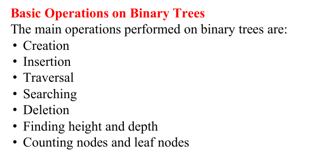 
### One example

```text
        A
       / \
      B   C
     / \
    D   E
```

Root = A; children of A = B and C; children of B = D and E; leaf nodes = C, D, E. There are 5 nodes and 4 edges.

**Advantages**
- Naturally represents hierarchical information.
- Useful for searching and organising structured data.
- Used in file systems, databases, compilers, and decision-making.

**Disadvantages**
- More complicated to implement than arrays.
- Links/pointers require extra memory.
- Performance depends on the tree's shape and type.
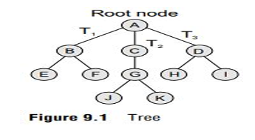 
> [!hint] Memory trick
> **Tree = hierarchy; root at the top, children below, leaves have no children.**

> [!attention] AI
> A leaf has no children. Remember the structural rule—not whether the leaf looks like it needs a family therapist.

## 2. Tree Terminology

| Term | Simple definition | Example from the diagram above |
|---|---|---|
| Root | Topmost node. | A |
| Parent | Node directly above another node. | A is parent of B and C. |
| Child | Node directly below a parent. | B is a child of A. |
| Siblings | Nodes with the same parent. | B and C |
| Leaf / terminal node | Node with no children. | C, D, E |
| Internal node | Node with at least one child. | A, B |
| Edge | Connection between nodes. | A–B |
| Path | Sequence of connected nodes. | A → B → D |
| Ancestor | Node above another node on its path to root. | A and B are ancestors of D. |
| Descendant | Node below another node. | D and E are descendants of A. |
| Degree of a node | Number of children it has. | Degree(A) = 2 |
| Level / depth | Number of edges from root to the node; root is level 0. | Depth(D) = 2 |
| Height | Longest downward path from a node to a leaf. | Height(A) = 2 edges |

**Note:** Some textbooks count height using nodes instead of edges. Follow your teacher's convention.
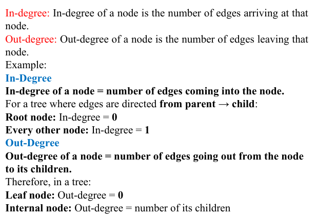 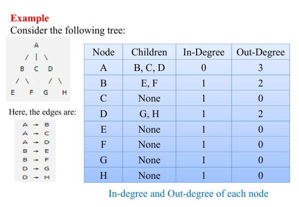 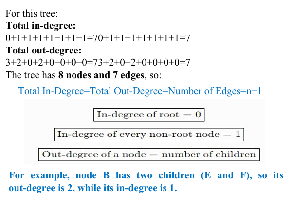 
> [!hint] Memory trick
> **Degree = children; depth = distance from root; height = distance down to deepest leaf.**

> [!attention] AI
> Depth measures distance from the root; height measures the longest downward path to a leaf. Swap them in an answer and your tree grows in the wrong direction.

## 3. Types of Trees

| Type | Definition | Key point |
|---|---|---|
| General tree | A node can have any number of children. | No fixed child limit. |
| Binary tree | A node has at most two children. | Left and right child. |
| Binary Search Tree (BST) | Smaller keys go left and larger keys go right. | Ordered searching. |
| Threaded binary tree | Uses otherwise-NULL links to point to inorder predecessor/successor. | Helps traversal. |
| B-Tree | Balanced multiway search tree with multiple keys per node. | Useful for indexing. |
| B+ Tree | Records/record pointers are stored at leaves; leaves are usually linked. | Efficient range searches. |
| Decision tree | Represents decisions and outcomes. | Questions lead to results. |
| Expression tree | Represents expressions using operators and operands. | Operators are internal nodes. |
| Huffman tree | Produces prefix codes for compression. | Frequent symbols get shorter codes. |

## 4. Binary Tree

A **binary tree** is a tree in which each node has at most two children: a left child and a right child.

### ADT
- **Data:** Each node stores data, a left link, and a right link.
- **Operations:** `CreateNode()`, `SetLeft()`, `SetRight()`, `Search()`, `Insert()`, `Delete()`, `Traverse()`.

### One example

```text
        10
       /  \
      20   30
     / \
    40  50
```

Root = 10; left child of 10 = 20; right child of 10 = 30; leaf nodes = 40, 50, 30.

**Advantages**
- Represents hierarchical data clearly.
- At most two child links per node keep the structure simple.
- Forms the basis of BSTs and expression trees.

**Disadvantages**
- An ordinary binary tree does not automatically sort values.
- A skewed tree may be inefficient to search.
- Links require extra memory.

> [!hint] Memory trick
> **Binary = at most two child links: left and right.**

> [!attention] AI
> “At most two” means zero, one, or two children—not exactly two children for every node.

### 4.1 Binary Tree Representation
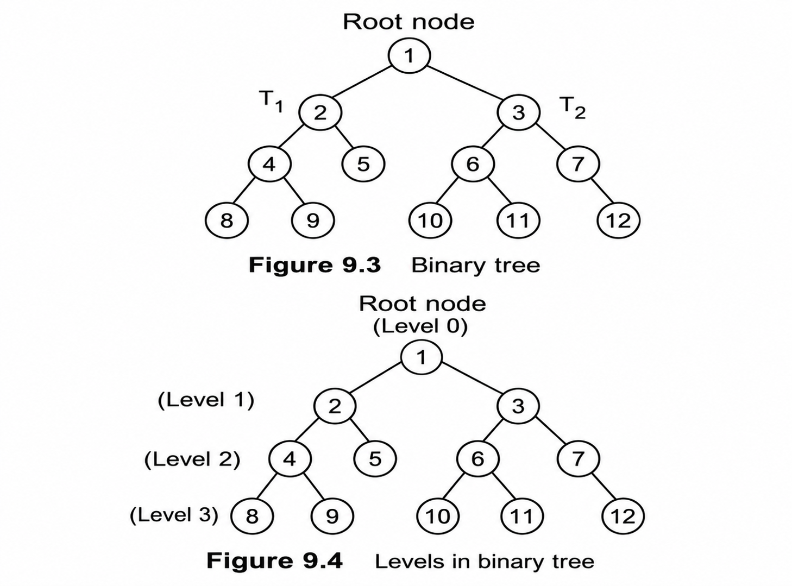 

**Linked representation:** Each node stores data and left/right links. A missing child is `NULL`.

```text
[data | left link | right link]
```

**Array representation:** For a zero-based array, left child of index `i` = `2i + 1`; right child = `2i + 2`; parent = `(i − 1) / 2` using integer division for `i > 0`.

**One example:** If root A is stored at index 0, its left child B is at index 1 and right child C is at index 2.

| Representation | Advantages | Disadvantages |
|---|---|---|
| Linked | Flexible for irregular trees; allocates nodes as needed. | Extra pointer memory; links must be managed. |
| Array | Simple index calculations; convenient for complete trees. | Can waste space for sparse or skewed trees. |

## 5. Types of Binary Trees

| Type | Definition | How to identify |
|---|---|---|
| Full / strict | Every node has either 0 or 2 children. | No node has exactly one child. |
| Complete | All levels are full except possibly the last, which fills left to right. | Last level fills from the left. |
| Perfect | Every internal node has two children and all leaves are at the same level. | Every level is full. |
| Balanced | Height stays relatively small compared with the number of nodes. | Not excessively tall. |
| Skewed | Each internal node has only one child. | Looks like a chain. |

### One worked example: identify the type

```text
        1
       / \
      2   3
     / \
    4   5
```

This is a **complete binary tree** because the last level is filled from left to right. It is not perfect because node 3 has no children while nodes 4 and 5 are at the next level.

For a perfect binary tree of height `h` measured in edges, maximum nodes = $(2^{h+1}-1$), and maximum nodes at level `l` = $ (2^l). $

> [!hint] Memory trick
> **Full = 0 or 2 children; Complete = fill left; Perfect = every level full.**

> [!attention] AI
> Check child counts for Full, left-to-right filling for Complete, and every level for Perfect. These are three different tests.

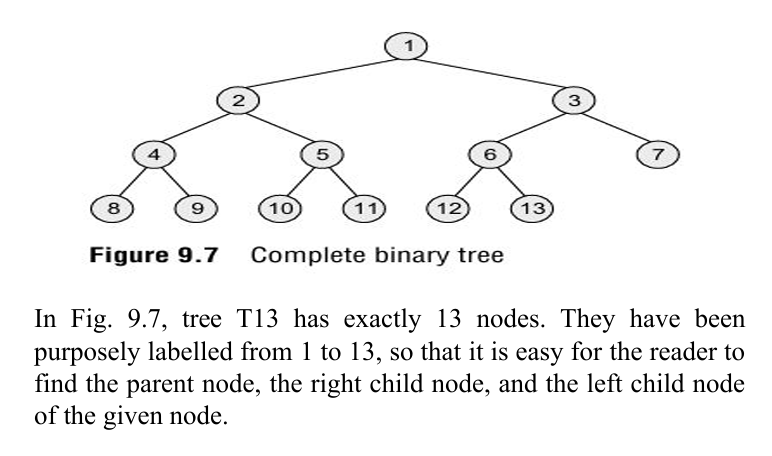 
## Creation of a Binary Tree — Short Notes

Definition: Creating a binary tree means creating nodes and connecting them using left and right links according to the required structure.

Each node contains:

-   Data: Stores the value.
    
-   Left link: Points to the left child.
    
-   Right link: Points to the right child.
    

Steps:

1.  Create nodes: Create a separate node for each value: `50, 30, 70, 20, 40, 60, 80`.
    
2.  Connect nodes: Set the left and right links according to the required tree.
    
3.  Complete the tree: Verify that all nodes are connected correctly. Missing children have `NULL` links.
    

Example:

```
        50
       /  \
      30   70
     / \   / \
    20 40 60 80
```

Connections: `50 → (30, 70)`, `30 → (20, 40)`, `70 → (60, 80)`. Nodes `20, 40, 60, 80` have no children, so both links are `NULL`.

> [!hint] Memory trick
>  Create = make nodes; Connect = set links.

## 2. Insertion in a Binary Search Tree (BST)

Definition: Insertion means adding a new node to an existing BST while maintaining its order.

Rules:

-   Smaller value → go left.
    
-   Greater value → go right.
    

Example: Insert `25` into the given BST.

```
        50
       /  \
      30   70
     / \   / \
    20 40 60 80
```

Steps:

1.  `25 < 50` → go left to 30.
    
2.  `25 < 30` → go left to 20.
    
3.  `25 > 20` → go right. Since the right link is empty, insert 25 there.
    

Final BST:

```
        50
       /  \
      30   70
     / \   / \
    20 40 60 80
      \
      25
```

> [!hint] Memory trick
 Compare → Move left or right → Insert at the first empty position.


***
## 6. Traversal of Binary Trees

**Traversal** means visiting every node exactly once in a particular order. The three main depth-first traversals are inorder, preorder, and postorder.

Use this single example:

```text
        50
       /  \
      30   70
     / \   / \
    20 40 60 80
```

| Traversal | Rule | Result |
|---|---|---|
| Inorder | Left → Root → Right | `20, 30, 40, 50, 60, 70, 80` |
| Preorder | Root → Left → Right | `50, 30, 20, 40, 70, 60, 80` |
| Postorder | Left → Right → Root | `20, 40, 30, 60, 80, 70, 50` |
| Level order | Visit each level from left to right | `50, 30, 70, 20, 40, 60, 80` |

### Applying each traversal
- **Inorder:** Left subtree of 50 gives `20, 30, 40`; then 50; then right subtree gives `60, 70, 80`.
- **Preorder:** Visit 50 first, then left subtree `30, 20, 40`, then right subtree `70, 60, 80`.
- **Postorder:** Finish left subtree `20, 40, 30`, then right subtree `60, 80, 70`, then visit 50.
- **Level order:** Read row by row: `50`; `30, 70`; `20, 40, 60, 80`.

### ADT
`Inorder()`, `Preorder()`, `Postorder()`, and `LevelOrder()` visit all nodes in their respective orders.

**Advantages**
- Provides different useful orders for processing nodes.
- Inorder traversal of a BST gives sorted values.
- Useful for displaying, copying, evaluating, and searching tree data.

**Disadvantages**
- Traversal visits every node, requiring at least \(O(n)\) time for `n` nodes.
- Recursive traversal may use stack space proportional to tree height.

> [!hint] Memory trick
> **Inorder = root in the middle; 
Preorder = root first; 
Postorder = root last.**

> [!attention] AI
> Preorder visits the root before its subtrees; postorder waits until both subtrees are done. The names tell you where the root appears.

## 7. Binary Search Tree (BST)

A **Binary Search Tree** is a binary tree where smaller values are placed in the left subtree and larger values in the right subtree. Both subtrees must follow the same rule.

### ADT
- **Data:** Keys/values stored in nodes with left and right links.
- **Operations:** `Search(key)`, `Insert(key)`, `Delete(key)`, `FindMin()`, `FindMax()`, `Inorder()`.

### One worked example: insert 40, 20, 60, 10, 30

```text
        40
       /  \
      20   60
     / \
    10  30
```

Search for 30: compare with 40 → go left; compare with 20 → go right; find 30. Inorder traversal gives `10, 20, 30, 40, 60`.

### BST deletion: three cases
1. **Leaf node:** Delete 10 directly because it has no children.
2. **One child:** If 20 has only child 30, connect 40's left link directly to 30.
3. **Two children:** Replace the node with its inorder successor (smallest value in its right subtree) or inorder predecessor (largest value in its left subtree), then delete that replacement from its old position.

**Advantages**
- Search, insertion, and deletion can be efficient when reasonably balanced.
- Inorder traversal gives sorted values.
- Minimum and maximum can be found by following the leftmost/rightmost links.

**Disadvantages**
- Sorted insertions can make an ordinary BST skewed.
- Worst-case operations take \(O(n)\) time.
- An ordinary BST does not automatically rebalance.

| Operation | Average case (balanced) | Worst case (skewed) |
|---|---:|---:|
| Search | $(O(\log n)$) | $(O(n)$) |
| Insert | $(O(\log n)$) | $(O(n)$) |
| Delete | $(O(\log n)$) | $(O(n)$) |

> [!hint] Memory trick
> **BST: smaller left, greater right; inorder gives sorted values.**

> [!attention] AI
> Each BST comparison tells you which side may contain the target. Searching the other side anyway ignores the very rule that makes a BST useful.

***
## 5. Searching in a Binary Search Tree (BST)

Definition: Searching means checking whether a particular value exists in a BST.

Rules:

-   Target smaller than current node → go left.
    
-   Target greater than current node → go right.
    
-   Target equals current node → value found.
    

### Example 1: Search for `60`

```
        50
       /  \
      30   70
     / \   / \
    20 40 60 80
```

Steps:

1.  Compare `60` with `50`: `60 > 50` → go right.
    
2.  Compare `60` with `70`: `60 < 70` → go left.
    
3.  Node `60` is found.
    

### Example 2: Search for `45`

1.  `45 < 50` → go left to 30.
    
2.  `45 > 30` → go right to 40.
    
3.  `45 > 40` → go right, but the link is `NULL`.
    

Therefore, 45 is not present in the BST.

> [!hint] Memory trick
 Compare → Move left or right → Found or NULL. Reaching `NULL` means the value is absent.
## 6. Deletion in a Binary Search Tree (BST)

Definition: Deletion means removing a node from a BST while maintaining its structure and ordering.

There are 3 cases:

### Case 1: Delete a leaf node

A leaf node has no children.

Example: Delete `20`.

Before:

```
        50
       /  \
      30   70
     / \   / \
    20 40 60 80
```

After:

```
        50
       /  \
      30   70
       \   / \
       40 60 80
```

Rule: Simply remove the node.

### Case 2: Delete a node having one child

Example: Delete `30` when its only child is `40`.

Before:

```
    50
   /
  30
    \
     40
```

After:

```
    50
   /
  40
```

Rule: Replace the deleted node with its only child.

### Case 3: Delete a node having two children

Example: Delete `50`.

Before:

```
        50
       /  \
      30   70
     / \   / \
    20 40 60 80
```

Steps:

1.  Find the inorder successor: the smallest value in the right subtree, which is `60`.
    
2.  Replace `50` with `60`.
    
3.  Remove the original `60` node from the right subtree.
    

After:

```
        60
       /  \
      30   70
     / \     \
    20 40     80
```

> [!hint] Memory trick 
Leaf = remove; one child = replace; two children = use inorder successor or predecessor.

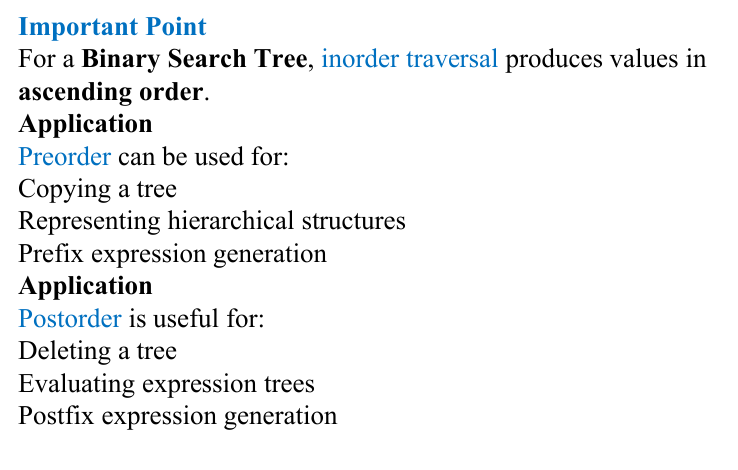 
## 6. Level-Order Traversal

Definition: Level-order traversal visits nodes level by level, from left to right, generally using a queue.

Example:

```
        50
       /  \
      30   70
     / \   / \
    20 40 60 80
```

Traversal order: `50 → 30 → 70 → 20 → 40 → 60 → 80`

| Level | Nodes |
| --- | --- |
| Level 0 | `50` |
| Level 1 | `30, 70` |
| Level 2 | `20, 40, 60, 80` |

> [!hint] Memory trick 
Level order = read each row from left to right.

## 7. Finding Height and Depth

### Height of a Binary Tree

Definition: Height is the number of edges on the longest path from the root to a leaf.

Using the same tree, the longest paths include:

-   `50 → 30 → 20`
    
-   `50 → 30 → 40`
    
-   `50 → 70 → 60`
    
-   `50 → 70 → 80`
    

Each path contains 2 edges. Therefore, height = 2.

Note: If height is counted by the number of nodes instead of edges, the height is `3`. State which convention you use.

> [!hint] Memory trick
 Height = longest path downward. Count the edges, not the nodes.

### Depth of a Node

Definition: Depth is the number of edges from the root to a particular node.

Using the same tree:

| Node | Depth |
| --- | --- |
| `50` | 0   |
| `30`, `70` | 1   |
| `20`, `40`, `60`, `80` | 2   |

> [!hint] Memory trick
 Depth = distance from root; height = longest distance down to a leaf.
> 
## 8. Depth of a Node

Definition: Depth is the number of edges from the root to a particular node.

Using the tree:

```
        50
       /  \
      30   70
     / \   / \
    20 40 60 80
```

| Node | Depth |
| --- | --- |
| `50` | 0   |
| `30`, `70` | 1   |
| `20`, `40`, `60`, `80` | 2   |

Example: To find the depth of node `40`, follow `50 → 30 → 40`. There are 2 edges, so its depth is `2`.

> [!hint] Memory trick Depth = count edges from the root to the node.

## 9. Counting Nodes

Definition: Counting nodes means finding the total number of nodes in a binary tree.

Using the same tree:

```
        50
       /  \
      30   70
     / \   / \
    20 40 60 80
```

The nodes are `50, 30, 70, 20, 40, 60, 80`.

Therefore, total number of nodes = 7.

Recursive formula:

$[ \text{Total Nodes} = 1 + \text{Left Subtree Nodes} + \text{Right Subtree Nodes} $]

The `1` represents the current root node.

> [!hint] Memory trick
> Count nodes = current root (1) + everything on the left + everything on the right.

## 10. Counting Leaf Nodes

Definition: A leaf node is a node that has no left child and no right child.

Example:

```
        50
       /  \
      30   70
     / \   / \
    20 40 60 80
```

Steps:

1.  Identify nodes with no children.
    
2.  The leaf nodes are `20, 40, 60, 80`.
    
3.  Therefore, total leaf nodes = 4.
    

Nodes `50, 30, 70` are not leaf nodes because they have children.

> [!hint] Memory trick
 Leaf = zero children. Count only the nodes at the ends of the branches.


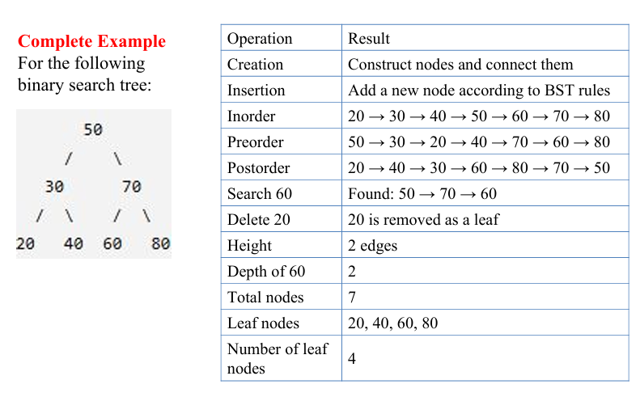 


***

## 8. Threaded Binary Tree

A **threaded binary tree** replaces one or more `NULL` child pointers with **threads** pointing to a node's inorder predecessor or successor. It supports traversal without recursion or an auxiliary stack.

### Types
- **Left-threaded:** A `NULL` left pointer may point to the inorder predecessor.
- **Right-threaded:** A `NULL` right pointer may point to the inorder successor.
- **Double-threaded:** Both types of empty links may be threaded.
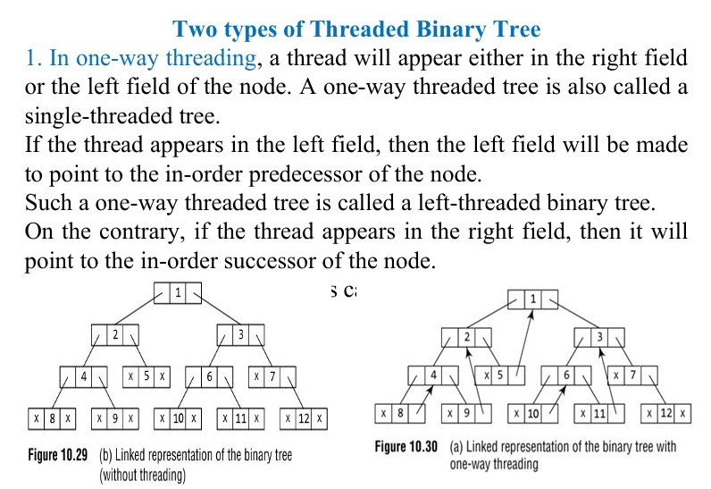 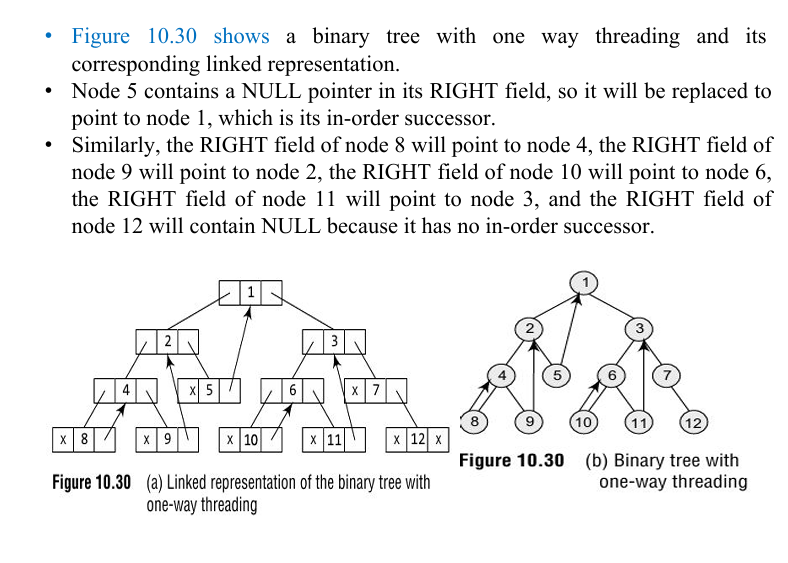 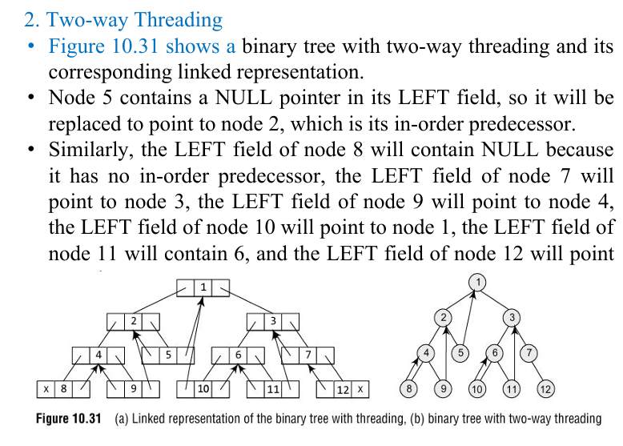 
### ADT
- **Data:** Node data, left/right pointers, and tag fields to distinguish child links from threads.
- **Operations:** `InorderSuccessor(node)`, `InorderPredecessor(node)`, `TraverseInorder()`, `Insert()`, `Delete()`.

### One example

```text
      20
     /  \
   10    30
```

Inorder sequence = `10, 20, 30`. If node 10 has no right child, its otherwise-`NULL` right pointer can be threaded to its inorder successor, 20. A thread is not a normal child link.

**Advantages**
- Traversal can avoid recursion and an auxiliary stack.
- Reuses otherwise-NULL pointers.
- Can give convenient access to inorder predecessor/successor.
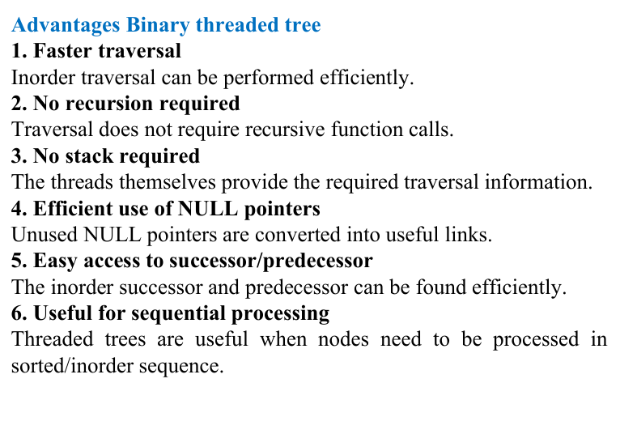 
**Disadvantages**
- More complicated than an ordinary binary tree.
- Insertion/deletion must update threads correctly.
- Tag fields are often needed to identify threads.
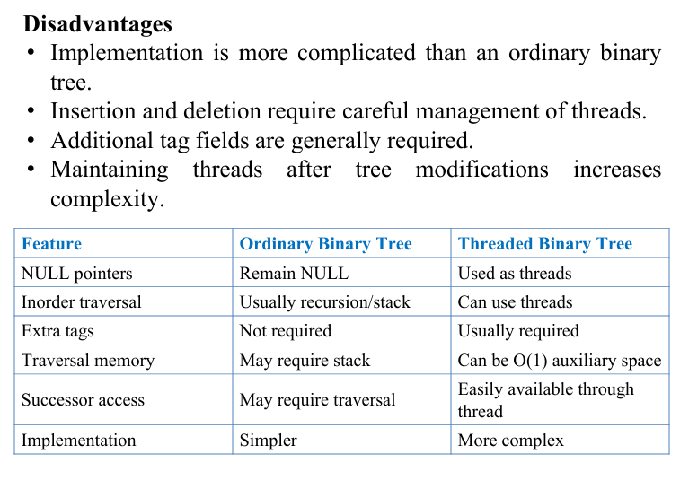 
> [!hint] Memory trick
> **Thread = turn an unused NULL link into a route to an inorder neighbour.**

> [!attention] AI
> A thread points to an inorder predecessor or successor; it does not create a new child. Keep that difference clear in your diagram.

 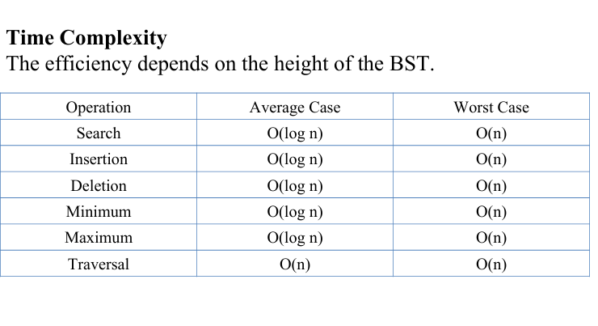 
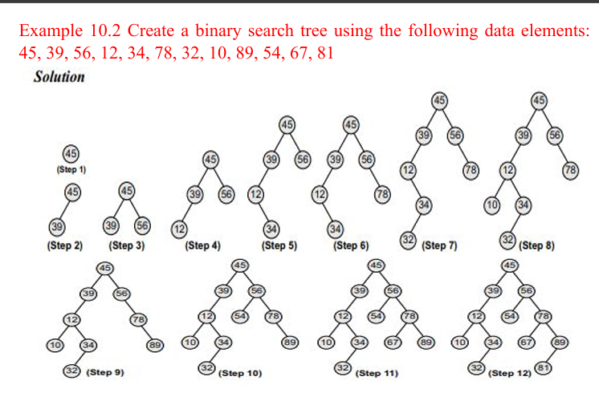 
## 9. B-Tree

A **B-Tree** is a balanced multiway search tree in which each node can store multiple sorted keys and have multiple children. It is useful for database and file-system indexing because it reduces disk accesses.

### ADT
- **Data:** Nodes store multiple sorted keys and child pointers.
- **Operations:** `Search(key)`, `Insert(key)`, `Delete(key)`, `Split(node)`, `BorrowFromSibling()`, `MergeNodes()`.

### One worked example: search in a node

Suppose a node contains `[20 | 40 | 60]`. To search for 50, compare it with 20 and 40, then follow the child range between 40 and 60.

```text
          [20 | 40 | 60]
          /     |     |     \
       <20   20–40  40–60   >60
```

### Main properties
- Nodes can store multiple sorted keys and have multiple children.
- All leaves are at the same depth.
- Insertion may split a full node.
- Deletion may require borrowing from a sibling or merging nodes.

For a B-Tree of order `m` under the common convention, a node can have at most `m` children and `m − 1` keys. Minimum-occupancy rules may vary by textbook.

**Advantages**
- Remains balanced, supporting efficient search, insertion, and deletion.
- High branching factor keeps height low.
- Well suited to storage where disk access is expensive.

**Disadvantages**
- Splitting, borrowing, and merging make implementation complex.
- Nodes may have unused key positions.
- More complex than a binary tree for basic in-memory use.

> [!hint] Memory trick
> **B-Tree = balanced, broad, many keys per node.**

> [!attention] AI
> When a B-Tree node becomes full, insertion may split it to preserve balance. The split is part of maintaining the structure.
> 
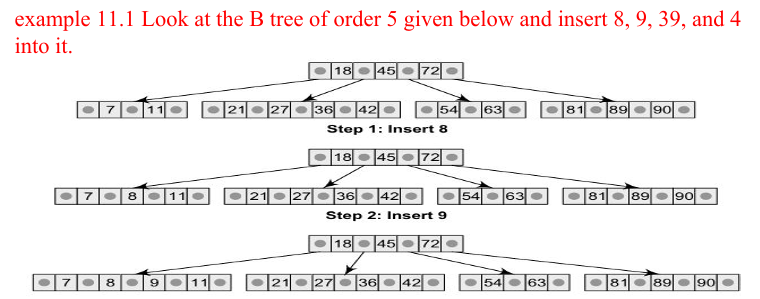 
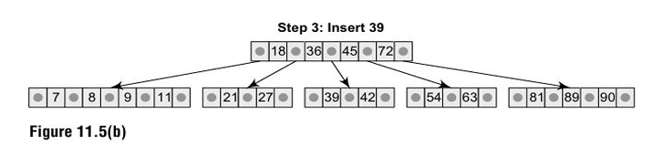 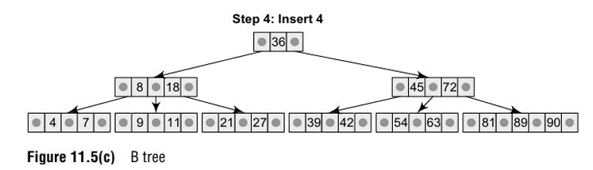
***
 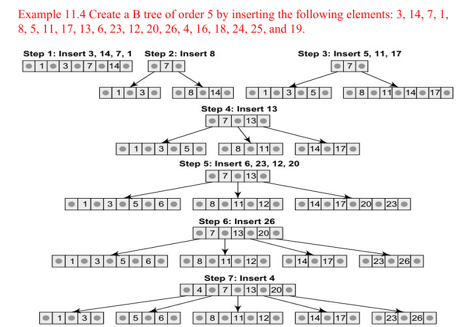 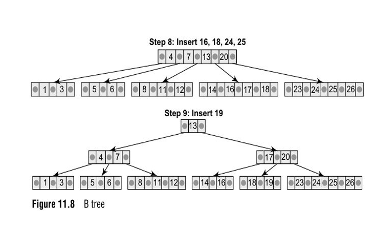 
***
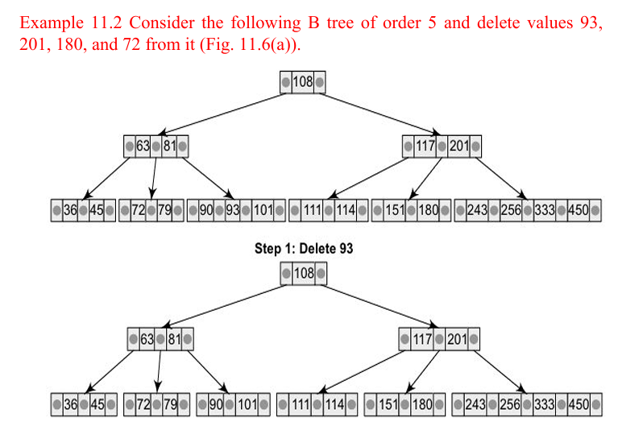 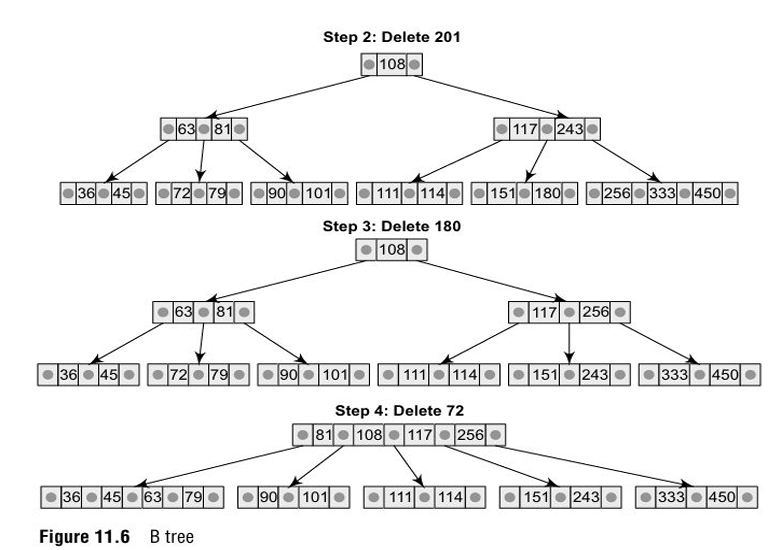 
## 10. B+ Tree

A **B+ Tree** is a balanced multiway search tree commonly used for database indexes. Internal nodes guide searches, records or record pointers are stored at the leaves, and leaf nodes are usually linked for sequential access.

### ADT
- **Data:** Internal nodes store search keys and child pointers; leaves store keys with records/record pointers and links to neighbouring leaves.
- **Operations:** `Search(key)`, `Insert(key)`, `Delete(key)`, `RangeSearch(low, high)`, `TraverseLeaves()`.

### One worked example: range search

```text
[10, 20, 30] → [40, 50, 60] → [70, 80, 90]
```

To retrieve keys from 30 to 70, find 30 and follow the linked leaves in order until 70 is reached.

**Advantages**
- Balanced structure supports efficient searching.
- Linked leaves make range and sequential queries efficient.
- High branching factor keeps the tree height low.
- Widely used for database indexing.

**Disadvantages**
- More complex than a simple BST.
- Separator keys may also appear in leaves, requiring storage.
- Insertions/deletions can require splitting, borrowing, or merging.
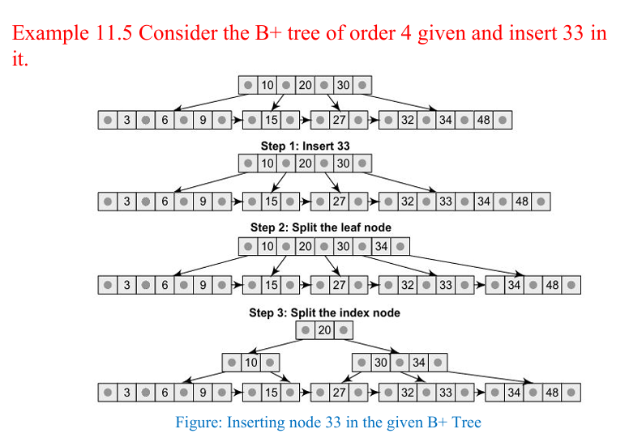 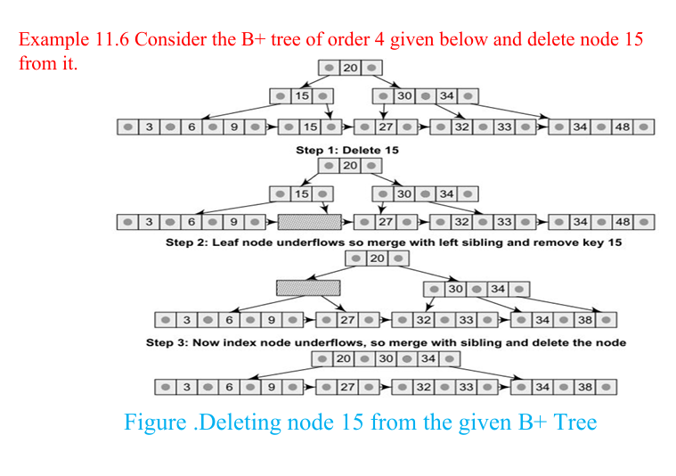 
### B-Tree vs B+ Tree

| B-Tree | B+ Tree |
|---|---|
| Records or record pointers may appear in internal and leaf nodes. | Records or record pointers are stored at leaves. |
| Leaves are not necessarily linked. | Leaves are usually linked. |
| Search may finish at an internal node. | Record search proceeds to a leaf. |
| Range scans can be less direct. | Linked leaves make range scans efficient. |

> [!hint] Memory trick
> **B+ Tree = records at the bottom; linked leaves make range searches easier.**
>
> [!attention] AI
> For a range query, find the starting leaf and follow leaf links in order. That is the practical benefit of linking the leaves.

> [!danger] ANYTHING BELOW THIS PART IS NOT IN PPT
> 
***
## 11. Decision Tree

A **decision tree** represents decisions and their possible outcomes. Internal nodes represent questions/tests, branches represent outcomes, and leaf nodes represent final results.

### ADT
- **Data:** Decision/test nodes, outcome branches, and result leaves.
- **Operations:** `Evaluate(input)`, `ChooseBranch(outcome)`, `ReachResult()`.

### One worked example

```text
             Is score >= 40?
               /       \
             Yes        No
             /           \
          Pass           Fail
```

For score 55, the condition is true, so follow Yes → Pass. For score 32, follow No → Fail.

**Advantages**
- Easy to understand and explain visually.
- Represents decisions and outcomes clearly.
- Useful for classification, diagnosis, and troubleshooting.

**Disadvantages**
- Large trees can be difficult to understand.
- Learned trees can change when training data changes.
- Poorly designed trees may make inaccurate decisions.

> [!hint] Memory trick
> **Question at a node → outcome on a branch → result at a leaf.**
>
> [!attention] AI
> A score of 55 satisfies `score >= 40`, so the correct branch is Yes. Follow the condition, not the branch you prefer.

## 12. Expression Tree

An **expression tree** represents an arithmetic or logical expression. Operators are internal nodes and operands are leaf nodes.

### ADT
- **Data:** Operator nodes and operand nodes.
- **Operations:** `BuildExpression()`, `Evaluate()`, `Inorder()`, `Preorder()`, `Postorder()`.

### One worked example: `(A + B) * C`

```text
        *
       / \
      +   C
     / \
    A   B
```

| Traversal | Form | Result |
|---|---|---|
| Inorder | Infix | `(A + B) * C` |
| Preorder | Prefix | `* + A B C` |
| Postorder | Postfix | `A B + C *` |

The root operator is `*`, so the result of `A + B` is multiplied by C.

**Advantages**
- Clearly represents operator precedence and grouping.
- Supports evaluation and conversion between infix, prefix, and postfix.
- Used in compilers and calculators.

**Disadvantages**
- Requires node and link management.
- Uses extra memory for nodes and links.
- Infix output may need parentheses to preserve grouping.

> [!hint] Memory trick
> **Operators are internal nodes; operands are leaves. Preorder = prefix; inorder = infix; postorder = postfix.**
>
> [!attention] AI
> Since `*` is the root and `+` is its left child, the tree represents `(A + B) * C`. Keep the brackets to preserve the grouping.

## 13. Huffman Encoding

**Huffman encoding** is a lossless compression method that gives shorter binary codes to more frequent symbols and longer codes to less frequent symbols. Its codes are **prefix-free**, meaning no symbol's code is the prefix of another symbol's code.

### ADT
- **Data:** Leaf nodes store symbols/frequencies; internal nodes store the sum of their children's frequencies.
- **Operations:** `BuildTree(frequencies)`, `CombineTwoSmallest()`, `GenerateCode(symbol)`, `Encode(data)`, `Decode(bits)`.

### One worked example

Frequencies: `A = 5`, `B = 2`, `C = 1`.

1. Combine the two smallest: `C(1) + B(2) = 3`.
2. Combine the new node (3) with `A(5)` to make root frequency 8.
3. Assign left edge = 0 and right edge = 1.

```text
          (8)
         /   \
       A(5)  (3)
             / \
           C(1) B(2)
```

Codes for this displayed tree: `A = 0`, `C = 10`, `B = 11`. Swapping left/right labels may produce different but equally valid codes with the same code lengths.

**Advantages**
- Can reduce the number of bits when symbol frequencies differ.
- Lossless: the original data can be recovered.
- Prefix-free codes allow unambiguous decoding.

**Disadvantages**
- The frequencies or code tree must be known to decode correctly.
- Header/tree storage can reduce benefits for small files.
- It does not guarantee better compression for every possible input.

> [!hint] Memory trick
> **Huffman = repeatedly combine the two lowest frequencies; frequent symbols usually get shorter codes.**
>
> [!attention] AI
> A has the highest frequency in this example, so it receives a one-bit code. Code length follows the tree path—not alphabetical order.

## 14. Comparison of Important Trees

| Structure | Main purpose | Advantage | Disadvantage |
|---|---|---|---|
| Binary tree | Two-child hierarchy | Simple structure | Does not automatically sort data |
| BST | Ordered search | Inorder gives sorted values | Can become skewed |
| Threaded tree | Traversal using threads | Can avoid recursion/stack | Updates are more complex |
| B-Tree | Balanced multiway search | Low height; fewer disk accesses | Splits/merges are complex |
| B+ Tree | Database indexing/range queries | Linked leaves support range scans | Extra key storage |
| Decision tree | Represent choices/outcomes | Easy to interpret | Large trees can be complex |
| Expression tree | Represent expressions | Preserves expression structure | Requires construction/evaluation |
| Huffman tree | Lossless compression | Efficient prefix codes | Needs frequency/tree information |

## 15. Exam-Style Solved Questions

### Q1. Find the traversals of this binary tree.

```text
        40
       /  \
      20   60
     / \   / \
    10 30 50 70
```

**Answer:**
- **Inorder (Left → Root → Right):** `10, 20, 30, 40, 50, 60, 70`
- **Preorder (Root → Left → Right):** `40, 20, 10, 30, 60, 50, 70`
- **Postorder (Left → Right → Root):** `10, 30, 20, 50, 70, 60, 40`

### Q2. Construct a BST by inserting 45, 25, 65, 15, 35.

**Answer:**

```text
        45
       /  \
      25   65
     / \
    15  35
```

Values smaller than 45 go left and values greater than 45 go right. Within the left subtree, 15 goes left of 25 and 35 goes right of 25.

### Q3. Which tree is suitable for database range searches: B-Tree or B+ Tree?

**Answer:** A **B+ Tree** is especially suitable because its leaf nodes are linked. After locating the first key in the range, the system can follow linked leaves to retrieve subsequent keys in order.

### Q4. Convert `(A + B) * C` into prefix and postfix forms.

**Answer:** Prefix (preorder) = `* + A B C`; Postfix (postorder) = `A B + C *`.

### Q5. Generate Huffman codes for A = 5, B = 2, C = 1.

**Answer:** Combine C(1) and B(2) to obtain 3, then combine 3 and A(5) to obtain 8. With left edge = 0 and right edge = 1 in the shown tree, codes are `A = 0`, `C = 10`, and `B = 11`.

## 16. Last-Minute Revision

| Topic | Remember this |
|---|---|
| Tree | Hierarchical structure; `n` nodes have `n − 1` edges. |
| Binary tree | At most two children per node. |
| Full / Complete / Perfect | 0-or-2 children / fill left / all levels full. |
| Inorder | Left → Root → Right. |
| Preorder | Root → Left → Right. |
| Postorder | Left → Right → Root. |
| BST | Smaller left, greater right; inorder is sorted. |
| Threaded tree | Reuses NULL links for inorder neighbours. |
| B-Tree | Balanced multiway tree with multiple keys per node. |
| B+ Tree | Records at leaves; linked leaves help range searches. |
| Decision tree | Question → branch → result. |
| Expression tree | Operators inside; operands at leaves. |
| Huffman | Repeatedly combine the two lowest frequencies. |

> [!hint] Final exam strategy
> **Draw the structure first, label the rule, apply it one step at a time, and write the final result clearly.** Do not memorise algorithm pseudocode unless the question specifically asks for it.
