# DSA — Chapter 5: Graphs (Exam-Oriented Question Bank)

> [!abstract] Exam answer format
> For each topic, write **Definition → ADT → one worked example/diagram → advantages → disadvantages → applications** where relevant. Focus on applying concepts to the given graph, showing traversal orders, edge choices, tables, and final results. Do not spend time memorising pseudocode unless the question specifically asks for an algorithm.

> [!warning] Important for solved examples
> Always state the **starting vertex** and the **order in which neighbours are considered**. BFS and DFS answers can differ when neighbour order differs.

## 1. Introduction to Graphs

A **graph** is a non-linear data structure consisting of **vertices (nodes)** and **edges** connecting them. It is written as `G = (V, E)`, where `V` is the set of vertices and `E` is the set of edges. Unlike a tree, a graph can represent complex relationships between vertices.

### ADT
- **Data:** A set of vertices and the edges connecting them.
- **Operations:** `AddVertex()`, `AddEdge()`, `RemoveVertex()`, `RemoveEdge()`, `Adjacent(v)`, `Traverse()`, `Search(v)`.

### One example

```text
A ----- B
| \     |
|  \    |
D ----- C
```

One possible representation is `V = {A, B, C, D}` and `E = {(A,B), (A,D), (A,C), (B,C), (C,D)}`. There are **4 vertices and 5 edges**. Because the edges have no arrows, this is an undirected graph.

**Advantages**
- Represents complex relationships naturally.
- Useful for modelling routes, networks, and dependencies.
- Supports traversal and path-finding operations.

**Disadvantages**
- Large graphs can require significant storage.
- Some graph problems are computationally complex.
- Cycles and multiple possible paths can make analysis harder.

**Applications:** Road maps, social networks, computer networks, flight routes, web links, and task dependencies.

> [!hint] Memory trick
> **Graph = vertices (things) + edges (relationships).**

> [!attention] AI
> In a social network, people are vertices and friendships are edges. No friendship edge? The graph cannot simply assume they are best friends.

## 2. Graph Terminology

| Term | Simple definition | Example |
|---|---|---|
| Vertex / Node | An item in a graph. | City A |
| Edge | A connection between two vertices. | Road A–B |
| Adjacent vertices / Neighbours | Vertices connected directly by an edge. | A and B if A–B exists |
| Degree | Number of edges connected to a vertex in an undirected graph. | If A connects to B, C, D, then `degree(A) = 3` |
| In-degree | Number of directed edges entering a vertex. | Two arrows enter C, so `in-degree(C) = 2` |
| Out-degree | Number of directed edges leaving a vertex. | Three arrows leave A, so `out-degree(A) = 3` |
| Isolated vertex | A vertex with degree 0. | A vertex with no edges |
| Path | A sequence of vertices connected by edges. | A → B → D |
| Path length | Number of edges in a path. | A → B → D has length 2 |
| Cycle | A path that returns to its starting vertex. | A → B → C → A |
| Connected graph | Every vertex can be reached from every other vertex in an undirected graph. | One connected component |
| Disconnected graph | A graph containing separate components. | Two groups with no connecting edge |
| Weighted / Labelled graph | A graph whose edges have values such as cost, time, or distance. | A–B has weight 12 |
| Complete graph | Every pair of distinct vertices is directly connected. | All pairs have an edge |
| Regular graph | Every vertex has the same degree. | Every vertex has degree 3 in a 3-regular graph |
| Clique | A set of vertices where every pair is directly connected. | Three vertices with all three possible edges |
| Loop / Self-loop | An edge connecting a vertex to itself. | A → A |

For a complete undirected graph with `n` vertices, the number of edges is `E = n(n − 1) / 2`. A path `A → B → D` has 3 vertices and 2 edges, so its path length is **2**.

> [!hint] Memory trick
> **Degree counts connections; in-degree comes in; out-degree goes out.**

> [!attention] AI
> Treat a vertex like a station: count arrows entering for in-degree and arrows leaving for out-degree. Do not count the same arrow in the wrong direction.

## 3. Types of Graphs
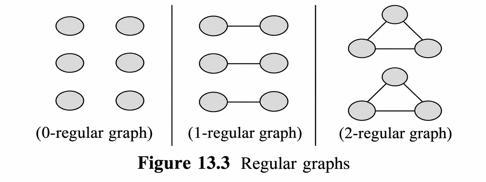 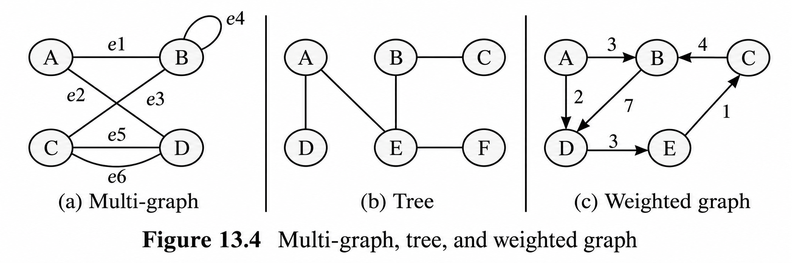 
| Type | Simple definition | Example / key point |
|---|---|---|
| Undirected graph | Edges have no direction. | A–B can be followed both ways. |
| Directed graph (digraph) | Edges have direction. | A → B does not automatically allow B → A. |
| Weighted graph | Edges carry a weight. | Edge weight represents distance or cost. |
| Unweighted graph | Edges have no assigned weights. | Each edge is treated equally for edge-count paths. |
| Simple graph | No self-loops or multiple edges between the same pair of vertices. | At most one edge per pair. |
| Complete graph | Every pair of distinct vertices has an edge. | For `n` vertices, edges = `n(n − 1)/2` in an undirected graph. |
| Regular graph | All vertices have equal degree. | A 3-regular graph has degree 3 at every vertex. |
| Cyclic graph | Contains at least one cycle. | A → B → C → A |
| Acyclic graph | Contains no cycles. | An undirected tree is connected and acyclic. |
| Connected graph | Every vertex is reachable from every other vertex. | One connected component. |
| Disconnected graph | Some vertices cannot reach others. | Multiple components. |

**Advantages of classifying graphs:** Helps select a suitable representation and algorithm; makes graph properties easier to understand. **Limitation:** A graph can fit multiple categories at once, such as being directed and weighted.

> [!hint] Memory trick
> **Directed = arrow; weighted = number; complete = every pair; regular = same degree.**

> [!attention] AI
> A complete graph has an edge between every pair of distinct vertices. It is not called complete because the assignment is finished.

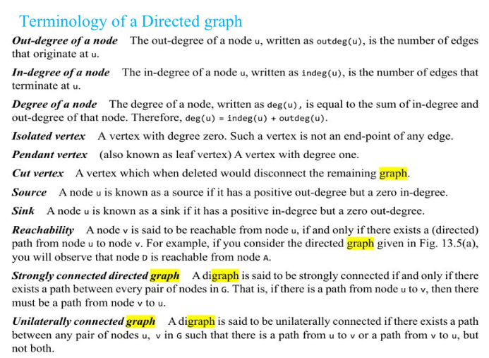 

***
## 4. Graph Representation

Graph representation is the way a graph is stored in computer memory. Common representations include an **adjacency matrix**, **adjacency list**, and **adjacency multi-list**.

### 4.1 Adjacency Matrix
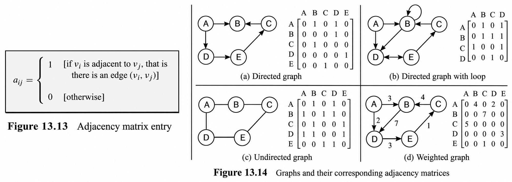 
An **adjacency matrix** is a two-dimensional `V × V` table. Entry `A[i][j]` is `1` if an edge connects the vertices and `0` otherwise. For a weighted graph, the entry can store the edge weight.

Example graph: A–B, A–C, and B–C.

|  | A | B | C |
|---|---:|---:|---:|
| **A** | 0 | 1 | 1 |
| **B** | 1 | 0 | 1 |
| **C** | 1 | 1 | 0 |

For an undirected graph, the matrix is symmetric because an edge A–B also connects B–A. The order of rows and columns depends on the chosen vertex order.

**Advantages:** Fast edge lookup (`O(1)`); simple to understand; suitable for dense graphs. **Disadvantages:** Requires `O(V²)` storage even when few edges exist; changing vertices can require changing the matrix; neighbour scanning can take `O(V)` time.

### 4.2 Adjacency List

An **adjacency list** stores each vertex with a list of its directly connected neighbours.

```text
A: B, C
B: A, C
C: A, B
```

**Advantages:** Uses `O(V + E)` storage; efficient for sparse graphs; easy to iterate through neighbours. **Disadvantages:** Checking a particular edge can take time proportional to the neighbour list; more complex than a matrix for some operations.

### 4.3 Adjacency Multi-list

An **adjacency multi-list** is a linked representation for an undirected graph in which each edge is stored once but linked to the lists of both endpoint vertices. It avoids storing the same undirected edge as two separate edge records.

**Advantages:** Avoids duplicate edge records and is useful for processing edges in undirected graphs. **Disadvantages:** More complex to implement and update because each edge is linked to both endpoint lists.

### 4.4 Comparison

| Feature | Adjacency matrix | Adjacency list | Adjacency multi-list |
|---|---|---|---|
| Storage | `O(V²)` | `O(V + E)` | `O(V + E)` with edge records and links |
| Edge lookup | `O(1)` | May scan neighbours | Follows edge records through endpoint links |
| Best suited for | Dense graphs | Sparse graphs | Edge-oriented processing of undirected graphs |
| Main benefit | Fast edge check | Space-efficient for few edges | Stores each undirected edge once |
| Main drawback | Wastes space for sparse graphs | Edge lookup may be slower | More complicated links |

> [!hint] Memory trick
> **Matrix = full table; list = actual neighbours; multi-list = one edge record shared by both endpoints.**

> [!attention] AI
> With 1,000 vertices and only a few edges, a matrix stores mostly zeros. An adjacency list stores the neighbours that actually exist.
> 

## 5. Graph Traversal

**Graph traversal** means systematically visiting vertices of a graph. The two main methods are **Breadth-First Search (BFS)** and **Depth-First Search (DFS)**. A `visited` marker prevents repeatedly processing vertices when cycles exist.

Use this graph for the examples below. Start at A and consider neighbours alphabetically.

```text
        A
       / \
      B   C
     / \   \
    D   E   F
```

### ADT
- **Data:** Vertices, edges, and a visited marker for each vertex.
- **Operations:** `Visit(v)`, `MarkVisited(v)`, `GetNeighbours(v)`, `BFS(start)`, `DFS(start)`.

> [!hint] Memory trick
> **Traversal = visit systematically; visited = do not process the same vertex repeatedly.**

## 6. Breadth-First Search (BFS)

**Definition:** BFS visits a starting vertex, then all its immediate neighbours, then the next level of neighbours. It uses a **queue (FIFO — First In, First Out)**.

### ADT
- **Data:** Graph, visited markers, and a queue.
- **Operations:** `Enqueue(v)`, `Dequeue()`, `Visit(v)`, `MarkVisited(v)`.

### One worked example

Starting at A and checking neighbours alphabetically:

| Step | Vertex processed | New vertices added to queue | Queue after processing |
|---|---|---|---|
| 1 | A | B, C | B, C |
| 2 | B | D, E | C, D, E |
| 3 | C | F | D, E, F |
| 4 | D | None | E, F |
| 5 | E | None | F |
| 6 | F | None | Empty |

**BFS traversal:** `A → B → C → D → E → F`

BFS visits vertices level by level. For a seven-vertex graph where A connects to B and C, B connects to D and E, and C connects to F and G, the BFS order is `A, B, C, D, E, F, G` when neighbours are visited left to right.

### Applications
- Finding the shortest path by number of edges in an unweighted graph.
- Finding connected components (repeat BFS from unvisited vertices if needed).
- Finding vertices within a given number of social connections.
- Exploring computer networks and web links.
- Finding routes with the fewest transitions when all edges count equally.

**Advantages:** Easy to understand; finds shortest paths in unweighted graphs; systematically explores reachable vertices. **Disadvantages:** Can use significant memory when many vertices wait in the queue; ignores different edge weights when finding a minimum-cost route; a single BFS does not visit other disconnected components.

**Complexity:** With an adjacency list, `O(V + E)` time and `O(V)` auxiliary space; with an adjacency matrix, typically `O(V²)` time.

> [!hint] Memory trick
> **BFS = Breadth = level by level = Queue (FIFO).**

> [!attention] AI
> BFS processes the first discovered neighbour first. The queue is what keeps the traversal moving level by level instead of diving down one branch.
> 
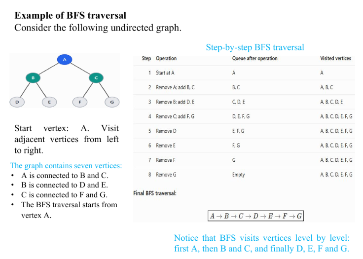 
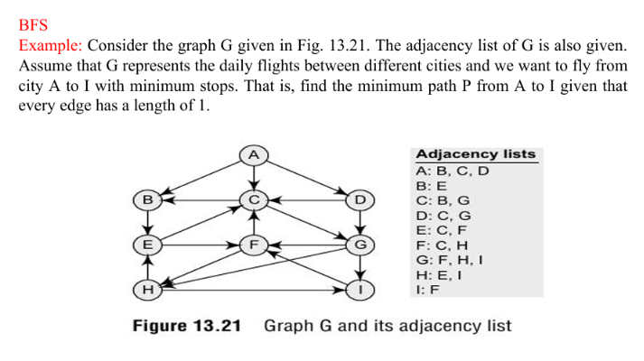 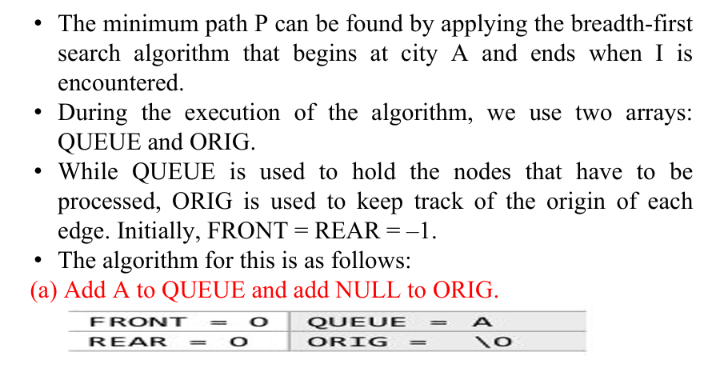 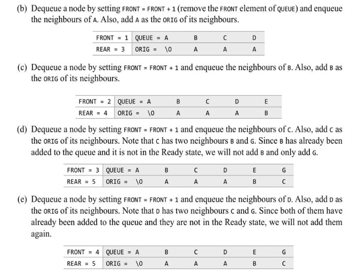 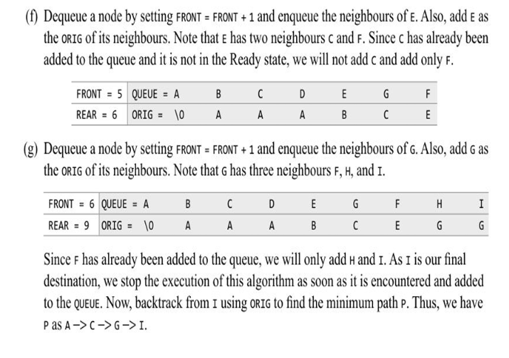 
## 7. Depth-First Search (DFS)

**Definition:** DFS visits a vertex and follows one branch as deeply as possible before backtracking to explore another branch. It uses a **stack (LIFO — Last In, First Out)** or recursion.

### ADT
- **Data:** Graph, visited markers, and a stack or recursive call stack.
- **Operations:** `Push(v)`, `Pop()`, `Visit(v)`, `MarkVisited(v)`, `Backtrack()`.

### One worked example

Use the same graph, start at A, and visit neighbours alphabetically.

1. Start at A and go to B.
2. From B, go to D. D has no unvisited neighbours, so backtrack to B.
3. From B, visit E. E has no unvisited neighbours, so backtrack to A.
4. From A, visit C, then visit F.

**DFS traversal:** `A → B → D → E → C → F`

The order can change with a different neighbour order, but a valid DFS must explore deeply and backtrack.

### Applications
- Exploring mazes and backtracking problems.
- Detecting cycles.
- Determining whether a path exists between two vertices.
- Finding connected components.
- Supporting topological sorting in a directed acyclic graph (DAG).
- Exploring software dependencies and linked web pages.
- Constructing a spanning tree of a connected graph.

**Advantages:** Can be implemented with recursion or a stack; useful for cycle detection; can use less memory than BFS when the search frontier is very wide; forms the basis of other graph algorithms. **Disadvantages:** Does not generally find the shortest path; very deep recursion may exceed the recursion limit; a single DFS only visits vertices reachable from its starting vertex.

**Complexity:** With an adjacency list, `O(V + E)` time and `O(V)` auxiliary space; with an adjacency matrix, typically `O(V²)` time.

> [!hint] Memory trick
> **DFS = Depth = go deep, then backtrack = Stack (LIFO).**

> [!attention] AI
> DFS does not abandon a branch forever when it reaches a dead end. It backtracks to the last vertex with an unexplored neighbour.
> 
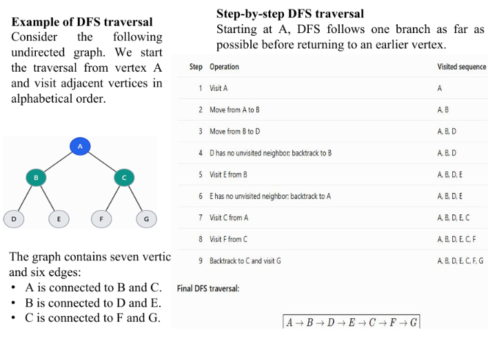 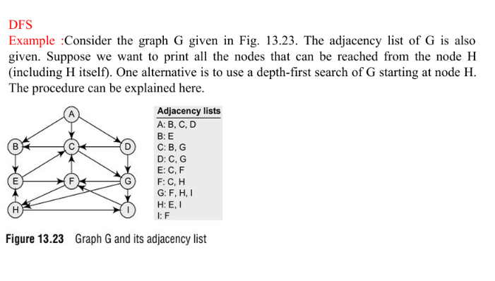 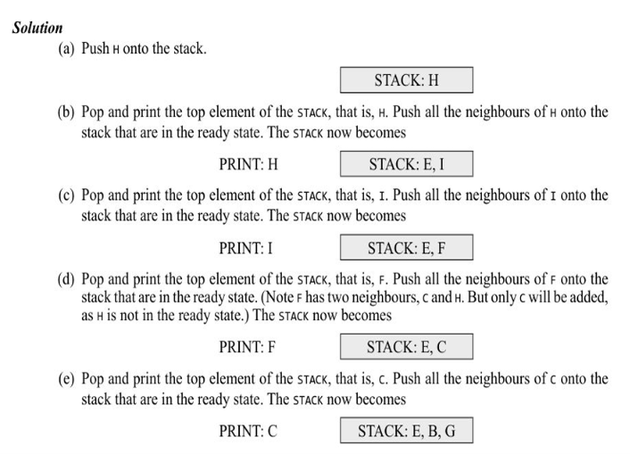 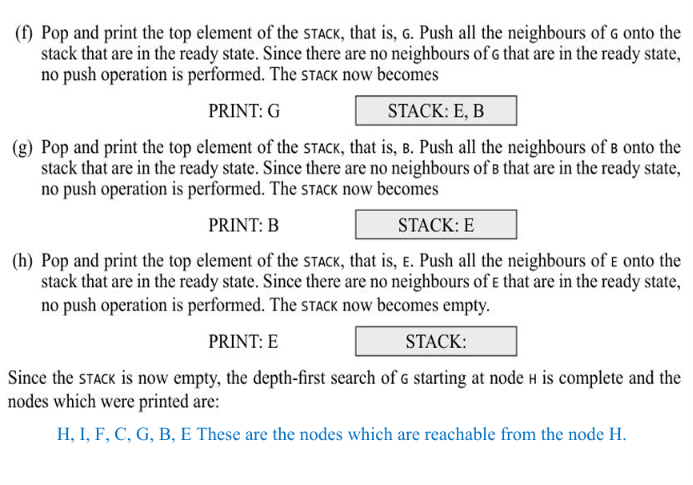 
***
## 8. BFS vs DFS

| Feature | BFS | DFS |
|---|---|---|
| Full form | Breadth-First Search | Depth-First Search |
| Method | Visits level by level | Explores deeply, then backtracks |
| Data structure | Queue (FIFO) | Stack (LIFO) or recursion |
| Shortest path | Finds shortest path by edge count in an unweighted graph | Does not generally guarantee shortest path |
| Common uses | Unweighted shortest paths, level exploration | Cycle detection, backtracking, connectivity |
| Adjacency-list complexity | `O(V + E)` | `O(V + E)` |

> [!hint] Memory trick
> **BFS = Queue = levels; DFS = Stack = depth.**

> [!attention] AI
> If the question asks for the fewest edges in an unweighted graph, think BFS. If it asks you to explore a branch deeply and backtrack, think DFS.

## 9. Minimum Spanning Tree (MST)

A **spanning tree** of a connected, undirected graph connects all vertices without creating cycles. A **Minimum Spanning Tree (MST)** is the spanning tree with the minimum possible total edge weight.

### ADT
- **Data:** Weighted undirected graph and a set of selected edges.
- **Operations:** `SelectEdge()`, `CheckCycle()`, `AddVertex()`, `TotalWeight()`.

### Properties
- Includes every vertex.
- Has exactly `V − 1` edges for `V` vertices.
- Contains no cycles.
- Has the minimum total edge weight among all spanning trees.
- In an unweighted connected graph, every spanning tree is an MST.
- Multiple MSTs can exist when different edge selections have the same minimum total weight.
- If all edge weights are distinct, the MST is unique.
- In a cycle, an edge that is strictly heavier than every other edge in that cycle cannot belong to an MST.

### One worked example

| Edge | Weight |
|---|---:|
| A–B | 1 |
| A–C | 3 |
| B–C | 2 |
| B–D | 4 |
| C–D | 5 |

Choose A–B (1), B–C (2), and B–D (4). All four vertices are connected, there is no cycle, and the total weight is `1 + 2 + 4 = 7`. These edges form an MST for this example.

**Advantages:** Connects all vertices with minimum total connection cost; removes unnecessary cycles while preserving connectivity; useful for economical network design. **Disadvantages:** Requires edge weights to optimise cost; the MST does not necessarily give the shortest path between every pair; different MSTs may exist when weights tie.

**Applications:** Telephone and computer networks, connecting cities with roads or cables, airline and rail networks, electronic circuits, and network design.

> [!hint] Memory trick
> **MST = all vertices + no cycles + `V − 1` edges + minimum total weight.**

> [!attention] AI
> An MST minimises the total cost of connecting the network. It does not promise that every trip between two cities is the shortest possible trip.
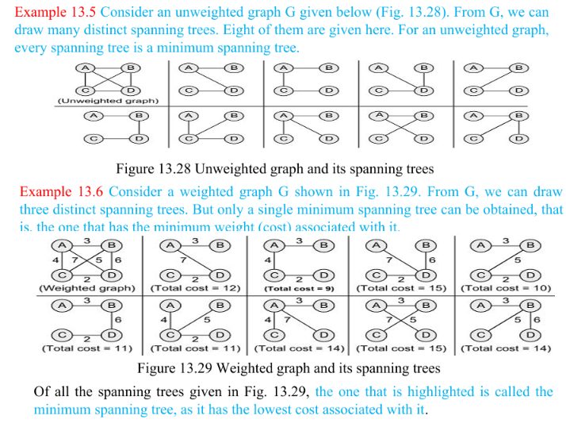 
## 10. Prim's Algorithm

**Definition:** Prim's algorithm is a greedy method for building an MST of a connected, weighted, undirected graph. It starts from one vertex and repeatedly adds the cheapest edge that connects the current tree to a new vertex.

### ADT
- **Data:** Graph, current MST, and candidate edges to vertices outside the tree.
- **Operations:** `ChooseStart()`, `FindCheapestConnectingEdge()`, `AddEdge()`, `AddVertex()`.

### Important terms
- **Tree vertices:** Vertices already included in the MST.
- **Fringe vertices:** Vertices outside the MST but adjacent to at least one tree vertex.
- **Unseen vertices:** Vertices that are neither tree vertices nor fringe vertices.
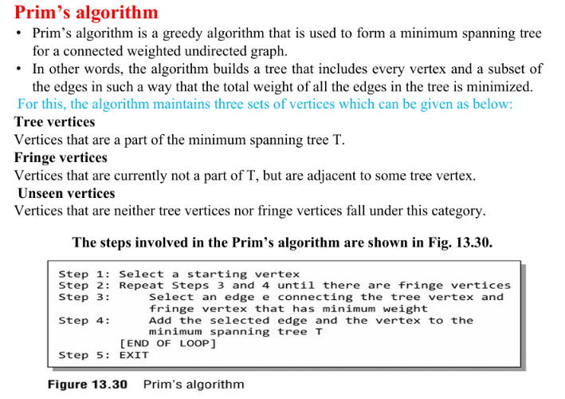 
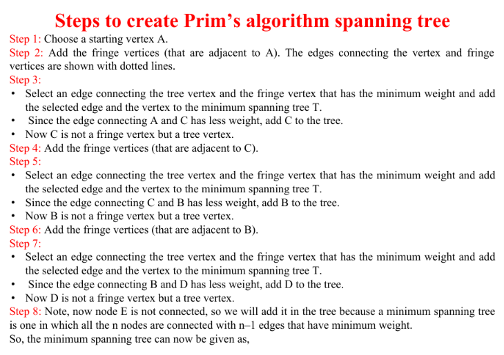 
### One worked example

Use the graph from the MST section. Start at A.

| Step | Current tree vertices | Candidate edges to outside vertices | Chosen edge |
|---|---|---|---|
| 1 | A | A–B (1), A–C (3) | A–B (1) |
| 2 | A, B | A–C (3), B–C (2), B–D (4) | B–C (2) |
| 3 | A, B, C | B–D (4), C–D (5) | B–D (4) |

All vertices are included. MST edges are `{A–B, B–C, B–D}` and total weight is `1 + 2 + 4 = 7`.

### Key points
- Prim's grows one connected tree.
- It begins from any selected vertex.
- At each step, choose the lowest-weight edge from the tree to a vertex outside it.
- Do not add an edge between two vertices already in the tree, because that creates a cycle.
- The MST contains `V − 1` edges.
- A common implementation using an adjacency list and binary heap takes `O(E log V)` time; a simple matrix implementation takes `O(V²)`.

**Advantages:** Systematically grows an MST; often effective for dense graphs with suitable implementations; maintains one connected tree. **Disadvantages:** Requires careful selection of the cheapest edge crossing the tree boundary; a simple implementation may be slower on large graphs; a single MST requires a connected graph.

> [!hint] Memory trick
> **Prim = pick a starting point, then grow one tree using the cheapest connecting edge.**

> [!attention] AI
> Prim does not choose the cheapest edge anywhere in the graph automatically. It chooses the cheapest edge that connects its current tree to a new vertex.

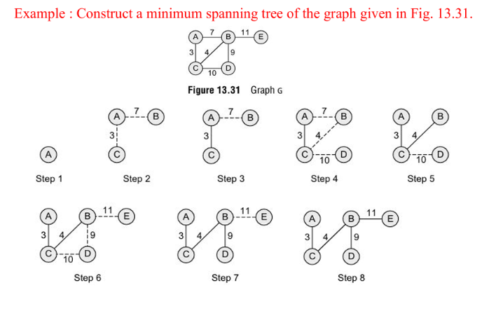 
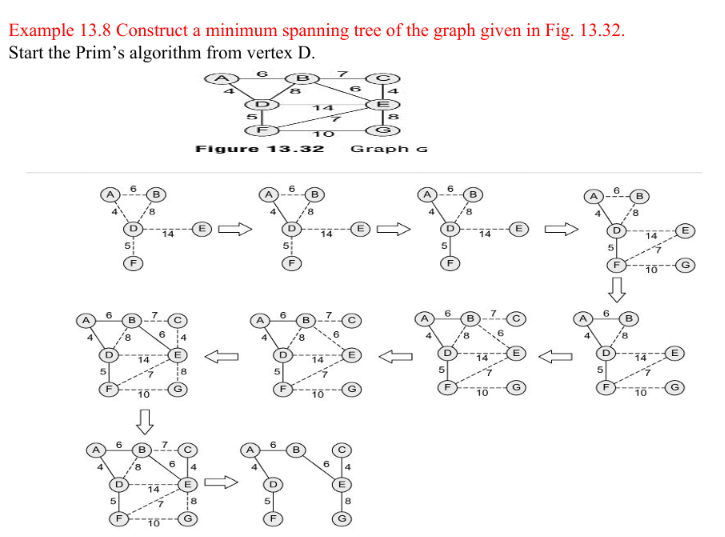 
***
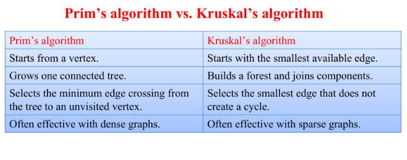 
## 11. Kruskal's Algorithm

**Definition:** Kruskal's algorithm is a greedy method for finding an MST. It sorts edges by weight and adds the cheapest edge that does not create a cycle. If the graph is disconnected, it produces a minimum spanning forest.

### ADT
- **Data:** Weighted edge list, selected MST edges, and components.
- **Operations:** `SortEdges()`, `CheckComponents()`, `AddEdge()`, `RejectCycleEdge()`.

### One worked example

| Edge | Weight | Decision | Reason |
|---|---:|---|---|
| A–B | 1 | Select | Does not create a cycle |
| B–C | 2 | Select | Connects a new vertex |
| A–C | 3 | Reject | A and C are already connected through A–B–C |
| B–D | 4 | Select | Connects D |
| C–D | 5 | Reject | All vertices are connected; it would create a cycle |

**MST edges:** `{A–B, B–C, B–D}`. **Total weight:** `1 + 2 + 4 = 7`.

### Key points
- Sort edges from smallest to largest.
- Initially, every vertex belongs to its own component.
- Select an edge only if it joins two different components.
- Stop after selecting `V − 1` edges for a connected graph.
- A disconnected graph results in a minimum spanning forest.
- A common implementation with sorting and a disjoint-set structure takes `O(E log E)` time.

**Advantages:** Easy to apply using a sorted edge list; often effective for sparse graphs; avoids cycles by checking components. **Disadvantages:** Requires sorting the edges; component tracking is necessary; it may build separate components before they are joined.

> [!hint] Memory trick
> **Kruskal = sort all edges; keep the cheapest edge that does not create a cycle.**

> [!attention] AI
> If A and C are already connected through A–B–C, adding A–C closes a cycle. Kruskal skips it even if the edge looks tempting.

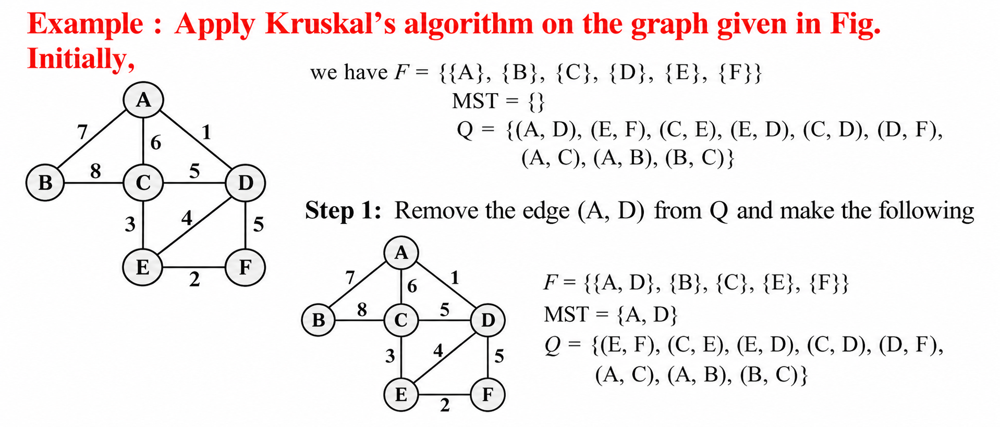 
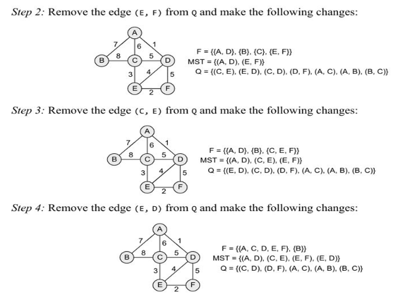 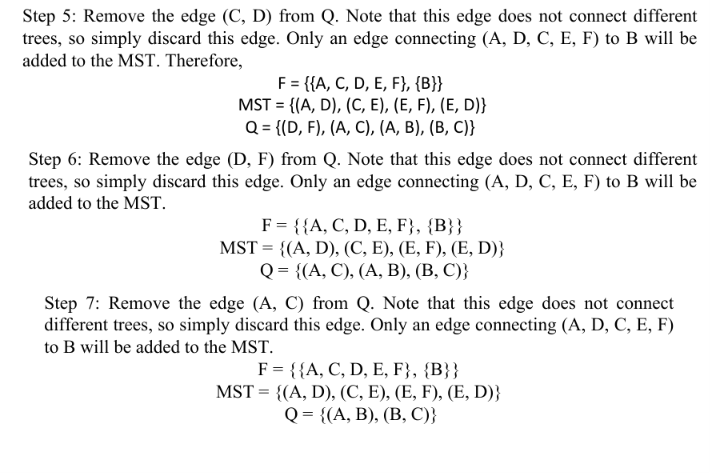 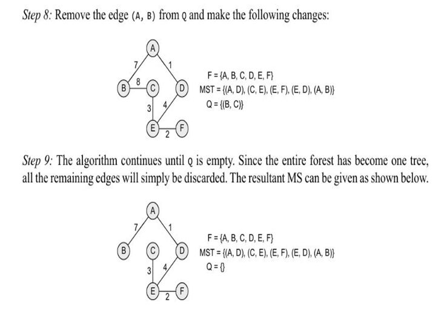 
## 12. Prim's vs Kruskal's Algorithm

| Feature | Prim's | Kruskal's |
|---|---|---|
| Starts with | A selected vertex | All edges sorted by weight |
| Growth | Grows one tree | Joins separate components |
| Selects | Cheapest edge from current tree to a new vertex | Cheapest edge that does not form a cycle |
| Cycle handling | Avoids edges connecting two vertices already in its tree | Skips edges whose endpoints are already in the same component |
| Often suitable for | Dense graphs with suitable implementation | Sparse graphs with suitable implementation |
| Common time | `O(E log V)` with heap/list; `O(V²)` with matrix | `O(E log E)` with sorting and disjoint sets |

> [!hint] Memory trick
> **Prim grows from a vertex; Kruskal grows from sorted edges.**

> [!attention] AI
> Prim asks, “What is the cheapest edge to expand my current tree?” Kruskal asks, “What is the cheapest edge that joins two different components?”

## 13. Dijkstra's Shortest-Path Algorithm

**Definition:** Dijkstra's algorithm finds the shortest paths from one source vertex to every other reachable vertex in a weighted graph with **non-negative edge weights**. It is used in network routing and route planning. It is a shortest-path algorithm, not an MST algorithm.

### ADT
- **Data:** Weighted graph, source vertex, tentative distances, visited/settled vertices, and predecessors.
- **Operations:** `SetDistance()`, `SelectMinimumDistance()`, `RelaxEdge()`, `UpdatePredecessor()`, `GetShortestPath()`.

### One worked example

| Edge | Weight |
|---|---:|
| A–B | 4 |
| A–C | 2 |
| C–B | 1 |
| B–D | 5 |
| C–D | 8 |

Find shortest distances from source A.

| Vertex | Best path from A | Total cost |
|---|---|---:|
| A | A | 0 |
| C | A → C | 2 |
| B | A → C → B | `2 + 1 = 3` |
| D | A → C → B → D | `2 + 1 + 5 = 8` |

The direct route A → B costs 4, but A → C → B costs 3, so the best distance to B is **3**. The shortest distance to D is **8** through B.

### Important limitation
Dijkstra's algorithm does not generally work correctly with negative edge weights. If negative weights must be handled, an algorithm such as Bellman–Ford may be appropriate.

**Advantages:** Finds minimum-cost paths from one source with non-negative weights; useful for maps and routing; provides shortest distances and routes. **Disadvantages:** Negative edge weights are not supported in general; it optimises routes from one source, not total network connection cost; results depend on correct weights.

**Complexity:** A common adjacency-list and binary-heap implementation takes `O((V + E) log V)`; a simple implementation can take `O(V²)`.

> [!hint] Memory trick
> **Dijkstra = shortest routes from one source; edge weights must be non-negative.**

> [!attention] AI
> A direct edge is not always the cheapest route. Compare the total cost of the whole path: A–B costs 4, but A–C–B costs 3.
> 
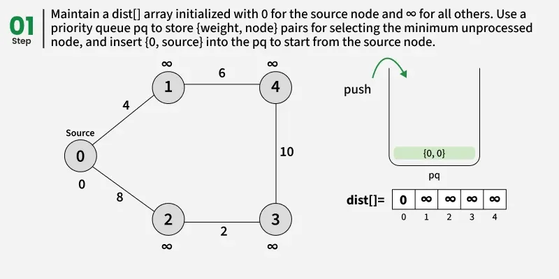 
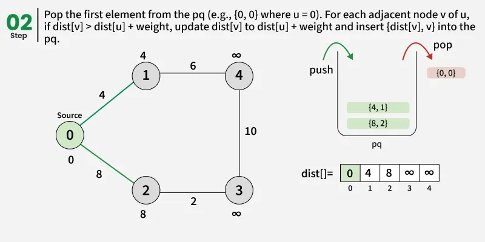 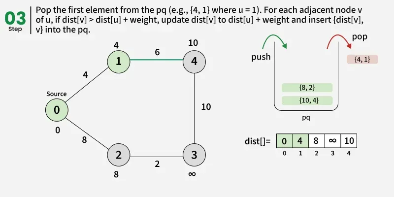 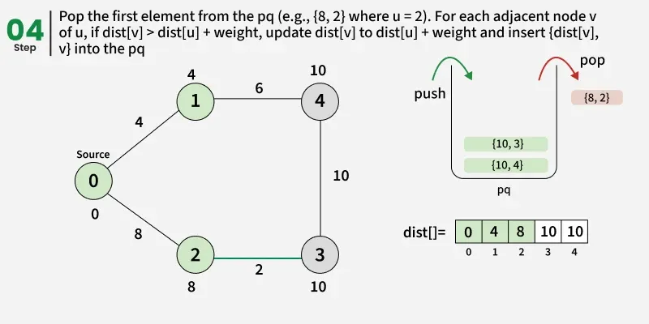 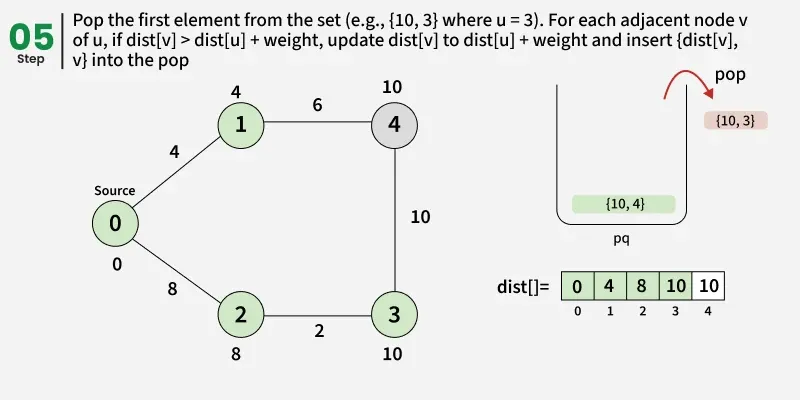 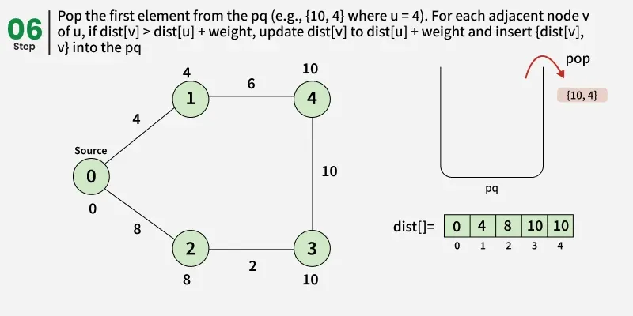 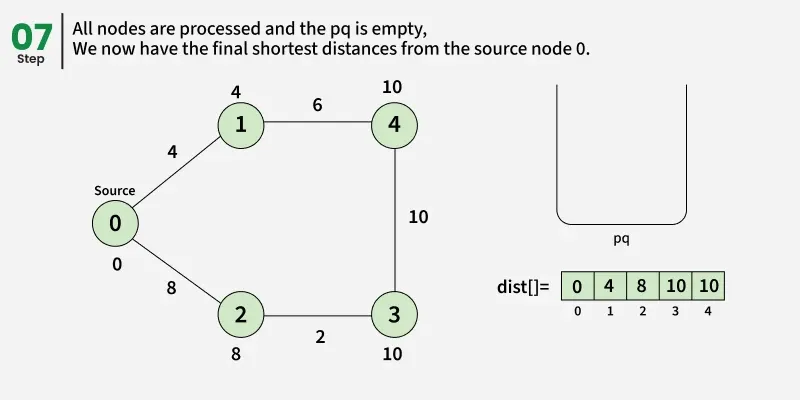 
## 14. Minimum Spanning Tree vs Shortest Path

| Minimum Spanning Tree (MST) | Shortest-path algorithm |
|---|---|
| Connects all vertices with minimum total edge weight. | Finds minimum-cost routes from a source to other vertices. |
| Uses Prim's or Kruskal's algorithm. | Uses Dijkstra's for non-negative edge weights. |
| Has `V − 1` edges when the graph is connected. | A shortest-path tree may have `V − 1` edges for reachable vertices, but it optimises source-to-vertex distances. |
| Does not guarantee the shortest route between every pair. | Optimises routes from the selected source. |
| Example: cheapest cable network connecting cities. | Example: shortest driving routes from one city. |

> [!hint] Memory trick
> **MST minimises the whole network cost; Dijkstra minimises routes from one source.**

## 15. Applications and Suitability of Graphs

| Real-world problem | Graph model / suitable method | Why it fits |
|---|---|---|
| Road map / route planning | Vertices = locations; weighted edges = distance or time; Dijkstra for non-negative weights | Finds a low-cost route from a source |
| Railway stops with equal edge cost | BFS | Finds the fewest edges/stops |
| Social network | Vertices = people; edges = relationships; BFS for connection levels | Finds people one, two, or more connections away |
| Computer network | Vertices = devices; edges = links; BFS/DFS for reachability | Explores reachable devices |
| Web crawling | Vertices = pages; edges = links; BFS or DFS | Visits linked pages systematically |
| Network cable/telephone design | Weighted graph + MST | Connects all sites with minimum total cable cost |
| Airline/rail network design | Weighted graph + MST | Selects a low-cost network without cycles |
| Maze solving | DFS | Explores a path and backtracks at dead ends |
| Dependency analysis | Directed graph + DFS/topological sorting for a DAG | Represents which task/module depends on another |
| Cycle detection | DFS | Helps identify cycles in graph relationships |
| Connected components | BFS or DFS | Finds groups of mutually reachable vertices |
| Minimum-cost route from one source | Dijkstra with non-negative weights | Compares path costs from the source |

> [!hint] Memory trick
> **BFS = fewest edges; DFS = deep exploration; MST = cheapest network; Dijkstra = cheapest route from a source.**

## 16. Exam-Style Solved Questions

### Q1. Represent a graph using an adjacency matrix and adjacency list.

Given an undirected graph with edges A–B, A–C, and B–C.

**Adjacency matrix:**

|  | A | B | C |
|---|---:|---:|---:|
| **A** | 0 | 1 | 1 |
| **B** | 1 | 0 | 1 |
| **C** | 1 | 1 | 0 |

**Adjacency list:**

```text
A: B, C
B: A, C
C: A, B
```

### Q2. Apply BFS starting from A.

```text
        A
       / \
      B   C
     / \   \
    D   E   F
```

Assume neighbours are considered alphabetically.

**Answer:** `A → B → C → D → E → F`

BFS visits A first, then its neighbours B and C, then the next level D, E, and F.

### Q3. Apply DFS starting from A.

Use the same graph and alphabetical neighbour order.

**Answer:** `A → B → D → E → C → F`

DFS follows A → B → D, backtracks to B for E, then backtracks to A and explores C → F.

### Q4. Find the MST using Prim's or Kruskal's algorithm.

Given edges A–B = 1, A–C = 3, B–C = 2, B–D = 4, C–D = 5.

**Answer:** Select A–B (1), B–C (2), and B–D (4). Reject A–C because it creates a cycle after A–B and B–C are selected. Reject C–D because all vertices are already connected.

**MST:** `{A–B, B–C, B–D}`. **Total weight:** `1 + 2 + 4 = 7`.

### Q5. Use Dijkstra's algorithm to find the shortest route from A to B.

Given A–B = 4, A–C = 2, and C–B = 1.

**Answer:** Direct route A → B costs `4`. Route A → C → B costs `2 + 1 = 3`. The shortest route is **A → C → B**, with total cost **3**.

### Q6. Differentiate between BFS and DFS.

**Answer:** BFS visits vertices level by level using a queue (FIFO) and finds the shortest path by edge count in an unweighted graph. DFS explores one branch deeply before backtracking and uses a stack (LIFO) or recursion. DFS does not generally guarantee the shortest path.

### Q7. Differentiate between Prim's and Kruskal's algorithms.

**Answer:** Prim's starts at a vertex and grows one tree by choosing the cheapest edge to a new vertex. Kruskal's sorts all edges and selects the cheapest edge that does not create a cycle. Both produce an MST for a connected, weighted, undirected graph.

### Q8. Differentiate between MST and shortest path.

**Answer:** An MST connects every vertex with the minimum total edge weight and has `V − 1` edges. A shortest-path algorithm finds minimum-cost routes from a source to other vertices. An MST does not necessarily provide the shortest route between every pair.

## 17. Last-Minute Revision

| Topic | Remember this |
|---|---|
| Graph | Vertices + edges |
| Degree | Number of edges connected to a vertex in an undirected graph |
| In-degree / Out-degree | Arrows entering / arrows leaving |
| Complete graph | Every pair connected; undirected edges = `n(n − 1)/2` |
| Adjacency matrix | `V × V`; fast edge check; `O(V²)` storage |
| Adjacency list | Stores neighbours; `O(V + E)` storage |
| Adjacency multi-list | Each undirected edge record is shared by both endpoint lists |
| BFS | Queue, FIFO, level by level |
| DFS | Stack/recursion, LIFO, deep then backtrack |
| BFS vs DFS | BFS gives shortest path by edge count in unweighted graphs; DFS does not generally |
| Spanning tree | All vertices, connected, no cycles, `V − 1` edges |
| MST | Minimum total edge weight |
| Prim's | Grow one tree from a starting vertex |
| Kruskal's | Sort edges; reject edges that create cycles |
| Dijkstra | Shortest paths from one source; non-negative weights |
| MST vs shortest path | Cheapest complete network vs cheapest routes from a source |

> [!hint] Exam strategy
> **Draw the graph, write the starting vertex and neighbour order, show each selected edge or visited vertex, and state the final traversal/path/cost clearly.** Prioritise solved examples and correct reasoning over memorising pseudocode unless the question specifically asks for it.
