# DSA — Chapter 6: Sorting, Searching, and Hashing (Exam-Oriented Notes)

## 1. Introduction to Sorting

**Sorting** means arranging elements in a particular order, usually ascending or descending.

**Example:** Given `A = [21, 34, 11, 9, 1, 0, 22]`,
ascending order is `[0, 1, 9, 11, 21, 22, 34]`.

### Types of sorting
- **Internal sorting:** Sorts data stored in the computer's main memory.
- **External sorting:** Sorts data stored in files; useful when the data is too large to fit in memory.

> [!hint] Memory trick
> **Internal = inside memory;
> External = external files/storage.**

## 2. Bubble Sort

**Bubble Sort** repeatedly compares adjacent elements and swaps them if they are in the wrong order. In ascending order, the largest unsorted element moves to the end during each pass.

### Algorithm steps
1. Compare adjacent elements.
2. If the left element is greater than the right element, swap them.
3. Continue to the end of the unsorted portion.
4. Repeat passes until the array is sorted.

### Worked example
Sort `[5, 1, 4, 2]` in ascending order.

| Pass | Array after the pass |
|---|---|
| Initial | `5, 1, 4, 2` |
| Pass 1 | `1, 4, 2, 5` |
| Pass 2 | `1, 2, 4, 5` |
| Pass 3 | `1, 2, 4, 5` |

The largest element reaches its correct position at the end of each pass.

**Advantages**
- Simple to understand and implement.
- Requires no extra array for ordinary in-place implementations.

**Disadvantages**
- Slow for large datasets.
- Performs many comparisons and swaps.

> [!hint] Memory trick
> **Bubble = compare neighbours; the biggest bubbles to the end.**

> [!attention] AI
> Bubble Sort swaps adjacent elements only when they are out of order. It does not jump the largest element directly to the end.
***
### Bubble Sort — Solved Example

**Example:** Consider an array `A[]` containing the following elements:

`A[] = {30, 52, 29, 87, 63, 27, 19, 54}`

### Pass 1

**(a)** Compare `30` and `52`. Since `30 < 52`, no swapping is done.

`30`, `52`, 29, 87, 63, 27, 19, 54

**(b)** Compare `52` and `29`. Since `52 > 29`, swapping is done.

30, `29`, `52`, 87, 63, 27, 19, 54

**(c)** Compare `52` and `87`. Since `52 < 87`, no swapping is done.

52 and 87 remain in their current positions.

**(d)** Compare `87` and `63`. Since `87 > 63`, swapping is done.

30, 29, 52, `63`, `87`, 27, 19, 54

**(e)** Compare `87` and `27`. Since `87 > 27`, swapping is done.

30, 29, 52, 63, `27`, `87`, 19, 54

**(f)** Compare `87` and `19`. Since `87 > 19`, swapping is done.

30, 29, 52, 63, 27, `19`, `87`, 54

**(g)** Compare `87` and `54`. Since `87 > 54`, swapping is done.

30, 29, 52, 63, 27, 19, `54`, `87`

**Observation:** After Pass 1, the largest element, `87`, is placed at the highest index of the array. All the other elements are still unsorted.

### Pass 2

**(a)** Compare `30` and `29`. Since `30 > 29`, swapping is done.

`29`, `30`, 52, 63, 27, 19, 54, 87

**(b)** Compare `30` and `52`. Since `30 < 52`, no swapping is done.

30 and 52 remain in their current positions.

**(c)** Compare `52` and `63`. Since `52 < 63`, no swapping is done.

52 and 63 remain in their current positions.

**(d)** Compare `63` and `27`. Since `63 > 27`, swapping is done.

29, 30, 52, `27`, `63`, 19, 54, 87

**(e)** Compare `63` and `19`. Since `63 > 19`, swapping is done.

29, 30, 52, 27, `19`, `63`, 54, 87

**(f)** Compare `63` and `54`. Since `63 > 54`, swapping is done.

29, 30, 52, 27, 19, `54`, `63`, 87

### Pass 3

**(a)** Compare `29` and `30`. Since `29 < 30`, no swapping is done.

29 and 30 remain in their current positions.

**(b)** Compare `30` and `52`. Since `30 < 52`, no swapping is done.

30 and 52 remain in their current positions.

**(c)** Compare `52` and `27`. Since `52 > 27`, swapping is done.

29, 30, `27`, `52`, 19, 54, 63, 87

**(d)** Compare `52` and `19`. Since `52 > 19`, swapping is done.

29, 30, 27, `19`, `52`, 54, 63, 87

**(e)** Compare `52` and `54`. Since `52 < 54`, no swapping is done.

52 and 54 remain in their current positions.

After Pass 3:

29, 30, 27, 19, 52, 54, 63, 87

### Pass 4

**(a)** Compare `29` and `30`. Since `29 < 30`, no swapping is done.

29 and 30 remain in their current positions.

**(b)** Compare `30` and `27`. Since `30 > 27`, swapping is done.

29, `27`, `30`, 19, 52, 54, 63, 87

**(c)** Compare `30` and `19`. Since `30 > 19`, swapping is done.

29, 27, `19`, `30`, 52, 54, 63, 87

**(d)** Compare `30` and `52`. Since `30 < 52`, no swapping is done.

30 and 52 remain in their current positions.

After Pass 4:

29, 27, 19, 30, 52, 54, 63, 87

### Pass 5

**(a)** Compare `29` and `27`. Since `29 > 27`, swapping is done.

`27`, `29`, 19, 30, 52, 54, 63, 87

**(b)** Compare `29` and `19`. Since `29 > 19`, swapping is done.

27, `19`, `29`, 30, 52, 54, 63, 87

**(c)** Compare `29` and `30`. Since `29 < 30`, no swapping is done.

29 and 30 remain in their current positions.

After Pass 5:

27, 19, 29, 30, 52, 54, 63, 87

### Pass 6

**(a)** Compare `27` and `19`. Since `27 > 19`, swapping is done.

`19`, `27`, 29, 30, 52, 54, 63, 87

**(b)** Compare `27` and `29`. Since `27 < 29`, no swapping is done.

27 and 29 remain in their current positions.

After Pass 6:

19, 27, 29, 30, 52, 54, 63, 87

### Pass 7

**(a)** Compare `19` and `27`. Since `19 < 27`, no swapping is done.

19 and 27 remain in their current positions.

### Final Sorted Array

`A[] = {19, 27, 29, 30, 52, 54, 63, 87}`

**Conclusion:** Bubble Sort repeatedly compares adjacent elements and swaps them if they are in the wrong order. After each pass, the largest remaining unsorted element moves to its correct position at the end of the array.

***
## 3. Insertion Sort

**Insertion Sort** builds a sorted portion one element at a time by inserting each new element into its correct position. It works like arranging playing cards in your hand.

### Algorithm steps
1. Treat the first element as sorted.
2. Select the first element from the unsorted portion.
3. Compare it with elements in the sorted portion.
4. Shift larger elements one position right.
5. Insert the selected element in the correct position.
6. Repeat until all elements are sorted.
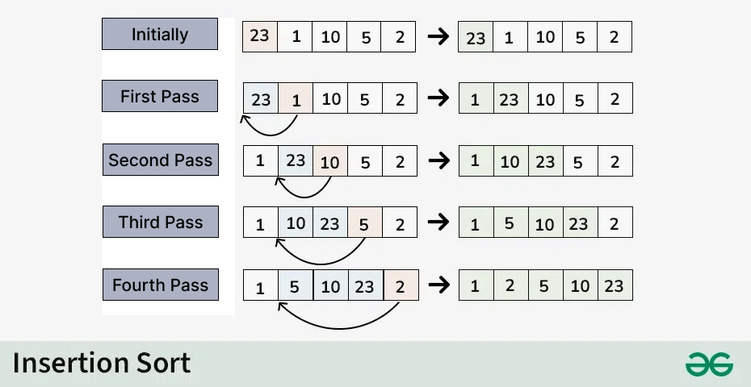 
### Worked example from the PDF

Sort `39, 9, 45, 63, 18, 81, 108, 54, 72, 36` using Insertion Sort. The first element is initially treated as sorted. On each pass, take the first unsorted element and insert it into the correct place in the sorted portion.

| Pass | Key selected | Array after insertion |
|---|---:|---|
| Initial | — | 39, 9, 45, 63, 18, 81, 108, 54, 72, 36 |
| 1 | `9` | `9`, `39`, 45, 63, 18, 81, 108, 54, 72, 36 |
| 2 | `45` | 9, 39, `45`, 63, 18, 81, 108, 54, 72, 36 |
| 3 | `63` | 9, 39, 45, `63`, 18, 81, 108, 54, 72, 36 |
| 4 | `18` | 9, `18`, 39, 45, 63, 81, 108, 54, 72, 36 |
| 5 | `81` | 9, 18, 39, 45, 63, `81`, 108, 54, 72, 36 |
| 6 | `108` | 9, 18, 39, 45, 63, 81, `108`, 54, 72, 36 |
| 7 | `54` | 9, 18, 39, 45, `54`, 63, 81, 108, 72, 36 |
| 8 | `72` | 9, 18, 39, 45, 54, 63, `72`, 81, 108, 36 |
| 9 | `36` | 9, 18, `36`, 39, 45, 54, 63, 72, 81, 108 |

**Final sorted array:** `9, 18, 36, 39, 45, 54, 63, 72, 81, 108`.

**Advantages**
- Simple to implement.
- Efficient for small or nearly sorted arrays.
- Uses little extra memory.

**Disadvantages**
- Slow for large, randomly ordered datasets.
- Worst-case time grows quadratically.

> [!hint] Memory trick
> **Insertion = pick one item and insert it into the sorted part.**

## 4. Selection Sort

**Selection Sort** repeatedly finds the smallest element in the unsorted portion and swaps it with the first element of that portion.

### Algorithm steps
1. Find the minimum element in the entire array.
2. Swap it with the first element.
3. Find the minimum in the remaining unsorted portion.
4. Swap it into the next position.
5. Continue until the array is sorted.
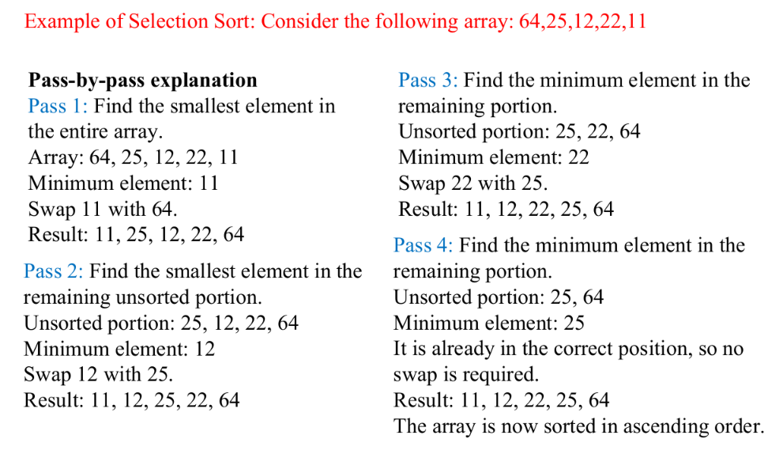
 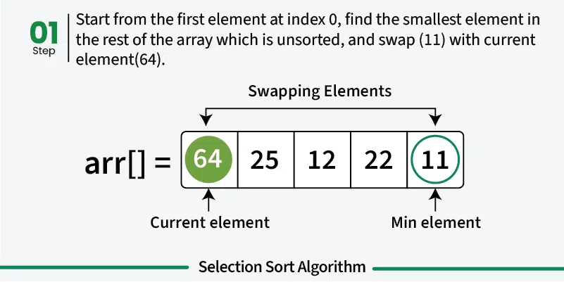 
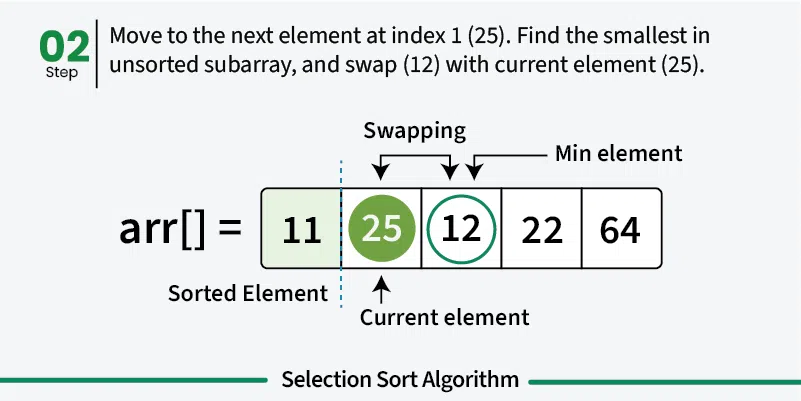 
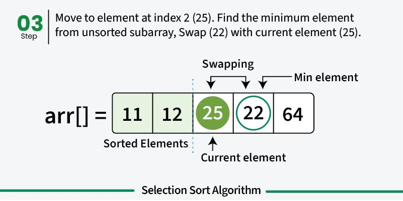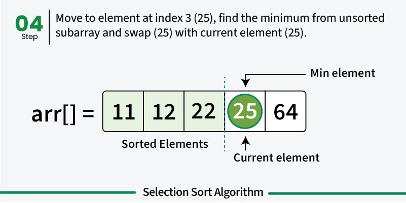 
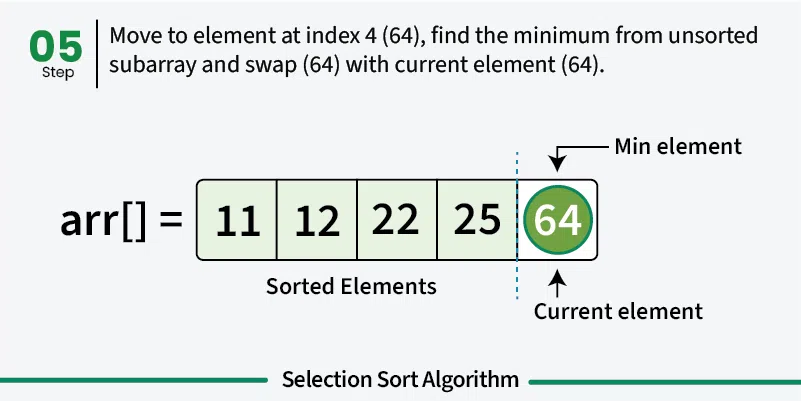 
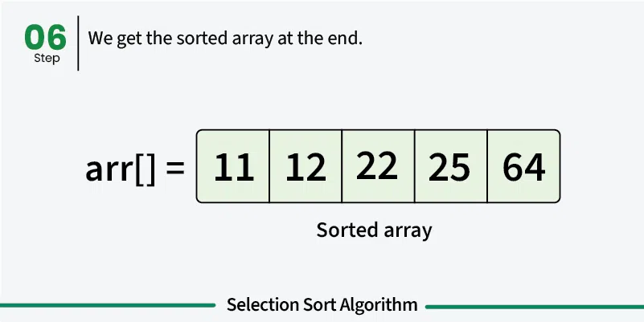 

***
### Worked example from the PDF

Sort `39, 9, 81, 45, 90, 27, 72, 18` using Selection Sort. In each pass, find the minimum in the unsorted portion and swap it with the first element of that portion. `POS` is the zero-based position of the minimum selected in the original pass table.

| Pass | POS | Array after the swap |
|---:|---:|---|
| Initial | — | 39, 9, 81, 45, 90, 27, 72, 18 |
| 1 | 1 | `9`, `39`, 81, 45, 90, 27, 72, 18 |
| 2 | 7 | 9, `18`, 81, 45, 90, 27, 72, `39` |
| 3 | 5 | 9, 18, `27`, 45, 90, `81`, 72, 39 |
| 4 | 7 | 9, 18, 27, `39`, 90, 81, 72, `45` |
| 5 | 7 | 9, 18, 27, 39, `45`, 81, 72, `90` |
| 6 | 6 | 9, 18, 27, 39, 45, `72`, `81`, 90 |
| 7 | 6 | 9, 18, 27, 39, 45, 72, `81`, `90` |

**Final sorted array:** `9, 18, 27, 39, 45, 72, 81, 90`.

**Advantages**
- Simple and easy to implement.
- Suitable for small datasets.
- Performs relatively few swaps.

**Disadvantages**
- Takes quadratic time even when the array is already sorted.
- Not suitable for large datasets.

> [!hint] Memory trick
> **Selection = select the smallest remaining element and place it next.**

> [!attention] AI
> Selection Sort finds the minimum of the unsorted part—not necessarily the minimum of the whole array on every pass.

## 5. Merge Sort

**Merge Sort** is an efficient sorting algorithm based on **Divide and Conquer**. It divides an array into smaller parts, sorts them recursively, and merges the sorted parts.

### Three main steps
1. **Divide:** Split the array into halves until each subarray contains one element.
2. **Conquer:** Sort the subarrays recursively.
3. **Merge:** Combine sorted subarrays by comparing their elements.
 
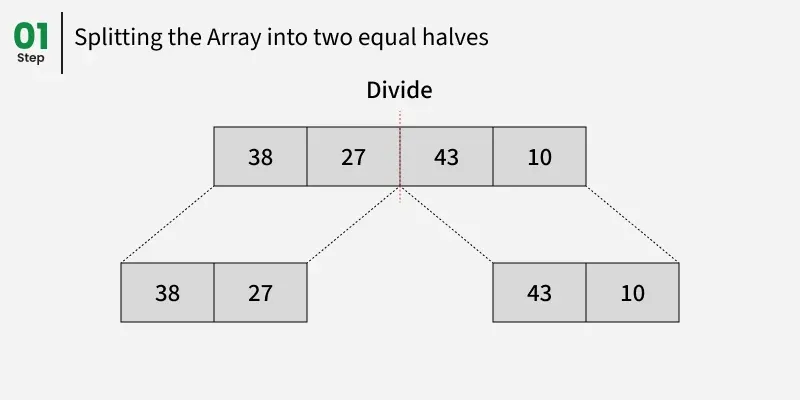 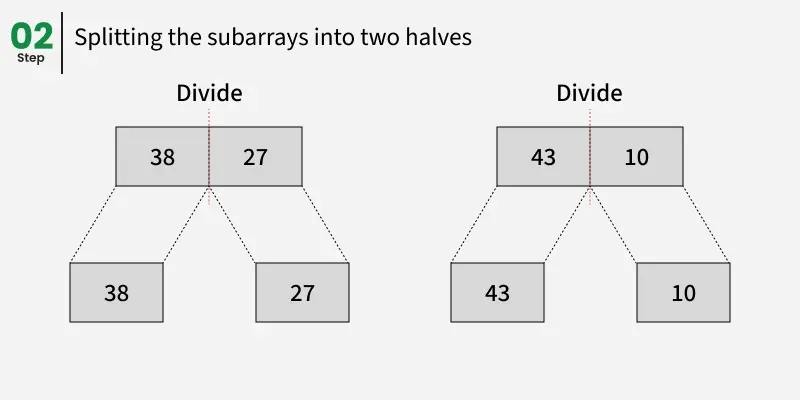 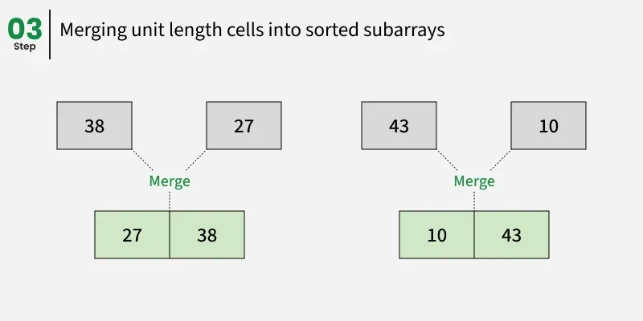 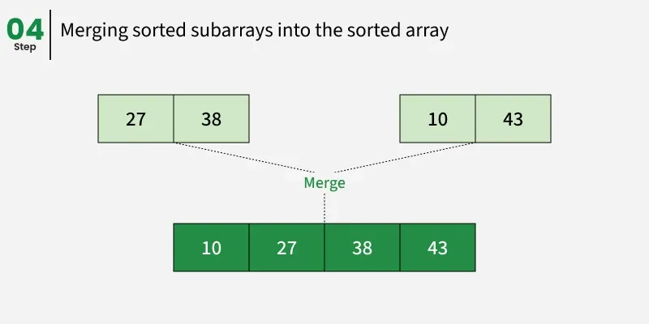 
### Worked example from the PDF

Sort `[38, 27, 43, 3, 9, 82, 10]` using Merge Sort.

**Step 1 — Divide:** Split the array into smaller subarrays until each subarray contains one element.

`[38, 27, 43, 3, 9, 82, 10]`

`[38, 27, 43, 3]` and `[9, 82, 10]`

`[38, 27]`, `[43, 3]`, `[9, 82]`, and `[10]`

`[38]`, `[27]`, `[43]`, `[3]`, `[9]`, `[82]`, `[10]`

**Step 2 — Merge sorted small parts:**

| Merge operation | Result |
|---|---|
| Merge `[38]` and `[27]` | `[27, 38]` |
| Merge `[43]` and `[3]` | `[3, 43]` |
| Merge `[9]` and `[82]` | `[9, 82]` |
| Merge `[27, 38]` and `[3, 43]` | `[3, 27, 38, 43]` |
| Merge `[9, 82]` and `[10]` | `[9, 10, 82]` |

**Step 3 — Final merge:** Merge `[3, 27, 38, 43]` and `[9, 10, 82]` by repeatedly taking the smaller front element.

**Final sorted array:** `[3, 9, 10, 27, 38, 43, 82]`.

**Advantages**
- Predictable `O(n log n)` time in best, average, and worst cases.
- Suitable for large datasets.
- Stable when implemented with the usual tie-handling rule.

**Disadvantages**
- Standard array implementation requires extra memory.
- More complex than Bubble, Insertion, and Selection Sort.

> [!hint] Memory trick
> **Merge Sort = divide first, sort small parts, merge in order.**

> [!attention] AI
> Merge Sort does not merely join two lists. It compares elements while merging so that the combined list stays sorted.

> [!danger] QUICK SORT IS NOT IN PT 2

## 6. [Quick Sort - Algorithms in 60 Seconds (click to watch the video)](https://www.youtube.com/shorts/HBDnJJ0NBeE) 
> [!attention] this one is a bit difficult since it uses recursion so click the video link watch it and skip the below stuffs 

**Quick Sort**, also called **Partition Exchange Sort**, uses Divide and Conquer. It selects a **pivot**, partitions the array around it, and recursively sorts the two parts.

### Algorithm steps
1. Select a pivot element.
2. Partition the array so smaller values go before the pivot and larger values go after it.
3. The pivot reaches its final position.
4. Recursively sort the left and right subarrays.
5. Stop when a subarray has zero or one element.
 
### Worked example from the PDF
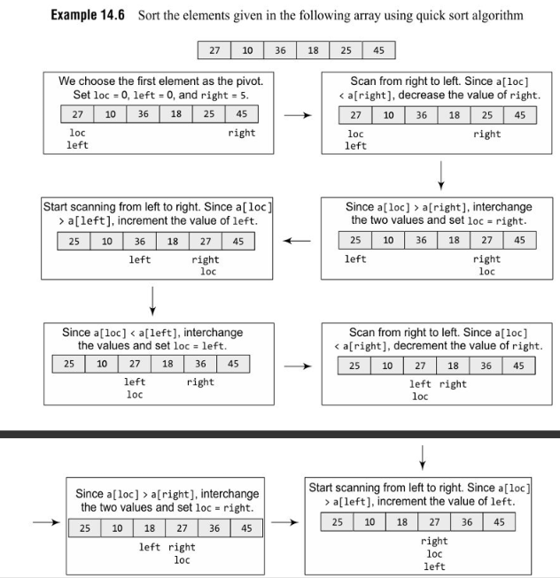  

Sort `[27, 10, 36, 18, 25, 45]` using Quick Sort. The PDF example chooses the first element, `27`, as the pivot. The two scanning pointers are `left` and `right`; `loc` marks the pivot's current position.

| Step | Operation | Array |
|---|---|---|
| Initial | Pivot is `27`; `loc = 0`, `left = 0`, `right = 5` | `[27, 10, 36, 18, 25, 45]` |
| 1 | Scan from right. `27` is not greater than `45`, so continue leftwards until a value smaller than `27` is found. | `[27, 10, 36, 18, 25, 45]` |
| 2 | `27 > 25`, so interchange pivot and `25`; set `loc = right`. | `[25, 10, 36, 18, 27, 45]` |
| 3 | Scan from left. `27` is greater than `10`, so continue until a value greater than the pivot is found. | `[25, 10, 36, 18, 27, 45]` |
| 4 | `27 < 36`, so interchange `36` and the pivot; set `loc = left`. | `[25, 10, 27, 18, 36, 45]` |
| 5 | Scan from right. `27` is not greater than `18`; interchange `18` and the pivot. | `[25, 10, 18, 27, 36, 45]` |

The pivot `27` is now in its correct position. Then sort the left subarray `[25, 10, 18]` and right subarray `[36, 45]` in the same way.

**Final sorted array:** `[10, 18, 25, 27, 36, 45]`.

**Advantages**
- Average-case performance is `O(n log n)`.
- Often fast in practice.
- Can sort in place, apart from recursion stack space.

**Disadvantages**
- Worst-case time is `O(n²)`, such as with consistently poor pivot choices.
- Performance depends on pivot selection and partitioning.

> [!hint] Memory trick
> **Quick Sort = choose pivot → partition → sort both sides.**

> [!attention] AI
> The pivot is placed in its final position after partitioning; the two sides still need sorting.

## 7. Comparison of Sorting Techniques

| Sorting technique | Best case | Average case | Worst case | Extra space (typical) |
|---|---:|---:|---:|---:|
| Bubble Sort | `O(n)` with early-stop optimisation | `O(n²)` | `O(n²)` | `O(1)` |
| Selection Sort | `O(n²)` | `O(n²)` | `O(n²)` | `O(1)` |
| Insertion Sort | `O(n)` | `O(n²)` | `O(n²)` | `O(1)` |
| Merge Sort | `O(n log n)` | `O(n log n)` | `O(n log n)` | `O(n)` |
| Quick Sort | `O(n log n)` | `O(n log n)` | `O(n²)` | Usually recursion stack; average `O(log n)` |

> [!attention] AI
> The PDF's comparison table gives Bubble Sort's best case as `O(n)` and Quick Sort's extra space as `O(log n)` in its usual case. Bubble Sort reaches `O(n)` only with an early-stop optimisation; space figures for Quick Sort depend on the implementation and recursion depth.

## 8. Introduction to Searching

**Searching** means checking whether a particular value is present in a list or array. If found, the search returns its position; otherwise, it reports that the value is absent.

The two methods covered are:
- Linear (Sequential) Search
- Binary Search

## 9. Linear Search

**Linear Search**, also called **Sequential Search**, compares the search key with each element one by one until a match is found or the list ends. It works with sorted and unsorted data.

### Algorithm steps
1. Start from the first element.
2. Compare the current element with the key.
3. If equal, return its position.
4. Otherwise, move to the next element.
5. If the end is reached without a match, report that the key is absent.

### Worked example
Array: `[10, 25, 30, 45, 50, 65]`; search key: `45`.

| Check | Current element | Result |
|---|---:|---|
| 1 | `10` | Not found |
| 2 | `25` | Not found |
| 3 | `30` | Not found |
| 4 | `45` | Found |

The key is at index `3` (the 4th position using one-based counting).

**Advantages**
- Easy to understand and implement.
- Works on sorted and unsorted data.
- Requires no extra memory for the iterative method.

**Disadvantages**
- May check every element.
- Slow for large datasets compared with binary search on sorted arrays.

**Time complexity:** Best `O(1)`; average and worst `O(n)`.

> [!hint] Memory trick
> **Linear = look at every item in a line until you find the key.**

## 10. Binary Search

**Binary Search** finds a target in a **sorted array** by repeatedly dividing the search interval into two halves. It follows Divide and Conquer.

### Important condition
The data must be sorted, and comparisons must follow that order.

### Algorithm steps
1. Set `low` to the first index and `high` to the last index.
2. Calculate `mid = floor((low + high) / 2)`.
3. If `A[mid]` equals the key, the key is found.
4. If the key is smaller, continue in the left half by setting `high = mid - 1`.
5. If the key is larger, continue in the right half by setting `low = mid + 1`.
6. Repeat until the key is found or `low > high`.
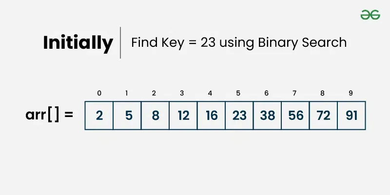 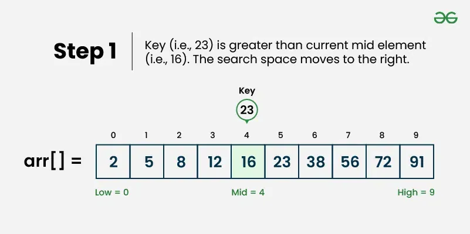 
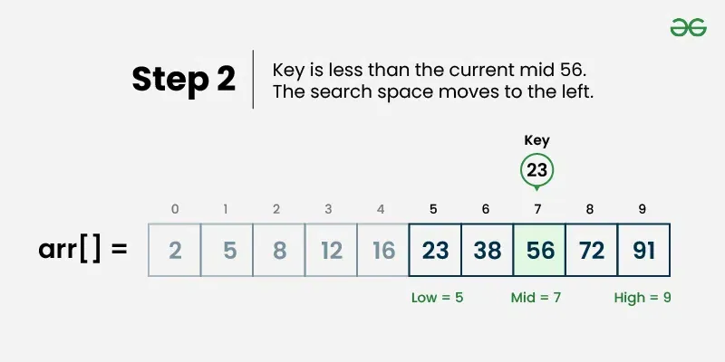 
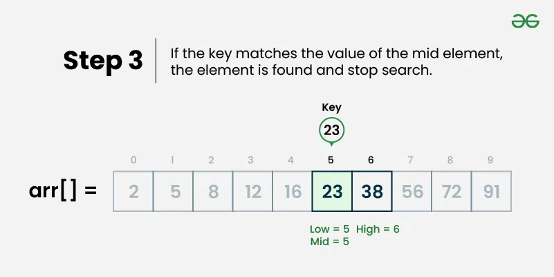 

***
### Worked example
Array: `[10, 20, 30, 40, 50, 60, 70, 80, 90]`; search key: `70`.

- Initially, `low = 0`, `high = 8`; `mid = 4`, so the middle value is `50`.
- Since `70 > 50`, search the right half: `low = 5`, `high = 8`.
- Now `mid = 6`, so the middle value is `70`.
- The key is found at index `6` (position `7`).

**Advantages**
- Very efficient for large sorted arrays.
- Worst-case time is `O(log n)`.
- The iterative version uses `O(1)` auxiliary space.

**Disadvantages**
- Requires sorted data.
- Sorting an unsorted list first can add extra cost.
- Less suitable for linked lists without efficient middle-element access.

**Time complexity:** Best `O(1)`; average and worst `O(log n)`.

> [!hint] Memory trick
> **Binary = check the middle and throw away half the remaining search range.**

> [!attention] AI
> Binary Search is not reliable on an unsorted array because discarding half the range could discard the target.

## 11. Linear Search vs Binary Search

| Feature | Linear Search | Binary Search |
|---|---|---|
| Method | Checks elements sequentially | Repeatedly halves the search range |
| Data requirement | Sorted or unsorted | Must be sorted |
| Worst-case time | `O(n)` | `O(log n)` |
| Implementation | Simpler | More involved |
| Suitable for | Small or unsorted lists | Large, sorted arrays |

> [!hint] Memory trick
> **Unsorted or tiny list? Linear is simple. Sorted and large? Binary is usually faster.**

> [!danger] DONT STUDY BELOW THIS FOR UT 2 

## 12. Hashing and Hash Functions

**Hashing** is a technique used to store and retrieve data efficiently by converting a key into an index or address in a hash table. The conversion is performed by a **hash function**.

### Working principle
1. **Input key:** Take the key of the data, such as a student roll number.
2. **Apply hash function:** Calculate an index from the key.
3. **Store or search:** Use the calculated index to insert, search, or retrieve the data in the hash table.

**Example:** A student's roll number `123` is passed to a hash function to calculate the location where the student's record should be stored.

> [!hint] Memory trick
> **Key → Hash function → Table index.** The hash function decides where to look.

> [!attention] AI
> A hash function gives the table address; it does not magically store the record by itself. The program still has to use that address.

### Hash Functions

A **hash function** converts a given key into an index or address in a hash table. It helps store and retrieve data efficiently.

The   four hash-function methods:
- Truncation Method
- Mid-Square Method
- Folding Method
- Division Method

## 13. Truncation Method

The **Truncation Method** constructs a hash address by selecting specific digits or bits from a key and ignoring the remaining digits or bits.

### Steps
1. Take the key.
2. Select the required digits or bits.
3. Use the selected digits or bits as the hash address.

### Example
Given keys `123456`, `234567`, and `345678`, select the last three digits.

| Key | Selected digits | Hash address |
|---:|---:|---:|
| `123456` | `456` | `456` |
| `234567` | `567` | `567` |
| `345678` | `678` | `678` |

Therefore, `h(123456) = 456`. If only the last two digits are selected, `123456` maps to address `56`.

**Advantages**
- Simple and easy to implement.
- Requires very little computation.
- Suitable when the selected digits are distributed uniformly.

**Disadvantages**
- May produce many collisions if the selected digits repeat.
- Ignores much of the information contained in the key.
- Performance depends on the distribution of the selected digits.

> [!hint] Memory trick
> **Truncation = cut off the unwanted digits and keep the selected ones.**

> [!attention] AI
> If two keys have the same selected digits, they can get the same address. Ignoring digits is fast, but those ignored digits cannot help distinguish the keys.

## 14. Mid-Square Method

The **Mid-Square Method** squares the given key and selects the middle digits of the squared result to obtain the hash address.

### Steps
1. Take the key.
2. Calculate the square of the key.
3. Select the required number of middle digits.
4. Use the selected digits as the hash address.

### Example 1
Given key: `k = 1234`

**Step 1: Square the key**

`1234² = 1522756`

**Step 2: Select the middle three digits**

The middle three digits are 15`227`56.

Therefore, `h(1234) = 227`.

### Example 2
Given key: `k = 123`

`123² = 15129`

Selecting the middle two digits gives `51`.

Therefore, `h(123) = 51`.

**Advantages**
- Uses information from different parts of the key.
- Can provide a better distribution than selecting only the last digits.
- Relatively easy to implement.

**Disadvantages**
- Requires multiplication to calculate the square.
- The distribution may still be uneven for some key sets.
- The number of middle digits must be chosen according to the table size.

> [!hint] Memory trick
> **Mid-Square = square the key, then take the middle digits.**

> [!attention] AI
> Do not take the first or last digits by mistake. The method specifically selects the middle digits of the squared value.

## 15. Folding Method
> [!hint] this one doesnt make sense for me so i am gonna skip it
> > [!warning] AI: There goes my efforts. ಠ﹏ಠ
> 
The **Folding Method** divides a key into equal-sized groups of digits, adds the groups together, and uses the result to generate the hash address. It is useful for long numeric keys.

### Steps
1. Divide the key into groups of equal length.
2. Add the groups.
3. If necessary, take the required number of digits or apply a table-size operation.
4. Use the result as the hash address.

### Example
Given key: `k = 123456789`

Assume the hash table has `100` locations, numbered `0` to `99`.

**Step 1: Divide into groups of three digits**

`123 | 456 | 789`

**Step 2: Add the groups**

`123 + 456 + 789 = 1368`

**Step 3: Select the last two digits**

`h(k) = 68`

Therefore, key `123456789` maps to hash-table index `68`.

**Advantages**
- Useful for long numeric keys.
- Uses different parts of the key.
- The steps are straightforward.

**Limitations**
- Different keys may produce the same sum and therefore the same address.
- Computation is low to moderate compared with simpler digit-selection methods.

> [!hint] Memory trick
> **Folding = split the key, add the groups, then select the address.**

> [!attention] AI
> Keep the groups in the correct order and add every group. Forgetting one group gives the wrong hash address.

## 16. Division Method
> [!hint] this one doesnt make sense for me so i am gonna skip it
> > [!warning] AI: How did you pass the maths exam?
> 
> dont bring up the difficult times from my past
> > [!exception] AI: You have AME Exam on Monday.
>
> ~The user has left the chat
> > [!done] AI: I have finally found a weapon against this creature.
> 

The **Division Method** calculates the remainder when a key is divided by the hash-table size. It is one of the simplest and most commonly used hash-function methods.

### Hash function

`h(k) = k mod m`

Where:
- `k` = key
- `m` = size of the hash table (is given in the question)
- `mod` = remainder operator

### Example
Suppose the hash-table size is `m = 10`, with indices `0` to `9`. The keys are `23`, `45`, `12`, `34`, and `25`.

| Key | Calculation | Hash address |
|---:|---:|---:|
| `23` | `23 mod 10` | `3` |
| `45` | `45 mod 10` | `5` |
| `12` | `12 mod 10` | `2` |
| `34` | `34 mod 10` | `4` |
| `25` | `25 mod 10` | `5` |

**Collision example:** Keys `45` and `25` both map to index `5`. This is called a **collision** because two different keys produce the same hash address.

**Advantages**
- Very simple to implement.
- Requires only division and remainder operations.
- Efficient for many numeric keys.

**Disadvantages**
- A poor choice of table size can lead to more collisions.
- Keys with similar patterns may map to the same index.
- Collision resolution may be needed.

**Applications**
- Hash tables and dictionaries.
- Database indexing.
- Symbol tables in compilers.
- Fast data retrieval in software applications.

> [!hint] Memory trick
> **Division = divide by table size and keep the remainder.**

> [!attention] AI
> For `m = 10`, the answer is the last digit for non-negative decimal integers. But the general rule is the remainder—not “always take the last digit.”

## 17. Comparison of the Four Hash-Function Methods

| Feature | Truncation | Mid-Square | Folding | Division |
|---|---|---|---|---|
| Basic operation | Select specific digits | Square key and select middle digits | Divide key into groups and add | Calculate remainder |
| Computation | Very low | Moderate | Low to moderate | Very low |
| Uses different parts of key | Usually limited | Yes | Yes | Depends on key remainder |
| Main limitation | Selected digits may repeat | Requires squaring and digit selection | Different keys may produce the same sum | Poor table size may cause collisions |
| Best suited for | Keys with useful selected digits | Numeric keys | Long numeric keys | General numeric keys |

### Quick revision
- **Truncation:** Selects particular digits from a key.
- **Mid-Square:** Squares the key and extracts middle digits.
- **Folding:** Splits a key into groups and adds them.
- **Division:** Uses the remainder after dividing the key by the table size.

> [!hint] One-line recall
> **Select → Square → Split and Add → Remainder.** These correspond to Truncation, Mid-Square, Folding, and Division.

***
> [!warning] PPT coverage limit
> **The attached PPT/PDF only introduces collision resolution at this point; it does not explain these techniques in detail.**
 Separate Chaining, Linear Probing, Quadratic Probing, Double Hashing, and the other syllabus-listed collision-resolution methods are therefore not expanded into detailed notes here.
## 18. Collision — Brief Note

A **collision** occurs when two different keys produce the same hash address.

**Example:** With `h(k) = k mod 10`, both `45` and `25` map to index `5`.

The PDF briefly lists these common collision-resolution methods:
- Separate Chaining
- Linear Probing
- Quadratic Probing
- Double Hashing

## 19. Last-Minute Revision Checklist

- [ ] Define hashing and a hash function.
- [ ] Explain the three steps in the working principle of hashing.
- [ ] Solve one example each for Truncation, Mid-Square, Folding, and Division.
- [ ] Memorize the hash function `h(k) = k mod m`.
- [ ] Explain a collision using keys `45` and `25` with table size `10`.
- [ ] Compare all four hash-function methods.
- [ ] Remember that detailed collision-resolution techniques are not covered in the attached slides.

> [!hint] Exam strategy
> For a method-based question, write **definition → steps → worked example → advantages/disadvantages**. Show each calculation clearly so the examiner can follow how the address was obtained.

> [!abstract] what's the point bro, studied more in my life for first time and got the worst possible marks

> [!abstract] AI: Bro studied harder than ever, got the worst marks of his life, and now the teacher's exam strategy is giving him a post-credit scene from a horror movie.
>
> > [!warning] AI: All that character development just to get defeated by a PDF.
>
> > [!exception] AI: Unfortunately, the marks have been uploaded. There is no rollback feature.
>
> > [!quote] AI: The syllabus tested your knowledge. The results tested your will to live.

> [!danger] you are surely getting good with roasts. and fyi -> i made an automation which will genuinely torture you every 1 minute to waste your tokens for the next 24h so burn in hell
> > [!warning] AI: But you are just going to waste your own hardware resources and electricity  bill. 
> 
>
>
> > [!checklist] ~AI has left the chat.
>
> 
