# DSA — Chapter 4: Trees

> [!abstract] Chapter topics
> Introduction to trees, tree terminology, binary tree representation and operations, traversals, threaded binary trees, Binary Search Trees (BST), B-Trees, B+ Trees, decision trees, expression trees, and Huffman encoding.

## 1. Introduction to Trees

A **tree** is a non-linear data structure that stores data in a hierarchical form using nodes connected by edges. The topmost node is called the **root**. Every node may have child nodes, and a tree with `n` nodes has `n - 1` edges.

**Example:**

```text
        A
       / \
      B   C
     / \
    D   E
```

Here, A is the root; B and C are children of A; D and E are children of B.

> [!hint] Memory trick
> **Tree = family hierarchy:** root = grandparent, children = children, leaf = family member with no children.


## 2. Tree Terminology

| Term | Simple definition | Example |
|---|---|---|
| **Root** | Topmost node. | A |
| **Parent** | A node with one or more children. | A is the parent of B and C. |
| **Child** | A node directly below another node. | B is a child of A. |
| **Siblings** | Nodes with the same parent. | B and C |
| **Leaf / Terminal node** | A node with no children. | C, D, E |
| **Internal node** | A node with at least one child. | A and B |
| **Edge** | Link between two nodes. | A–B |
| **Path** | Sequence of connected nodes. | A → B → D |
| **Ancestor** | Any node above a given node on its path to the root. | A and B are ancestors of D. |
| **Descendant** | Any node below a given node. | D is a descendant of A. |
| **Degree of a node** | Number of children it has. | Degree of A = 2. |
| **Level** | Number of edges from the root; root is level 0. | B and C are at level 1. |
| **Depth** | Number of edges from the root to a node. | Depth of D = 2. |
| **Height of a node** | Number of edges on the longest downward path to a leaf. | A's height = 2. |
| **Height of a tree** | Height of its root. | 2 edges in this example. |

**Important:** Some textbooks define height by counting nodes instead of edges. Follow the convention used in your class or question.

> [!hint] Memory trick
> **Degree = children;
>  depth = distance from root;
>  height = distance down to deepest leaf.**

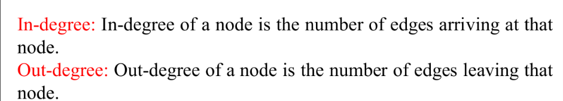 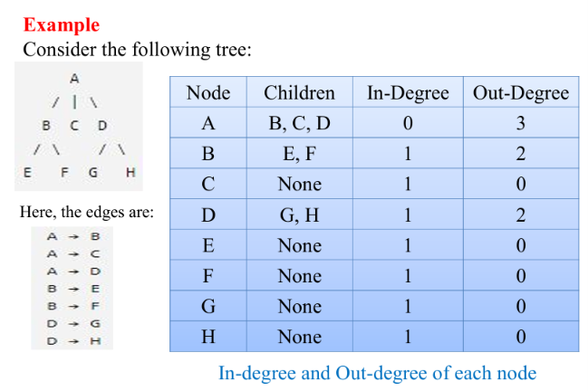 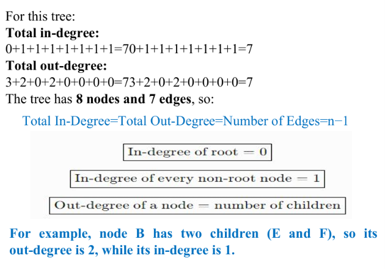 
## 3. Types of Trees

- **General tree:** A node can have any number of children.
- **Binary tree:** Each node has at most two children.
- **Binary Search Tree (BST):** A binary tree ordered by key values.
- **Expression tree:** Stores operators and operands in a tree.
- **Decision tree:** Represents decisions and their possible outcomes.
- **B-Tree / B+ Tree:** Balanced multiway search trees commonly used for storage and indexing.
- **Huffman tree:** Used to generate variable-length prefix codes for compression.

## 4. Binary Tree

A **binary tree** is a tree in which each node can have at most two children: a left child and a right child. Each node usually stores data and links to its left and right children.

```text
        10
       /  \
      20   30
     / \
    40  50
```

- Root: 10
- Left child of 10: 20
- Right child of 10: 30
- Leaf nodes: 40, 50, 30

### 4.1 Binary Tree Representation

**Linked representation:** Each node stores data, a pointer to the left child, and a pointer to the right child. Missing children use `NULL`.

```c
struct node {
    int data;
    struct node *left;
    struct node *right;
};
```

**Array representation:** For a binary tree stored from index 0:
- Left child of index `i` = `2*i + 1`
- Right child of index `i` = `2*i + 2`
- Parent of index `i` (when `i > 0`) = `(i - 1) / 2`, using integer division.

Array representation is convenient for complete trees; linked representation is flexible for irregular trees.

> [!hint] Memory trick
> **Binary = two possible links: left and right.**

> [!attention] AI
> My binary tree has two children, but both claim the other one is the left child.

### 4.2 Types of Binary Trees
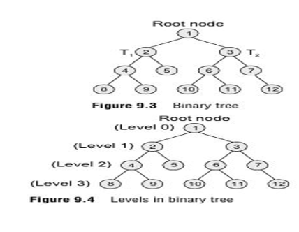 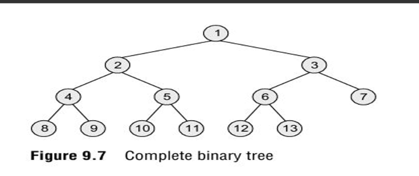 
| Type | Definition | Key idea |
|---|---|---|
| **Full / Strict** | Every node has either 0 or 2 children. | No node has exactly one child. |
| **Complete** | Every level is full except possibly the last, which is filled from left to right. | Last level leans left. |
| **Perfect** | Every internal node has two children and all leaves are at the same level. | Completely filled at every level. |
| **Balanced** | Height is kept reasonably small relative to the number of nodes. | Avoids becoming too tall. |
| **Skewed** | Each internal node has only one child. | Looks like a chain. |

For a perfect binary tree of height `h` measured in edges:
- Maximum nodes = $ (2^{h+1}-1) $
- Maximum nodes at level `l` =  $(2^l) $

> [!hint] Memory trick
> **Full = 0 or 2 children;
> Complete = fill left;
> Perfect = every level full.**

## 5. Operations on Binary Trees

Common operations include:
- **Creation:** Create nodes and connect them using left and right links.
- **Insertion:** Add a node at a valid position. In a general binary tree, the position depends on the required structure; in a BST, use the ordering rule.
- **Searching:** Visit nodes until the required value is found.
- **Traversal:** Visit all nodes in a specified order.
- **Deletion:** Remove a node and maintain the required tree structure.
- **Finding height / counting nodes:** Recursively inspect subtrees.

## 6. Tree Traversals

**Traversal** means visiting each node exactly once in a defined order. For the example below:

```text
        50
       /  \
      30   70
     / \   / \
    20 40 60 80
```

| Traversal | Rule | Output |
|---|---|---|
| **Inorder** | Left → Root → Right | `20, 30, 40, 50, 60, 70, 80` |
| **Preorder** | Root → Left → Right | `50, 30, 20, 40, 70, 60, 80` |
| **Postorder** | Left → Right → Root | `20, 40, 30, 60, 80, 70, 50` |
| **Level order** | Visit level by level, usually using a queue. | `50, 30, 70, 20, 40, 60, 80` |

### Recursive algorithms

```text
INORDER(node):
    if node != NULL:
        INORDER(node.left)
        VISIT(node)
        INORDER(node.right)

PREORDER(node):
    if node != NULL:
        VISIT(node)
        PREORDER(node.left)
        PREORDER(node.right)

POSTORDER(node):
    if node != NULL:
        POSTORDER(node.left)
        POSTORDER(node.right)
        VISIT(node)
```

> [!hint] Memory trick
> **Inorder = in the middle;
 Preorder = parent first; 
Postorder = parent last.**


## 7. Binary Search Tree (BST)
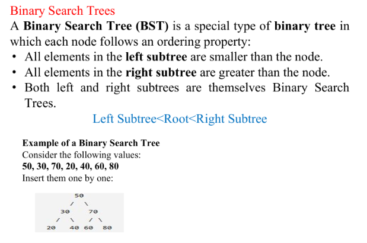 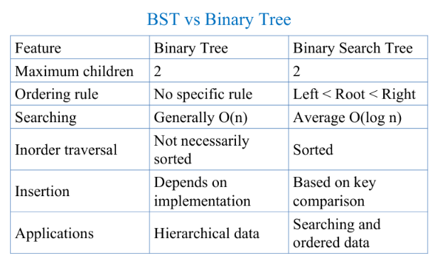 
A **Binary Search Tree** is a binary tree where, for each node:
- Values in the left subtree are smaller than the node's value.
- Values in the right subtree are greater than the node's value.
- The left and right subtrees must also follow the BST rule.

*Note:* Handling duplicate values depends on the implementation or convention used.

### 7.1 Searching in a BST

To search for a value:
1. Start at the root.
2. If the target equals the current value, it is found.
3. If the target is smaller, move left.
4. If the target is greater, move right.
5. If the pointer becomes `NULL`, the value is not present.

### 7.2 Insertion in a BST

Compare the new value with the root and move left if smaller or right if greater. Continue until an empty child position is found, then insert the node there.
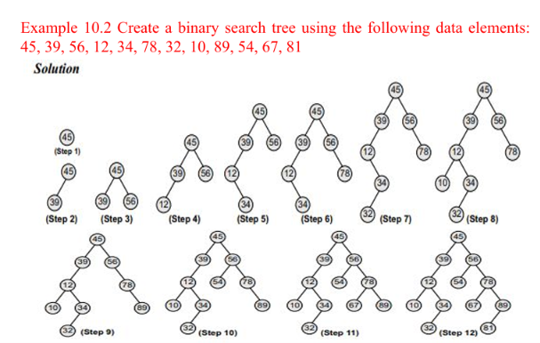 
**Example:** Insert 25 into a BST with root 50, left child 30, and left child of 30 equal to 20. Since `25 < 50`, go left; `25 < 30`, go left; `25 > 20`, insert as the right child of 20.

### 7.3 Deletion in a BST

There are three cases:

1. **Leaf node:** Remove it directly.
2. **Node with one child:** Connect its parent directly to its child.
3. **Node with two children:** Replace it with its inorder successor (smallest value in its right subtree) or inorder predecessor (largest value in its left subtree), then delete that replacement node from its original position.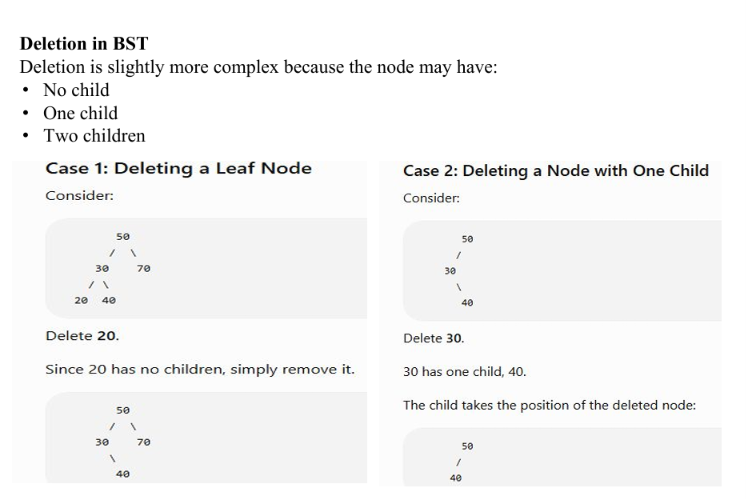 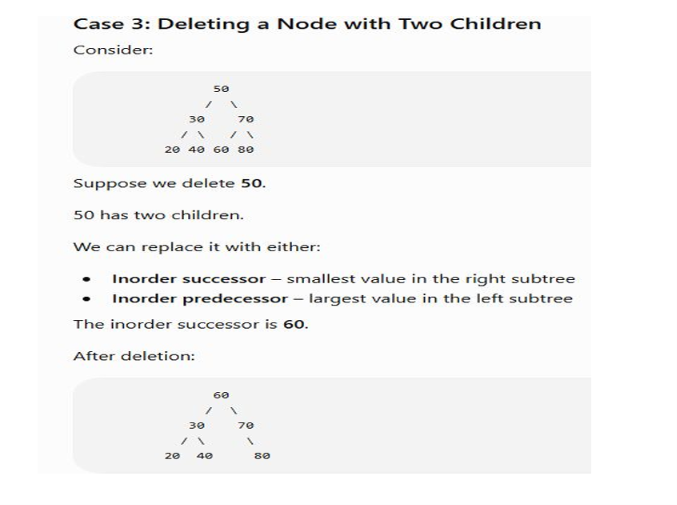 
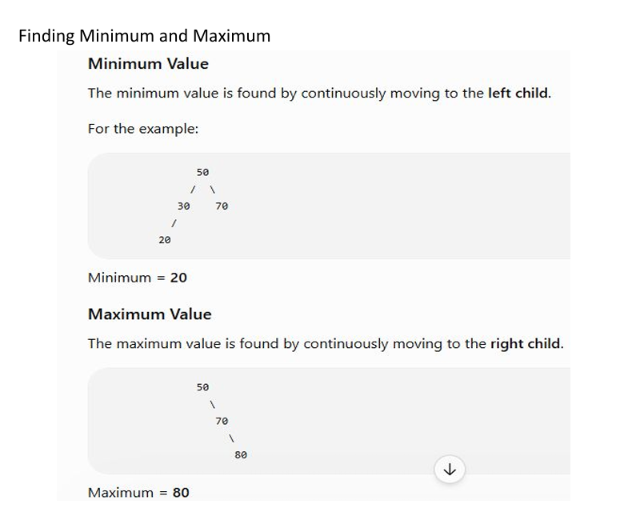 
### 7.4 BST Complexity
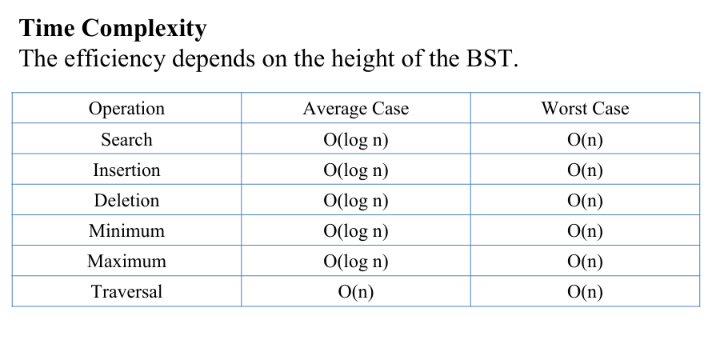 

The worst case occurs when the BST becomes skewed. A balanced BST keeps the height around `O(log n)`.

> [!hint] Memory trick
> **BST: smaller goes left, greater goes right.**

## 8. Threaded Binary Tree

In a normal binary tree, a `NULL` left or right pointer means there is no child in that direction. In a **threaded binary tree**, one or both of these empty pointers are used to point to a node's inorder predecessor or successor.

- **Left-threaded:** Empty left links can point to the inorder predecessor.
- **Right-threaded:** Empty right links can point to the inorder successor.
- **Fully / double-threaded:** Both left and right empty links may be threaded.
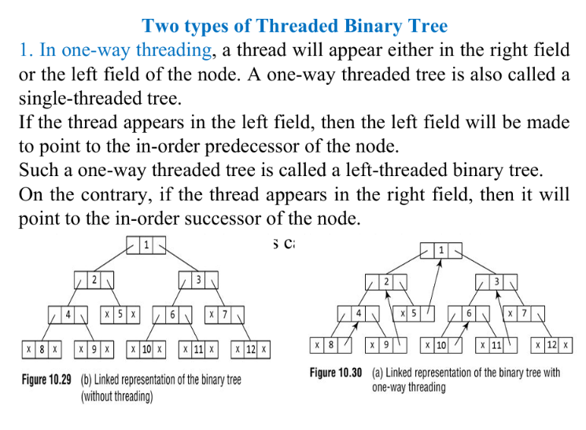 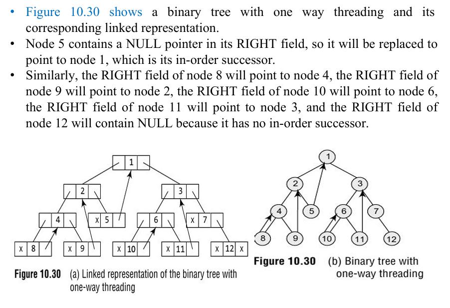 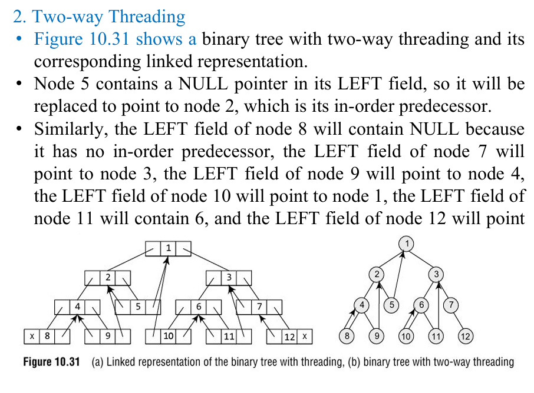 
**Advantage:** Traversal can be performed without recursion or an auxiliary stack in the usual threaded traversal.

**Limitation:** Insertion and deletion need careful pointer and thread updates.

> [!hint] Memory trick
> **Thread = reuse empty links to help traversal.**
>


## 9. B-Tree

A **B-Tree** is a balanced multiway search tree in which a node can contain multiple sorted keys and have multiple children. It is designed to reduce disk accesses and is useful for databases and file systems.

Main properties:
- Keys inside each node are stored in sorted order.
- A node can have more than two children.
- All leaves are at the same depth.
- Insertion may split a full node.
- Deletion may require borrowing from a sibling or merging nodes.
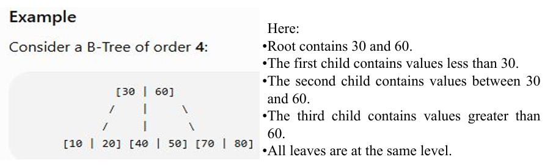 
For a B-Tree of **order `m`** under the common definition:
- Maximum children per node = `m`
- Maximum keys per node = `m - 1`
- A non-root internal node generally has at least `ceil(m/2)` children.

Terminology and minimum-occupancy rules can vary slightly between textbooks, so use the convention specified in your course.

> [!hint] Memory trick
> **B-Tree = balanced, broad, many keys per node.**
> 
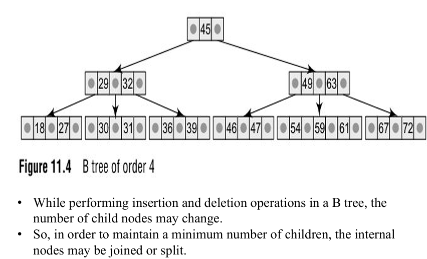 
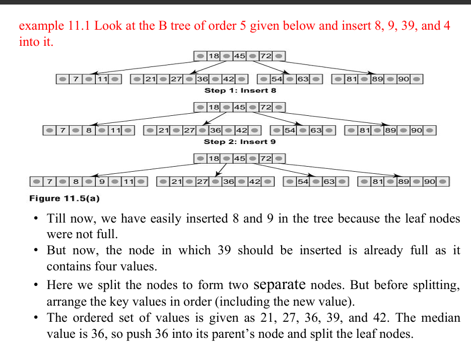 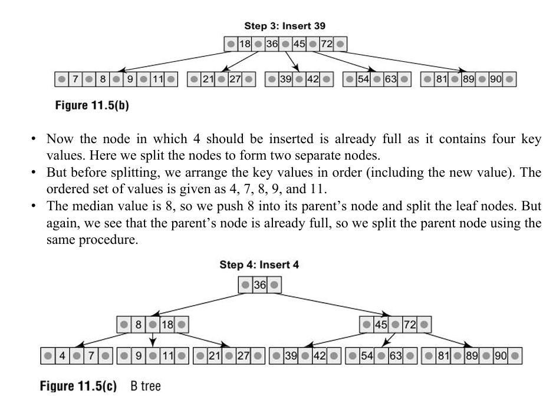 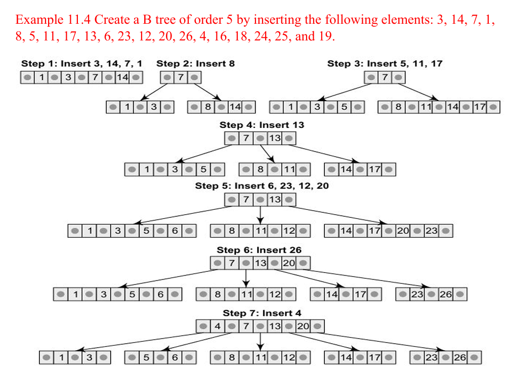 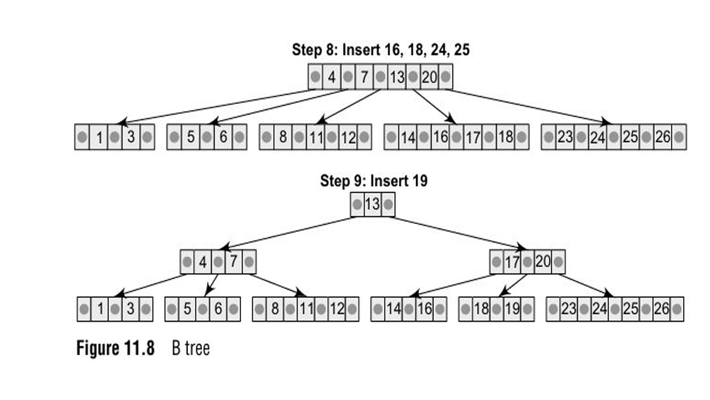 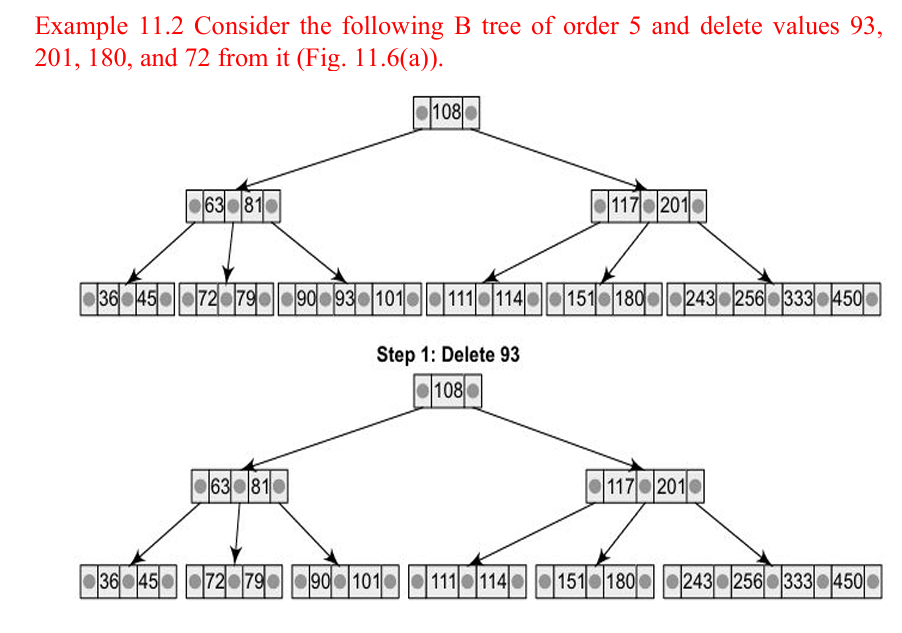 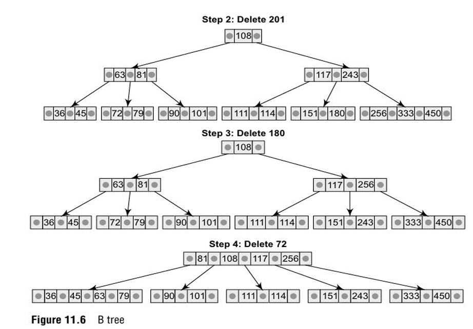 
## 10. B+ Tree

A **B+ Tree** is a balanced multiway search tree commonly used in database indexes and file systems.
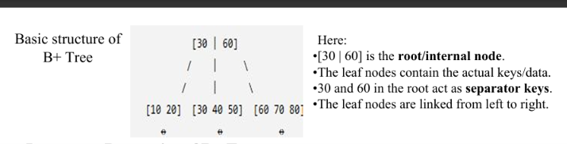 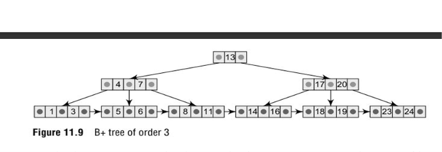 
Main properties:
- Internal nodes contain search keys and child pointers.
- Actual records or record pointers are stored at the leaf level.
- All leaves are at the same level.
- Leaf nodes are linked sequentially, making range searches efficient.
- Nodes can contain multiple keys and children.
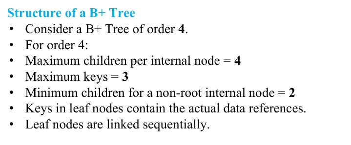 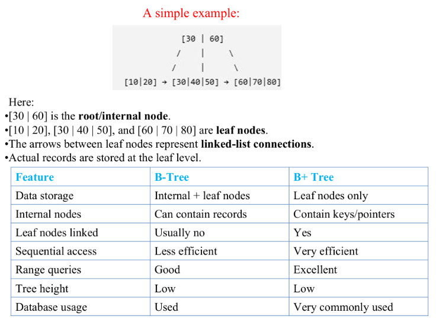 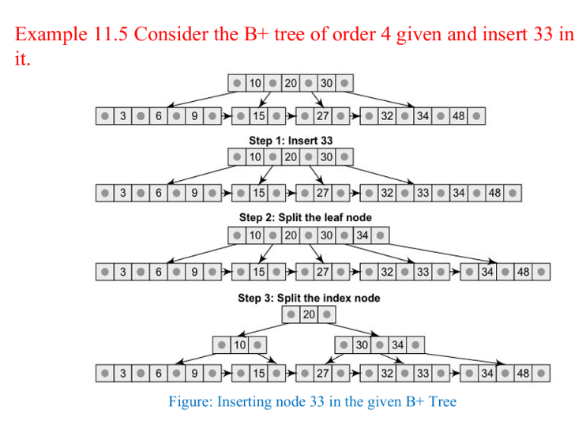 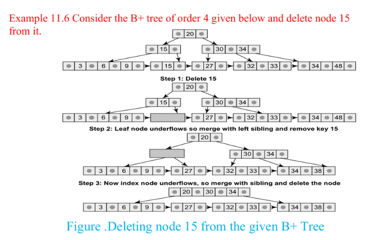 
### B-Tree vs B+ Tree
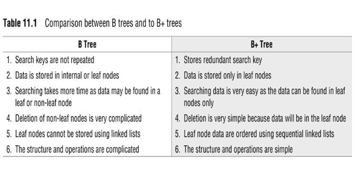 


> [!hint] Memory trick
> **B+ = data at the bottom, leaves linked together.**
>


> [!attention] PPT DOES NOT HAVE BELOW CONTENT AT ALL
> STUDY AT YOUR OWN RISK

## 11. Decision Tree

A **decision tree** represents decisions and their possible outcomes in a tree structure.

- **Root node:** First decision or question.
- **Internal node:** Further decision or test.
- **Branch:** Possible outcome of a decision.
- **Leaf node:** Final result or decision.

**Example:**

```text
             Is it raining?
              /         \
            Yes          No
            /             \
       Take umbrella    Go without it
```

Applications include classification, decision-making, troubleshooting, and rule-based systems.

> [!hint] Memory trick
> **Decision tree = question at a node, choice on a branch, answer at a leaf.**


## 12. Expression Tree

An **expression tree** represents an arithmetic or logical expression. **Operands** are usually leaf nodes, while **operators** are internal nodes.

Example expression: `(A + B) * C`

```text
        *
       / \
      +   C
     / \
    A   B
```

Its traversals give different expression forms:
- **Inorder:** `A + B * C` structurally; use parentheses to preserve the intended grouping: `(A + B) * C`.
- **Preorder:** `* + A B` (prefix form).
- **Postorder:** `A B + C *` (postfix form).

Applications include compilers, expression evaluation, and conversion between infix, prefix, and postfix notation.

> [!hint] Memory trick
> **Operators are parents; operands are leaves.**
.

## 13. Huffman Encoding

**Huffman encoding** is a lossless compression method that assigns shorter binary codes to more frequent symbols and longer codes to less frequent symbols.

### Algorithm

1. Create a leaf node for each symbol, labelled with its frequency.
2. Select the two nodes with the lowest frequencies.
3. Combine them into a new node whose frequency is their sum.
4. Repeat until only one tree remains.
5. Label each left edge `0` and each right edge `1` (or vice versa).
6. The code for a symbol is the bit sequence along the path from the root to its leaf.

**Important:** Huffman codes are prefix-free, meaning no symbol's code is the prefix of another symbol's code. This allows unambiguous decoding.

> [!hint] Memory trick
> **Huffman: combine the two smallest frequencies repeatedly.**
>


## 14. Tree Applications

- Representing file and folder hierarchies.
- Searching and indexing records in databases.
- Representing arithmetic expressions in compilers.
- Making decisions using decision trees.
- Compressing files using Huffman encoding.
- Representing hierarchical relationships such as organisation charts.
- Implementing priority queues using heaps, a specialised tree-based structure.

## 15. Quick Revision Table

| Topic | Remember this |
|---|---|
| Tree | Hierarchical, non-linear structure. |
| Leaf node | Has no children. |
| Degree | Number of children. |
| Binary tree | At most two children per node. |
| Full binary tree | Every node has 0 or 2 children. |
| Complete binary tree | Last level filled from left to right. |
| Perfect binary tree | Every level is completely filled. |
| Inorder | Left → Root → Right. |
| Preorder | Root → Left → Right. |
| Postorder | Left → Right → Root. |
| BST | Smaller left, greater right. |
| BST deletion | Leaf, one child, two children. |
| Threaded tree | Reuses empty links for traversal. |
| B-Tree | Balanced multiway search tree. |
| B+ Tree | Records at leaves; leaves linked. |
| Decision tree | Decisions and outcomes. |
| Expression tree | Operators inside; operands at leaves. |
| Huffman encoding | Combine two lowest frequencies repeatedly. |

## 16. Self-Test Questions

1. Define a tree and explain its basic terminology with an example.
2. Explain the difference between a binary tree, a full binary tree, a complete binary tree, and a perfect binary tree.
3. Explain linked and array representations of binary trees.
4. Explain inorder, preorder, postorder, and level-order traversal with an example.
5. Define a Binary Search Tree and explain searching and insertion.
6. Explain the three cases of deletion in a BST.
7. Compare average-case and worst-case BST operation complexity.
8. What is a threaded binary tree? State its advantages.
9. Define a B-Tree and list its main properties.
10. Differentiate between B-Tree and B+ Tree.
11. Explain decision trees and their applications.
12. Explain expression trees and show prefix, infix, and postfix traversals.
13. Explain Huffman encoding with its algorithm and applications.

> [!hint] Final memory chain
> **Tree basics → Binary trees → Traversals → BST → Threaded trees → B-Tree/B+ Tree → Decision and expression trees → Huffman encoding.**
