# SE Chapter 4 — UML and DFD Design Question Bank

> **Exam-focused | Question-wise | CO4: Design**
>
> Similar questions are grouped together, but each question number from the supplied pages is covered. For a 4-mark answer, write the definition/context and draw the diagram. 

## How to answer a design question

1. Identify the application and its main entities.
2. Identify actors, inputs, outputs, and the system boundary.
3. Draw the requested diagram and label every component and arrow.
4. Add a short explanation of how the system works.

> [!hint] Memory trick
> **Class = structure;
>  Use Case = who/what;
> Activity = workflow;
>  Sequence = message order;
> State = lifecycle;
> Component = modules;
> DFD = data movement.**

> [!attention] AI
> Unlabelled arrows are not “minimalist design”; they are the software equivalent of mumbling during a viva. Label them.

---
## UML Class Diagram — Short Notes

### 1. Class Notation

A class is represented by a box divided into three compartments:

```
+----------------------+
|       Student        |  Class Name
+----------------------+
| - name: String       |  Attributes
| - rollNo: int        |
+----------------------+
| + login(): void      |  Methods
| + display(): void    |
+----------------------+
```

-   Class name: Name of the class, written at the top.
    
-   Attributes: Data stored in the class, such as `name` and `rollNo`.
    
-   Methods: Functions performed by the class, such as `login()`.
    

Visibility symbols:

| Symbol | Meaning |
| --- | --- |
| `+` | Public — accessible from any class |
| `-` | Private — accessible only within the class |
| `#` | Protected — accessible within the class and its subclasses |
| `~` | Package/default — accessible within the same package |

## 2. Relationships Between Classes
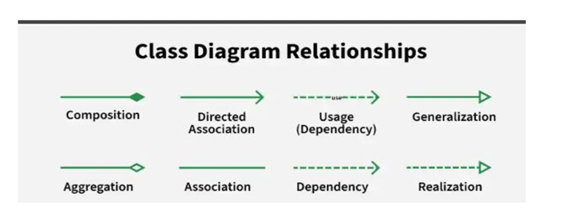 
### 1. Association

Definition: Association represents a relationship between two classes whose objects interact with each other.

Example: A Student enrolls in a Course.

```
+---------+             +--------+
| Student |-------------| Course |
+---------+             +--------+
```

### 2. Directed Association

Definition: Directed association represents a relationship where the direction of interaction is specified.

Example: A Teacher accesses Student details.

```
+---------+             +---------+
| Teacher |------------>| Student |
+---------+             +---------+
```

### 3. Aggregation

Definition: Aggregation represents a whole-part relationship in which the part can exist independently of the whole. It is shown using an empty diamond on the whole side.

Example: A Car has an Engine, but the Engine can exist independently.

```
+-----+ ◇------------- +--------+
| Car |                | Engine |
+-----+                +--------+
```

### 4. Composition

Definition: Composition represents a strong whole-part relationship in which the part cannot exist independently of the whole. It is shown using a filled diamond on the whole side.

Example: A House contains Rooms that depend on the House in this model.

```
+-------+ ◆----------- +------+
| House |              | Room |
+-------+               +------+
```

### 5. Generalization (Inheritance)

Definition: Inheritance represents an is-a relationship in which a child class inherits attributes and methods from a parent class. It is shown using a solid line with a hollow arrow pointing towards the parent.

Example: Dog and Cat inherit from Animal.

```
          +----------+
          |  Animal  |
          +----------+
               △
               |
        +------+------+
        |             |
   +---------+   +---------+
   |   Dog   |   |   Cat   |
   +---------+   +---------+
```

### 6. Realization (Interface Implementation)

Definition: Realization represents a relationship in which a class implements the methods declared by an interface. It is shown using a dashed line with a hollow arrow pointing towards the interface.

Example: Circle implements the Shape interface.
`THIS ARROW LINES ARE DOTTED LINES - - - > `
```
     +----------------+
     | <<interface>>  |
     |     Shape      |
     |    getArea()   |
     +----------------+
              △
              |
             - - -
              |
       +-------------+
       |    Circle   |
       +-------------+
```

### 7. Dependency Relationship

Definition: Dependency represents a weak relationship in which a change in one class may affect another class that relies on it. It is shown using a dashed arrow.

Example: A Customer depends on Order functionality to place an order.

```
+----------+          - - - - -> +-------+
| Customer |                     | Order |
+----------+                     +-------+
```

### 8. Usage Dependency

Definition: Usage dependency occurs when one class uses the functionality of another class without owning it or maintaining it as a permanent part.

Example: A ReportGenerator uses a Printer to print reports.

```
+-----------------+     - - - - -> +---------+
| ReportGenerator |                | Printer |
+-----------------+                +---------+
```

## Quick revision

| Relationship | Remember |
| --- | --- |
| Association | Interacts with |
| Directed association | Interaction has a direction |
| Aggregation | Has-a; part exists independently |
| Composition | Strong ownership; part depends on whole |
| Inheritance | Is-a |
| Realization | Implements an interface |
| Dependency | One class relies on another |
| Usage dependency | Uses another class's functionality |

> [!hint] Memory trick
>  Empty diamond = independent part;
>  filled diamond = dependent part;
> hollow triangle = inheritance or realization.
>  For realization, the line is dashed; for inheritance, it is solid.

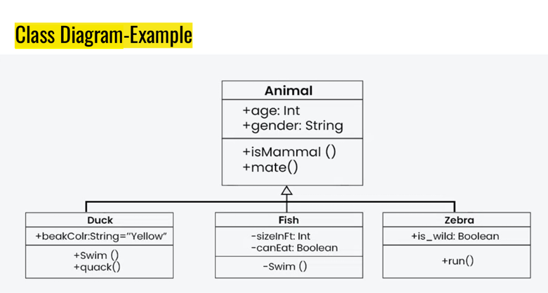 
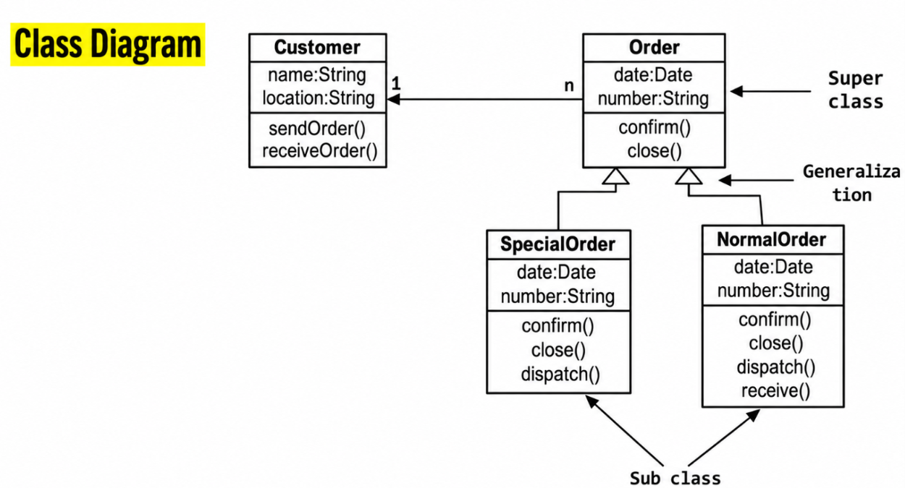 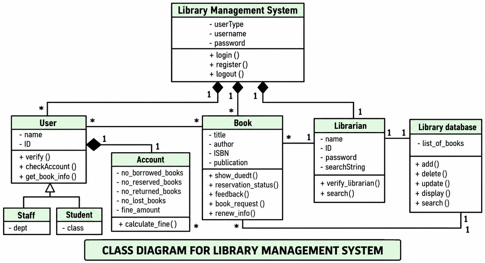 
> [!checklist] practice this before moving ahead

***
# Group A — Class Diagram Questions
## Q1. Design a Class Diagram for an AI-Based Management System

**Definition:** A class diagram shows the static structure of a system through classes, attributes, methods, and relationships.

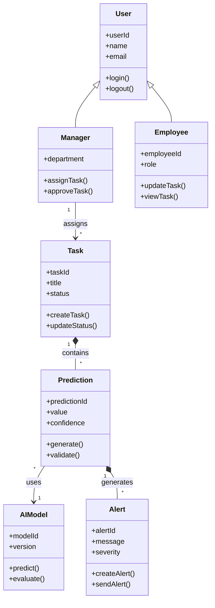

| Class | Attributes | Methods |
|---|---|---|
| `User` | userId, name, email | login(), logout() |
| `Manager` | department | assignTask(), approveTask() |
| `Employee` | employeeId, role | updateTask(), viewTask() |
| `Task` | taskId, title, status | createTask(), updateStatus() |
| `AIModel` | modelId, version | predict(), evaluate() |
| `Prediction` | predictionId, value, confidence | generate(), validate() |
| `Alert` | alertId, message, severity | createAlert(), sendAlert() |

**Relationships:** `Manager` and `Employee` inherit from `User`. A manager assigns tasks to employees (**association**). A filled diamond (`◆`) indicates **composition**, where the owned object’s lifecycle depends on the owner. Use `1` for one and `*` for many.

> [!hint] Memory trick
> **Class = noun,
> method = verb,
>  relationship = connection.** `Employee` is a class; `updateTask()` is a method.

## Q12. Develop a Class Diagram for an AI-Based Prediction System

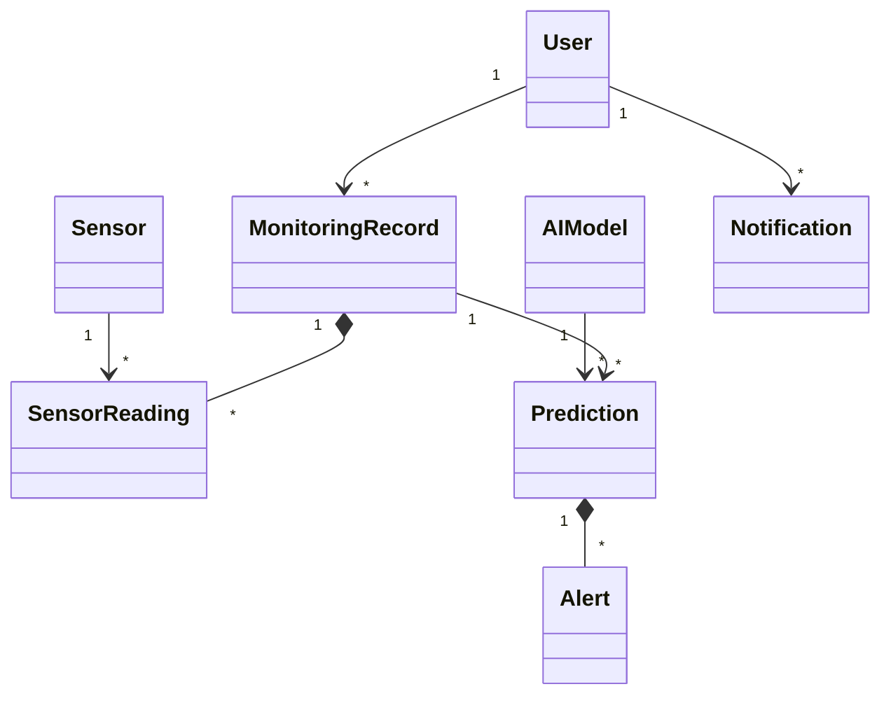

| Class | Attributes | Methods |
|---|---|---|
| `User` | userId, name, contact | login(), viewPrediction() |
| `Sensor` | sensorId, type, location | collectData(), checkStatus() |
| `SensorReading` | readingId, value, timestamp | validate(), normalize() |
| `MonitoringRecord` | recordId, date, status | storeReading(), viewHistory() |
| `AIModel` | modelId, version, modelType | preprocess(), predict() |
| `Prediction` | predictionId, result, confidence | generate(), classifyRisk() |
| `Alert` | alertId, severity, message | create(), send() |
| `Notification` | notificationId, channel, status | deliver(), markRead() |

**Explanation:** Sensors collect data; readings are validated and stored; the AI model generates predictions. Risky predictions trigger alerts and notifications.


## Q21. Draw a Class Diagram for a Sugarcane Irrigation Prediction System

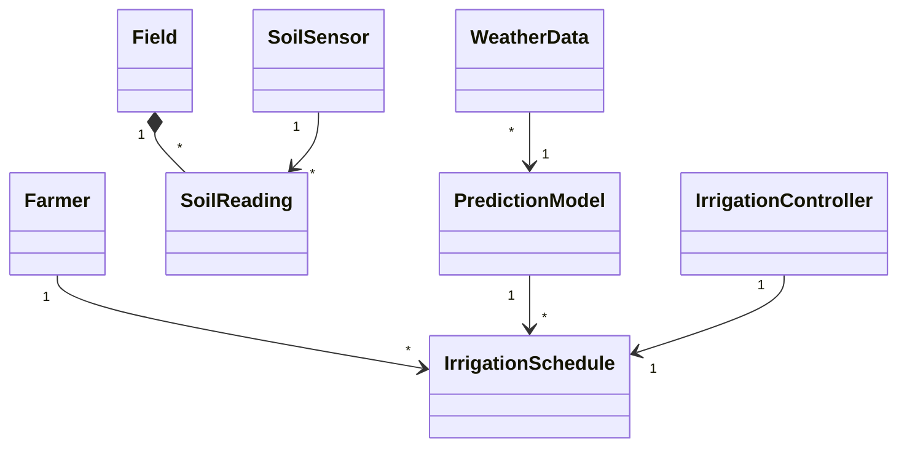

| Class | Attributes | Methods |
|---|---|---|
| `Farmer` | farmerId, name | viewPrediction(), approveSchedule() |
| `Field` | fieldId, cropType, area | getFieldDetails() |
| `SoilSensor` | sensorId, moisture | readMoisture() |
| `WeatherData` | temperature, rainfall, humidity | fetchWeather() |
| `PredictionModel` | modelId, version | predictIrrigation() |
| `IrrigationSchedule` | scheduleId, time, status | createSchedule(), updateStatus() |
| `IrrigationController` | controllerId, state | turnOn(), turnOff() |

**Explanation:** Soil and weather data are analyzed to predict irrigation needs. The schedule is shown to the farmer; a controller switches irrigation on/off only if automation is available.

## Q26. Draw a Class Diagram for a Satellite Monitoring System

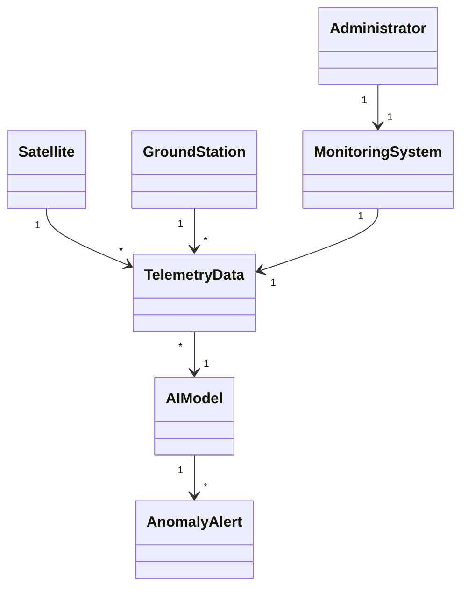

| Class | Attributes | Methods |
|---|---|---|
| `Satellite` | satelliteId, orbit, status | transmitTelemetry() |
| `TelemetryData` | timestamp, readings | validate(), store() |
| `GroundStation` | stationId, location | receiveData(), forwardData() |
| `Sensor` | sensorId, type | collectReading() |
| `AIModel` | modelId, version | detectAnomaly() |
| `Alert` | alertId, severity, message | generate(), send() |
| `Administrator` | adminId, name | monitor(), manageSystem() |

**Explanation:** The satellite sends telemetry to a ground station. Data is checked by the monitoring system and analyzed by an AI model. Detected anomalies create alerts.


## Q36. Draw a Class Diagram for a Thermal Battery Monitoring System

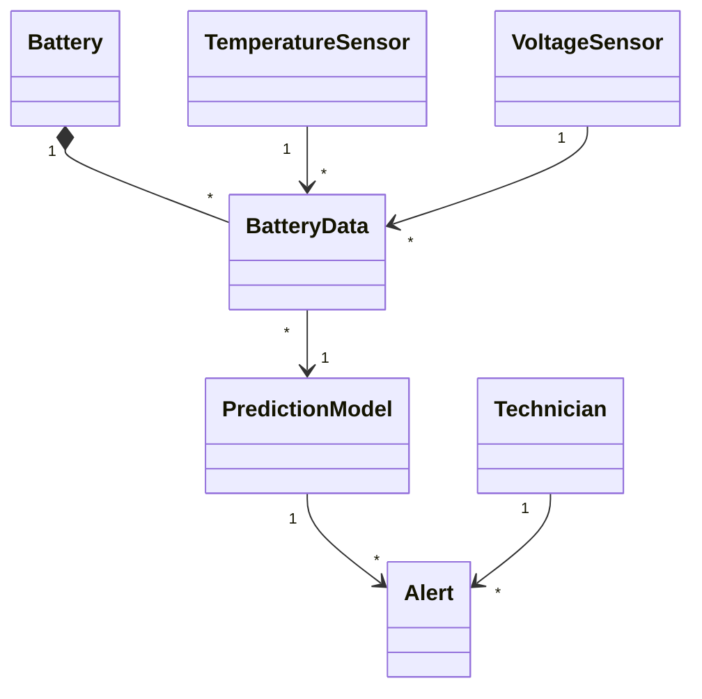

| Class | Attributes | Methods |
|---|---|---|
| `Battery` | batteryId, status, capacity | getStatus(), shutdown() |
| `TemperatureSensor` | sensorId, temperature | readTemperature() |
| `VoltageSensor` | sensorId, voltage | readVoltage() |
| `BatteryData` | timestamp, temperature, voltage | validate(), store() |
| `PredictionModel` | modelId, version | predictFault(), predictTemperature() |
| `Alert` | alertId, severity, message | generate(), send() |
| `Technician` | technicianId, name | acknowledgeAlert(), inspectBattery() |

**Explanation:** Sensors measure temperature and voltage. The model predicts overheating/faults and alerts the technician.

---
# Activity Diagrams - Unified Modeling Language (UML)


An Activity Diagram is a behavioral UML diagram used to represent workflows, processes, and the sequence of activities within a system. It shows how actions are connected and how control flows from one activity to another.

-   Illustrates sequential and concurrent activities, along with decision paths and control flow.
-   Starts with an initial node and ends with a final node, helping model system behavior over time.

> ****Example:**** An Online Shopping System activity diagram showing steps such as Browse Products-> Add to Cart -> Make Payment -> Order Confirmation.

## Uses of Activity Diagram

Activity diagrams are used to visualize workflows, processes, and the dynamic behavior of a system.

-   ****Modeling Workflows or Processes:**** Represents the sequence of activities in a business process or system workflow.
-   ****Concurrent or Parallel Processing:**** Shows multiple activities that can execute simultaneously.
-   ****Understanding Dynamic Behavior:**** Illustrates how a system behaves and responds to events over time.
-   ****Clarifying Complex Logic:**** Simplifies decision-making and branching processes for better understanding.
-   ****System Design and Analysis:**** Helps analyze, design, and communicate system behavior effectively.
-   ****Describing Use Cases:**** Visualizes the flow of actions and interactions within a use case.

## Activity Diagram Notations


### 1. Initial State

Represents the starting point of an activity or process.

-   Shown as a filled black circle in the diagram.
-   A process typically has only one initial state unless nested activities are used.


> ****Example:**** Here the initial state of the system before the application is opened.


### 2. Action or Activity State

Represents the execution of an action or task within a process.

-   Shown as a rectangle with rounded corners.
-   Represents any action, operation, or event that occurs in the workflow.


> ****Example****: Consider the previous example of opening an application, opening the application is an activity state in the activity diagram.


### 3. Action Flow or Control flows

Represents the transition and sequence of activities within a process.

-   Shown as a line with an arrowhead indicating the direction of flow.
-   An activity can have multiple incoming and outgoing control flows, with conditions specified on the arrows if required.


> ****Example****: Here both the states transit into one final state using action flow symbols i.e. arrows.


### 4. Decision node and Branching

Represents a point where a decision is made to determine the next flow of control.

-   Shown with multiple outgoing paths based on conditions or guard expressions.
-   Always has two or more outgoing control flow arrows.


> ****Example****: We apply the conditions on input number to display the result :
> 
> -   If number is odd then display the number.
> -   If number if even then display the error.


### ****5. Guard****

Represents a condition that must be satisfied for a particular flow to be followed.

-   Written next to a decision path, often within square brackets.
-   Helps control the direction of flow based on specific conditions.


### 6. Fork

Represents a point where a workflow is split into multiple parallel activities.

-   Shown as a solid rectangular bar with one incoming arrow and multiple outgoing arrows.
-   Allows several activities to execute simultaneously.


> ****Example:**** In the example below, the activity of making coffee can be split into two concurrent activities and hence we use the fork notation.


### 7. Join

Represents a point where multiple parallel activities merge into a single flow.

-   Shown with two or more incoming edges and one outgoing edge.
-   Synchronizes concurrent activities before proceeding to the next step.


> ****Example:**** When both activities i.e. steaming the milk and adding coffee get completed, we converge them into one final activity.


### 8. Merge or Merge Event

Represents a point where multiple alternative paths combine into a single flow.

-   Merges two or more workflow paths into one outgoing path.
-   The process continues regardless of which incoming path was followed.


> ****Example:**** In the diagram below: we can't have both sides executing concurrently, but they finally merge into one. A number can't be both odd and even at the same time.


### 9. Swimlanes

Represents a grouping of activities based on roles, responsibilities, or processes.

-   Shown as a rectangular row or column in the activity diagram.
-   Helps identify who is responsible for each activity and improves workflow clarity.


> ****Example:**** Here different set of activities are executed based on if the number is odd or even. These activities are grouped into a swimlane.


### 10. Time Event

Represents an event that pauses the workflow for a specific period of time.

-   Shown using an hourglass symbol in the activity diagram.
-   Used when an activity or event requires a time delay before continuing.


> ****Example:**** Let us assume that the processing of an image takes a lot of time. Then it can be represented as shown below.


### 11. Final State or End State

Represents the point where a process or activity reaches completion.

-   Shown as a filled circle inside another circle.
-   A system or process can have multiple final states.


## Differences between an Activity diagram and a Flowchart

An activity diagram is very similar to a flowchart. So let us understand if activity diagrams or flowcharts are any different.

| Flowchart | Activity Diagram |
| --- | --- |
| Represents the step-by-step flow of a process or algorithm | Represents the flow of activities and actions in a system |
| Used mainly for procedural or algorithmic logic | Used to model workflows and business processes |
| Focuses on control flow using symbols like start, process, decision | Focuses on activities, decisions, parallel flows, and transitions |
| Simple and easy to understand | More expressive and detailed than flowcharts |
| Commonly used in programming and problem-solving | Commonly used in UML for system and process modeling |
| Does not support concurrency well | Supports parallel and concurrent activities |

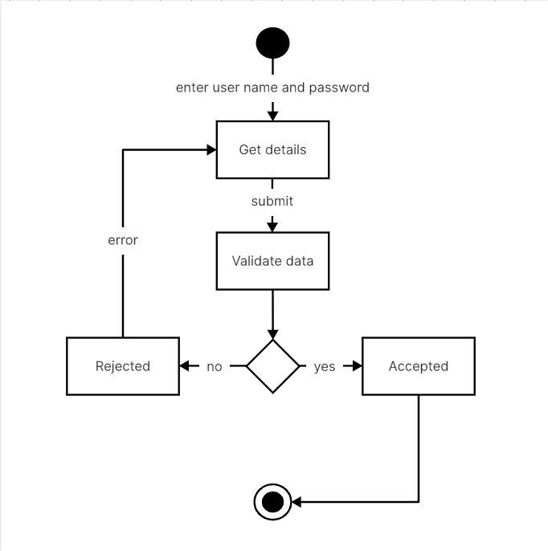 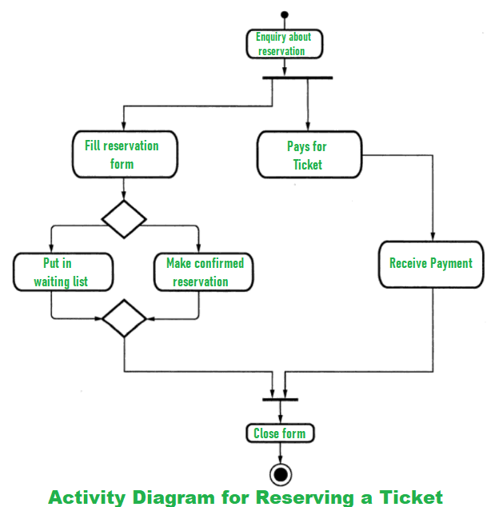 
***
# Group B — Activity Diagram Questions

## Q2. Design an Activity Diagram for an AI-Based Monitoring System

An **activity diagram** represents the workflow of activities and decisions.
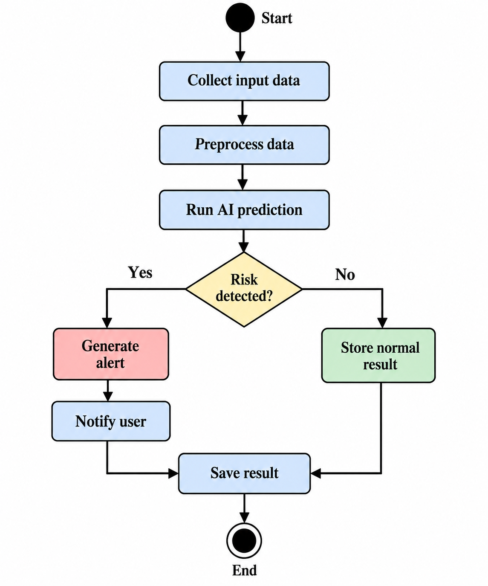 


**Explanation:** The system collects and cleans data, runs the AI model, and checks the risk. A risky prediction creates an alert; otherwise, the normal result is stored.

> [!hint] Memory trick
> **Collect → Clean → Predict → Decide → Alert or Store.**

## Q16. Design an Activity Diagram for an AI-Based Heat-Wave Monitoring and Prediction System
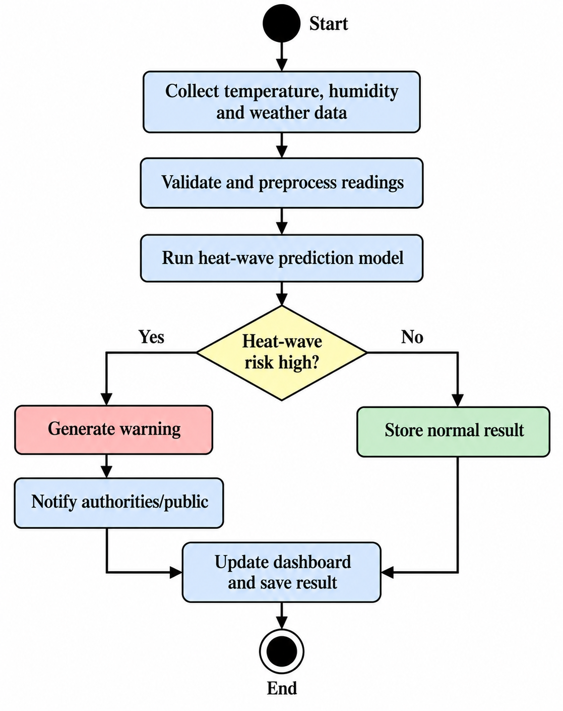 


**Explanation:** Weather data is collected and prepared for prediction. High risk triggers a warning; otherwise, the normal result is stored and monitoring continues.

## Q28. Design an Activity Diagram for AI-Based Satellite Anomaly Detection
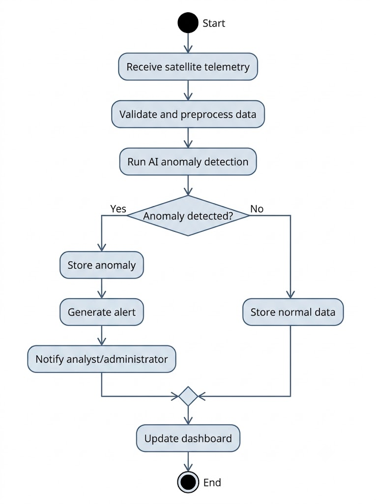 


**Explanation:** Telemetry is validated and analyzed. If abnormal behavior is detected, the system records it and alerts the relevant analyst; otherwise, it stores normal readings.

## Q31. Design an Activity Diagram for an AI-Based Urine Test Health Monitoring System
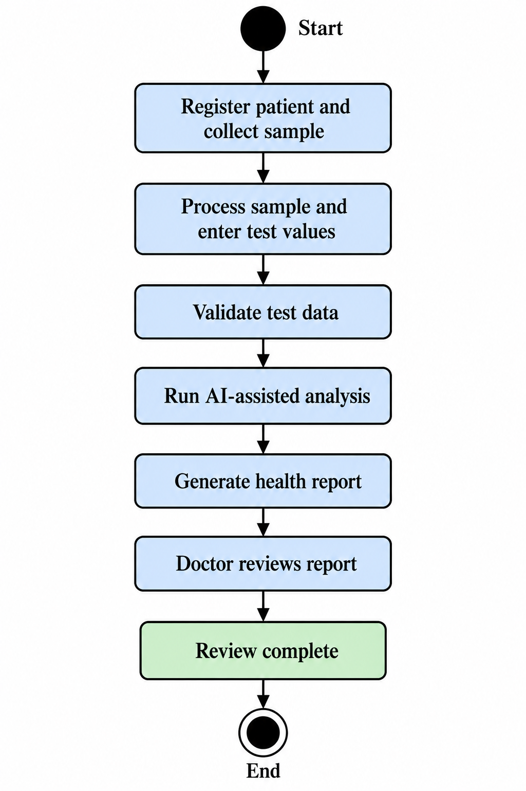 

**Explanation:** Patient/sample data is registered, test values are processed, and AI assists with analysis. A report is generated for the doctor to review.

## Q37. Design an Activity Diagram for AI-Based Thermal Battery Monitoring and Prediction
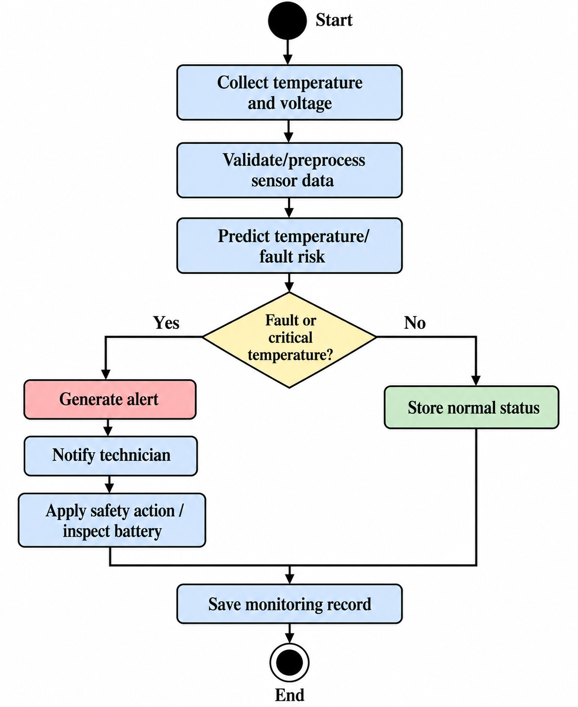 


**Explanation:** Sensor data is analyzed to predict overheating or faults. Critical results generate an alert and prompt safety action; normal results are stored.

---
# Sequence Diagrams - Unified Modeling Language (UML)


A Sequence Diagram is a [UML](https://www.geeksforgeeks.org/system-design/unified-modeling-language-uml-introduction/) interaction diagram that shows how objects communicate with each other in a specific sequence over time. It focuses on the order of messages exchanged between system components to perform a task.

-   Illustrates interactions and message exchanges between objects in chronological order.
-   Helps analyze use cases, understand system behavior, and design application workflows.

> ****Example:**** In an online banking system, a Customer sends a login request to the Authentication System, which verifies the credentials and returns an access response. The diagram shows each message in the order it occurs.

## Uses of Sequence Diagrams

Sequence diagrams are used to visualize the order of interactions between objects and understand how a system behaves over time.

-   ****Visualizing Dynamic Behavior****: Shows how objects interact step-by-step during the execution of a process or workflow.
-   ****Clear Communication****: Provides an easy-to-understand representation of system interactions for developers and stakeholders.
-   ****Designing System Architecture****: Illustrates communication between system components, supporting effective architecture design.
-   ****Documenting System Behavior****: Serves as documentation for understanding and maintaining system processes.
-   ****Debugging and Troubleshooting****: Helps identify bottlenecks, errors, and inefficiencies in object interactions and message flow.

## Sequence Diagram Notations

### 1. Actors

An Actor in UML represents a role played by a user, system, or external entity that interacts with the system. Actors exist outside the system boundary and initiate or participate in system activities.

-   Actors can be human users, external systems, devices, or organizations interacting with the system.
-   They are represented using a stick-figure symbol and can appear multiple times in a diagram.


> ****Example:**** Here the user in seat reservation system is shown as an actor where it exists outside the system and is not a part of the system.


### 2. Lifelines

A Lifeline in a UML Sequence Diagram represents an individual participant or object involved in an interaction. It shows the existence of an object over time and is displayed as a vertical dashed line below the participant's name.

-   Each object or participant in a sequence diagram is represented by its own lifeline.
-   Lifelines are placed at the top of the diagram and help track message exchanges over time.


We display a lifeline in a rectangle called head with its name and type. The head is located on top of a vertical dashed line (referred to as the stem) as shown above.


### 3. Messages

Communication between objects is depicted using messages. The messages appear in a sequential order on the lifeline.

-   We represent messages using arrows.
-   Lifelines and messages form the core of a sequence diagram.


Messages can be broadly classified into the following categories:

### 1. Synchronous messages

A synchronous message requires the sender to wait until the receiver finishes processing and sends a response. The interaction proceeds only after the reply is received.

-   A large number of calls in object oriented programming are synchronous.
-   We use a solid arrow head to represent a synchronous message.


### 2. Asynchronous Messages

An asynchronous message is a message where the sender does not wait for a response from the receiver. The sender continues its execution while the receiver processes the message independently.

-   The sender does not pause or wait for a reply.
-   Represented in UML by a line with an open arrowhead.


### 3. Create message

A Create Message is used to instantiate a new object in a sequence diagram when an interaction requires its creation. It is represented by a dotted arrow labeled create.

> ****Example:**** The creation of a new order on a e-commerce website would require a new object of Order class to be created.


### 4. Delete Message

A Delete Message is used to destroy or remove an object from the system in a sequence diagram. It is represented by an arrow ending with an ****X****, indicating the object's termination.

> ****Example:**** In the scenario below when the order is received by the user, the object of order class can be destroyed.


### 5. Self Message

Certain scenarios might arise where the object needs to send a message to itself. Such messages are called Self Messages and are represented with a U shaped arrow.


> ****Example:**** Consider a scenario where the device wants to access its webcam. Such a scenario is represented using a self message.


### 6. Reply Message

Reply messages are used to show the message being sent from the receiver to the sender. We represent a return/reply message using an open arrow head with a dotted line. The interaction moves forward only when a reply message is sent by the receiver.


> ****Example:**** Consider the scenario where the device requests a photo from the user. Here the message which shows the photo being sent is a reply message.


### 7. Found Message

A Found message is used to represent a scenario where an unknown source sends the message. It is represented using an arrow directed towards a lifeline from an end point.

> ****Example:**** Consider the scenario of a hardware failure.


It can be due to multiple reasons and we are not certain as to what caused the hardware failure.


### 8. Lost Message

A Lost message is used to represent a scenario where the recipient is not known to the system. It is represented using an arrow directed towards an end point from a lifeline.

> ****Example:**** Consider a scenario where a warning is generated.


The warning might be generated for the user or other software/object that the lifeline is interacting with. Since the destination is not known before hand, we use the Lost Message symbol.


### 9. Guards

To model conditions we use guards in UML. They are used when we need to restrict the flow of messages on the pretext of a condition being met. Guards play an important role in letting software developers know the constraints attached to a system or a particular process.

> ****Example:**** In order to be able to withdraw cash, having a balance greater than zero is a condition that must be met as shown below.


The above sequence diagram depicts the sequence diagram for an emotion based music player:

-   Firstly the application is opened by the user.
-   The device then gets access to the web cam.
-   The webcam captures the image of the user.
-   The device uses algorithms to detect the face and predict the mood.
-   It then requests database for dictionary of possible moods.
-   The mood is retrieved from the database.
-   The mood is displayed to the user.
-   The music is requested from the database.
-   The playlist is generated and finally shown to the user.

## Challenges of Using Sequence Diagrams

While sequence diagrams are useful for modeling interactions, they can become difficult to manage in large and complex systems.

-   ****Complexity and Size:**** Large systems can result in lengthy diagrams that are difficult to read and maintain.
-   ****Dynamic Nature:**** Diagrams require frequent updates as system requirements and interactions change.
-   ****Ambiguity in Messages:**** Unclear message definitions can lead to misunderstandings and inaccurate representations.
-   ****Concurrency and Parallelism:**** Representing multiple simultaneous interactions can increase diagram complexity.
-   ****Real-Time Constraints:**** Modeling precise timing requirements and real-time behavior may require additional documentation.

***

# Group C — Sequence Diagram Questions

## Q3. Design a Sequence Diagram for an AI-Based Prediction System

A **sequence diagram** shows messages between objects in time order, from top to bottom.

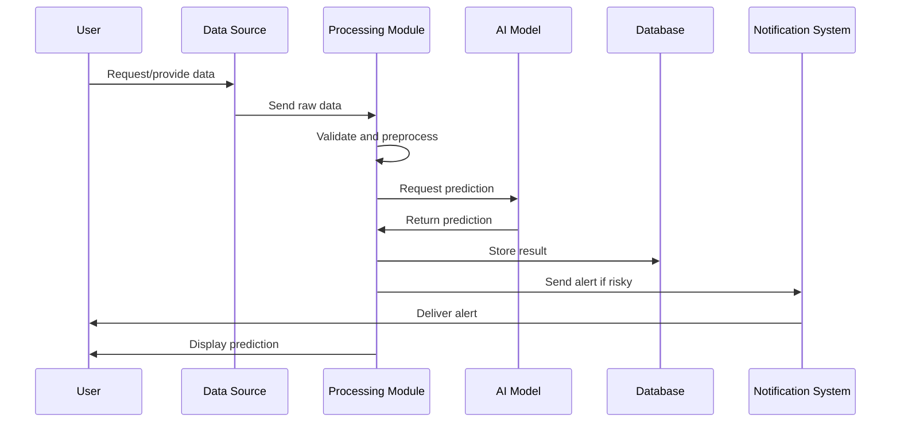

**Explanation:** Data is collected and preprocessed before the AI model predicts an outcome. The result is stored and displayed; a risky prediction also triggers a notification.

## Q17. Draw a Sequence Diagram for a Heat-Wave Prediction System

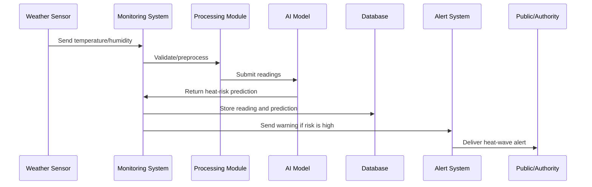

**Explanation:** Weather readings are analyzed, results are stored, and an alert is sent only if the predicted risk is high.

## Q22. Draw a Sequence Diagram for an AI-Based Sugarcane Irrigation Prediction System

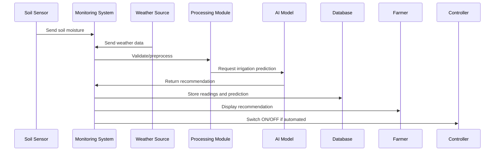

**Explanation:** Soil and weather readings are combined to predict irrigation need. The farmer receives the recommendation, and an automatic controller acts only if supported.

## Q27. Design a Sequence Diagram for Satellite Telemetry Monitoring

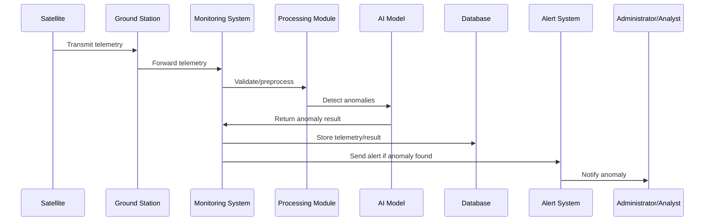

**Explanation:** Telemetry reaches the ground station, is checked and analyzed, and abnormal behavior causes an alert.

## Q32. Draw a Sequence Diagram for an AI-Based Urine Test Health Monitoring System

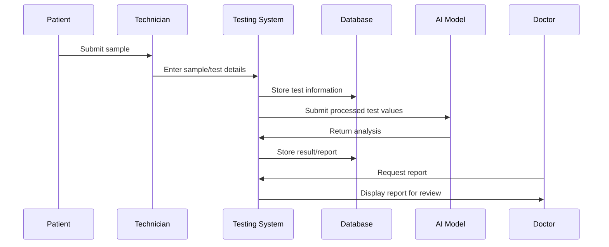

**Explanation:** The technician enters test data, AI assists with analysis, and the doctor reviews the generated report.

## Q38. Draw a Sequence Diagram for Thermal Battery Prediction

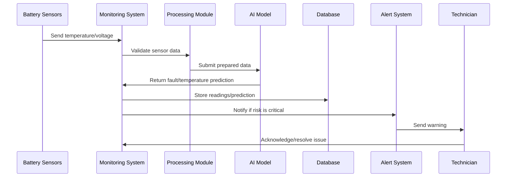

**Explanation:** Sensor readings are analyzed and stored. A critical prediction triggers an alert for the technician.

---
# State Machine Diagrams | Unified Modeling Language (UML)


A State Machine Diagram is a behavioral UML diagram used to represent how an object or system changes its state in response to events over time. It models the lifecycle of an object by showing different states and the transitions between them.

-   Represents dynamic behavior of a system using states, events, and transitions
-   Helps visualize how an object reacts to external inputs and moves from one state to another
-   State Machine diagrams are also known as State Diagrams and State-Chart Diagrams. These both terms can be used interchangeably.

> ****Example:**** In the ATM verification process shown in the diagram, the system moves from Waiting for PIN to PIN Verification when the user enters the PIN. If the PIN is authenticated successfully, the system transitions to the User Identified state.


## Basic Components and Notations of a State Machine Diagram

The basic components and their notations of a State Machine Diagram are:

### 1. Initial state

We use a black filled circle represent the initial state of a System or a Class.


### 2. Transition

We use a solid arrow to represent the transition or change of control from one state to another. The arrow is labelled with the event which causes the change in state.


### 3. State

We use a rounded rectangle to represent a state. A state represents the conditions or circumstances of an object of a class at an instant of time.


### 4. Fork

We use a rounded solid rectangular bar to represent a Fork notation with incoming arrow from the parent state and outgoing arrows towards the newly created states. We use the fork notation to represent a state splitting into two or more concurrent states.


### 5. Join

We use a rounded solid rectangular bar to represent a Join notation with incoming arrows from the joining states and outgoing arrow towards the common goal state. We use the join notation when two or more states concurrently converge into one on the occurrence of an event or events.


### 6. Self transition

We use a solid arrow pointing back to the state itself to represent a self transition. There might be scenarios when the state of the object does not change upon the occurrence of an event. We use self transitions to represent such cases.


### 7. Composite state

We use a rounded rectangle to represent a composite state also. We represent a state with internal activities using a composite state.


### 8. Final State

We use a filled circle within a circle notation to represent the final state in a state machine diagram.


# Draw a State Machine diagram in UML

Below are the steps on how to draw the State Machine Diagram in UML


### Step 1: Identify the System

-   Understand what your diagram is representing.
-   Whether it's a machine, a process, or any object, know what different situations or conditions it might go through.

### Step 2: Identify Initial and Final States

-   Figure out where your system starts (initial state) and where it ends (final state).
-   These are like the beginning and the end points of your system's journey.

### Step 3: Identify Possible States

-   Think about all the different situations your system can be in.
-   These are like the various phases or conditions it experiences.
-   Use boundary values to guide you in defining these states.

### Step 4: Label Triggering Events

-   Understand what causes your system to move from one state to another.
-   These causes or conditions are the events.
-   Label each transition with what makes it happen.

### Step 5: Draw the Diagram with appropriate notations

-   Now, take all this information and draw it out.
-   Use rectangles for states, arrows for transitions, and circles or rounded rectangles for initial and final states.
-   Be sure to connect everything in a way that makes sense.

## Example: Online Order System

Let's understand State Machine diagram with the help of an example, ie for an Online Order


The UML diagrams we draw depend on the system we aim to represent. Here is just an example of how an online ordering system might look like :

-   On the event of an order being received, we transition from our initial state to Unprocessed order state.
-   The unprocessed order is then checked.
-   If the order is rejected, we transition to the Rejected Order state.
-   If the order is accepted and we have the items available we transition to the fulfilled order state.
-   However if the items are not available we transition to the Pending Order state.
-   After the order is fulfilled, we transition to the final state. In this example, we merge the two states i.e. Fulfilled order and Rejected order into one final state.

> ****Note:**** Here we could have also treated fulfilled order and rejected order as final states separately.

## Applications of State Machine Diagram

The main use cases of state machine diagram are:

-   State Machine Diagrams are very useful for modeling and visualizing the dynamic behavior of a system.
-   They are also used in UI design where they help to illustrate how the interface changes in response to user actions, helping designers to create a better use experience.
-   In game design, state machine diagrams can help model the behavior of characters or objects, detailing how they change states based on player interactions or game events
-   In embedded systems, where hardware interacts with software to perform tasks, State Machine Diagrams are valuable for representing the control logic and behavior of the system.

## ****Differences between a State Machine Diagram and a Flowchart****

| ****State Machine Diagram**** | ****Flowchart**** |
| :--- | :--- |
| Represents different states of a system/object and transitions between them | Represents the step-by-step flow of a process or algorithm |
| Focuses on state changes caused by events | Focuses on execution flow and decision-making steps |
| Behavioral UML diagram | Process/algorithm representation diagram |
| Used for modeling dynamic behavior and object lifecycle | Used for modeling workflows and business processes |
| Uses states, transitions, events, and initial/final states | Uses process blocks, decision symbols, and arrows |
| Shows how an object behaves over time in different states | Shows how control moves from one step to another |
| Best suited for complex state-dependent systems | Best suited for simple procedural workflows |
| ****Example:**** ATM states like Card Inserted -> PIN Verification -> Authenticated | ****Example:**** ATM process like Insert Card -> Enter PIN -> Validate PIN -> Show Menu |

***
# Group D — State Chart Diagram Questions

## Q4. Create a State Chart Diagram for an AI-Generated Prediction/Alert Object

A **state chart diagram** shows an object’s states and the events/conditions that cause transitions.

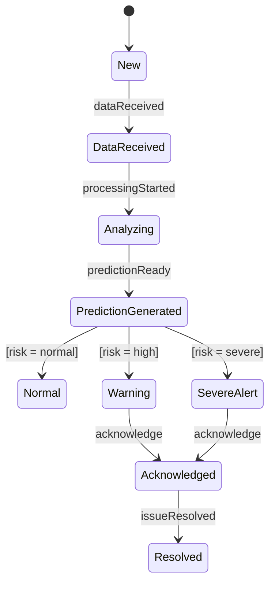

**Explanation:** Data arrives, the system analyzes it, and a prediction is generated. Risk level determines whether the object becomes normal, warning, or severe alert. After acknowledgement and action, it becomes resolved.

## Q11. Construct a State Chart for an AI Prediction Object and show event-based transitions

Use Q4’s diagram and label transitions with events:
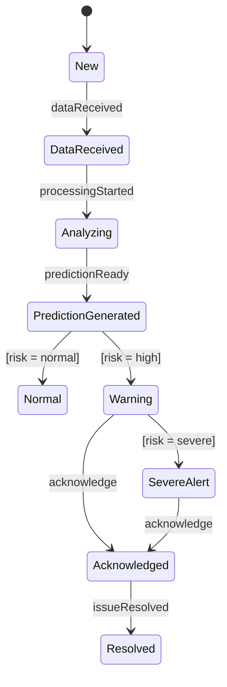
- `dataReceived`: New → Data Received
- `processingStarted`: Data Received → Analyzing
- `predictionReady`: Analyzing → Prediction Generated
- `[risk = normal]`: Prediction Generated → Normal
- `[risk = high]`: Prediction Generated → Warning
- `[risk = severe]`: Warning → Severe Alert
- `acknowledge`: Warning/Severe Alert → Acknowledged
- `issueResolved`: Acknowledged → Resolved

**Explanation:** States describe the current condition of the prediction object. Events or conditions cause state transitions.

## Q18. Design a State Chart Diagram for a Heat-Wave Alert
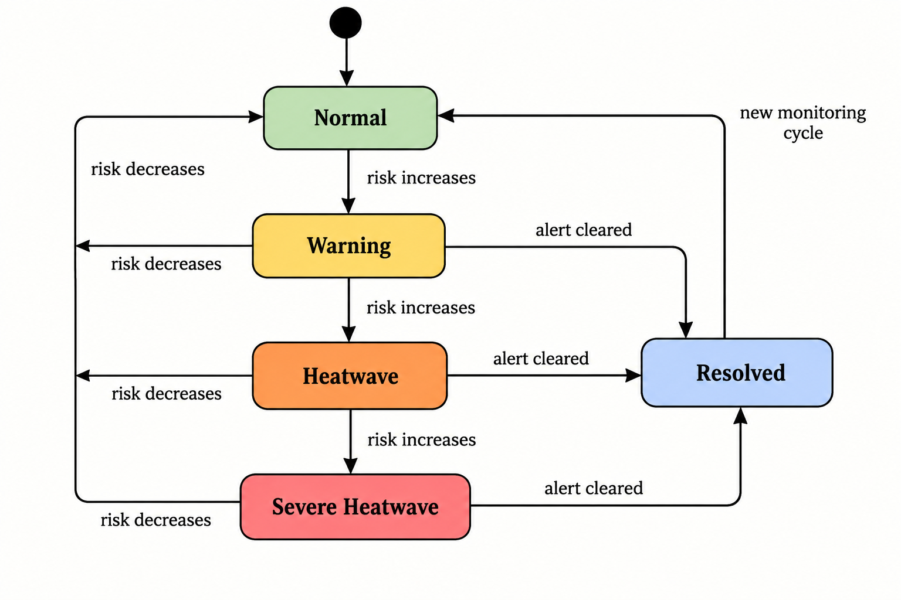 

**Explanation:** Rising risk moves the system from normal to warning, then to heatwave or severe heatwave. When the risk passes and action is complete, the alert is resolved.

## Q23. Create a State Chart Diagram for an Irrigation System

```text
Soil Dry -> Prediction Generated
                  |
             <Water needed?>
              /         \
            Yes          No
             |            |
       Irrigation ON   Irrigation OFF
             |
     [moisture sufficient]
             |
 Soil Moisture Sufficient
             |
       Irrigation OFF
```

**Explanation:** The system predicts irrigation need from sensor readings. Irrigation turns on if soil is dry enough and turns off when sufficient moisture is reached.

## Q29. Create a State Chart Diagram for Satellite Monitoring
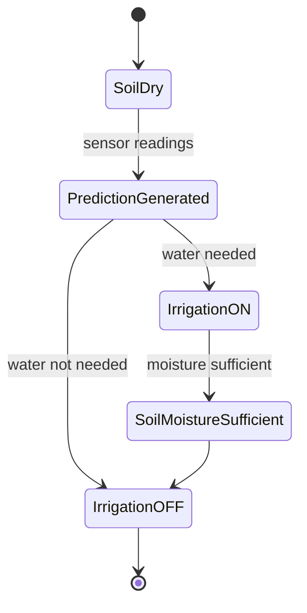


**Explanation:** The system receives telemetry while operational. An anomaly causes an alert and maintenance; after a successful check, the system returns to operational state.

## Q33. Create a State Chart Diagram for a Urine Test Report

```text
Sample Collected
       |
Under Testing
       |
Result Generated
       |
AI Analysis Completed
       |
Report Generated
       |
Reviewed by Doctor
```

**Explanation:** The report progresses from sample collection through testing and analysis to report generation and doctor review.

## Q39. Create a State Chart Diagram for a Thermal Battery Object

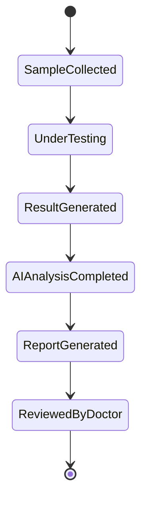

**Explanation:** Increasing temperature causes transitions from normal to heating, overheating, and critical. A safety trip shuts the battery down until maintenance confirms it is safe.

---
# Use Case Diagram - Unified Modeling Language (UML)


A Use Case Diagram is a UML diagram that shows how users (actors) interact with a system and its functions (use cases). It provides a high-level view of system requirements and scope.

-   Represents actors (users or external systems) and the use cases they interact with.
-   Shows relationships between users and system functionalities, making requirements easier to understand.

> ****Example:**** In an Online Banking System, actors such as Customer and Admin interact with use cases like Login, Check Balance, Transfer Funds, and Manage Accounts.


Use Case Diagram Notations

## When to Apply Use Case Diagram?

Use case diagrams are used to understand, analyze, and communicate how users interact with a system.

-   ****Requirements Gathering:**** Understand user needs and identify the system’s functions.
-   ****Communication with Stakeholders:**** Provide a simple view of system functionality for both technical and non-technical users.
-   ****System Design and Planning:**** Plan system features and workflows based on user requirements.
-   ****Defining System Boundaries:**** Show what is inside and outside the system and identify the actors interacting with it.

## Use Case Diagram Notations

UML Notations provide a standard visual language to represent and communicate system design, architecture, and behavior clearly among developers and stakeholders.

### 1. Actors

Actors are external entities that interact with a system to perform specific tasks or achieve goals. They can be users, other systems, or hardware devices that initiate or participate in use cases.

> ****Example:**** In an ATM System, the Customer is an actor who performs actions such as Withdraw Cash and Check Balance.


Actors

### 2. Use Cases

Use Cases represent specific system functionalities that help users achieve their goals. They show what the system does and are represented by ****ovals**** in a Use Case Diagram.

> ****Example:**** In an Online Shopping System, "Place Order", "Track Delivery", and "Update Product Information" are examples of use cases.


Use Cases

### 3. System Boundary

System Boundary defines the scope of the system and separates its internal functionalities from external actors. It is represented by a rectangle around the use cases.

> ****Example:**** In an Online Shopping System, all use cases such as "Place Order" and "Track Delivery" are enclosed within the system boundary, while Customer and Admin remain outside as actors.


## Use Case Diagram Relationships

In a Use Case Diagram, relationships play a crucial role in depicting the interactions between actors and use cases.

### 1. Association Relationship

Association Relationship shows the interaction between an actor and a use case. It is represented by a line connecting the actor and the use case.

> ****Example:**** Online Banking System

-   ****Actor:**** Customer
-   ****Use Case:**** Transfer Funds
-   ****Association:**** A line connecting the "Customer" actor to the "Transfer Funds" use case, indicating the customer's involvement in the funds transfer process.


### 2. Include Relationship

Include Relationship shows that one use case uses the functionality of another. It is represented by a dashed arrow pointing to the included use case.

> ****Example:**** Social Media Posting

-   ****Use Cases:**** Compose Post, Add Image
-   ****Include Relationship:**** The "Compose Post" use case includes the functionality of "Add Image." Therefore, composing a post includes the action of adding an image.


Include Relationship

### 3. Extend Relationship

Extend Relationship shows optional or conditional behavior added to a use case. It is represented by a dashed arrow labeled “extend.”

> ****Example: Flight Booking System****

-   ****Use Cases:**** Book Flight, Select Seat
-   ****Extend Relationship:**** The "Select Seat" use case may extend the "Book Flight" use case when the user wants to choose a specific seat, but it is an optional step.


Extend Relationship

### 4. Generalization Relationship

Generalization Relationship shows an “is-a” relationship, where one use case is a specialized form of another. It is represented by an arrow pointing to the general use case.

> ****Example: Vehicle Rental System****

-   ****Use Cases:**** Rent Car, Rent Bike
-   ****Generalization Relationship:**** Both "Rent Car" and "Rent Bike" are specialized versions of the general use case "Rent Vehicle."

## Use Case Diagram example(Online Shopping System)

Let's understand how to draw a Use Case diagram with the help of an Online Shopping System:

-   Actors
-   Customer

### ****Use Cases****

-   Browse Products
-   Add to Cart
-   Checkout
-   Manage Inventory (Admin)

### ****Relations****

-   The Customer can browse products, add items to the cart, and complete the checkout.
-   The Admin can manage the inventory

****The use case diagram of an Online Shopping System:****


## Common Use Case Diagram Tools and Platforms

Use Case Diagram Tools help create and design diagrams easily, support team collaboration, and improve overall efficiency.

-   ****Lucidchart:**** Cloud-based and collaborative, with real-time editing, comments, and ready-made templates.
-   ****Draw.io:**** Free and open-source, works online and offline, integrates with Google Drive and Dropbox, and supports many diagram types.
-   ****Microsoft Visio:**** Part of Microsoft Office, supports Use Case and other diagrams, and provides many shapes and templates.
-   ****SmartDraw****: Easy to use, offers various diagram templates, and integrates with Microsoft Office and Google Workspace.

## Common Mistakes while making Use Case Diagram

Avoiding common mistakes ensures the accuracy and effectiveness of the Use Case Diagram. Here are key points for each mistake:

-   Adding too much detail can confuse people.
-   Unclear connections lead to misunderstandings about system interactions.
-   Different names for the same elements create confusion.
-   Incorrectly using generalization can misrepresent relationships.
-   Failing to define the system’s limits makes its scope unclear.
-   Treating the diagram as static can make it outdated and inaccurate.

***


# Group E — Use Case Diagram Questions
## Q15. Design a Use Case Diagram and Class Diagram for an AI-Based Heat-Wave Monitoring System

### Class diagram

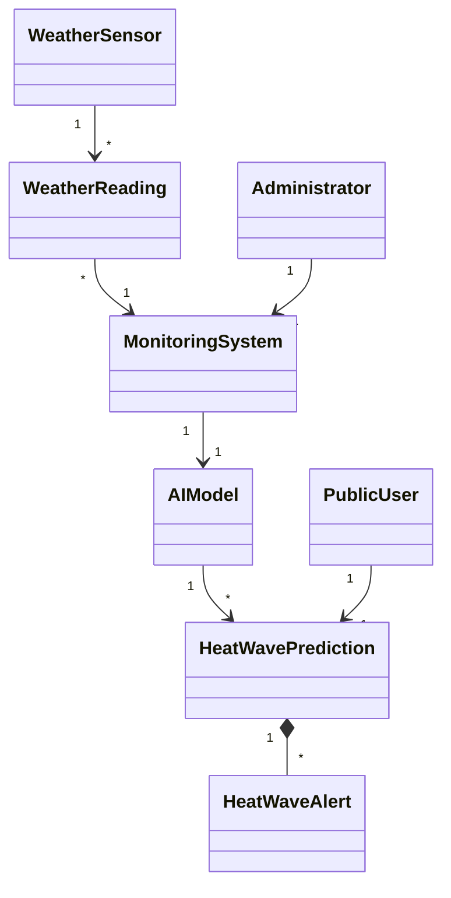

| Class | Attributes | Methods |
|---|---|---|
| `WeatherSensor` | sensorId, location | collectWeatherData() |
| `WeatherReading` | temperature, humidity, timestamp | validateData() |
| `MonitoringSystem` | systemId, status | preprocessData(), storeData() |
| `AIModel` | modelId, version | predictHeatRisk() |
| `HeatWavePrediction` | riskLevel, confidence | generatePrediction() |
| `HeatWaveAlert` | alertId, severity, message | issueAlert() |
| `Administrator` | adminId, name | configureThreshold() |
| `PublicUser` | userId, location | viewForecast(), receiveAlert() |
> [!danger] THE CHANCE OF ALL USE CAE DIAGRAM GIVEN BELOW BEING IS QUITE HARD SO PREPARE ACCORIDNGLY (SINCE QUESTIONS ARE OF 4 MARKS I HAVE SIMPLIEFIED USE CASE DIAGRAMS ACCORDINGLY)

### Use case diagram

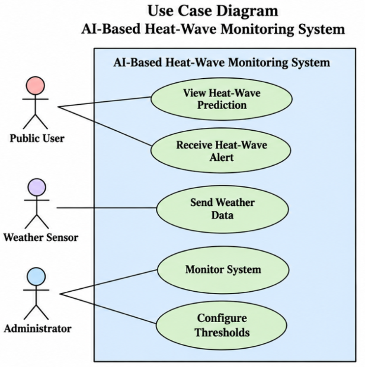 

**Explanation:** Weather sensors provide readings; the system preprocesses them, predicts heat risk, and alerts users when risk is high.

## Q20. Design a Use Case Diagram and Activity Diagram for an AI-Based Sugarcane Irrigation Prediction System
> [!danger] THE CHANCE OF ALL USE CAE DIAGRAM GIVEN BELOW BEING IS QUITE HARD SO PREPARE ACCORIDNGLY (SINCE QUESTIONS ARE OF 4 MARKS I HAVE SIMPLIEFIED USE CASE DIAGRAMS ACCORDINGLY)

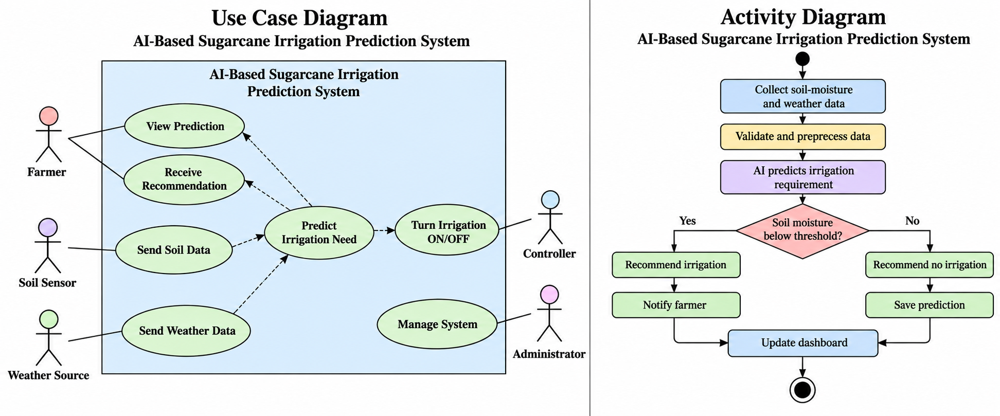 
### Activity diagram


**Explanation:** The AI combines soil moisture and weather data. It recommends irrigation when soil is too dry and otherwise recommends keeping irrigation off.

## Q30. Design a Use Case Diagram and Class Diagram for an AI-Based Urine Test Health Monitoring System
> [!danger] THE CHANCE OF ALL USE CAE DIAGRAM GIVEN BELOW BEING IS QUITE HARD SO PREPARE ACCORIDNGLY (SINCE QUESTIONS ARE OF 4 MARKS I HAVE SIMPLIEFIED USE CASE DIAGRAMS ACCORDINGLY)

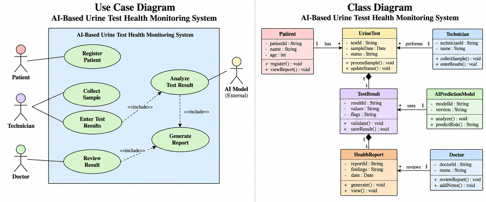 

**Explanation:** A technician records sample/test data, AI assists with analysis, the system generates a report, and the doctor reviews it. AI supports clinical review; it does not replace the doctor.
## Q5. Design a Use Case Diagram for an AI-Based Monitoring System
> [!danger] THE CHANCE OF ALL USE CAE DIAGRAM GIVEN BELOW BEING IS QUITE HARD SO PREPARE ACCORIDNGLY (SINCE QUESTIONS ARE OF 4 MARKS I HAVE SIMPLIEFIED USE CASE DIAGRAMS ACCORDINGLY)

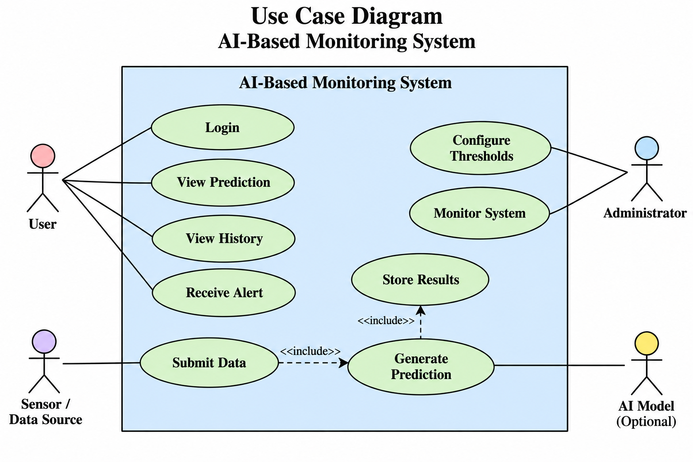 


**Explanation:** Sensors submit data; the system predicts and stores results; users view predictions and receive alerts; administrators manage system settings.

## Q8. Design a Use Case Diagram and Sequence Diagram for an AI-Based Online Monitoring System
> [!danger] THE CHANCE OF ALL USE CAE DIAGRAM GIVEN BELOW BEING IS QUITE HARD SO PREPARE ACCORIDNGLY (SINCE QUESTIONS ARE OF 4 MARKS I HAVE SIMPLIEFIED USE CASE DIAGRAMS ACCORDINGLY)

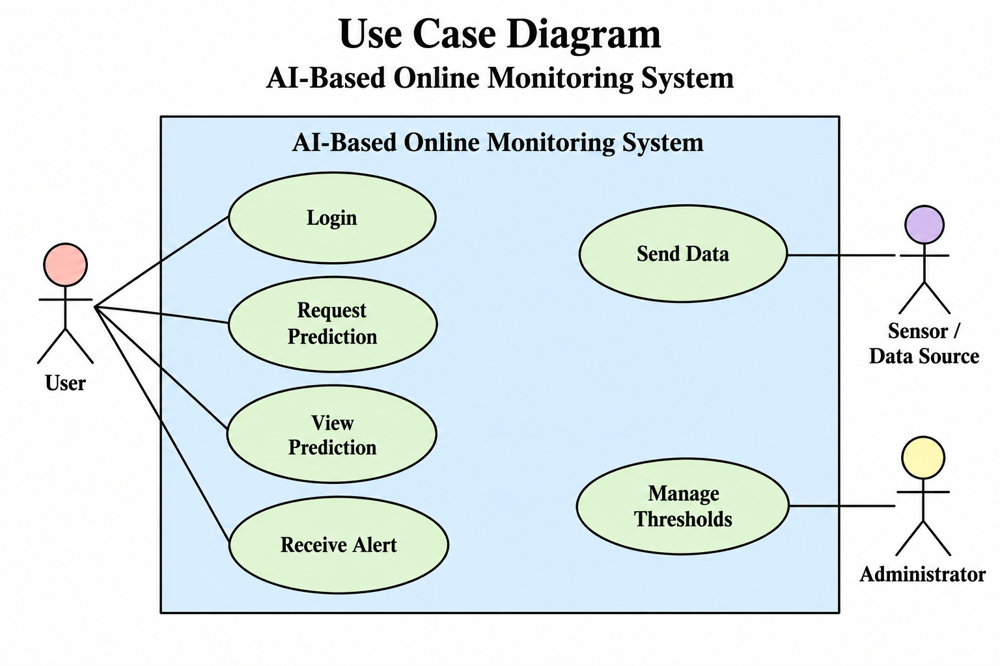 

### Sequence diagram

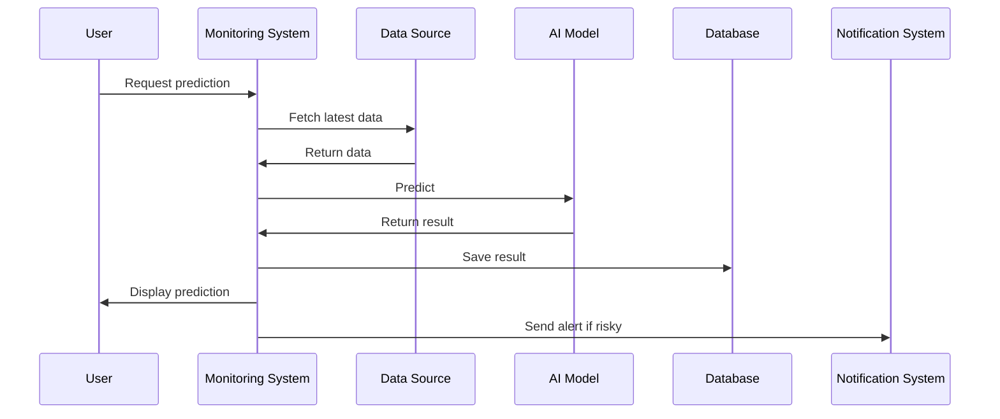

**Explanation:** The use case diagram lists system functions; the sequence diagram shows the order of messages when a user requests a prediction.

## Q25. Design a Use Case Diagram for an AI-Based Satellite Monitoring System
> [!danger] THE CHANCE OF ALL USE CAE DIAGRAM GIVEN BELOW BEING IS QUITE HARD SO PREPARE ACCORIDNGLY (SINCE QUESTIONS ARE OF 4 MARKS I HAVE SIMPLIEFIED USE CASE DIAGRAMS ACCORDINGLY)

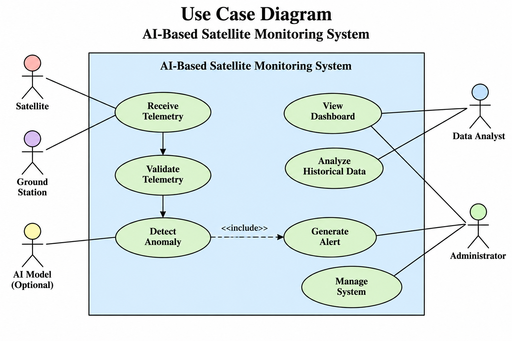 

**Explanation:** Satellite telemetry reaches the monitoring system through the ground station. The system analyzes data, detects anomalies, stores results, and informs analysts or administrators.

## Q30. Use Case Diagram for an AI-Based Urine Test Health Monitoring System
> [!danger] THE CHANCE OF ALL USE CAE DIAGRAM GIVEN BELOW BEING IS QUITE HARD SO PREPARE ACCORIDNGLY (SINCE QUESTIONS ARE OF 4 MARKS I HAVE SIMPLIEFIED USE CASE DIAGRAMS ACCORDINGLY)


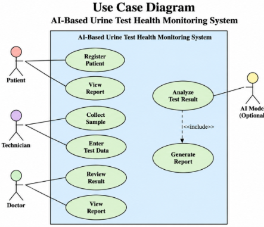 


**Explanation:** The patient provides details, the technician records test data, the system generates a report with AI-assisted analysis, and the doctor reviews it.

## Q35. Design a Use Case Diagram for an AI-Based Thermal Battery Monitoring System
> [!danger] THE CHANCE OF ALL USE CAE DIAGRAM GIVEN BELOW BEING IS QUITE HARD SO PREPARE ACCORIDNGLY (SINCE QUESTIONS ARE OF 4 MARKS I HAVE SIMPLIEFIED USE CASE DIAGRAMS ACCORDINGLY)

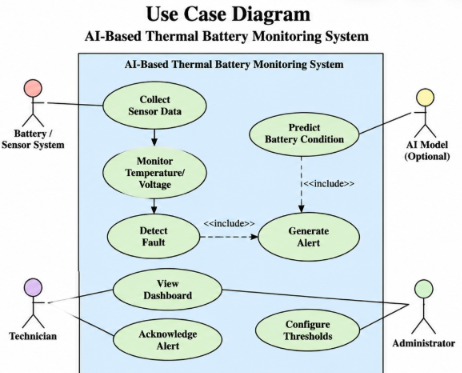 
**Explanation:** Sensors provide temperature and voltage readings. The system predicts battery condition and alerts technicians or administrators when a fault is detected.

---
# Component Based Diagram - Unified Modeling Language (UML)


A Component-Based Diagram is a [Unified Modeling Language](https://www.geeksforgeeks.org/system-design/unified-modeling-language-uml-introduction/) [(UML)](https://www.geeksforgeeks.org/system-design/unified-modeling-language-uml-introduction/) [](https://www.geeksforgeeks.org/system-design/unified-modeling-language-uml-introduction/)structural diagram used to represent the organization of a system into modular components and their relationships. It helps visualize how different parts of a system interact and work together to form the overall architecture.

-   Components encapsulate specific functionality and expose interfaces for communication with other components.
-   Shows dependencies and interactions between components, making complex systems easier to understand and maintain.

> ****Example:**** In an e-commerce system, components such as User Interface, Order Service, and Payment Service interact through defined interfaces. The diagram illustrates how these components communicate to process customer orders and payments.

## Components

Component-Based Diagrams in UML comprise several key elements, each serving a distinct role in illustrating the system’s architecture. Here are the main components and their roles:

### ****1. Component****

Represent modular parts of the system that encapsulate functionalities. Components can be software classes, collections of classes, or subsystems.

-   ****Symbol:**** Rectangles with the component stereotype («component»).
-   ****Function:**** Define and encapsulate functionality, ensuring modularity and reusability.


Component

### ****2. Interfaces****

Specify a set of operations that a component offers or requires, serving as a contract between the component and its environment.

-   ****Symbol:**** Circles (lollipops) for provided interfaces and half-circles (sockets) for required interfaces.
-   ****Function:**** Define how components communicate with each other, ensuring that components can be developed and maintained independently.


Interfaces

### ****3. Relationships****

Relationships represent the connections and dependencies between components and interfaces, showing how different parts of the system interact.

-   ****Dependency (Dashed Arrow):**** Indicates that one component relies on another component or interface to perform its functionality.
-   ****Association & Assembly Connector:**** A solid line shows a direct relationship between components, while an assembly connector links a required interface of one component to a provided interface of another.

****Function:**** Helps visualize communication paths, dependencies, and interactions between components within the system architecture.


Relationships

### ****4. Ports****

****Role:**** Represent specific interaction points on the boundary of a component where interfaces are provided or required.

-   ****Symbol:**** Small squares on the component boundary.
-   ****Function:**** Allow for more precise specification of interaction points, facilitating detailed design and implementation.


Ports

### ****5. Artifacts****

Represent physical files or data that are deployed on nodes.

-   ****Symbol:**** Rectangles with the artifact stereotype («artifact»).
-   ****Function:**** Show how software artifacts, like executables or data files, relate to the components.


Artifacts

### ****6. Nodes****

Represent physical or virtual execution environments where components are deployed.

-   ****Symbol:**** 3D boxes.
-   ****Function:**** Provide context for deployment, showing where components reside and execute within the system’s infrastructure.


Nodes

## Best practices for creating Component Based Diagrams

Following best practices helps create clear, accurate, and easy-to-understand component diagrams that effectively communicate system architecture.

-   ****Understand the System:**** Gather requirements and understand the system's features, goals, and constraints before creating the diagram.
-   ****Keep it Simple:**** Focus on key components and avoid unnecessary details that can make the diagram difficult to understand.
-   ****Use Consistent Naming:**** Choose meaningful and consistent names for components, interfaces, and other elements.
-   ****Define Clear Interfaces:**** Clearly show the interfaces provided and required by each component and their responsibilities.
-   ****Use Stereotypes and Annotations:**** Add UML stereotypes and annotations where needed to provide additional architectural information.

## Example of Component Based Diagram

This component diagram represents an ****Online Store**** system, breaking it down into various functional components and showing how they interact. Here’s a breakdown of each part:


Example of Component Based Diagram

### 1. OnlineStore Component

Represents the main system and encapsulates the core functionality of the online store. It contains the Order, Customer, and Product components.

### 2. Order Component

Handles order-related operations within the OnlineStore system.

-   Connected to the Product component to access product information for orders.
-   Connected to the Customer component to associate orders with customers.
-   Uses delegate connectors (<>) to route certain internal operations to other components or systems.

### 3. Customer Component

Manages customer data and customer-related activities.

-   Connected to the Order component for processing and managing customer orders.
-   Linked to the Account component through a delegate connection, allowing access to account-related information from an external system.

### 4. Product Component

Manages product information and product-related operations.

-   Connected to the Order component so orders can reference and use available products.

### 5. Account Component

Represents an external component located outside the OnlineStore boundary.

-   Connected to the Customer component through a delegate relationship.
-   Handles account-related functions that are delegated from the OnlineStore system.

## ****Tools and Software available for Component-Based Diagrams****

Several tools and software are available for creating Component-Based Diagrams, ranging from general-purpose diagramming tools to specialized UML modeling software. Here are some popular options:

-   ****Lucidchart:**** Lucidchart is a cloud-based diagramming tool that supports creating various types of diagrams, including Component-Based Diagrams.
-   ****Microsoft Visio:**** Microsoft Visio is a versatile diagramming tool that supports creating Component-Based Diagrams and other types of UML diagrams.
-   ****Visual Paradigm:**** Visual Paradigm is a comprehensive UML modeling tool that supports the creation of Component-Based Diagrams, along with other UML diagrams.
-   ****Enterprise Architect:**** Enterprise Architect is a powerful UML modeling and design tool used for creating Component-Based Diagrams and other software engineering diagrams.
-   ****IBM Rational Software Architect:**** IBM Rational Software Architect is an integrated development environment (IDE) for modeling, designing, and developing software systems.

## ****Applications of Component-Based Diagrams****

Component-Based Diagrams help visualize system structure, improve communication, and support the development and maintenance of software systems.

-   ****System Design and Architecture:**** Helps architects understand system structure, component interactions, and dependencies.
-   ****Requirements Analysis:**** Assists stakeholders in understanding functional and non-functional system requirements.
-   ****System Documentation:**** Serves as a reference for documenting architectural decisions and overall system design.
-   ****Software Development:**** Guides developers by defining component boundaries and interactions.
-   ****Code Generation and Implementation:**** Can be used as a foundation for generating code and accelerating development.
-   ****System Maintenance and Evolution:**** Makes it easier to analyze, modify, and extend the system as requirements change.

***


***
# Group F — Component Diagram Questions

## Q6. Design a Component Diagram for an AI-Based Monitoring and Prediction System

A **component diagram** shows the major software modules and their dependencies.
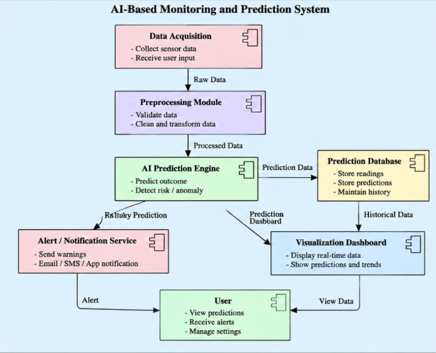 

**Explanation:** Data is collected, cleaned, analyzed, stored, and displayed. Risky predictions trigger notifications.

## Q14. Develop a Component Diagram for an AI-Based Monitoring System
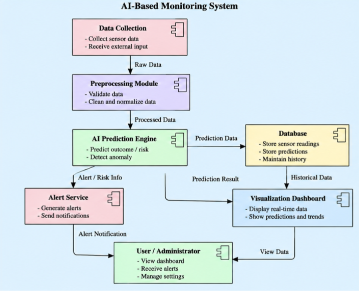 

**Justification:** Separate components are easier to test and maintain. The AI model can be updated without redesigning the dashboard, and the alert service handles notifications independently.

---

# What is DFD (Data Flow Diagram)


A Data Flow Diagram (DFD) is a graphical tool used to represent how data moves through a system. It shows data inputs, outputs, data stores, and the processes that transform the data. DFDs provide a high-level overview of system functionality and are widely used in structured analysis due to their simplicity and clarity for both technical and non-technical users.

DFDs help visualize the major steps in a system and illustrate how information flows between different components.


Basic Flow of DFD

## Characteristics of Data Flow Diagram

1.  Graphical Representation: DFDs use standard symbols (processes, data stores, data flows, external entities) to simplify complex systems into easy-to-read diagrams.
2.  Problem Analysis: They help analyze system requirements by clarifying how data is processed, stored, and transferred.
3.  Abstraction: DFDs focus on what the system does, not how it is implemented. Technical details are intentionally omitted.
4.  Hierarchy: DFDs are built in levels: Level 0 (Context Diagram) → High-level overview and Level 1+ → More detailed breakdown of system processes

## Levels of Data Flow Diagram

DFDs are categorized into various levels, with each level providing different degrees of detail. The levels are numbered from ****0**** and onward. The higher the level, the more detailed the diagram becomes.

-   ****Level 0 DFD**** (Context Diagram): Represents the entire system as one single process, showing its interaction with external entities. It highlights major inputs and outputs without internal details.
-   ****Level 1 DFD****: Breaks the Level 0 process into major subprocesses. Shows internal data flows and data stores.
-   ****Level 2 and Beyond****: Further decomposes Level 1 subprocesses for a detailed view of specific functional areas. Useful for large or complex systems requiring deeper analysis.

## Types of Data Flow Diagram

DFDs can be classified into two main types, each focusing on a different perspective of system design:


Types of Data Flow Diagram

### 1. Logical DFD

The Logical Data Flow Diagram mainly focuses on the system process. It illustrates how data flows in the system. Logical Data Flow Diagram (DFD) mainly focuses on high level processes and data flow without diving deep into technical implementation details.

Logical DFDs is used in various organizations for the smooth running of system. Like in a Banking software system, it is used to describe how data is moved from one entity to another.


Logical Data Flow Diagram of Online Grocery Store

### 2. Physical DFD

Physical data flow diagram shows how the data flow is actually implemented in the system. In the Physical Data Flow Diagram (DFD), we include additional details such as data storage, data transmission, and specific technology or system components includin:

-   Hardware
-   Software
-   Databases
-   File structures
-   Actual data movement and storage mechanisms


Physical Data Flow Diagram of online Grocery Store

## Components of Data Flow Diagrams

A DFD consists of four main components that work together to represent the flow of data within the system:


Data Flow Diagram Methods and Symbol

### 1. Process

Represents input to output transformation in a system that takes place because of process function.

-   ****Symbol****: Circle or rounded rectangle
-   ****Example****: "Validate User," "Generate Bill"

### 2. Data Flow

Shows the movement of information between processes, entities, or data stores. The arrow symbol is the symbol of data flow. A relatable name should be given to the flow to determine the information which is being moved.

-   ****Symbol****: Arrow
-   Each flow should represent one type of data.

### 3. Data Store (Warehouse)

Represents where data is stored for later use. Two horizontal lines represent the symbol of the store. The warehouse is simply not restricted to being a data file rather it can be anything like a folder with documents, an optical disc, a filing cabinet.

-   ****Symbol****: Two horizontal lines
-   Examples: Database, file system, document folder

### 4. External Entity (Terminator)

Users or systems outside the boundary that interact with the system. It can be, for example, organizations like banks, groups of people like customers or different departments of the same organization, which is not a part of the model system and is an external entity. Modeled systems also communicate with terminator.

## Rules of DFD

Following are the rules of DFD:

### 1. Data can flow from

-   Terminator or External Entity → Process
-   Process → Terminator or External Entity
-   Process → Data Store
-   Data Store → Process
-   Process → Process

### 2. Data Cannot Flow From

-   Terminator or External Entity → Terminator or External Entity
-   Terminator or External Entity → Data Store
-   Data Store → Terminator or External Entity
-   Data Store → Data Store

## Example: Levels of DFD (Railway Reservation System)

To demonstrate how DFD levels are created, let's take an example of a Railway Reservation System. This example helps illustrate how data moves between users, processes, and data stores—such as passenger information, booking records, schedules, and payments - at different levels of detail. Each level of the DFD breaks the system into more specific processes to show how the reservation workflow operates internally.

### Level 0 DFD

Shows the reservation system as one process interacting with:

-   Passenger (external entity)
-   Payment system
-   Database (data store)


Level 0 of Railway Reservation System

### Level 1 DFD

Breaks the system into subprocesses such as:

-   Search Train
-   Book Ticket
-   Cancel Ticket
-   Process Payment


Level 1 DFD of Railway Reservation System

### Level 2 DFD

Further decomposes subprocesses (e.g., "Book Ticket" → Verify Availability → Calculate Fare → Confirm Booking)

## Advantages and Disadvantages of DFD

| ****Advantages**** | ****Disadvantages**** |
| :--- | :--- |
| Helps understand how data moves through the system. | Can be time-consuming to create for large systems. |
| Offers a clear graphical representation for both technical and non-technical users. | Focuses only on data flow — does not show control flow, performance, or UI details. |
| Breaks the system into smaller processes for better clarity and documentation. | Needs regular updates; diagrams easily become outdated if the system changes. |
| Useful for system analysis, requirement gathering, and documentation. | Requires proper knowledge to create accurate and meaningful diagrams. |

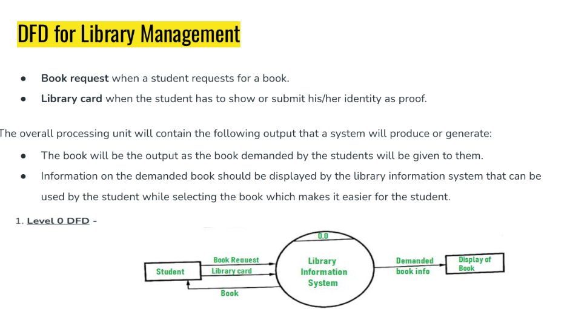 
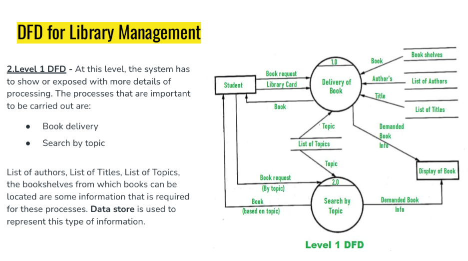 
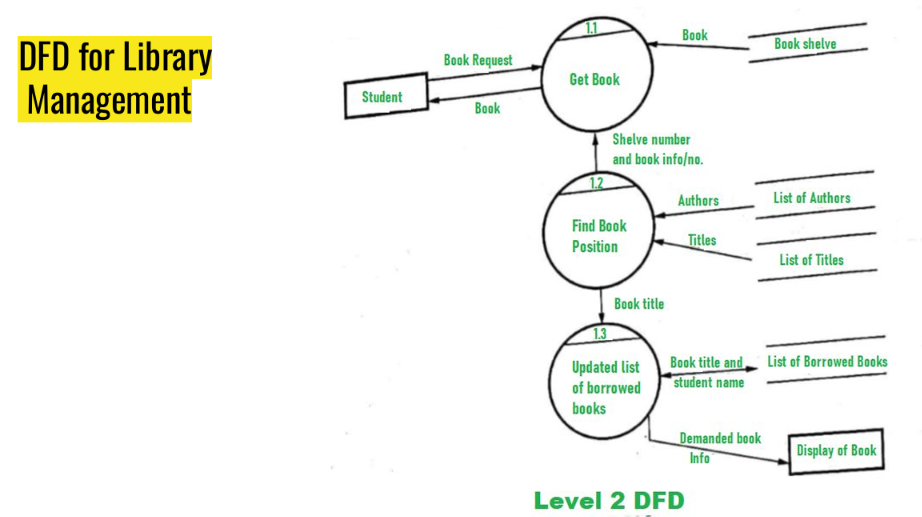 
***
# Group G — DFD Level 0 and Level 1 Questions

> [!abstract] DFD essentials
> **External entity** = source/destination of data;
> **process** = transforms data;
> **data store** = saved data;
> **data flow** = named arrow. Level 0 shows the whole system as one process. Level 1 expands it into sub-processes.
>  Both levels must be balanced: external inputs/outputs must remain consistent.

## Q7. Design DFD Level 0 and Level 1 for an AI-Based Prediction System
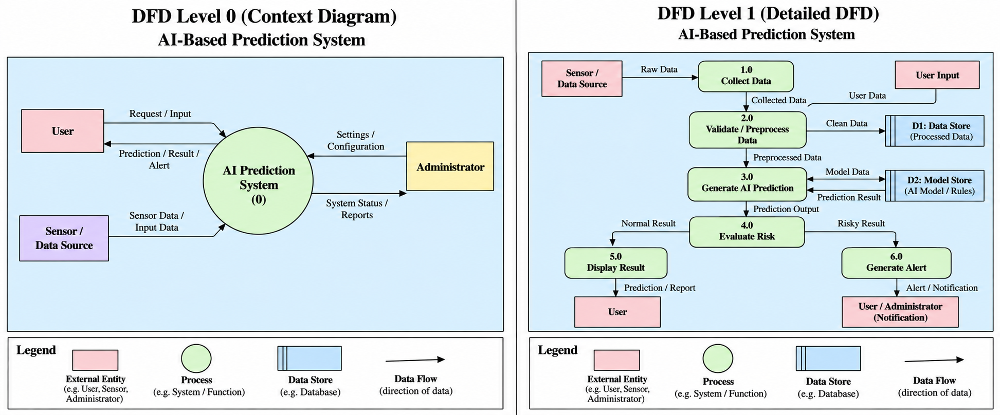 

**Explanation:** Data is collected, cleaned, analyzed, and stored. The prediction is displayed; risky results trigger an alert.

## Q13. Construct DFD Level 0 and Level 1 for an AI-Based Monitoring Application
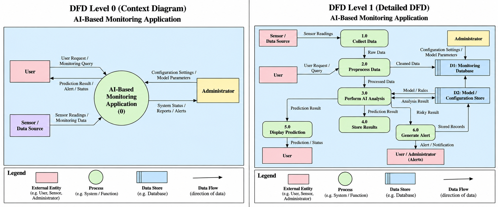 
- **Level 0:** One process named `AI-Based Monitoring Application`, connected to User, Sensor/Data Source, and Administrator.
- **Level 1 processes:** `1.0 Collect Data`, `2.0 Preprocess Data`, `3.0 Perform AI Analysis`, `4.0 Store Results`, `5.0 Display Prediction`, `6.0 Generate Alert`.
- **Data stores:** `D1 Monitoring Database`, `D2 Model/Configuration Store`.
- **Flows:** sensor readings, user requests, cleaned data, prediction results, stored records, alerts, and configuration settings.

**Explanation:** Level 1 expands the single process from Level 0 into smaller processes. Keep the same external inputs and outputs in both levels (balancing).

## Q19. DFD Level 0 and Level 1 for an AI-Based Heat-Wave Monitoring System
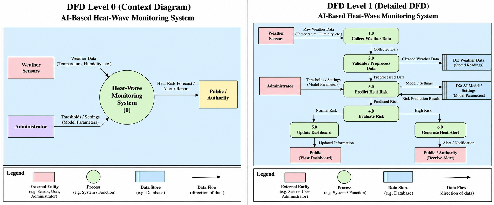 

**Explanation:** Weather readings are collected and cleaned. The AI predicts heat risk; high risk triggers an alert, while normal risk updates the dashboard.

## Q24. DFD Level 0 and Level 1 for an AI-Based Sugarcane Irrigation Prediction System
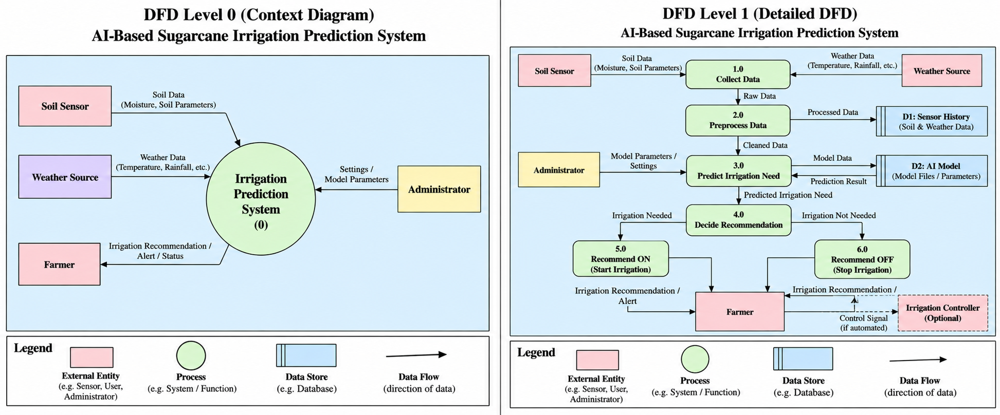 

**Explanation:** Soil and weather data are used to predict irrigation need. The farmer receives an ON/OFF recommendation; a controller is included only if automation exists.

## Q34. DFD Level 0 and Level 1 for an AI-Based Urine Test Health Monitoring System
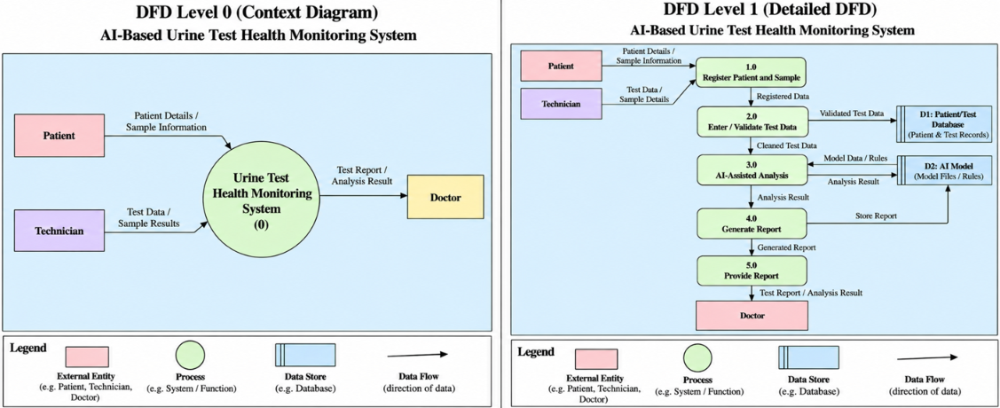 

**Explanation:** Patient/sample information is registered, test values are validated, AI-assisted analysis supports report generation, and the doctor receives the report for review.

## Q40. DFD Level 0 and Level 1 for an AI-Based Thermal Battery Monitoring System
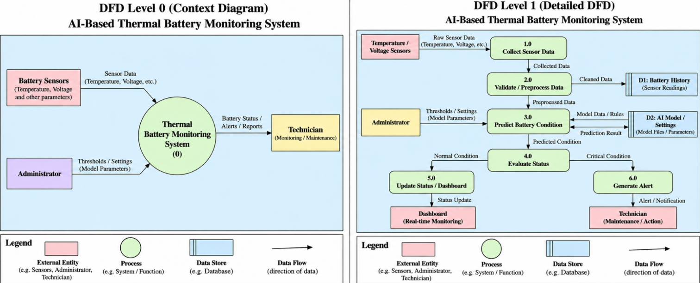 
**Explanation:** Sensor readings are checked and analyzed. Normal status is shown on the dashboard; a critical prediction alerts the technician.

---

***
# Group H — Combined and General Questions

## Q9. Design Activity, Sequence, Use Case, and Class Diagrams for Any One AI Application

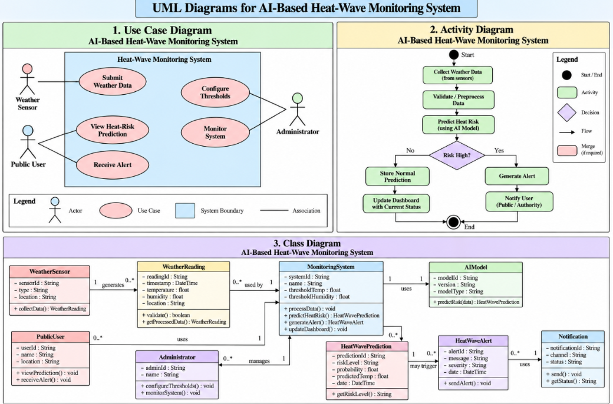 

### 3. Sequence Diagram

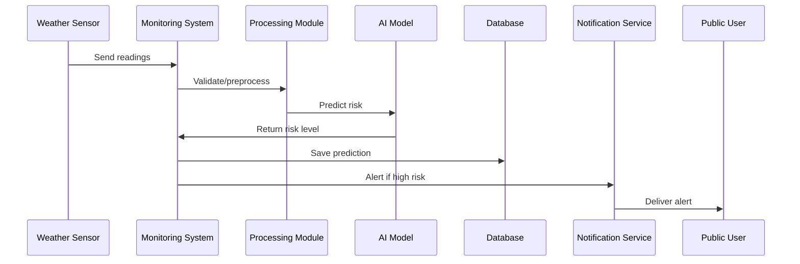

**Explanation:** Use Case shows actors/functions; Activity shows workflow; Sequence shows message order; Class shows static structure.

## Q10. Design a Suitable UML Diagram for an AI-Based Monitoring System and Justify Your Choice

| Requirement | Suitable diagram | Why |
|---|---|---|
| Show classes and relationships | Class diagram | Static structure |
| Show workflow and decisions | Activity diagram | Process flow |
| Show message order | Sequence diagram | Time-ordered interactions |
| Show object lifecycle | State chart diagram | States and transitions |
| Show actors and functions | Use case diagram | User-visible functionality |
| Show software modules | Component diagram | Components and dependencies |
| Show input, processing, storage, output | DFD | Data movement and transformation |

**Answer:** For an AI system that predicts outcomes from sensor data, a DFD is suitable when the focus is data movement. An Activity Diagram is better when the focus is workflow and risk-based decisions.

## Q8 — Online Monitoring System: Quick Diagram Selection

For an online monitoring system, use a **Use Case Diagram** to show Login, Request Prediction, View Prediction, and Receive Alert. Use a **Sequence Diagram** to show the request from user to system, data retrieval, AI prediction, database storage, and alert delivery.

## Q15 — Heat-Wave Monitoring: Quick Diagram Selection

Use a **Use Case Diagram** for Public User, Weather Sensor, and Administrator interactions; use a **Class Diagram** for WeatherSensor, WeatherReading, AIModel, HeatWavePrediction, HeatWaveAlert, and PublicUser.

---

# Application-Specific Quick Reference

| Application | Inputs | AI task | Output/action | Main actors |
|---|---|---|---|---|
| Heat-wave monitoring | Temperature, humidity, weather data | Predict heat risk | Heat alert/forecast | Sensor, public, authority |
| Sugarcane irrigation | Soil moisture, weather | Predict irrigation need | ON/OFF recommendation | Farmer, soil sensor, weather source |
| Satellite monitoring | Satellite telemetry | Detect anomalies | Anomaly alert | Satellite, ground station, analyst |
| Urine test health monitoring | Sample and test values | Assist analysis | Report for doctor review | Patient, technician, doctor |
| Thermal battery monitoring | Temperature, voltage | Predict overheating/fault | Warning/safety action | Sensors, technician, administrator |

## Diagram Symbols to Remember

| Diagram | Main symbol | Meaning |
|---|---|---|
| Class | Rectangle with name/attributes/methods | Static structure |
| Use Case | Stick actor and oval | Actor interacting with a function |
| Activity | Rounded box, diamond, arrows | Workflow and decision |
| Sequence | Lifelines and horizontal messages | Interaction order |
| State Chart | Rounded states and transition arrows | Object lifecycle |
| Component | Component boxes/dependency arrows | Software modules |
| DFD | Entity, process, data store, arrow | Data movement |

> [!warning] Common exam mistakes
> - **Use Case:** Actors outside the system boundary; use cases inside.
> - **Sequence:** Time moves from top to bottom; label messages.
> - **Activity:** Label branches such as `[Yes]` and `[No]`.
> - **State Chart:** States are conditions of an object, not simply a list of actions.
> - **Class:** Include classes, attributes/methods, and meaningful relationships.
> - **DFD:** Name processes and data flows; keep Level 0 and Level 1 balanced.
> - **Component:** Show modules and dependencies, not runtime message order.

## Last-Minute Revision

- **Class:** What things exist, and how are they related?
- **Use Case:** Who uses the system, and what can they do?
- **Activity:** What steps happen, and what decisions are made?
- **Sequence:** Which object sends which message, and when?
- **State Chart:** How does an object change state after events?
- **Component:** What modules make up the software?
- **DFD:** Where does data come from, how is it processed/stored, and where does it go?

> [!hint] One-line memory trick
> **Structure, Users, Workflow, Messages, States, Modules, Data** = **Class, Use Case, Activity, Sequence, State, Component, DFD**.
